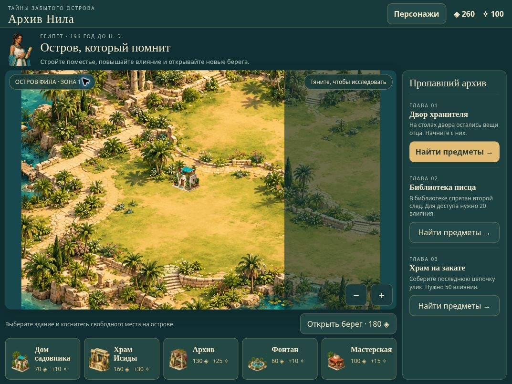
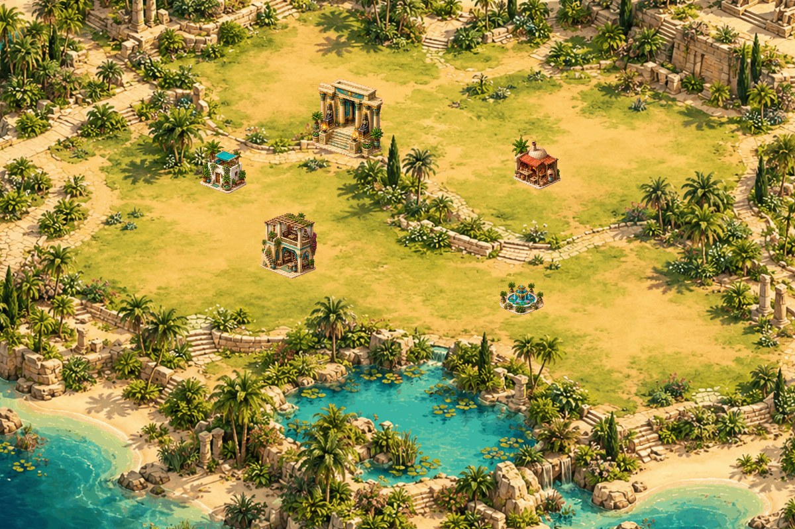
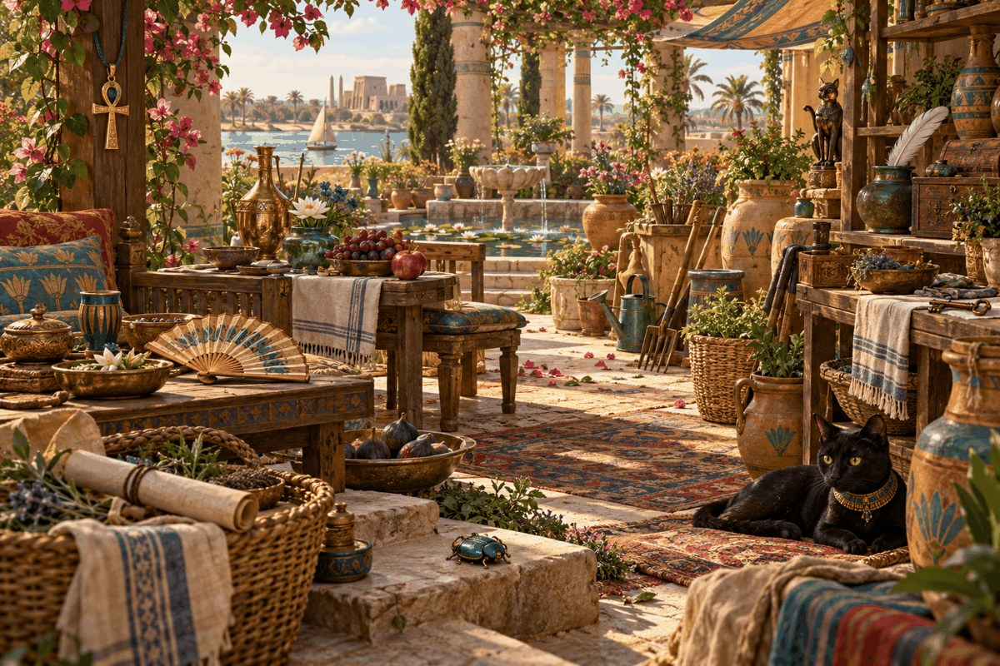
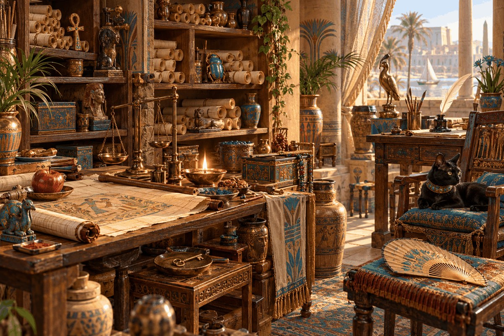
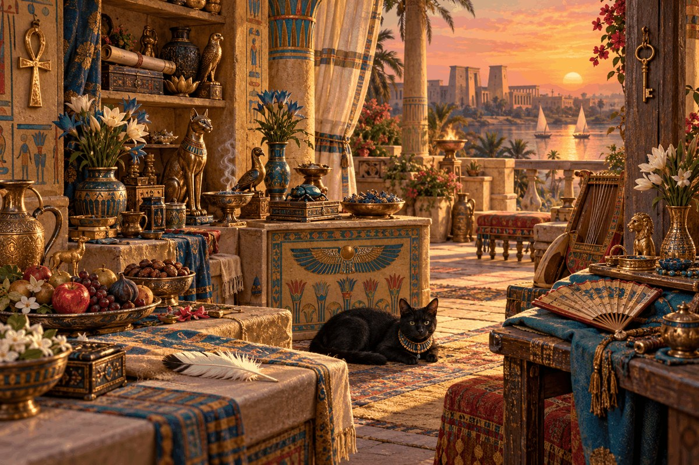

# Архив Нила · Nile Archive

Приключенческая игра в жанре **hidden object**: ищите предметы, раскрывайте семейную тайну и восстанавливайте островное поместье в Египте эпохи Птолемеев. Игровое поле написано на **C / SDL2** и собрано в **WebAssembly**; интерфейс браузера — на HTML/CSS/JavaScript.

[**Играть в браузере**](https://nile-archive-igor.regal-wolf-3081.chatgpt.site) · [Скачать проект](https://github.com/corepunch/nile-archive/archive/refs/heads/main.zip)

Опубликованная демоверсия требует входа через ChatGPT. Локальная версия из этого репозитория работает без него.

## Сюжет

**Египет, 196 год до н. э.** Нефра, дочь хранителя архива, возвращается в семейное поместье на острове Нила. После наводнения отец исчез, библиотека опустела, а знакомые дворы и террасы хранят лишь разрозненные следы прошлого.

Среди повседневных вещей Нефра находит свиток с семейной печатью. Отец успел спрятать книги до прихода воды — и оставил цепочку подсказок. Печать ведёт к библиотеке, план острова указывает на старый храм, а последняя записка обещает открыть путь к спрятанному архиву.

Чтобы вернуть острову жизнь, Нефра восстанавливает дома, мастерскую, фонтан и храм. Поиск предметов приносит средства для строительства, а восстановление поместья открывает новые главы и берега. Находки приближают её к архиву; судьба отца остаётся основой для продолжения истории.

Это художественный сюжет в историческом антураже, а не реконструкция реальных событий.

### Три главы прототипа

| Глава | Место | Развитие истории |
| --- | --- | --- |
| 1. Двор хранителя | Семейный двор с фонтаном | Среди оставленных вещей находится свиток с семейной печатью. |
| 2. Библиотека писца | Зал с папирусами и столами писцов | Печать раскрывает план острова и направление к старому храму. |
| 3. Храм на закате | Терраса у Нила | Последнее послание указывает, где отец спрятал книги. |

## Персонажи

| Нефра — героиня | Хорем — пропавший отец | Мерит — лодочница будущих глав |
| --- | --- | --- |
|  |  |  |

Нефра показана в интерфейсе и сюжетных сообщениях. Все трое представлены в галерее персонажей. Мерит пока не участвует в игровой цепочке улик.

## iPad: только альбомная ориентация

Все игровые экраны занимают доступную высоту окна без прокрутки страницы. Canvas сохраняет пропорции 3:2 и использует Retina-буфер до 2×; координаты нажатий считаются по его фактическому CSS-размеру. Главы, магазин и награды остаются в пределах экрана. Галерея персонажей открывается отдельным окном. В портретном режиме игра закрыта экраном поворота; открытый сюжетный диалог восстанавливается после возвращения в альбомный.

Проверены размеры CSS-окна: 1024×768, 1080×810, 1133×744, 1158×756, 1180×820, 1210×834, 1366×1024, 1376×1032 и 1080×650 с учётом уменьшенной высоты Safari. Это браузерная проверка компоновки, а не испытание на физических устройствах.

[Подробный протокол iPad](docs/IPAD.md) · [Отчёт 63 проверок](docs/ipad-layout-report.json)



## Скриншоты

Кадры игрового поля получены текущим SDL2-рендерером без HTML-интерфейса. На кадре острова показано примерное размещение пяти зданий и открытые зоны; новая игра начинается с домом садовника и одной открытой зоной.

### Остров и строительство



### Двор хранителя



### Библиотека писца



### Храм на закате



## Как играть

1. Откройте первую главу и найдите восемь предметов из списка. Подсказка обводит один из оставшихся предметов золотой рамкой.
2. Завершите сцену, чтобы получить **240 монет и 20 влияния**. Сцены можно проходить повторно.
3. Вернитесь на остров, выберите постройку и коснитесь свободного места для её размещения.
4. Повышайте влияние для доступа к следующим главам: библиотеке нужно **20**, храму — **50**.
5. Тратьте монеты на открытие новых берегов. Всего доступно **четыре зоны**.

Перетаскивайте остров мышью или пальцем; кнопки **− / +** меняют масштаб. Целевая платформа — **iPad, только альбомная ориентация**. В портретной ориентации показан экран с просьбой повернуть устройство; игровой прогресс сохраняется. Прогресс сохраняется в `localStorage` текущего браузера и не синхронизируется между устройствами.

### Постройки

| Постройка | Цена, монеты | Влияние |
| --- | ---: | ---: |
| Дом садовника | 70 | +10 |
| Храм Исиды | 160 | +30 |
| Архив | 130 | +25 |
| Фонтан | 60 | +10 |
| Мастерская | 100 | +15 |

## Запуск готовой веб-версии

В `dist/` уже включены HTML, JavaScript, WebAssembly и игровой пакет данных. Для запуска достаточно Python 3:

```sh
git clone https://github.com/corepunch/nile-archive.git
cd nile-archive
python3 -m http.server 8080 --directory dist
```

Откройте **http://localhost:8080**. Чтобы проверить игру на телефоне в той же сети Wi-Fi, используйте `http://<локальный-IP-компьютера>:8080`.

Открытие `index.html` напрямую через `file://` не подходит: WebAssembly и пакет ресурсов загружаются по HTTP.

## Сборка из исходников

Потребуется [Emscripten SDK](https://emscripten.org/docs/getting_started/downloads.html) с активированным окружением `emsdk_env.sh`:

```sh
./build.sh
python3 -m http.server 8080 --directory dist
```

Сборка использует SDL2-порт Emscripten. При первом запуске компилятору может понадобиться загрузить и собрать его зависимости. Исходная демоверсия собрана Emscripten **3.1.6**.

## Структура проекта

| Файл или каталог | Назначение |
| --- | --- |
| `game.c` | SDL2-рендеринг, поиск предметов, камера острова, размещение зданий |
| `dist/index.html` | Интерфейс, сюжетные сообщения, экономика и сохранение прогресса |
| `dist/game.js`, `dist/game.wasm`, `dist/game.data` | Готовая сборка Emscripten |
| `scene*.bmp` | Три фона для поиска предметов |
| `island.bmp` | Карта острова |
| `atlas.bmp` | Атлас предметов и построек |
| `tools/import_buildings.py` | Пересборка атласа из изометрических построек, требует Pillow |
| `docs/screenshots/` | Скриншоты игрового поля |

## Полное описание проекта

- [Концепция, сюжет, правила, экономика, архитектура, сохранения, проверки и дальнейшие идеи](docs/PROJECT.md)
- [Референсы June’s Journey и Pearl’s Peril и принятые решения](docs/REFERENCES.md)
- [Художественное направление, задания для иллюстраций и устройство атласа](docs/ART.md)

## Статус

Это игровой прототип с тремя короткими сценами, упрощённой экономикой и изометрическими постройками и предметами, нарисованными внутри сцен. Сборка WebAssembly выполнена; отдельно проверены карты попаданий трёх сцен, защита от повторного засчитывания, пересечения построек и границы камеры. В браузере проверены 63 комбинации экранов и альбомных размеров iPad, а также поворот устройства и точность нажатия по предмету. Проверка на физическом iPad в Safari пока не выполнена.

Иллюстрации фонов созданы генеративным инструментом; портреты и изометрические постройки также созданы генеративным инструментом; Pillow используется для подготовки ресурсов. Механический ориентир — цикл поиска предметов и развития острова из June’s Journey и Pearl’s Peril. Персонажи, сюжет и графика проекта созданы отдельно.

## Лицензия

См. [LICENSE](LICENSE).
