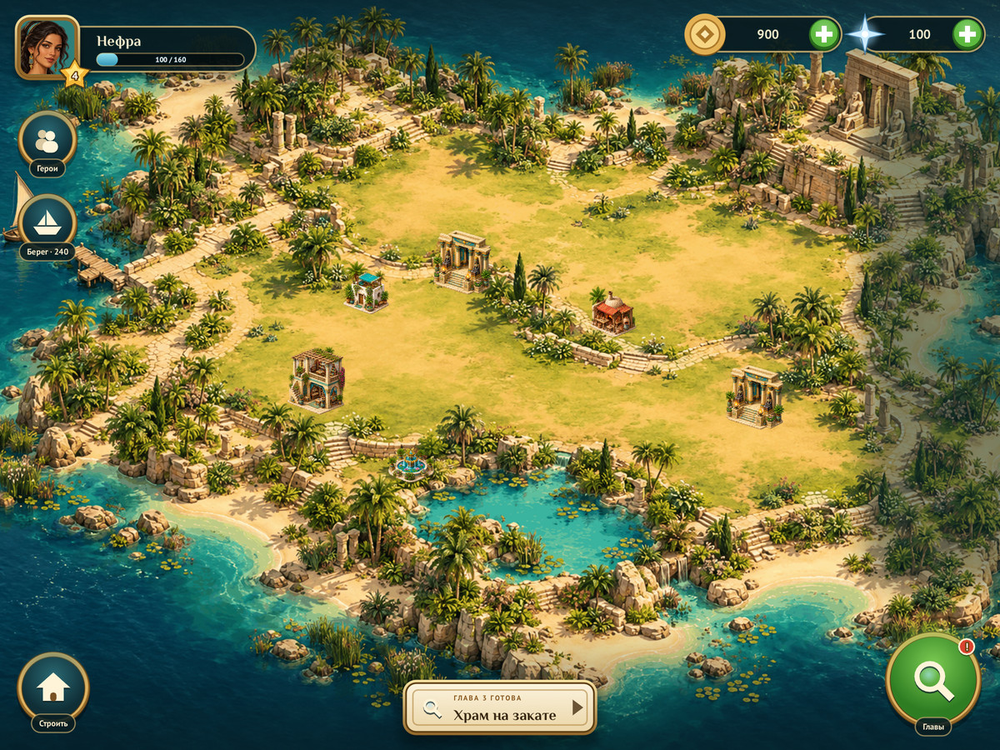

# Sprite engine + two games

One repository, one small **C11 + SDL2** engine, two games written in **Lua** on it:

| | Game | Core loop | Meta-game |
| --- | --- | --- | --- |
|  | **[Архив Нила / Nile Archive](games/nile-archive/README.md)** (Russian) | Hidden-object scenes painted in Ptolemaic Egypt | Restore an island estate: buildings, influence, new shores |
|  | **[Relic Rush · The Lost Valley](games/relic-rush/README.md)** (English) | Hex match-4 on ten shaped boards with sand, chains, ice, rays, bombs and prisms | Restore an island: ten wonders placed freely, six regions opened with stars and compasses |

The games target the iPad; the web build is only a fullscreen preview (a bare canvas, no HTML UI). Both games are a "puzzle → reward → build" loop, so the shared parts are big: the city-building meta-game (economy, building catalogue, placement, zones, timed income), characters and dialogue (portraits, speech bubbles, typed text, story beats that play once), the camera, styled text, UI widgets, save files, effects, sound, and the platform layer for desktop, iPad and phones (native and WebAssembly). Nile Archive lays itself out for any landscape screen; Relic Rush keeps a fixed 480 × 900 portrait design, letterboxed — the engine supports both.

**The engine knows mechanics, the games know content and rules.** The engine is C; all game logic is Lua 5.4, and the glue between them is generated from one XML description of the API, together with its reference. See [docs/SCRIPTING.md](docs/SCRIPTING.md) for the contract, [docs/LUA_API.md](docs/LUA_API.md) for the reference and [docs/LINEAGE.md](docs/LINEAGE.md) for where every idea comes from.

## Layout

```
engine/            the shared engine: ONE public header + one .c per module
  engine.h         math, app, input, gfx, camera, fx, text, ui, audio, save, story, city, script
  core.c           window, logical screen, main loop, pointer/touch gestures, screenshots
  gfx.c            textures, anti-aliased shapes, camera, particles
  font.c           TrueType text: outline, soft shadow, gradient; Retina-crisp glyph atlas
  ui.c             immediate-mode widgets, input blocking, toasts, modals
  save.c           key=value saves (files natively, localStorage on the web)
  city.c           the city-building meta-game
  audio.c          a tiny synthesiser for feedback tones
  story.c          characters, dialogue with portraits, speech bubbles
  script.c         the Lua runtime: sandboxed state, require, the main-loop callbacks
  launcher.c       main() for a Lua game, built once per game
  api.xml          the Lua API, described once          ─┐ tools/luagen.py
  api_lua.c/.h     the generated glue                   ─┤ (committed; make gen,
  engine.d.lua     generated editor annotations         ─┘  checked by make test)
  lua_lib.c        Lua 5.4 as one translation unit, sandbox libraries only
  third_party/     Lua 5.4.8, stb_truetype, stb_image, stb_image_write
games/
  nile-archive/    lua/main.lua + data/ (art, fonts) + docs/ + tools/
  relic-rush/      lua/ (main, rules, island, board, screens, vfx, island_view, state)
                   + art/ (sources) + data/ (runtime) + docs/ + tools/
tests/             engine tests in C; tests/lua/: the generated API and the games' rules
tools/             luagen.py (XML → glue + docs), screenshots.sh, make_reels.py, artkit.py
docs/              ENGINE.md, SCRIPTING.md, LUA_API.md (generated), LINEAGE.md
web/               shell.html: a bare fullscreen canvas for the web preview
```

Each game is one folder with its own content; the engine never includes game code. Adding a third game means adding `games/<name>/lua/main.lua` and a `data/` folder — the Makefile picks it up once its name is added to `GAMES`.

## Build and run

Native builds need SDL2 development files (`apt install libsdl2-dev`, `brew install sdl2`) and a C compiler; Lua is vendored. Tested on Linux; macOS and Windows (MSYS2) use the same Makefile through `pkg-config`/`sdl2-config`. Regenerating the Lua glue (`make gen`) needs Python 3.

```sh
make              # builds build/nile-archive and build/relic-rush
make run-nile     # or: make run-relic
make test         # generated-code freshness, engine tests, the games' Lua rule tests (headless)
make gen          # after editing engine/api.xml
make shots        # re-render the documentation screenshots (software renderer, no display needed)
```

Web (needs the [Emscripten SDK](https://emscripten.org/docs/getting_started/downloads.html) on `PATH`):

```sh
make web
python3 -m http.server 8080 --directory dist   # open http://localhost:8080/nile-archive/ or /relic-rush/
```

CI builds both targets on every push; the `web` artifact of a run is a ready-to-host `dist/`. The **Deploy to GitHub Pages** workflow (run it from the Actions tab) publishes it once Pages is enabled with "GitHub Actions" as the source.

Every game accepts: `--size WxH`, `--fresh` (no save read/write), `--data DIR`, `--lua DIR`, `--shot out.png [--frames N]`. Games add their own entry points for screenshots (Nile: `--screen <name>`; Relic Rush: `--level`, `--city`, `--victory`, `--dialog`, … and `--smoke`, which plays level one through injected clicks, claims, builds and enters level two).

## The engine in five minutes

A game is `games/<name>/lua/main.lua`, which returns the app descriptor: a title, a save id, a design resolution, and `init` and `frame(dt)` functions. The engine runs the loop; the game draws everything, every frame. The API is [`engine/engine.h`](engine/engine.h) seen from Lua — same names minus the type prefix, documented in [docs/LUA_API.md](docs/LUA_API.md). Conventions:

- **Value types are tables with a metatable**: `vec2`, `size2`, `rect`, `color`, `purse`, `camera`, `style`, `input`. Functions return new values and chain as methods; `a + b` works on vectors and purses; every field left out is zero, so `style{font = f, size = 17}` is complete.
- **Stateful things are handles**: `city.new()`, the save handle inside a visitor. Fields read and write the engine's state; callbacks are plain functions.
- **Modules are globals**: `app`, `input`, `gfx`, `texture`, `camera`, `fx`, `font`, `style`, `text`, `sfx`, `ui`, `save`, `story`, `city`, `num`, `ease`.

Layout uses [RectCut](https://halt76.notion.site/RectCut-for-dead-simple-UI-layouts-d175c7ff15e74c92b235eb43702155c8): slice a rect off one side and keep going.

```lua
local screen = app.screen()
local header = screen:cut_top(66)
local side = screen:cut_right(270)
local shop = screen:cut_bottom(112)
-- what is left of `screen` is the island view
for i, b in ipairs(buildings) do
    if ui.button(shop:col(5, i - 1, 10), b.name) then select(i) end
end
```

Styled text is a value you tweak per call:

```lua
local title = style{font = serif, size = 30}:grad(color.hex(0xFFF3D1), color.hex(0xE2B46A))
                  :outlined(1.4, ink):shadowed(vec2(0, 3), 4, color(0, 0, 0, 140))
text.draw(title:sized(40), box:center(), vec2(.5, .5), "Память возвращается")
```

The city meta-game is data plus one update/draw pair. Relic Rush's wonders, for example:

```lua
local wonders = {
    {name = "Expedition camp", sprite_path = "buildings/0.png", width = 180, max_height = 230,
     footprint = size2(72, 34), cost = purse(60, 10, 5)},          -- gold, wood, stone
    ...
}
local c = city.new()
c.defs = wonders
c.buildable = function(c, p) return island.grass(p) end   -- the game knows its map ...
c.zone_at = function(c, p) return island.zone(p) end      -- ... and its regions; the engine the rest
c:init("island.jpg")
local ev = c:update(input.world(), R.prog.wallet, app.clock(), dt)
if ev.result == city.ZONE then open_region_card(ev.zone) end
c:draw(input.world(), app.clock())
```

Placement is either instant (Nile: pick a card, tap the land) or a confirmable ghost (Relic Rush: `c:begin_place`, drag, `c:confirm`); buildings can be dragged to move; zones open with a cost and requirements once they touch open land; fog, paths between buildings and timed income are options.

Characters are data too; a story beat is a list of lines that plays once per save:

```lua
local cast = {
    {id = "elena", name = "Elena Voss", portrait_path = "characters/elena.png", color = color(44, 108, 84)},
    {id = "mara", name = "Mara Bell", portrait_path = "characters/mara.png", color = color(150, 74, 40), right = true},
}
story.setup(cast, story_style{text = speech, name = tag, framed = true, skip = "SKIP"})
story.play("intro", {{"elena", "The Lost Valley at last."}, {"mara", "And now we do."}})
...
story.frame(dt)   -- last in the frame: portrait, bubble, typed text, tap to continue
story.bubble(above_building, "A new wonder!", speech, cream, brown, 220, story.SPEECH)   -- words over the world
```

Saves are one function per game that both reads and writes, so fields cannot drift:

```lua
local function serialize(s)
    R.prog.level = s:int("level", R.prog.level)
    R.prog.wallet = s:ints("wallet", R.prog.wallet)
    R.island:serialize(s)
end
save.read("progress", serialize)    -- at start
save.write("progress", serialize)   -- after something worth keeping
```

See [docs/ENGINE.md](docs/ENGINE.md) for the architecture, the screen model, text rendering and the decisions behind them, and [docs/SCRIPTING.md](docs/SCRIPTING.md) for the Lua side.

## C engine, Lua games

The engine stays C11 on purpose (see the earlier "C, not C++" argument: value types and prefixed free functions chain as well as methods, no ABI or exception questions, trivial Emscripten builds). The games moved to Lua for the reasons every engine from LÖVE to Don't Starve settled on it: content as tables, no compile step for game logic, the same scripts on desktop, iPad and the web, and a hard boundary that keeps engine and game from leaking into each other. The port was checked pixel for pixel — every documentation screenshot and reel frame rendered by the Lua games is identical to the C games' at the same commit — and the C rule tests were ported too.

The Lua glue is not written by hand: [`engine/api.xml`](engine/api.xml) describes the API once and [`tools/luagen.py`](tools/luagen.py) writes the C bindings, the Markdown reference and editor annotations from it, after wayland-scanner, GObject Introspection and the `.cgen` generator in [corepunch/orion-ui](https://github.com/corepunch/orion-ui). `make test` fails if the generated files are stale.

## Merging the repositories

This repository is the single home for the engine and both games. Relic Rush was imported from `corepunch/relic-rush` (commit `4463559`) into `games/relic-rush/`: its rules and tests were kept, its island became the engine city, and its presentation was rebuilt on the engine. `corepunch/relic-rush` can now be archived, and this repository renamed (for example to `sprite-games`) — GitHub keeps redirects from the old name.

## References

- [docs/LINEAGE.md](docs/LINEAGE.md) — 2D engines from hardware sprites and Turbo Pascal's SPX to LÖVE, Defold and PICO-8; Lua in shipped games; XML-described APIs — and what was taken from each.
- [RectCut for dead simple UI layouts](https://halt76.notion.site/RectCut-for-dead-simple-UI-layouts-d175c7ff15e74c92b235eb43702155c8) — the layout technique used by every screen.
- [sokol headers](https://github.com/floooh/sokol) — C API style: descriptor structs, zero-init defaults, designated initialisers.
- [Lua 5.4](https://www.lua.org/manual/5.4/) — the games' language, vendored under `engine/third_party/lua` (MIT).
