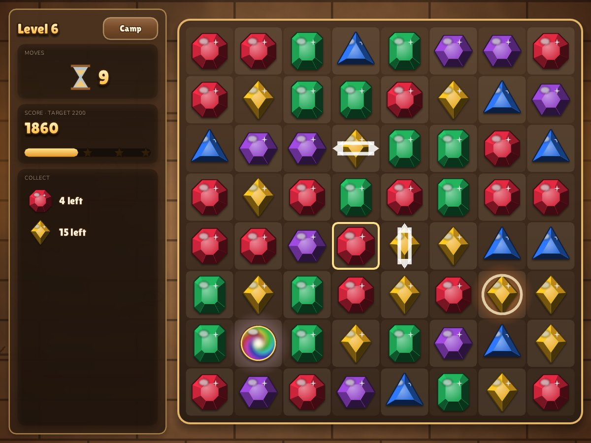

# Sprite engine + two games

One repository, one small **C11 + SDL2** engine, two games built on it:

| | Game | Core loop | Meta-game |
| --- | --- | --- | --- |
|  | **[Архив Нила / Nile Archive](games/nile-archive/README.md)** (Russian) | Hidden-object scenes painted in Ptolemaic Egypt | Restore an island estate: buildings, influence, new shores |
|  | **[Relic Rush](games/relic-rush/README.md)** (English) | Match-3 with blasters, bombs and relic orbs | Build an expedition camp: buildings unlock with stars and earn coins over time |

Both games are a "puzzle → reward → build" loop, so the shared parts are big: the city-building meta-game (economy, building catalogue, placement, zones, timed income), the camera, styled text, UI widgets, save files, effects, and the platform layer for desktop, iPad and phones (native and WebAssembly).

## Layout

```
engine/            the shared engine: ONE public header + one .c per module
  engine.h         math, app, input, gfx, camera, fx, text, ui, save, city
  core.c           window, logical screen, main loop, pointer/touch gestures, screenshots
  gfx.c            textures, anti-aliased shapes, camera, particles
  font.c           TrueType text: outline, soft shadow, gradient; Retina-crisp glyph atlas
  ui.c             immediate-mode widgets, input blocking, toasts, modals
  save.c           key=value saves (files natively, localStorage on the web)
  city.c           the city-building meta-game
  third_party/     stb_truetype, stb_image, stb_image_write (public domain)
games/
  nile-archive/    main.c + data/ (art, fonts) + docs/ + tools/
  relic-rush/      main.c, board.c, relic.h + data/ + docs/ + tools/
tests/             headless tests for the engine and the match-3 rules
tools/             artkit.py (procedural art helpers), screenshots.sh
web/               HTML shell for the Emscripten builds
```

Each game is one folder with its own content; the engine never includes game code. Adding a third game means adding `games/<name>/main.c` and a `data/` folder — the Makefile picks it up once its name is added to `GAMES`.

## Build and run

Native builds need SDL2 development files (`apt install libsdl2-dev`, `brew install sdl2`). Tested on Linux; macOS and Windows (MSYS2) use the same Makefile through `pkg-config`/`sdl2-config`.

```sh
make              # builds build/nile-archive and build/relic-rush
make run-nile     # or: make run-relic
make test         # headless engine + board tests
make shots        # re-render the documentation screenshots (software renderer, no display needed)
```

Web (needs the [Emscripten SDK](https://emscripten.org/docs/getting_started/downloads.html) on `PATH`):

```sh
make web
python3 -m http.server 8080 --directory dist   # open http://localhost:8080
```

CI builds both targets on every push; the `web` artifact of a run is a ready-to-host `dist/`. The **Deploy to GitHub Pages** workflow (run it from the Actions tab) publishes it once Pages is enabled with "GitHub Actions" as the source.

Every game accepts: `--size WxH`, `--fresh` (no save read/write), `--data DIR`, `--shot out.png [--frames N]`. Games add `--screen <name>` to open a specific screen (used for screenshots) and Relic Rush has `--autoplay N`, a bot that plays N levels through the real game loop.

## The engine in five minutes

Everything a game needs is in [`engine/engine.h`](engine/engine.h). Conventions:

- **Value types, passed and returned by value**: `vec2`, `vec3`, `ivec2`, `size2`, `rect`, `color`, `purse`, `camera`, `text_style`, `texture`. No getters for `.x/.y` gymnastics — use the operations.
- **Type-prefixed functions that chain**: `rect_inflate(rect_offset(r, v2(0, 8)), -12)`, `vec2_lerp(a, b, ease_out_back(t))`, `g.cam = camera_clamp(camera_input(g.cam, in))`, `wallet = purse_add(purse_sub(wallet, cost), reward)`.
- **Zero is a valid default** for every descriptor (`app_desc`, `text_style`, `camera`, `building_def`), so designated initialisers only name what matters.
- **One header.** Internals stay `static` inside their `.c` file.

Layout uses [RectCut](https://halt76.notion.site/RectCut-for-dead-simple-UI-layouts-d175c7ff15e74c92b235eb43702155c8): slice a rect off one side and keep going.

```c
rect screen = app_screen();
rect header = rect_cut_top(&screen, 66);
rect side   = rect_cut_right(&screen, 270);
rect shop   = rect_cut_bottom(&screen, 112);
// what is left of `screen` is the island view
for (int i = 0; i < 5; i++)
    if (ui_button(rect_col(shop, 5, i, 10), buildings[i].name, 0)) select(i);
```

Styled text is a value you tweak per call:

```c
text_style title = ts_shadow(ts_outline(ts_grad((text_style){.font = serif, .size = 30},
                                                hex(0xFFF3D1), hex(0xE2B46A)), 1.4f, ink),
                             v2(0, 3), 4, rgba(0, 0, 0, 140));
text_draw(ts_size(title, 40), rect_center(box), v2(.5f, .5f), "Память возвращается");
```

The city meta-game is data plus one update/draw pair:

```c
static building_def camp_defs[] = {
    {"Tent", "Diggers' shelter", "buildings/0.png", .height = 140, .cost = {{120}},
     .income = {{30}}, .income_period = 60},
    ...
};
city_event ev = city_update(&g.camp, input_world(), &g.wallet, app_clock());
if (ev.result == CITY_COLLECTED) fx_text(ev.screen, &popup, fmt("+%d", ev.amount.v[COINS]));
city_draw(&g.camp, input_world(), app_clock());
```

Saves are one function per game that both reads and writes, so fields cannot drift:

```c
static void serialize(save *s, void *user) {
    save_int(s, "coins", &g.wallet.v[COINS]);
    save_ints(s, "stars", g.stars, MAX_LEVELS);
    city_serialize(&g.camp, s);
}
save_read("progress", serialize, NULL);   // at start
save_write("progress", serialize, NULL);  // after something worth keeping
```

See [docs/ENGINE.md](docs/ENGINE.md) for the architecture, the screen model, text rendering and the decisions behind them.

## C, not C++

The request was "C, or maybe C++ so it is `rect->inflate()`". This is C11 on purpose:

- Chaining already works with free functions over values: `rect_inflate(r, 4)` returns a new rect, so there is no mutation to hide behind a method, and nothing is lost compared to `r.inflate(4)`.
- Prefixes (`rect_`, `vec2_`, `camera_`) give the same discoverability as methods — type `rect_` and the editor lists everything you can do with a rect.
- No hidden costs, no ABI or exception questions, trivial Emscripten builds; a clean build of the engine and both games takes about ten seconds (mostly stb), incremental rebuilds about one.
- If C++ is ever wanted for a game, `engine.h` is already `extern "C"`-wrapped.

## Merging the repositories

`corepunch/relic-rush` contained only a README and a license (GPLv3, same as this repo). Its history was merged into this repository (`git log --graph` shows both roots), so this repository is now the single home for the engine and both games. Once this lands, `relic-rush` can be archived, and this repository can be renamed (for example to `sprite-games`) — GitHub keeps redirects from the old name.

## References

- [RectCut for dead simple UI layouts](https://halt76.notion.site/RectCut-for-dead-simple-UI-layouts-d175c7ff15e74c92b235eb43702155c8) — the layout technique used by every screen.
- [sokol headers](https://github.com/floooh/sokol) — C API style: descriptor structs, zero-init defaults, designated initialisers.
- [raylib](https://github.com/raysan5/raylib) — small C game library passing `Vector2` / `Rectangle` by value.
- [stb](https://github.com/nothings/stb) — `stb_truetype` (glyphs and signed distance fields), `stb_image`, `stb_image_write`.
- [fontstash](https://github.com/memononen/fontstash) — glyph atlas caching on demand, the model for `font.c`.
- [The logic behind match-3 games](https://azumo.com/insights/the-logic-behind-match-3-games) — resolve loop: mark, clear, fall, refill, rescan; L/T and 4/5-in-a-row specials.
- June's Journey, Pearl's Peril (hidden objects + estate) and Gardenscapes/Homescapes (match-3 + building) for the puzzle → reward → build loop; see [games/nile-archive/docs/REFERENCES.md](games/nile-archive/docs/REFERENCES.md).

## License

GPL-3.0, see [LICENSE](LICENSE). Fonts are under the SIL Open Font License (texts next to the font files). `engine/third_party` is public domain / MIT (stb).
