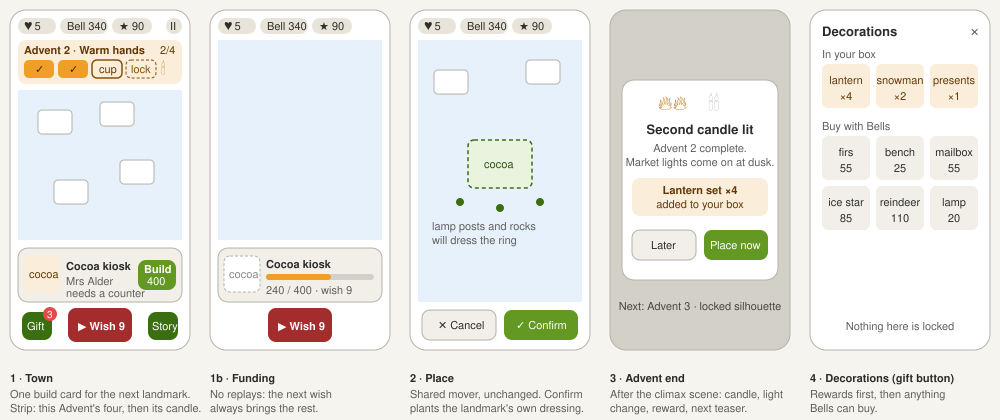

# Four purchases per epoch, stories by chapter

**Design proposal for Relic Rush and Christmas Market.** The purchase ladders and the scenes used as examples below already exist. The epoch strip, build card and keepsake box are proposed UI. Nile Archive keeps its June's Journey structure.

## Purchases and chapters

Keep the rhythm of Cradle of Rome. The player matches pieces, banks resources and spends them on the next building. A purchase has a practical consequence worth showing on the build card. The Spring Well puts water buckets on future boards. Repairing the Quay Steps opens a route the crew could see from camp but couldn't reach. [Rome's twenty purchases](cradle-of-rome-reference/GAME_DESIGN.md#5-every-building-in-the-original-20-purchase-ladder)

- **An epoch counts four confirmed campaign purchases.** Twenty required purchases make five epochs in each game. The ordered ladder includes workaday buildings as well as story landmarks. Optional buildings such as the Jungle Market, citizen arrivals and decorations sit outside the count. The existing ladder supplies the order and availability. [Relic Rush ladder](../games/relic-rush/lua/economy.lua) · [Christmas Market ladder](../games/christmas-market/lua/economy.lua)
- **A chapter follows a question or wish.** Open it when a character wants something and close it when the player's actions have changed what that character can do. A chapter can cross an epoch boundary or end partway through one. Its closing scene belongs to an authored event, such as restoring the steps. The fourth purchase fills the epoch strip.
- **The next level funds the next purchase.** Design prices around forward play and reserve the resources needed for required purchases before offering optional spending. In Relic Rush Chapter 1, Claim banks only the resources actually matched. A first clear can make a purchase available. The story moves when the player confirms a build or repair, or a citizen arrives. Use this rule when revising later Relic Rush chapters, which still have first-clear scenes. [Relic Rush campaign milestones](../games/relic-rush/docs/story.md#campaign-milestones)

## Worked example · Relic Rush Chapter 1, A Light Below

**Who's answering Mara's lamp?** The chapter takes six purchases. Four of them carry scenes. Clearing the listed board makes the purchase eligible once earlier required work is complete. The player still has to spend the resources and confirm it. [Chapter 1 script](../games/relic-rush/docs/story.md#chapter-1-a-light-below)

| Epoch · purchase | After clear | What the player does | What follows |
| --- | --- | --- | --- |
| 1 · 1 | 1 | Choose a site for the Expedition Camp. | Hammer gems become available. Mara signals from the lookout and gets two flashes back. The crew needs drinking water. |
| 1 · 2 | 4 | Restore the Spring Well on its original site. | Water buckets enter the board. Tomas accepts a place at camp and tells Mara the electric relay is dead. What sent the flashes? |
| 1 · 3 | 7 | Build the Trapper's Cabin. | Hammer upgrades to Dynamite. The next board lets the player use the upgrade. |
| 1 · 4 | 7 | Choose a site for the Artisan Workshop. | Cut blocks enter the board. Tomas shows Mara how to size a replacement tread to fit the old cuts. Epoch one is complete and the steps still need repairing. |
| 2 · 1 | 9 | Put the Water Mill back to work. | The crew can proceed to the quay repair after clear 10. |
| 2 · 2 | 10 | Restore the Quay Steps where they stood. | The tread seats in the old notch. Cut to the ancient keeper setting that height so the night watch will have dry footing at high tide. Back in the present, the crew reaches the viewing shutter. Three flashes come back. The player chooses who answers. Chapter 1 ends here. |

The keeper appears at the instant the player can understand his decision by looking at their own repair. His scene belongs to the past. The crew learns what it can observe from the newly accessible shutter. Future repairs should likewise open a route, enable someone's work or bring people together. The present-day town is the one the player builds.

## Citizens are characters

Give each citizen a name, a workplace, a reason to stay and someone they have business with. Introduce them doing their job. Bring them back when another resident or a later purchase gives them something new to do. A short exchange at a stall or a detail the player can tap on a return visit can carry a relationship between the larger scenes.

- **People the chapter depends on arrive reliably.** Restoring the well brings Tomas into camp. At the workshop, Mara needs his knowledge of the old cuts. By the quay, the player can choose him to answer the signal. His arrival and the well repair share one scene.
- **Optional specialists can be earned through play.** Follow Rome's building-and-feat pattern. A citizen can arrive once they have a workplace and the player has accomplished a relevant board feat. Give their trade a lasting effect, such as a better yield on a matched piece or faster tool charge. Give them a later exchange with a neighbour, available when both are present. The main chapter must still make sense if that specialist never arrives. [Rome's citizen challenges](cradle-of-rome-reference/GAME_DESIGN.md#7-citizen-challenges-buildings-can-have-a-second-payoff)
- **Christmas Market already shows how this can feel.** When Agnes opens the bakery, Henrik sends Pip with a penny for a bun he insists he doesn't want. Agnes saves one at the back of the tray. Later, Henrik's workshop gives him a window facing hers. Still later, a tap at the bakery reveals two cups on the sill. The player gets to see a relationship change through the ordinary business of running the market. Use the existing cast, stalls and tap bubbles for more of these encounters. [Christmas Market script](../games/christmas-market/docs/story.md)

Christmas Market's three written episodes can keep their own pace. Lighting an Advent candle can mark a Sunday or a Christmas Eve scene. Choose that moment from the market's calendar and the neighbours' wishes. The twenty purchases already supply five construction epochs.

## Decorations

1. **Landmarks bring their own dressing.** On confirmation, matching pieces appear in the clearance ring, such as lamps by the bakery or palms at the well. Players who never open the decoration shop still get a lived-in town.
2. **Keepsakes have an occasion.** A new resident or a chapter-closing build can bring something specific to that event, such as lanterns for the market. Keep movable gifts in a box until the player wants to place them. Relic Rush levels award matched resources only.
3. **Extra decorations are optional purchases.** Players can spend spare Coins or Bells and move or store the pieces. Decoration counts add neither a campaign requirement nor a level payout.

## UI

1. **One build card shows the next required purchase.** Show its picture, name, price and practical effect. For a story landmark, add one line from the person who needs it. While funding, show the shortfall and the next level. When affordable, Build starts placement or Restore previews the original site. Confirm spends the resources and applies the change. The card can use the existing next-restoration slot. [Relic Rush results screen](../games/relic-rush/lua/screens.lua)
2. **Four slots show the current epoch.** Fill a slot for each confirmed required purchase, outline the current one and show the rest as silhouettes. Later epochs stay hidden. A chapter title or an Advent candle follows its own story event.
3. **The decoration shop holds the keepsake box and items for sale.** In Christmas Market the gift button can show the number of unplaced gifts.
4. **A chapter-end card follows the closing scene.** Show what has changed on the island and, when the occasion brings a keepsake, offer Place now and Later.

### Mockup

The [Christmas Market wireframe](mockups/chapter-progression.svg) illustrates the build card's ready and funding states, placement with Confirm and Cancel, a candle-lighting scene, and the gift box. Its original Advent strip combines purchases and candles. In the revised design the four slots track purchases, while candle lighting follows the story calendar.

## Implementation sketch

- Derive the epoch and its four slots from the ordered required purchases. Preserve waived ladder positions in existing saves. Keep the game's authored chapter-ending event separate from completing the fourth slot. Test both boundaries using the Workshop and Quay Steps.
- Use shared engine forms for the card and strip with each game's skin. Verify funding, placement, fixed-site repair and chapter-end states at 480 × 900 and 390 × 844. [Engine skins](UI_ENGINE.md#skins)
- Keep arrivals and scenes in each game's campaign data. Record an arrival once, resume an unread scene on reload, and condition optional exchanges on the residents present. Track who takes part and what changes in the game's story sheet. [Story writing guide](STORY_WRITING.md)
- Record dressing sets in the building catalogue and the wreath and strip states in the asset catalogue. [Building art](BUILDING_ART.md) · [Building registration](BUILDINGS.md)

## Open questions

- Which market occasion should light each Advent candle, including the last one?
- Which pieces of a landmark's dressing can the player move or store?
- Which optional purchases should compete for coins left after the next required building is funded?
