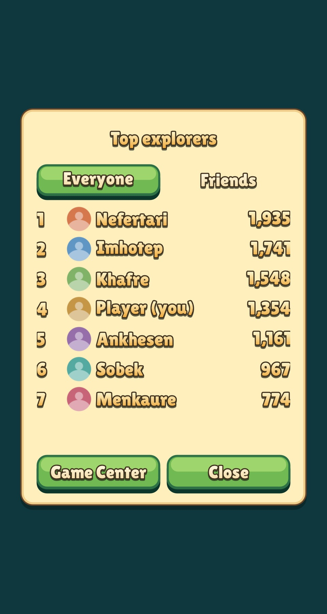

# Game Center

Every game gets sign-in, leaderboards and achievements from the shared
engine through the generated `gamecenter` Lua module. Nothing is configured
per game in code: sign-in starts by itself at launch, and a game only names its
boards and achievements.

```lua
gamecenter.submit('stars', total_stars)       -- higher is better; non-records are dropped
gamecenter.unlock('first_island')             -- or gamecenter.unlock('builder', 40) for progress
gamecenter.load('stars', gamecenter.FRIENDS)  -- start a fetch (GLOBAL by default, 10 rows)

-- every frame of a leaderboard screen
local rows = gamecenter.entries('stars', gamecenter.FRIENDS)
if rows == nil then draw_spinner() end        -- nil until the first load finishes
for _, row in ipairs(rows or {}) do           -- {rank, score, name, me}
    draw_row(row.rank, row.name, row.score, row.me)
end

gamecenter.show(gamecenter.LEADERBOARD, 'stars')  -- Apple's own screen (also DASHBOARD, ACHIEVEMENTS)
gamecenter.access_point(true)                     -- Apple's floating badge
```

The full reference is in [LUA_API.md](LUA_API.md#gamecenter).

## Behaviour games can rely on

- **Nothing is lost.** Reports are kept in the `gamecenter` save slot until
  Game Center confirms them, and are resent at the next sign-in or when the app
  returns to the foreground. Offline play, a declined sign-in and a crash
  before the network answers all end the same way: the score arrives later.
- **Everything is asynchronous.** `load` never blocks. `entries` returns the
  last good rows, so a failed refresh leaves the screen as it was. A fetch made
  while sign-in is still pending waits for it.
- **The game works without Game Center.** On macOS, the web, headless runs,
  `--no-gamecenter`, a declined sign-in or no network, `state()` is
  `UNAVAILABLE` and `entries` returns the player's own best as a one-row board
  (`me = true`), so a leaderboard screen never needs a separate path.
- **Screenshots and tests never touch Game Center.** `--gamecenter-demo` adds
  sample rivals (and a signed-in state) so the screen can be captured.
- **Calls are cheap.** `submit` and `unlock` may be called from any event; only a
  new record or higher progress is saved or sent.

## Setting up a game

1. In App Store Connect open the app, then Services > Game Center, and add
   leaderboards and achievements. **The identifier must be
   `<bundle id>.<name>`**, for example `com.corepunch.relicrush.stars`, where
   `stars` is the name the game passes to Lua. Sort leaderboards high to low.
2. Nothing else: `tools/xcode/generate.py` links GameKit and writes the
   `com.apple.developer.game-center` entitlement for every iOS target
   (`Generated/ios.entitlements`). Automatic signing adds the capability to the
   App ID; `make ios` already allows provisioning updates. On a device, sign
   in to Game Center in Settings (use a Sandbox account for testing).

Friends boards (`gamecenter.FRIENDS`) show only players the user has
befriended in Game Center, and Game Center decides what is visible to a given
player; a new player simply sees a short list.

## The shared leaderboard dialog



`require("leaderboard")` (`engine/leaderboard.lua`) is the screen a game opens
from a button. It lists the rows `gamecenter.entries` returns in a scrolling
list under Everyone / Friends tabs, shows each player's Game Center portrait
(a round placeholder with their initial until it arrives), marks the player's own row, offers a button
to Apple's native board when signed in, and paints with the game's `ui.skin`.
It also explains an empty or loading board, and tells a signed-out player how to
compare with others. Without Game Center it shows the player's own best, so a
leaderboard button works in every build.

```lua
local leaderboard = require("leaderboard")
local lb = leaderboard.new{skin = skin, board = "stars", title = "Top explorers"}
lb:open()                                 -- from the button

-- frame, standalone
if lb:begin() then update_game() end      -- false while the dialog has the input
render_game()
lb:draw(dt, {reduced_motion = reduced})
```

A game that already has a `ui.modals` stack passes it in
(`leaderboard.new{modals = stack, ...}`), keeps drawing the stack itself, calls
`lb:sync()` before it draws and `lb:handle(event)` with each event it returns
(true when the event was the dialog's).

Options: `board` (required), `title`, `count` (rows requested, up to 25),
`rows` (rows visible before scrolling, default 8), `width`, `format(score)`
(default thousands separators; use it for times or stars), `texts` (every
caption, for translation) and `id`. A skin may define the optional roles
`leaderboard_row`, `leaderboard_me` and `leaderboard_note` to style the rows
and the status line; without them the labels use the skin's default text.
The chosen tab is a button and the other a flat caption, so it reads in any
skin. `tests/lua/leaderboard.lua` covers the dialog; the picture above is a
capture with `--gamecenter-demo`.

## Portraits

Each row carries `id` (Game Center's player id) and, once loaded, `photo`, a
round texture (`photo_rev` changes when it arrives). The platform loads a
portrait once per player after a board arrives (`GKPlayer loadPhotoForSize:`),
clips it to a circle at 96 px and hands it to the engine, which keeps the last
64 (`gamecenter.photo` in C: `gamecenter_photo(id)`). A player without a
portrait, or a failed load, leaves `photo` nil and is not asked again that run.
`--gamecenter-demo` draws placeholder busts so the dialog can be captured.

## One board per level

A board is only a name, so a game may keep one per level: `gamecenter.submit("level_07", score)` and
`leaderboard.new{board = "level_07"}`. Every board still has to exist in App Store
Connect under `<bundle id>.level_07` (Game Center allows 500 per app, and
boards can be grouped into a leaderboard set), and a board nobody has played
looks empty. Prefer one overall board as the main screen and per-level boards
reached from the level result or the level list, opened on the Friends tab.

## Engine and platform boundary

`engine/gamecenter.c` owns every decision: the report queue and its saved
state, the board cache (16 board/scope pairs, oldest evicted), the local
fallback and the demo rows. `engine/gamecenter_platform.c` compiles in the
platform unity unit and only translates:

| Engine asks | GameKit |
| --- | --- |
| `gamecenter_platform_start` | `GKLocalPlayer.authenticateHandler`; Apple's sign-in sheet is presented over the game |
| `..._report_score` | `GKLeaderboard submitScore:context:player:leaderboardIDs:` |
| `..._report_achievement` | `GKAchievement reportAchievements:` (completion banner on) |
| `..._load` | `GKLeaderboard loadLeaderboardsWithIDs:`, then `loadEntriesForPlayerScope:timeScope:range:` |
| `..._show` | `GKGameCenterViewController` (dashboard, one leaderboard or achievements) |
| `..._access_point` | `GKAccessPoint.shared` |

Completions are moved to the main queue and call `gamecenter_on_auth`,
`gamecenter_on_report` and `gamecenter_on_entries`. Targets other than iOS
compile a backend that reports itself unavailable. GameKit is iOS only here.

## Testing

`tests/test_gamecenter.c` replaces the backend with a recorder and drives the
completions by hand: queueing before sign-in, retry after failure, an
improvement made while a report is in flight, persistence across launches,
cache and eviction, and the local fallback. `tests/lua/gamecenter.lua` covers
the Lua bindings. Run them with `build/test/engine gamecenter`. The native
side is checked by building an iOS target; sign-in and real boards need a
device or simulator with a Game Center account.
