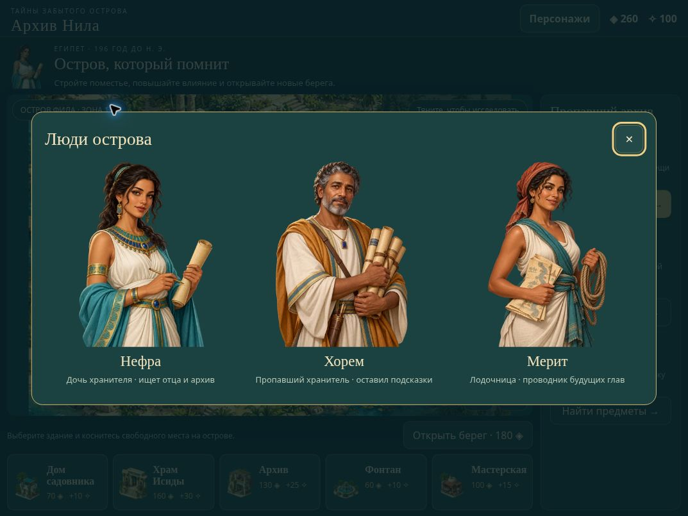

# iPad — альбомная ориентация

Основной формат игры — iPad в landscape. Портретная игровая компоновка не поддерживается: вместо неё появляется просьба повернуть устройство.

## Реализовано

- Полноэкранная компоновка в пределах доступного браузерного viewport: `100dvh` и safe-area.
- При запуске, изменении размера и повороте игровое поле вписывается в свободную область без искажений и обрезания картинки. Пропорции изображения — 3:2.
- SDL canvas получает реальный буфер в физических пикселях с коэффициентом до 2×. Координаты касания остаются в логической системе 1200×800.
- Кнопки имеют область взаимодействия не меньше 44×44 CSS-пикселей.
- В сценах остаются шапка с выходом, поле, все восемь названий, масштаб и подсказка. Главы и магазин скрываются.
- На острове размещены поле, главы, магазин и действие открытия берега. Вся страница не прокручивается; при необходимости панель глав может прокручиваться внутри.
- Галерея персонажей вынесена в отдельный диалог. Диалог награды и галерея ограничены высотой окна и имеют внутреннюю прокрутку как страховку.
- При повороте в портретный режим открытый диалог временно закрывается; после возвращения в landscape открывается снова. Незавершённая сцена и текущая награда не сбрасываются.
- Web App Manifest указывает `orientation: landscape`. Сам Safari не обязан принудительно поворачивать устройство; экран поворота работает независимо от поддержки orientation lock.

## Проверки

В Cloud Chrome использована настоящая веб-сборка SDL2 / WebAssembly внутри iframe с заданным CSS viewport. Это проверка browser layout и WebGL, не физического устройства и не WebKit.

| Альбомный CSS viewport | Ориентир |
| --- | --- |
| 1024×768 | Старые 9,7-дюймовые iPad |
| 1080×810 | iPad 8 / 9, панель 2160×1620 при 2× |
| 1133×744 | iPad mini 6 / 7 |
| 1158×756 | Более широкий viewport mini |
| 1180×820 | Класс Air 11 |
| 1210×834 | Класс Pro 11 |
| 1366×1024 | Большой iPad / Air 13 |
| 1376×1032 | Pro 13, панель 2752×2064 при 2× |
| 1080×650 | Уменьшенная доступная высота с браузерными панелями |

На каждом размере проверены семь состояний: остров, выбор постройки, двор, библиотека, храм, галерея персонажей, сюжет/награда. **63 из 63**: ни одного выхода проверяемых элементов за viewport, горизонтального или вертикального переполнения документа.

Дополнительно проверено:

- Портретный viewport 810×1080 показывает экран поворота и закрывает игровой диалог.
- Возврат к 1080×810 восстанавливает диалог награды.
- Кнопка «На остров» доступна в сцене и возвращает на остров.
- Нажатие на видимый анх в подогнанном Retina-поле меняет счётчик находок с 0/8 на 1/8.
- Canvas на 1080×810 в сцене имеет CSS-размер 924×616 и буфер 1848×1232 при 2×.
- По исходному коду и CSS все видимые кнопки имеют min-width/min-height 44, кроме более крупных 46×46 кнопок масштаба.

Машиночитаемый результат: [ipad-layout-report.json](ipad-layout-report.json). В тестовой фикстуре используется отдельное состояние с влиянием 100 и принудительным 2× буфером. Пользовательские сохранения не затрагиваются.

## Скриншоты интерфейса

Сняты с веб-сборки на viewport 1080×810; обрезан только внешний стенд проверки. Значения ресурсов соответствуют тестовому состоянию.

## Воспроизведение

Запустите `python3 -m http.server 8080 --directory dist`, затем откройте `http://localhost:8080/qa/ipad.html`. Выберите размер и состояние. Стенд изменяет размер самого iframe; уменьшение его изображения для размещения в окне не меняет CSS viewport внутри игры.

QA-параметры: `island`, `build`, `scene0`, `scene1`, `scene2`, `characters`, `reward`. Без `qa` игра загружает обычный локальный прогресс.

Остаётся проверить на физическом iPad в Safari: реальные safe-area, изменение панелей Safari, мультитач, длительную игру и переключение приложений. Такая проверка не заявляется выполненной.

## Размеры экранов — источники

- [Apple: iPad 8, 2160×1620](https://support.apple.com/en-my/118451).
- [Apple: iPad Pro, 2420×1668 и 2752×2064](https://www.apple.com/ipad-pro/specs/).
- [Apple: iPad mini](https://www.apple.com/ipad-mini/specs/).
