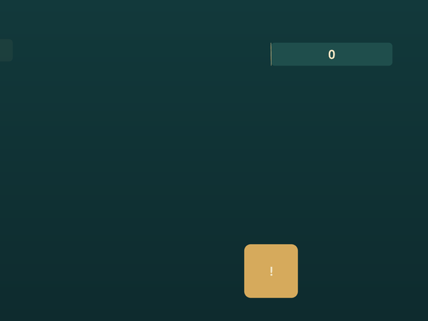

# Motion: ease and tween

The engine animates through one Lua module, [`engine/tween.lua`](../engine/tween.lua),
embedded by `make gen` and loaded before `main.lua`. It defines two globals:

- **`ease`**, the easing catalogue: every curve of [easings.net](https://easings.net)
  plus `linear`, `steps` and the parameterised `back` and `elastic`.
- **`tween`**, the motion API: tweens of any numeric or value-typed field, timelines
  with GSAP's position syntax, staggers, punch and shake, groups and time scaling.



*`tests/fixtures/motion`: six bars staggered in one timeline, each on its own curve, a punch, a counter and a shake. `make test` renders it; run it with `build/nile-archive --lua tests/fixtures/motion`.*

The engine ticks `tween.update(dt)` before every game frame, so a game writes
`tween.to(card, .3, {y = 0})` once and draws `card.y` every frame. Nothing
needs polling: a tween is a function of its playhead, so pausing, seeking,
reversing, looping and slow motion all work the same way on everything.

## Where it comes from

The module follows the libraries games are usually animated with, chosen for
their reputation rather than invented here:

| Library | What is borrowed |
| --- | --- |
| [GSAP](https://gsap.com/docs/v3/) | A tween or timeline renders at a playhead, so every control is a seek. Timeline positions (`"<"`, `">"`, `"+=0.2"`, labels), per-timeline `defaults`, stagger options (`each`, `amount`, `from`), a time scale on a timeline and on the whole group. |
| [flux](https://github.com/rxi/flux) | The small chainable Lua surface (`:ease`, `:delay`, `:on_complete`, `:after`), groups with their own `update(dt)`, overwrite by field: a newer tween takes over only the fields it touches. |
| [DOTween](https://dotween.demigiant.com/documentation.php) | `:loops(n, "yoyo")`, `punch` and `shake` with `vibrato`, `elasticity`, `randomness` and `fade_out`, an out-easing default. |
| [Godot 4 Tween](https://docs.godotengine.org/en/stable/classes/class_tween.html) | `from` and `relative`, the child tween returned from a timeline so its modifiers chain onto it, method tweens (`tween.value`). |

## Easing

Every curve is `f(t, ...)` with `t` clamped to `[0, 1]`. The families `sine`,
`quad`, `cubic`, `quart`, `quint`, `expo`, `circ`, `back`, `elastic` and `bounce`
each come as `in_`, `out_` and `in_out_`; a family is written once as its
ease-in and the others are derived from it, as flux does.

```lua
ease.out_cubic(t)                 -- the engine's default
ease.out_back(t, 2.5)             -- overshoot (default 1.70158, 10 % past the goal)
ease.out_elastic(t, 1, .3)        -- amplitude, period
ease.steps(t, 5)                  -- five equal steps, held until the next
ease.linear(t)  ease.none(t)      -- the same
ease.in_out(t)                    -- the historic name of in_out_cubic
ease.get("out_back")              -- a curve by name, for your own code
```

Pick an **out** curve for things arriving (cards, panels, counters), an **in**
curve for things leaving, `out_back` for a settle with a little overshoot,
`out_elastic` for a spring, `out_bounce` for a drop.

## Tweens

```lua
tween.to(card, .3, {y = 0, alpha = 1})                 -- from the current values to these
tween.to(card, .3, {y = 0}):ease("out_back"):delay(.1) -- settings chain
tween.to(card, .3, {y = 0}, {ease = "out_back", delay = .1, on_complete = done})  -- or as a table
tween.from(card, .3, {y = -40, alpha = 0})            -- from these to the current values
tween.to(card, .3, {x = 20}):relative()                -- goals are offsets from the start
tween.set(card, {alpha = 0})                           -- write now, through the overwrite rules
tween.value(0, score, .6, function(v) G.shown = v end) -- a number, handed to a function
```

- **Targets** are any table: a game's own records, or a list of them, `tween.to({a, b, c}, …)`.
- **Fields** are numbers or the engine's value types (`vec2`, `size2`, `rect`, `color`, `purse`
  and any table of numbers): `tween.to(sprite, .4, {pos = vec2(100, 50), tint = color(255, 0, 0)})`
  interpolates component-wise and writes a value of the same type, so `sprite.pos:len()` works mid-tween.
- A goal may be a **function** `(index, target)`, read when the tween starts: `{x = function(i) return i * 60 end}`.
- A finished tween writes the goal **exactly**; nothing accumulates rounding.
- The default ease is **`out_cubic`**; pass a name, a function, or a name with parameters, `:ease("out_back", 2.5)`.

### Settings (chainable, or keys of the options table)

| Setting | Meaning |
| --- | --- |
| `:ease(spec, a, b)` | Curve by name or function, with parameters. |
| `:delay(s)` | Wait before starting. A delayed tween does not take over fields until it starts. |
| `:loops(n, mode)` | `n` extra plays, `-1` forever; `mode` is `"restart"` (default), `"yoyo"` (back and forth) or `"incremental"` (each play adds the distance again). |
| `:from(vars)` | Start values; the target jumps there at once. |
| `:relative()` | Goals are offsets from the start values. |
| `:stagger(s)` / `:stagger{…}` | Offset each target in a list: `each` seconds between starts, or `amount` from the first start to the last; `from = "start" | "end" | "center" | "random" | index`; `ease` shapes the spread. |
| `:time_scale(k)` | Speed of this tween alone. |
| `:on_start(fn)` `:on_update(fn)` `:on_complete(fn)` `:on_loop(fn)` `:on_reverse_complete(fn)` | Callbacks; each receives the clip (and `on_loop` the play index). |
| `:after([target,] dur, vars)` | A tween that starts when this one completes; returns it, so its settings chain on. |

### Controls

Every control is a seek, so it is exact and idempotent:

```lua
t:pause()  t:resume()  t:play()  t:reverse()  t:restart()
t:seek(0.2)  t:progress(.5)  t:progress()      -- a time, a fraction, read the fraction
t:complete()                                   -- jump to the end, callbacks fire
t:kill()                                       -- stop where it is; nothing else fires
t:is_active()  t:is_done()  t:total()
```

A tween leaves its group when it completes or is killed, and comes back when
played, restarted or sought again.

## Overwrite

A tween **owns the fields it has started on** within its group. When a newer
tween starts on the same target and field, it takes the field over and the
older one stops writing it, while keeping its other fields. That is what you
want from a tap that interrupts a slide: no fight, no snap, the new tween
starts from wherever the value is now. Delayed tweens claim nothing until they
start. Children of one timeline never overwrite each other, so a timeline can
move `x` out and back in sequence; only another root tween or timeline takes a
field from them.

`tween.kill(target)` kills every tween of a target, `tween.kill(target, "x", "y")`
drops only those fields; `tween.of(target)` lists its tweens and
`tween.is_tweening(target)` asks.

## Timelines

A timeline sequences clips (tweens, nested timelines, calls and waits) and
is itself a clip: it loops, reverses, seeks and scales like a tween.

```lua
local tl = tween.timeline{defaults = {ease = "out_quad"}}
tl:to(card, .3, {y = 0})                  -- at the end (the start, when empty)
tl:to(card, .3, {alpha = 1}, "<")         -- with the previous child
tl:to(badge, .25, {scale = 1}, "+=.1")    -- a gap after the end
tl:to(badge, .2, {scale = 1.2}, "<.1")    -- 0.1 s after the previous child's start
tl:label("reward")                        -- name this moment
tl:call(function() sfx.play("coin") end)  -- at the end
tl:to(coins, .4, {count = 10}, "reward+=.05")
tl:wait(.3)                               -- a pause, appended
tl:add(other_timeline, ">")               -- nest one, after the previous child
```

The position is GSAP's: a number is absolute, `"+=x"` / `"-=x"` are from the
timeline's end, `"<"` and `">"` are the previous child's start and end with an
optional offset (`"<0.1"`, `">-0.2"`), a label is its position with an optional
offset, and nothing is the end. `tl:to`, `:from`, `:set`, `:punch`, `:shake` and
`:add` return the child so its own settings chain on
(`tl:to(card, .3, {y = 0}):ease("out_back"):delay(.1)`); `tl:call`, `:wait` and
`:label` return the timeline. `defaults` are applied to every child tween when it is
added, so a later `:ease` on the child wins. Options: `paused`, `loops`,
`delay`, `time_scale` and the callbacks.

A timeline's duration is measured from its children, so a child's delay or
loops count. A timeline with no children sits in the group, waiting.

## Punch and shake

```lua
tween.punch(card, .4, {scale = .25})                       -- out by .25 and back, with decaying swings
tween.punch(card, .4, {pos = vec2(0, -24)}, {vibrato = 10, elasticity = 1})
tween.shake(cam, .5, {center = vec2(8, 8)}, {vibrato = 20, randomness = 90, fade_out = true})
tween.shake(hud, .3, {angle = .05})
```

Both are relative to the start and end **exactly** where they began. A punch
goes towards its strength first and swings back `elasticity` (0..1) as far past
the start; `vibrato` is swings per second. A shake jolts `vibrato` times per
second in alternating directions that wander by up to `randomness` degrees,
tapering when `fade_out` is on (the default). Shakes draw from the group's own
random stream, so they are deterministic in tests.

## Groups and time

`tween` is the default group, ticked by the engine before each frame. A group
of your own ticks when you say so, with its own time scale, pause and
overwrite scope: a screen's effects, a paused board.

```lua
local fx = tween.group()
fx:to(spark, .3, {alpha = 0})
fx:update(dt)                      -- in your frame, when the board is running
fx:time_scale(.25)                 -- slow motion for that group only

tween.time_scale(.5)               -- the whole default group
tween.pause()  tween.play()
tween.instant(true)                -- reduced motion: every clip completes on its next update
tween.count()  tween.kill_all()
```

`tween.update(dt)` is also callable by hand, which is how tests drive it. With
`tween.instant(true)` (a group's `:set_instant(true)`) clips complete on their
first update and callbacks still fire, so a settings toggle for reduced motion
needs no second code path.

## In the games

- **Christmas Market and Relic Rush** (`screens.lua`): a dialog's entrance and
  exit are two tweens on `R.dialog` (`entry`, `exit`), started by `R.open_dialog()`
  and `R.close_dialog()`. The parts of the result screen (stars, score, rewards,
  buttons) join one timeline through `R.dialog_part(delay, duration)`, keyed by
  draw order like controls; the first tap calls `R.dialog_skip()`, which completes
  the timeline, and the smoke runs wait on `R.dialog_settled()`. `R.open_dialog(true)`
  opens a dialog at rest, for stills.
- **Nile Archive**: `G.open_modal(kind)` builds a paused timeline for a popup's
  pop (`out_back`), its backdrop and the staggered stars; `main.lua` plays it once
  any dialogue is over. In a scene, each name pill's arrival, strike-through and
  drop, the ring on a found item and the combo bar are tweens on records in
  `G.pills`, `G.marks` and `G` (`archive_scene.lua`).
- **The engine's modal stack** (`ui.modals`): a layer's backdrop fade is a tween
  on the layer.
- **Reduced motion**: each game calls `tween.instant(R.reduced_motion)` every
  frame, so every tween settles on its next update and no code path checks the
  flag for itself.


### What stays on its own clock

The match board's entrance (`engine/board_intro.lua`) is a small simulation
rather than a set of lerps: gravity falls, damped springs and a sweep computed
per cell from one clock, with callbacks at the landing times, and its tests
drive that clock (`intro:update(dt)`, `intro.t`). As tweens it would be one
custom-eased tween per cell per effect, so it keeps its clock. The particle
pools in `vfx.lua` and the continuous hint pulse are likewise not tweens.

## Writing juice with it

- **Arrivals**: `tween.from(panel, .25, {y = panel.y + 40, alpha = 0}):ease("out_cubic")`.
- **Pops**: `tween.punch(icon, .35, {scale = .3})` on a tap; `tween.to(icon, .25, {scale = 1}):from({scale = 0}):ease("out_back")` on a spawn.
- **Counters**: `tween.value(shown, total, .6, function(v) shown = v end):ease("out_quart")`.
- **Reveals in order**: `tween.to(cards, .3, {alpha = 1}):stagger{each = .05, from = "center"}`.
- **A beat**: a timeline with labels, one `call` for the sound, children positioned against the label.
- **Interrupting**: just start the new tween; overwrite hands the field over from the current value.

Keep durations short (0.15–0.4 s for UI, longer only for travel) and prefer out
curves for things that arrive. For the engine's C side, `engine.h` keeps the
small `tween` struct and its five curves for modules written in C.

## Tests

`tests/lua/tween.lua` covers the catalogue, tweens, overwrite, loops, controls,
timelines and positions, staggers, punch, shake, groups and reset, and runs in
`build/test/engine`. `testing.reset()` clears the default group with the rest
of the engine's state. Drive time with `tween.update(dt)` and check values after
each step; shakes repeat exactly per group.
