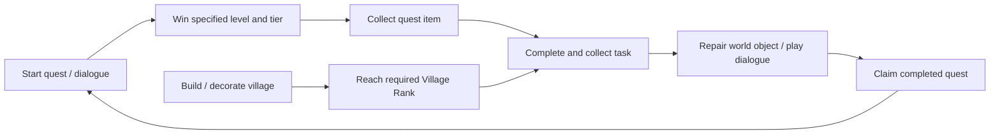

# Tropicats: story, progression, and puzzle implementation

Inspected 2026-11-11: the locally supplied `reference/Tropicats.app`, version
**2.5.11**, build **87469365**, and the public configuration and level bundles
named in that app's embedded manifest. This is a static resource and metadata
analysis, not a playthrough or a recovery of the original C# source. Spoilers follow.

The [design reference](tropicats-reference/README.md) expands this overview into
an element dictionary, board-design examples, all 70 chapters and 1,217 story
tasks, and concrete adaptation guidance for Relic Rush and Christmas Market.

Browse the extracted puzzles with the [local level atlas](../tools/tropicats-viewer/README.md):
run `python3 tools/tropicats-viewer/serve.py` and open <http://127.0.0.1:8765>.
The viewer also supports [original sprites extracted from the installed app](../tools/tropicats-viewer/ART.md),
with an explicit random-fruit preview and exact data inspection.
It compares all three tiers, displays objectives and board layers, and provides
cell-level inspection and changes relative to easy.

## What is actually there

| Measure | Verified result |
| --- | ---: |
| Numbered campaign levels | **2,730**, contiguous from 1 to 2,730 |
| Configured and decoded tier variants | **8,190**: a, b, c for every number |
| Additional unsuffixed puzzle assets | 500, numbered 0001–0500 |
| Level data bundles | 41 |
| Story chapters | **70** |
| Quests | **274** |
| Quest tasks | 1,217 |
| Story ending requirement | Level 2730c and Village Rank 137, within the final quest |
| Post-story selection table | 5,278 distinct references to existing numbered tiers |

The 500 unsuffixed assets are additional representations of existing numbers,
not levels 2731–3230. The app also contains a separate single-tier configuration;
its bundled `single_tiers` feature switch is false. Do not count every TextAsset
as a separate campaign level. Likewise, 8,190 means tier definitions, not 8,190
unrelated board shapes. Event and daily modes are separate from this campaign count.

Chapters 1 and 2 each contain five levels and one quest. Chapters 3–70 each
contain forty levels, normally four ten-level quests:

`5 + 5 + 68 × 40 = 2730`; `1 + 1 + 68 × 4 = 274`.

The 41 delivery areas are not the 70 story chapters. They package groups of 10,
40, or 80 levels for downloading. Six island IDs occur in the island-area table.

## How playing advances the story

The player is the Chief helping a village of cats rebuild after an earthquake.
Puzzle victories supply specific quest items. Completing a task can repair an
object, play a conversation, or satisfy a village-rank requirement. Claiming a
quest moves the story forward and unlocks subsequent puzzles.

For a campaign rewrite, the story handoff explains each unit and follows a
quest from setup to tasks, world changes and dialogue. [Story handoff](tropicats-reference/STORY.md#start-here-when-writing-a-new-campaign)



This is more tightly scripted than a generic pool of stars spent on arbitrary
renovations. `questconfig.task_levels` explicitly maps each quest item to level
numbers and tiers. Across the complete quest table, every campaign number occurs
exactly once with a required tier: **714 a, 975 b, and 1,041 c** references. That
does not establish the minimum number of attempts or wins needed by a player;
tier unlocking and village-rank work can add play.
Required item quantities differ from the number of listed tier tokens in 37
tasks. Keep the two values separate when interpreting the extract. [Task fields](tropicats-reference/STORY.md#how-to-read-a-chapter)

For example, the opening quest `chp1_q1` requires:

| Task | Puzzle victories | Result |
| --- | --- | --- |
| Shovel ×1 | 1a | Clear `ch1_rubble` |
| Bamboo ×1 | 2a | Restore `ch1_totem_place` |
| Log ×3 | 3a, 4a, 5a | Repair `ch1_totem` |

The second quest repairs Elsie and Kip's home using levels 6a–9a, then returns
their pet crab using 10a. Later quests mix tiers: `chp3_q3`, for example, uses
31a, 32b, 33a, 34a, 35b, 36a, 37c, 38a, 39a, and 40b.

Village progression is an independent gate. `chp3_q2` requires Village Rank 2;
`chp3_q4` requires Rank 3. There are **136 `reach_rank` tasks**, alongside
**194 `collect_and_repair`** and **887 `collect_and_interact`** tasks. The final
quest spans levels 2721–2730 and requires Rank 137. The default quest reward in
the bundled table is ten diamonds; this is a configuration value, not a promise
about rewards in every live account.

## The story's major arcs

These are summaries of the English quest recaps and dialogue, not invented
bridges between chapter titles.

| Chapters | Levels | Narrative movement |
| --- | --- | --- |
| 1–3 | 1–50 | Restore the Great Totem and homes; discover that someone deliberately cut the totem down; enlist Cubby to investigate. |
| 4–8 | 51–250 | Suspect a visiting dog, try to trap him, then heal him. Ragnaruff rescues the kittens and challenges the cats' assumptions about dogs. |
| 9–12 | 251–410 | The elder's scheme and Tika's anger explain the original disaster. The story then turns to Cubby and Olivia's marriage and the birth of their twins. |
| 13–16 | 411–570 | Open the island to visitors. Pirate Blacktail arrives; his mother, the Duchess, disrupts his relationship with Elsie. |
| 17–22 | 571–810 | Inventors, Felicity's farm, apparent haunting, and a lost puppy lead into the search for Ragnaruff's home. |
| 23–30 | 811–1130 | Nordog Island, impending cat–dog war, and the Island of the Ancients. Sylvia is revealed as Taka's mother; the supposedly lost parents and the Chief's origin become central mysteries. |
| 31–38 | 1131–1450 | Catton Abbey, the Duchess and Angus McYowler, investigations and family history; a new lead points to Elsie's mother on Furrenze Island. |
| 39–46 | 1451–1770 | Furrenze's art and performance stories, parents and inventors, ancient mercat remains, and an attempt to fly home. |
| 47–54 | 1771–2090 | Crash-land at Felicity's farm; pursue inventions and a way home. Purrcini's navy intervenes; Blacktail surrenders and Elsie takes command to seek help. |
| 55–62 | 2091–2410 | School and rivalry on Nordog Island, Gruffgar and Sylvia, hockey, reconciliation and education. |
| 63–68 | 2411–2650 | Alternate-world counterparts, crystals and manipulation; the evil Tropicats become the threat, and their totem is destroyed. |
| 69–70 | 2651–2730 | Confront the Queen and Purrcini. Blacktail returns; Elsie briefly becomes queen, then the Chief takes the crown. Return home for a farewell with the cast. |

The ending is explicit: `chp70_q4` is a farewell quest with visits to friends
and a final Elsie conversation. There is no chapter 71 in the inspected chapter,
quest, or English chapter-title tables. This supports a completed authored story,
not a claim that the live service has no other activities or server overrides.

## How the story is implemented

The app uses **Unity 6000.0.59f2** and contains **IL2CPP metadata version 31**.
The managed class/member names survive in `Data/Managed/Metadata/global-metadata.dat`.
The executable logic is compiled; the following architecture is supported by
configuration schemas and symbols, with exact method bodies unverified.

| Layer | Evidence | Responsibility |
| --- | --- | --- |
| Chapter index | `chapterconfig.json` | Chapter number, first level, starting quest ID |
| Quest definitions | bundled `questconfig` | Character, item counts, required tiers, action targets, presentation order and localization override |
| Quest runtime | `QuestManager`, `QuestService`, `QuestTaskHandler` | Task progress, completion/collection, quest availability, next quest, level locks |
| World actions | `RepairBuildingsByTagAction`, `CollectAndRepairTaskHandler`, `CollectAndInteractTaskHandler` | Turn task completion into a tagged world change or interaction |
| Dialogue staging | `storydialogueconfig.json` | Trigger, island, world location, participants, camera behavior, per-character animation |
| Dialogue runtime | `StoryController`, `StoryDialogueFlow` | Queue and play dialogue flows; react to task completion |
| Localized copy | English localization MonoBehaviour in `resources.assets` | Final text addressed by dialogue/quest keys |
| Saved progression | `QuestProgressCollection` and bundled sample state | Completed/collected quests, task progress, completed quest dialogues |

`storydialogueconfig.json` has **1,689 setup rows** and **16,884 detail rows**.
Only **10,969** detail rows carry a sentence field; others are animation/staging
commands. These counts include legacy and tutorial entries, not necessarily
unique scenes reachable in a current playthrough.

Setup triggers include `quest_start`, `quest_task_completed`,
`claim_button_tapped`, `level_completed`, and `tutorial`. A setup names a world
`place`, `island_id`, comma-separated characters and `camera_after`. Detail rows
name the speaker, sentence index, animation and sometimes exit/emoticon commands.
Keys such as `dialogue.story.t1chp1_q1.1` join staged sentences to localized text.

**Use localization for story analysis.** Some configuration `text` fields contain
old draft or placeholder wording that differs from the English localization.
Treating every embedded draft as displayed dialogue would misrepresent the game.
The English table has 20,310 entries, of which 10,733 start `dialogue.story.`;
that also includes retained variants and does not equal a runtime line count.

`QuestProgress` exposes states including unstarted, started, completed and done;
`QuestProgressCollection` separates completed quests, collected quests and played
quest dialogues. This supports a completion/claim/playback distinction. The
precise transition order and save reconciliation require method-level analysis
or runtime tracing beyond this inspection.

The app ships fallback JSON and a CDN manifest. Its small `config` bundle holds
chapter indexes, story staging, village/building configuration and level indexes.
The `levels_area_N` bundles hold puzzle definitions. `content_unlock` also retains
dated quest releases from 2020, evidence of incremental content delivery.

## How match-3 levels are structured

All **8,690 decoded puzzle assets** have **81 field positions**, corresponding
to a 9×9 board envelope with inactive cells shaping the playable area. They are
JSON TextAssets with `data`, `layout` and `collectable` sections.

| Section | Contents |
| --- | --- |
| `data.moves` | Per-variant move budget |
| `data.gems` | Gem/color configuration, amounts and optional period/max/usage fields |
| `data.objectives` | Explicit typed goal counts where used |
| `data.spawnRatios` / `spawnRatioDroppable` | Typed spawning parameters, probability and min/max bounds |
| `layout.fields` | Playable-cell mask |
| `layout.tiles`, `stones`, `chains`, `crates` | Cell layers for terrain and obstacles |
| `layout.spawning`, `dropItems`, `climbers`, `portals` | Spawn/exit and movement-related cell layers |
| `layout.gemColors`, `gemTypes`, optional `gemModifier` | Initial piece placement and properties |
| `layout.hiddenItems` | Hidden-object placements |

Some goals derive from the layout: an empty `data.objectives` array does not
mean a level has no objective. Metadata includes `LevelConfig.UpdateObjectives`
and layout counters for hidden items, treasure and unwatered fields. Numeric
tile/gem enum values are now mapped in the [mechanics dictionary](tropicats-reference/MECHANICS.md).
The exact runtime spawn-probability calculation remains unverified.

The campaign index classifies levels into these primary objective families:

| Config identifier | Numbered levels |
| --- | ---: |
| `treasure` | 414 |
| `water` | 412 |
| `climber` | 410 |
| `droppable` | 389 |
| `hiddenitem` | 375 |
| `resistant_blocker` | 324 |
| `chameleon` | 218 |
| `recipe` | 188 |

The localization calls `droppable` goals Turtles and `hiddenitem` goals Statues.
These counts describe the primary index label, not every obstacle or secondary
condition present on a board.

Variants are separately authored data. Level 1 demonstrates the differences:

| Asset | Moves | Rescue (`climber`) target | Cells containing stones |
| --- | ---: | ---: | ---: |
| `0001a` | 30 | 1 | 0 |
| `0001b` | 25 | 1 | 9 |
| `0001c` | 25 | 2 | 14 |

All three retain 54 playable cells. The stone values include different strengths;
the last column counts occupied cells, not total hits required. Harder variants
do not universally reduce moves: level 8 uses 35/38/41 moves with changed board
layers. Difficulty therefore combines layout, targets, spawn settings and budget.

The foreshadowing table schedules new concepts: stones at level 3, statues at 6,
turtles at 11, chains at 13, recipe goals at 15, ice at 21, cannonballs at 35,
portals at 51, and crates at 67. This is the presentation schedule; a harder
variant of an earlier number can already contain an obstacle.

## Evidence, reproduction and limits

The local working data is in ignored `reference/tropicats-analysis/`:

- `bundled/157_questconfig` and `bundled/english.json`: quest rules and localized copy.
- `config/`: twelve decoded configuration files.
- `levels/`: all 8,690 decoded puzzle JSON assets.
- `bundles/`: the downloaded config and 41 level bundles.
- `audit.json`: independently recounted totals, cross-reference checks, source URLs and SHA-256 fingerprints.
- `metadata-symbols.txt`: identifiers from the IL2CPP metadata string table.

The third-party game content is retained only in the ignored local reference
directory. The committed files are this analysis and the read-only auditing tool.
No game code, artwork, binaries or game saves were changed. No native instructions
were patched or executed as part of the inspection.

The temporary reader environment plus extraction occupied approximately 112 MB
before the final audit output. Downloads were about 1.62 MB total. No textures,
audio, models or large art bundles were downloaded.

To recount using the retained inputs:

```sh
/tmp/tropicats-inspect-venv/bin/python tools/inspect_tropicats.py \
  reference/Tropicats.app reference/tropicats-analysis/bundles \
  > reference/tropicats-analysis/audit.json
```

The optional external dependency is `UnityPy==1.25.4`; install it in an isolated
environment if the temporary one has expired. Public bundle URLs are derived
from `CDNConfig.json` plus the exact filenames in `assetbundles_hd`, and recorded
in `audit.json`. The config response matched its declared size; 39 level-bundle
responses differed slightly from embedded size metadata. All decoded correctly,
and the audit records actual lengths and hashes. These responses should not be
described as byte-identical to the historical manifest's original artifacts.

The audit checks contiguous level numbering, complete a/b/c coverage, duplicate
asset names, all quest tier references, exactly one quest reference per campaign
number, and all post-story tier references. It does not prove every puzzle is
solvable or every story trigger reachable. Server-specific overrides and live
experiments were not queried. The count is for this app's referenced content set.

Wooga's public [level-design account](https://medium.com/@april.harmon/tropicats-behind-the-scenes-how-a-match-3-level-is-made-977a77ca9b4b)
describes iterative authored puzzles and telemetry-informed balancing. Its
historical example of two chapters containing eighty numbered levels and 240
difficulty challenges agrees with the structure found here; it is not used as
the source for the current resource count. Wooga separately documents
[daily Challenges](https://wooga.theymes.com/hc/en/tropicats/articles/what-are-the-challenges-345).

## Complete chapter index

Titles below are the chapter labels in the supplied English localization;
ranges come from `chapterconfig.json` and the verified campaign endpoint.

| Chapter | Title | Levels |
| --- | --- | --- |
| 1 | Totem Troubles | 1–5 |
| 2 | A Mew Beginning | 6–10 |
| 3 | The Totem Cutter | 11–50 |
| 4 | On The Prowl | 51–90 |
| 5 | Eternal Enemies? | 91–130 |
| 6 | Heating Up | 131–170 |
| 7 | A Fair Trial | 171–210 |
| 8 | Who's A Good Boy? | 211–250 |
| 9 | The Great Kikuna | 251–290 |
| 10 | Taming Tika | 291–330 |
| 11 | I Do, I Mew | 331–370 |
| 12 | Purrenthood | 371–410 |
| 13 | The Beacon | 411–450 |
| 14 | Pirates of the Sea of Slobber | 451–490 |
| 15 | Mummy's Boy | 491–530 |
| 16 | Bad Romance | 531–570 |
| 17 | Enter The Inventor | 571–610 |
| 18 | Age Of Purrgress | 611–650 |
| 19 | Felicity's Farm | 651–690 |
| 20 | Fowl Play | 691–730 |
| 21 | A Way Home? | 731–770 |
| 22 | The Dream Harvest | 771–810 |
| 23 | A Hero's Welcome | 811–850 |
| 24 | Dogs Of War | 851–890 |
| 25 | A Trial Of Guts | 891–930 |
| 26 | Hail To The King | 931–970 |
| 27 | The Mother's Truth | 971–1010 |
| 28 | Toil And Trouble | 1011–1050 |
| 29 | Trouble In Paradise | 1051–1090 |
| 30 | The Truth About Chief | 1091–1130 |
| 31 | The Shabby Abbey | 1131–1170 |
| 32 | Unfortunate Son | 1171–1210 |
| 33 | Courting Disaster | 1211–1250 |
| 34 | Ode To A Highland Cat | 1251–1290 |
| 35 | Whodunit?! | 1291–1330 |
| 36 | The Ham Of The Whiskervilles | 1331–1370 |
| 37 | Night Of The Living Cat | 1371–1410 |
| 38 | The Highlander And The Duchess | 1411–1450 |
| 39 | Artistic Differences | 1451–1490 |
| 40 | Purrformance Of A Lifetime | 1491–1530 |
| 41 | Of Art And Memory | 1531–1570 |
| 42 | The Worst Show On Earth | 1571–1610 |
| 43 | Renaissance Cat | 1611–1650 |
| 44 | Dubious Parentage | 1651–1690 |
| 45 | The Mother Of Invention | 1691–1730 |
| 46 | Flight Of The Tropicats | 1731–1770 |
| 47 | Unhappy Landings | 1771–1810 |
| 48 | Captains Of Industry | 1811–1850 |
| 49 | Felicity's Feast | 1851–1890 |
| 50 | All Work And No Play | 1891–1930 |
| 51 | New Purrspectives | 1931–1970 |
| 52 | Furgive And Furget | 1971–2010 |
| 53 | Purrcini's Cannon March | 2011–2050 |
| 54 | A Meow For Help | 2051–2090 |
| 55 | Herding Kittens | 2091–2130 |
| 56 | Too Mewl For School | 2131–2170 |
| 57 | Ain't Misbehavin' | 2171–2210 |
| 58 | To Furgive Is Divine | 2211–2250 |
| 59 | A Song Of Ice And Felines | 2251–2290 |
| 60 | Cats Rule, Dogs Drool | 2291–2330 |
| 61 | Sylvia's Scheme | 2331–2370 |
| 62 | Lily The Learned | 2371–2410 |
| 63 | Yarn Theory | 2411–2450 |
| 64 | Hisstaken Identity | 2451–2490 |
| 65 | Be Mine | 2491–2530 |
| 66 | The Return Of Blacktail | 2531–2570 |
| 67 | Tropicruel Cats | 2571–2610 |
| 68 | Cat Scratch Fever | 2611–2650 |
| 69 | Impurrial Interference | 2651–2690 |
| 70 | The Fate of the Crown | 2691–2730 |
