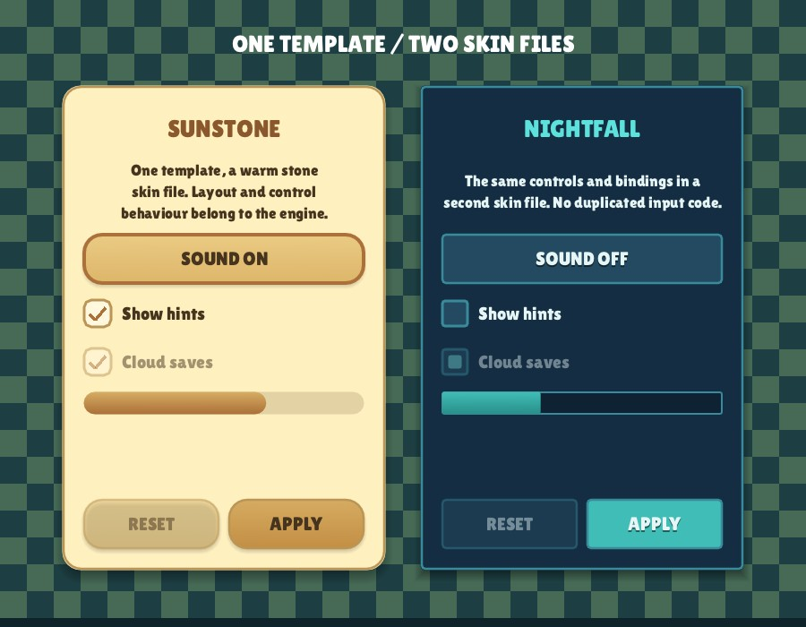
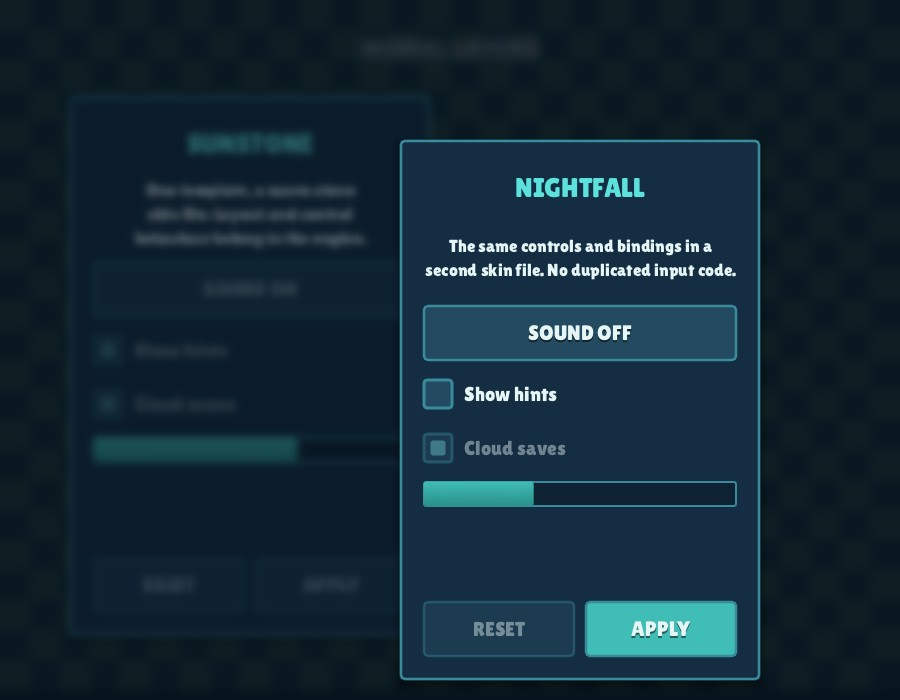

# Shared UI engine

The engine owns form resources, layout, controls, interaction/focus, model exchange
and modal composition. A game supplies its skin, model and action handlers. This
work is tracked in [issue #12](https://github.com/corepunch/nile-archive/issues/12).



## Resource and model exchange

The approach follows Orion's [declarative dialogs and DDX](https://github.com/corepunch/orion-ui/blob/1cf7e7272ab68665615c7c8b307b612e0b62c26a/docs/dialogs.md): a resource defines controls and a static binding table maps control IDs to model fields.
The [identity dialog](https://github.com/corepunch/orion-ui/blob/1cf7e7272ab68665615c7c8b307b612e0b62c26a/apps/gitclient/dialogs/dlg_identity.c) demonstrates push on opening, pull on acceptance, and game/application-owned actions. Here, Lua field paths replace C struct offsets; the renderer and input primitives remain native C.

```lua
local settings = {audio = {sound = true}}
local form = ui.form{
    root = {kind="column", panel=true, padding=24, gap=16, children={
        {kind="label", text="Settings", height=44, role="title"},
        {kind="toggle", id="sound", height=48,
         on_text="Sound on", off_text="Sound off"},
        {kind="button", id="accept", text="Apply", height=48, accent=true},
    }},
    bindings = {{id="sound", field="audio.sound", type="boolean"}},
}
assert(form:push(settings))
-- In the frame, after drawing the game:
ui.modal_layer(7, color(5,22,22,185))
local action = form:draw(rect(40,200,400,260), skin)
if action and action.id == "accept" then
    local ok, message = form:pull(settings)
    if ok then close_settings() else show_validation(message) end
end
```

`push(model)` validates and populates the controls. Editing changes the form's
values; the model changes only on `pull(model, validator?)`. Pull first validates
**all** fields and the optional validator, then commits them together. Cancelling
can discard the form without touching the model. Both return `ok, message?`.

Bindings have `id`, `field`, `type` (default `string`), optional `min`, `max` and
`readonly`. Types are `string`, `boolean`, `integer`, `number`, `texture`.
Paths such as `audio.sound` and `cost.1` support tables and numeric array keys.
Readonly bindings populate display controls but do not write back. False booleans
are preserved. Missing paths, wrong types and invalid ranges reject transfer.
Use `form:set(id,value)` / `form:get(id)` for computed display data; `form.values`
also holds visibility/enabled predicates.

## Layout and controls

| Node | Responsibility |
| --- | --- |
| `column`, `row` | Automatic flow with padding, gaps, fixed lengths and weighted `grow` |
| `list` | Data-backed row/column stack, populated with `form:set_items(id,records)` |
| `overlay` | Children share the same content bounds |
| `label` | Text/formatting, optional wrap, style or semantic role |
| `image` | Bound/authored texture, fitted to its allocated bounds |
| `button` | Command ID; pointer, disabled, focus and keyboard activation |
| `toggle` | Bound boolean with on/off captions; same interaction as a button |
| `checkbox` | Bound boolean drawn as a box, a mark when checked, and its caption; same interaction as a toggle |
| `progress` | Bound fraction through the engine meter |
| `spacer` | Fixed or flexible space |
| `custom` | Game-specific painting inside engine-assigned bounds |

Every node may have `width`, `height`, `min_width`, `min_height`, `grow`, `padding`,
`gap`, `visible=false`, or `visible_field`. Containers support cross-axis
`align="start|center|end|stretch"`. Buttons support `enabled=false`,
`enabled_field`, `accent` and `flat`. Interactive controls require unique string
IDs. Templates reject duplicate IDs, unknown kinds, invalid sizes/bindings and
excessive nesting. Construction copies the node tree so instances have independent
layout, values and focus.

Labels support `text_align="start|center|end"` (default `center`). Icon-and-copy
rows use `start` for both title and wrapped description. A row measures fixed
icon/control widths first, then wraps flexible copy in the remaining width;
its measured height grows with the text.

### Data-backed stacks

```lua
local help = ui.form{kind="list", id="topics", gap=12, item=function(record)
    return {kind="row", gap=14, align="center", children={
        {kind="image", image=record.icon, width=64, height=64, visible=record.icon~=nil},
        {kind="column", grow=1, gap=4, children={
            {kind="label", text=record.title, wrap=true,
             text_align=record.icon and "start" or "center"},
            {kind="label", text=record.description, wrap=true,
             text_align=record.icon and "start" or "center"},
        }},
    }}
end}
assert(help:set_items("topics", records))
```

The source is a dense array of records with stable string/integer `id` keys
(override the field with the list's `key`). The builder returns an ordinary node
resource; the engine instantiates, measures and stacks it. `direction="row"`
selects a horizontal list; the default is `column`. Rows are cached between
frames. Call `set_items` again to refresh/reorder the source or pass `{}` to clear
it. The engine validates the complete replacement before committing it, so bad
keys, malformed rows or builder errors preserve the current list.

Control IDs and visibility/enabled references are scoped to each record. Stable
keys preserve keyboard focus across reordering; removal releases it. Row actions
include `{id,kind,value,source,key}`: the action/control ID, list ID and record
key let the game update its model and refresh the source. Source records remain
game-owned. `node.value` supplies an initial control value on refresh. Generated
control IDs are available through `form.nodes`/`form.boxes` for inspection.

`form:measure(width,skin)` gives intrinsic width/height.
`form:layout(bounds,skin)` exposes ID-to-rectangle results for inspection/tests.
`form:draw(bounds,skin,options?)` lays out, paints and returns one action
`{id,kind="click|change",value}` or nil. `options.interactive=false` disables input
for a lower modal; `options.input` can supply a test input snapshot; `options.hit_offset` aligns hit
regions with a skin’s translated/animated painting. Tab moves
focus in resource order; Return/Space activate the focused control. Disabled
controls are excluded. Pointer activation uses the engine's press-origin and drag
rules. Touch has no artificial hover state.

## Skins

Each game describes its look in **one skin file**, for example
[`games/relic-rush/lua/skin.lua`](../games/relic-rush/lua/skin.lua). The file
returns `ui.skin{...}`: fonts, named colours, images, text styles and, for every
control, what each interaction state draws. `ui.skin` (in `engine/ui_skin.lua`)
compiles it into the paint contract below, so the result goes straight to
`form:draw`, `form:measure` and `ui.modals`. The same object paints hand-placed
widgets, so a game's forms and its own buttons can't drift apart. The engine
still owns layout, hit testing, focus, activation and data exchange.


```lua
-- games/<game>/lua/skin.lua
return ui.skin{
    fonts = {display = {path = "fonts/LilitaOne-Regular.ttf", scale = 1}},
    colors = {ink = "#47341E", sand = "#EBCB84", rim = "#BB9555", rust = "#AC713A"},
    text = {
        body = {font = "display", em = 23, fill = "ink"},
        muted = {extends = "body", fill = "#47341E80"},
        button = {font = "display", em = 24, fill = "ink", outline = "#00000040", outline_width = 1},
    },
    roles = {title = {text = "title", em = 31}},     -- a node's role picks a style
    controls = {
        panel = {normal = {layers = {{fill = "#FFF0C0", radius = 20}, {border = "rim", width = 1.5, radius = 20}}}},
        button = {
            text = "button",
            normal = {layers = {
                {shadow = "#00000040", radius = 20, blur = 8, offset = {0, 3}, fixed = true},
                {name = "body", fill = "sand", radius = 20},
            }},
            hover = {set = {body = {fill = "#FFE3A1"}}},
            pressed = {offset = {0, 2}},
            selected = {set = {body = {fill = "rust"}}},
            disabled = {text = "muted", set = {body = {fill = "#EBCB8480"}}},
            variants = {accent = {normal = {set = {body = {fill = "#D6AC62"}}}}, flat = {normal = {layers = {}}}},
        },
        toggle = {extends = "button"},
        checkbox = {size = 30, gap = 12, text = "body",
            box = {normal = {layers = {{name = "face", fill = "#FFF8DE", radius = 8}}}, pressed = {set = {face = {fill = "sand"}}}},
            mark = {normal = {layers = {{check = "rust", width = 3.5}}}},
            disabled = {text = "muted"}},
        progress = {track = {normal = {layers = {{fill = "#E3D2A4", radius = 12}}}},
                    fill = {normal = {layers = {{fill = "#D6AC62", radius = 12}}}}},
        label = {text = "body", wrap_text = "body", wrap_em = 20},
        focus = {normal = {layers = {{border = "rust", width = 2, radius = 22, inset = -3}}}},
    },
    theme = {dim = "#040F1996", backdrop_blur = 7},   -- native widgets and modal backdrops
}
```

**Fonts.** A name maps to a path (loaded once, shared by every skin) or to
`{path, scale}`, where `scale` converts the style's `em` to the engine's size
(Lilita One measures 1.17 em ascent to descent). `{font = f}` uses an
already loaded font. `skin:font(name)` returns it for the game's own text.

**Colours** are `"#RRGGBB"`, `"#RRGGBBAA"`, `{r, g, b, a}` or a name from
`colors`, which can name another entry.

**Text styles** have `font`, `em`, `fill`, `fill2` (vertical gradient),
`outline`, `outline_width`, `shadow`, `shadow_offset`, `shadow_blur`,
`tracking` and `extends`. Lengths are given at the style's `em` and scale with
the size a control asks for, so one outlined style serves every size. A node
chooses its style with `text_style`, its size with `em`, or both through `role`.

**Controls and states.** Each control has a look per state: `normal`,
`selected` (an on toggle, a checked checkbox), `hover`, `pressed` and
`disabled`. Looks merge over `normal` in that order, so a state names only what
differs: `layers` replaces the list, `set` patches named layers, `offset` moves
every layer that isn't `fixed`, and the caption, and `text` swaps its style.
Disabled controls never show hover or press. Keyboard focus is its own control,
`focus`, drawn around the focused one. `variants` apply for `flat`, `accent` or a
node's `role` and merge the same way. `extends` reuses another control.
A checkbox has `box` and `mark` looks (each with its own states), `size` and `gap`;
a progress bar has `track` and `fill`.

**Layers** draw in order inside the control's box:

| Layer | Draws |
| --- | --- |
| `{fill, fill2?, radius}` | Rounded rectangle, optionally a vertical gradient |
| `{border, width, radius}` | Rounded outline |
| `{shadow, radius, blur}` | Soft shadow |
| `{image, slice?, fit?}` | Authored art: stretched, `fit = "contain"`, or nine-slice with `slice = {left, top, right, bottom}` |
| `{check, width}` | A tick, for checkboxes without artwork |
| `{paint = function(box, node, state, skin)}` | Game code, for ornaments the table can't express |

Every layer takes `inset` (a number or `{left, top, right, bottom}`; negative
grows), `offset {x, y}`, `height_ratio` (keep the top fraction, for gloss) and
an optional `name` for `set` patches.

**Authored artwork.** A control drawn from images must name an image for every
state it supports; the engine never tints one state into another.
`skin:audit(required?)` lists `{control, state}` pairs whose images are missing
(by default hover, pressed and disabled; pass the game's own list per control),
for asset checks.

**Animated dialogs.** Set `skin.transform = function() return scale, offset, alpha end`
and every layer and caption follows the dialog's current scale, position and
opacity. Measurement always uses logical units, so layout doesn't change.

**Immediate mode.** Outside forms the same skin paints hand-placed controls:
`skin:draw_button(bounds, caption, opts)` returns true when clicked (`opts`:
`enabled`, `accent`, `flat`, `selected`, `role`, `hit_offset`), and
`skin:draw_checkbox(bounds, caption, value, opts)` returns the new value.
`skin:paint(kind, bounds, state, node)` and
`skin:paint_caption(kind, bounds, caption, state, node)` paint any control's
look for a state the game tracks itself, and `skin:text(name, em)` gives a text
style (following the transform) for free text.

**The paint contract.** Forms call `style(node)`, `panel(bounds, node)`,
`button(bounds, state, node)`, `button_text(bounds, caption, node, state)`,
`label(bounds, caption, node, style)`, `focus(bounds, node)`,
`checkbox(bounds, caption, node, state)`, `measure_checkbox(node, caption)` and
`progress(bounds, fraction, node)`. A compiled skin provides all of them. A game
can still pass a hand-written table with any subset, a native `theme`, `styles`
keyed by role/kind, or `button_states` textures; whatever it leaves out uses the
native look. `state` includes `hot`, `held`, `clicked`, `disabled`, `selected`,
`focused`. Theme changes are scoped to the form draw and restored. A skin's
`theme` fields override the engine theme current when the skin is compiled.

Relic Rush keeps its entire look in `lua/skin.lua`: four outlined text palettes,
the parchment panel, the jade button (pressed sinks it 2 units; disabled drains
its colour), the flat CLOSE variant and the focus ring. Its pause, building,
guide, shop and expedition dialogs and its island buttons all paint through it;
captures are pixel-identical to the hand-written paint code it replaced. Nile
Archive's build tray and Volcano's native widgets still use themes and paint
callbacks; moving them to skin files is the next step. Relic Rush's read-only
expedition HUD uses an engine row with computed labels. Its Explorer's guide uses a
stable-key source and one icon/copy row resource. The game paints authored icon
layers inside assigned bounds; the engine owns placement, wrapping, spacing and
the footer button. Nile Archive's city move strip also uses a form, with measured
rows, theme typography and validity-driven Confirm state. Native accent controls
measure and paint with `theme.accent_text`. Buttons reject a press that has
become a multi-touch gesture. Pointer activation requires a press that began on
visible UI: a control appearing under an existing world gesture cannot inherit
its release.

## Modal layers and input ownership



```lua
local modals = ui.modals(skin)
assert(modals:open("settings", form, settings, {width=400, blur=7}))
-- frame:
if modals:begin() then update_game() end -- disable underlying UI/world input
render_game()
local action = modals:draw(dt, {reduced_motion=reduced_motion})
if action and action.id == "accept" then
    if form:pull(settings) then modals:close(action.modal) end
elseif action and action.kind == "cancel" then modals:close(action.modal) end
```

`open(id,form,model,options)` pushes model values and a layer. Options include
`bounds`, `width`, `height`, `blur`, `dim`, `close_on_background` (default true), and a `cancel` command ID (default
`cancel`). Automatic bounds centre the measured form within the logical screen.
Each layer blurs/dims all earlier drawing; the next layer can blur the previous
dialog too. Only the top form receives input. Escape or a background tap emits
its cancel action. Set `close_on_background=false` for required confirmations.
A newly opened modal paints once with input disabled, so the release or
key that opened it cannot also press a newly appeared button or cancel it. The
next draw accepts input normally; lower layers remain inactive. This is covered
by the form test and Relic Rush's 390 x 844 expedition-browser input smoke test.

Custom painted dialogs share `ui.modal_dismiss(visible_bounds, options)`. It
registers the full bleed area for capture and returns true for Back or an eligible
background tap; the caller handles its cancel action. Options accept `input`,
`fresh`, `interactive` and `close_on_background`. The tap must be captured, begin
and end outside the visible dialog, and be free of dragging/multi-touch. An
inside-to-outside drag, an inherited world release or a fresh opening release
cannot dismiss. Pass actual transformed/safe-area bounds. Result screens can
omit the helper entirely when they require an explicit choice.

List actions retain their `source` list ID and stable item `key` through the modal
stack, so refreshing or reordering catalogue rows does not change their commands.
`close(id?)` closes only the top layer; duplicate open IDs are rejected.
`active()` reports whether any modal is open. Call `begin()` before underlying
widgets/update, then `draw()` after the game. Screen-wide blocking includes safe
areas. Reduced motion makes the backdrop transition immediate.

Existing screens can use `ui.modal_layer(radius,dim)` directly before their
custom dialog. `gfx.backdrop(radius,dim)` is the drawing-only equivalent. Drawing
order defines the layers; no per-game framebuffer management or duplicated world
rendering is required. `ui.modal_backdrop(t)` uses `ui_theme.backdrop_blur` and
`dim`; `story_style.backdrop_blur` enables the same engine effect for dialogue.
Zero blur preserves existing games' sharp backdrops.

## Gaussian renderer, verification and boundaries

The GPU resolves the current framebuffer, prefilters it in **two successive
half-size steps**, and runs a separable Gaussian at quarter resolution. It
computes contiguous Gaussian weights; adjacent taps share bilinear samples.
This avoids the grid/comb artifacts caused by spacing a tiny kernel apart. The
kernel is capped at 33 taps (at most 17 filtered samples per direction). Targets
are cached, reallocated on resize and released on renderer shutdown. Production
blur has no CPU pixel readback. Native GL, ES 3 and WebGL 2 use the same path.
The actual platform framebuffer, viewport, scissor and drawing state are restored.
On target/shader allocation failure it reports the problem and retains dimming.

A local Mac sample at 960×1800 measured **2.92 ms** for Gaussian blur **plus
synchronized RGBA readback**, averaged over 12 warm frames. The readback is in the
test only. This is a desktop measurement; mobile hardware performance is not yet
measured. `tests/test_backdrop.c` checks clip restoration, full-screen coverage,
sharp later drawing, nested blur, dim-only composition and resize/reallocation.
`tests/lua/forms.lua` checks binding transactions, layout/reflow, focus and
validation. `tests/lua/ui_skin.lua` checks skin compilation: colours, text
style inheritance and scaling, state merging and precedence, variants, the paint
transform, checkbox binding and keyboard input, immediate widgets and the audit. The real-window fixture checks bound toggles, deferred commit and
nested modal input.

```sh
make gen                         # after API, engine/ui_forms.lua, engine/ui_skin.lua or engine/city_smoke.lua changes
make CFLAGS="-O2 -g -Werror"
make test
make test-platform               # prefix with xvfb-run -a on Linux
./build/relic-rush --headless --mute --fresh --lua tests/fixtures/ui \
  --data games/relic-rush/data --size 900x700 --smoke
```

The fixture accepts `--nested --shot file.png`; without `--nested` it shows the
same template in two skin files (`tests/fixtures/ui/*_skin.lua`). `make shots` captures both. The runtime embeds
`engine/ui_forms.lua` and `engine/ui_skin.lua` through the generated `engine/ui_forms_lua.h`; native,
iOS and web games use the same implementation without extra game resources.

This core supports display, action and boolean controls (toggle and checkbox). Text-entry/IME, combo
boxes, scrolling containers, screen-reader integration and a visual resource
editor are not implemented here. Add those behaviours to the engine and extend
its tests/skin contract when needed. This is an adoption path for the existing
immediate-mode games, rather than a port of Orion's native window/message system.
