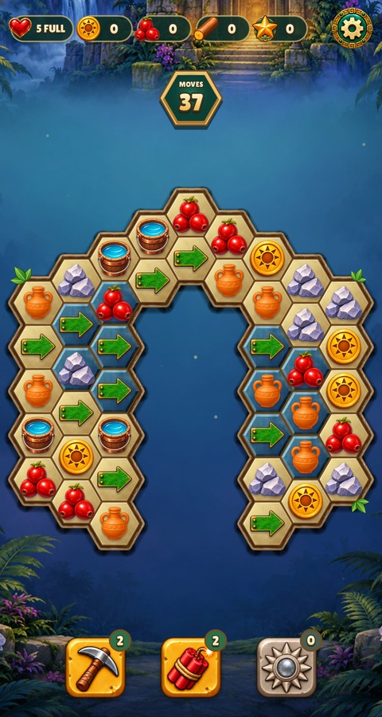
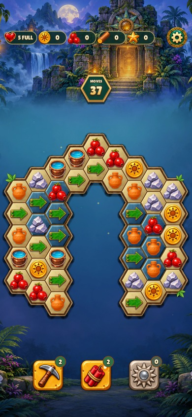
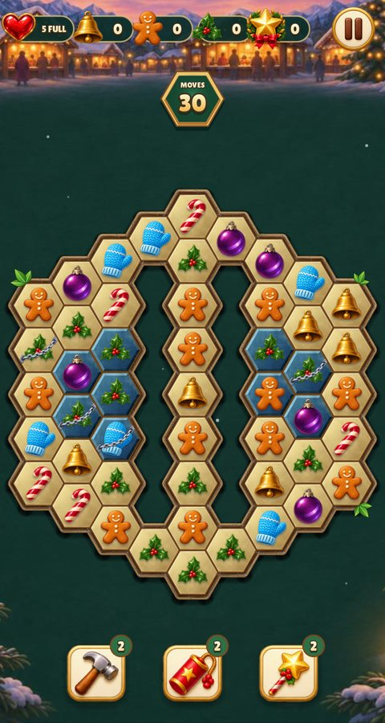
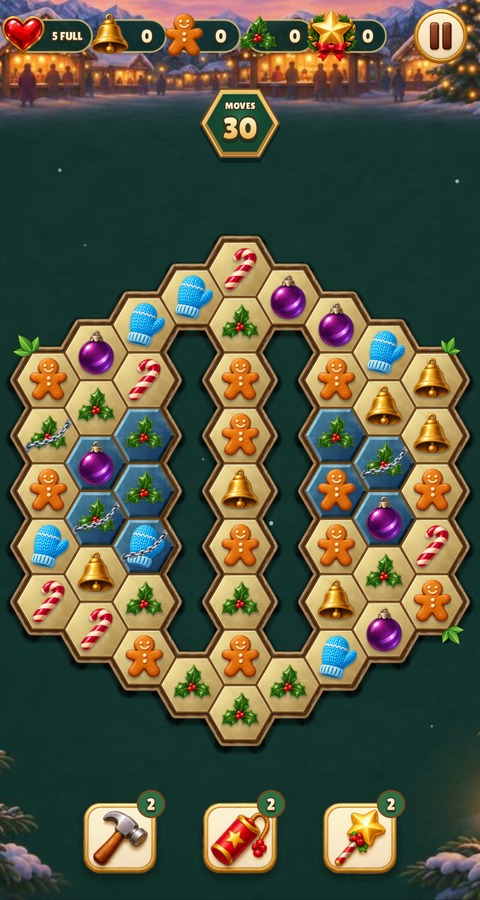
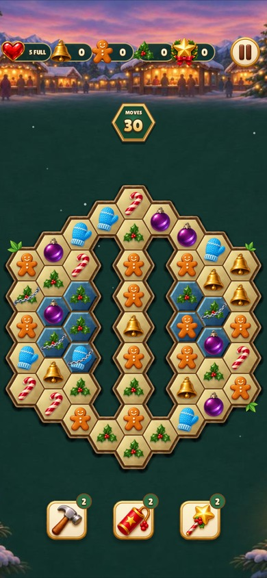
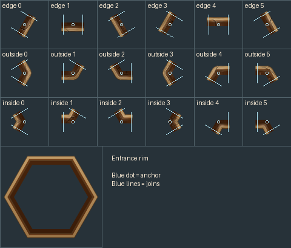

# Painted match-3 board frame

Relic Rush level 6 and Christmas Market level 4 exercise exposed edges, outward
tips and inward corners. Christmas Market's two enclosed openings use the same
frame pieces as the outside of the board.

| Board | Previous frame | Stone atlas in game |
| --- | --- | --- |
| Relic Rush, 480×900 |  |  |
| Relic Rush, 390×844 |  |  |
| Christmas Market, 480×900 |  |  |
| Christmas Market, 390×844 |  |  |

## Paint the frame

```sh
python3 tools/board_frame.py --output build/board-frame
python3 tools/board_frame.py --winter --output build/winter-frame
```

Use `stone.png` as the starter and `guide.png` as a separate reference layer.
The generator bakes the former dark-brown and tan bands using the same
seeded stone grain and cracks. Both games load their own copy at
`data/board-frame/stone.png`, which can be painted independently. The
generated files go to the output directory you specify.



The first three rows use 80×80 px slots. Each column is a direction of the
flat-top hex, counted clockwise from the right tip. The straight runs are
centred on edge midpoints. The outward and inward joins are centred on vertices.
Both the centre points and the join lines appear in blue in the guide.
The hex radius at this scale is 64 px. Keep the silhouette, join width and
matching paint across the join lines. The engine overlaps those joins by a
small amount to keep the stone continuous at both phone sizes. The 168×168 px
rim in the bottom left follows each cell's scale and rotation as it flies in.
The winter atlas adds a snowy north edge at `(240, 240)` in an 80×80 px slot.
Christmas Market uses it on the highest horizontal north rim edges with open
space above them. Stone inside an opening uses the bare slot.

The frame generator writes the stone atlas and guide. Pass `--game` to add
that game's ornament variants and export their Lua coordinates. The
[painted join review](../board-frame-decorations/baked.md) shows leaf and
festive artwork baked into the corner pieces.

## Reproduce the captures

```sh
build/test/all --suite=relic-rush --suite=christmas-market \
  "shot dressing-shore" "shot main-character-board" "shot phone-board" \
  "reel relic-rush-board-intro" "reel christmas-market-board-intro"
```

The 390×844 captures include the phone safe area. The baseline images come from
the preceding [board tile review](../board-tiles/README.md) with the same blue
tablet bevel and the original frame.
