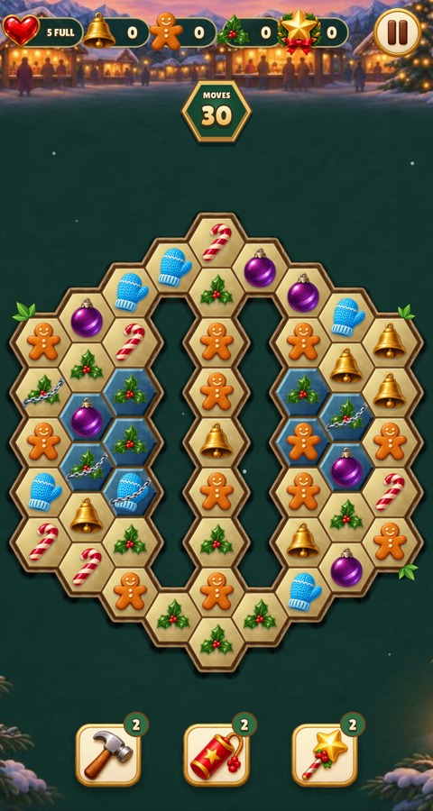
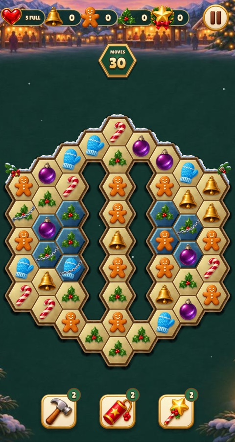
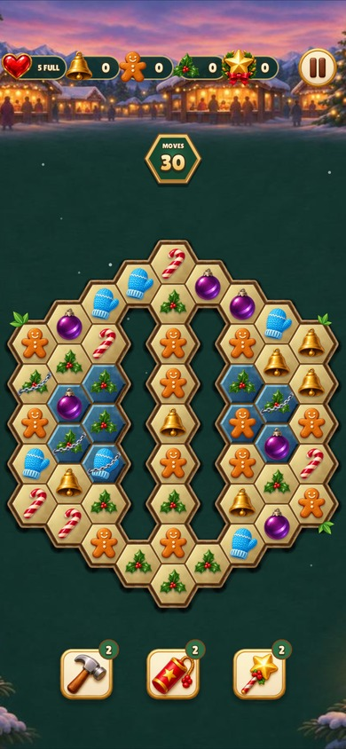

# Painted board decorations

Relic Rush level 6 has the repainted three-leaf sprig. Christmas Market
level 4 has snow along the exposed top rim, with a fir sprig tied with a red
ribbon and bell at the left shoulder and a fir sprig with a pinecone and
berries at the right. The stone atlas stays visible beneath the trim.

| Board | Before | Painted decorations |
| --- | --- | --- |
| Relic Rush, 480×900 |  |  |
| Relic Rush, 390×844 |  |  |
| Christmas Market, 480×900 |  |  |
| Christmas Market, 390×844 |  |  |

## Source and registration

The six sprites were painted together with the built-in ImageGen tool. The
inputs were the previous Relic Rush sprig from commit `f929f04c`, the local
Cradle of Rome reference `reference/cradle-of-rome/resources/textures/scenes/game/g_corners.png`,
and the [Christmas Market board](../board-frame-atlas/christmas-480-after.jpg).
[Source atlas](../../../engine/art/board-frame/decorations-source.png) ·
[Prompt](../../../engine/art/board-frame/decorations.prompt.txt) ·
[Crop and anchor settings](../../../engine/art/board-frame/decorations.json)

Each game loads separate 96×96 RGBA PNGs from `data/board-frame/`. The centre of
each sprite is its contact point at the stone. Registration crops and uniformly
scales each painting. It clears faint background alpha more than six source
pixels from the painted shape and carries the painted edge alpha into the
result. The sloped snow pieces also rotate by the few degrees needed for
the ±60° stone edges.

Paint the corresponding slot in the source atlas, then export the individual
PNGs. The stone [atlas generator](../board-frame-atlas/README.md) is independent.

```sh
python3 tools/board_frame_decor.py
python3 tools/board_frame_decor.py --check
build/test/all --suite=relic-rush --suite=christmas-market \
  "shot dressing-shore" "shot main-character-board" "shot phone-board"
```
