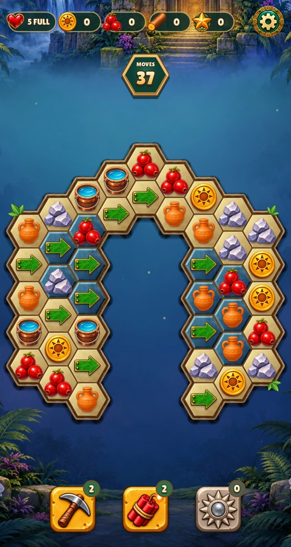
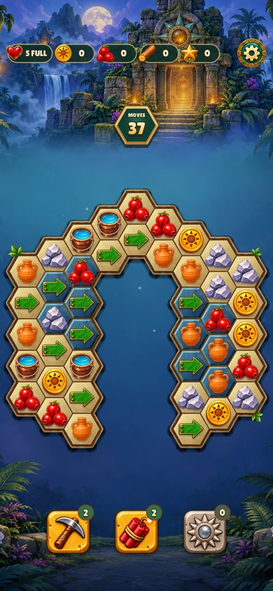
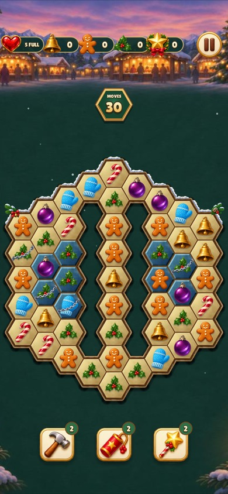

# Painted board decorations

[Current captures and hanging source art for the inner rim](interior.md).

Relic Rush level 6 has the repainted three-leaf sprig. Christmas Market
level 4 uses the winter stone atlas on the horizontal north-facing rim,
with a fir sprig tied with a red ribbon and bell at the left shoulder and
a fir sprig with a pinecone and berries at the right.

| Board | Before | In game |
| --- | --- | --- |
| Relic Rush, 480×900 |  |  |
| Relic Rush, 390×844 |  |  |
| Christmas Market, 480×900 |  |  |
| Christmas Market, 390×844 |  |  |

## Source and registration

The source art was painted together with the built-in ImageGen tool. The
inputs were the previous Relic Rush sprig from commit `f929f04c`, the local
Cradle of Rome reference `reference/cradle-of-rome/resources/textures/scenes/game/g_corners.png`,
and the [Christmas Market board](../board-frame-atlas/christmas-480-after.jpg).
[Source atlas](../../../engine/art/board-frame/decorations-source.png) ·
[Prompt](../../../engine/art/board-frame/decorations.prompt.txt) ·
[Crop and anchor settings](../../../engine/art/board-frame/decorations.json)

Each game loads separate 96×96 RGBA PNGs for its corner sprigs from
`data/board-frame/`. The centre of each sprite is its contact point at the
stone. Registration crops and uniformly scales each painting. It clears faint
background alpha more than six source pixels from the painted shape and
carries the painted edge alpha into the result.

The [stone atlas generator](../board-frame-atlas/README.md) uses the flat
snow painting for the winter atlas's north slot. In game, the highest
horizontal north edge in each column uses that slot.
Paint the corresponding source slot and regenerate the stone atlas or the
individual corner PNGs.

```sh
python3 tools/board_frame_decor.py
python3 tools/board_frame_decor.py --check
python3 tools/board_frame.py --winter --output build/winter-frame
build/test/all --suite=relic-rush --suite=christmas-market \
  "shot dressing-shore" "shot main-character-board" "shot phone-board"
```
