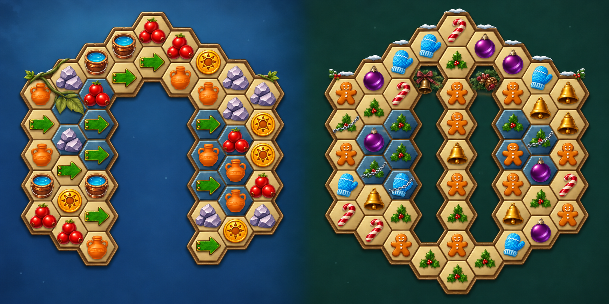
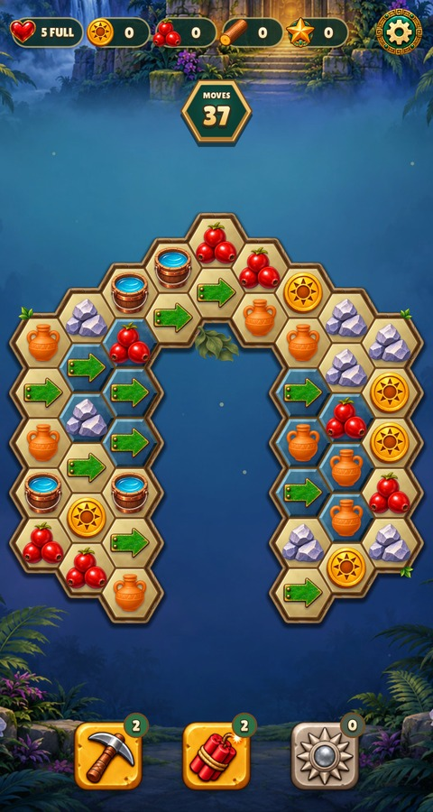
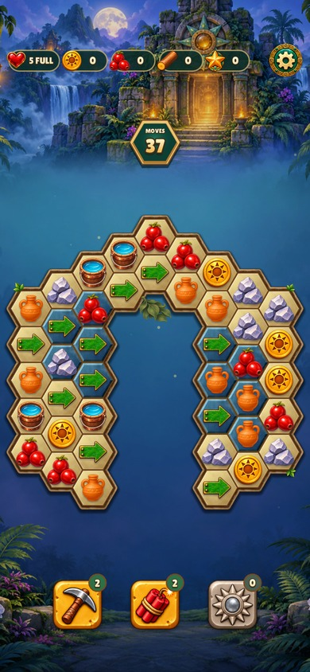
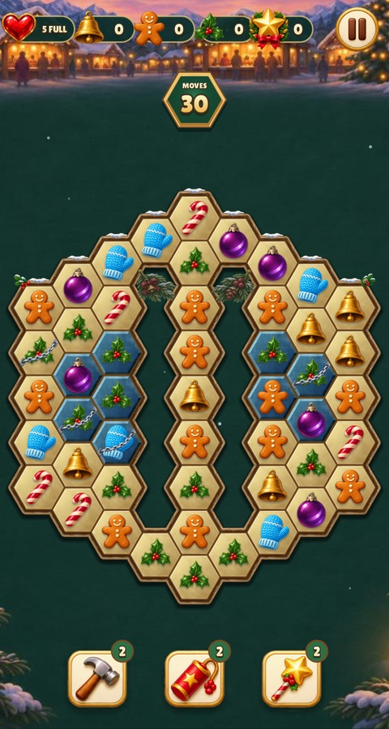
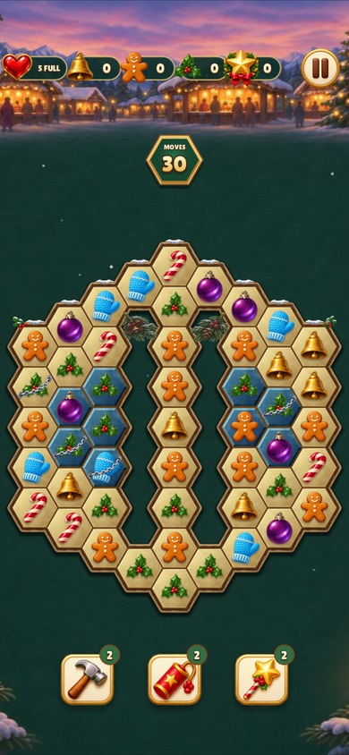

# Ornaments painted into the board rim

[Current front-facing artwork and placement review](front.md).

The ImageGen paint-over uses the two live board captures and Cradle of Rome's
corner sheet as inputs. The stems crossing the rim and their short contact
shadows informed the game atlas. The game uses its own flat-top hex geometry
and existing authored foliage to register each decorated join.



[ImageGen prompt](../../../engine/art/board-frame/baked-reference.prompt.txt)

| Board | Separate sprites | Painted frame pieces |
| --- | --- | --- |
| Relic Rush level 6, 480×900 |  |  |
| Relic Rush level 6, 390×844 |  |  |
| Christmas Market level 4, 480×900 |  |  |
| Christmas Market level 4, 390×844 |  |  |

[Christmas Market level 7 with painted joins on its open-top channel](christmas-open-baked.jpg)

Each variant combines one registered stone join, the authored ornament alpha
and a soft contact shadow on the stone. The generator crops and packs the
painted joins below the plain stone sections. The generated Lua companion
stores source rectangles and pivot offsets. The renderer selects a painted
join for each chosen outer tip or inner shoulder and uses the plain pieces for
the rest of the outline. The assets keep their muted colours and their
diagonal mounts into the first empty hex.

[Decoration source and placement recipes](../../../engine/art/board-frame/decorations.json) ·
[Relic Rush atlas](../../../games/relic-rush/data/board-frame/stone.png) ·
[Christmas Market atlas](../../../games/christmas-market/data/board-frame/stone.png)

```sh
python3 tools/board_frame.py --game relic-rush --output build/board-frame/relic-rush
python3 tools/board_frame.py --game christmas-market --output build/board-frame/christmas-market
build/test/all --suite=relic-rush --suite=christmas-market \
  "shot dressing-shore" "shot main-character-board" "shot phone-board" "shot designed-chambers"
```

For each game, copy `stone.png` to its `data/board-frame/` directory and
`board_frame_atlas.lua` to its `lua/` directory. `guide.png` previews the
plain sections and the decorated regions together.
