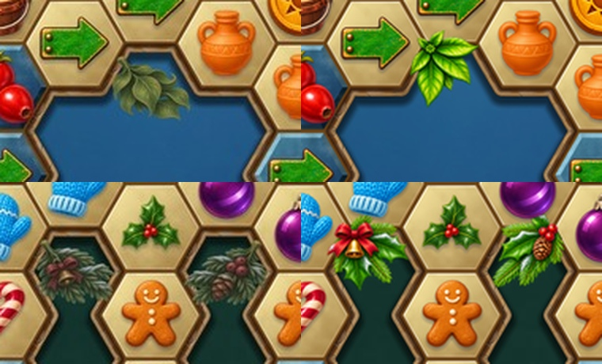
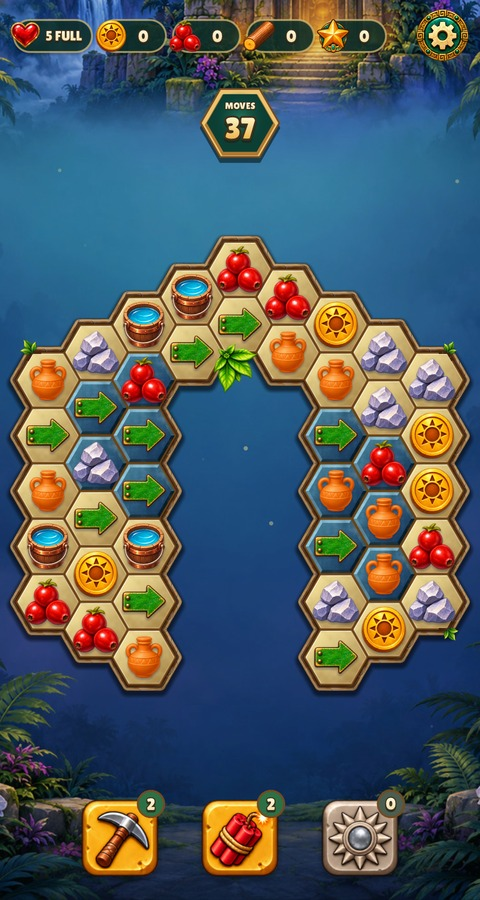
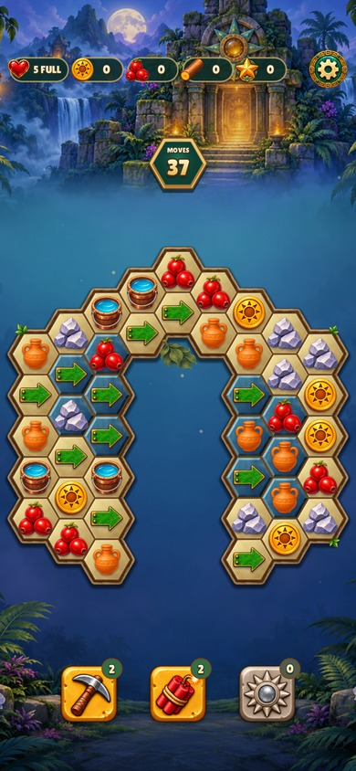
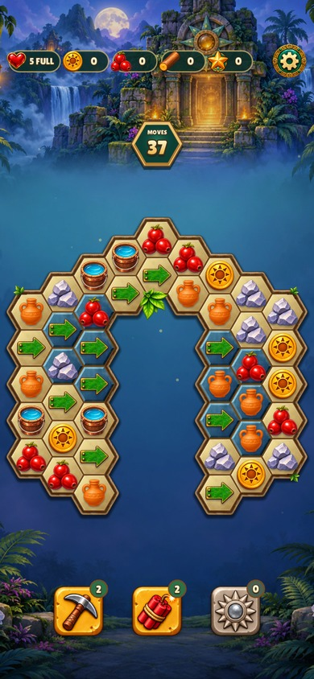
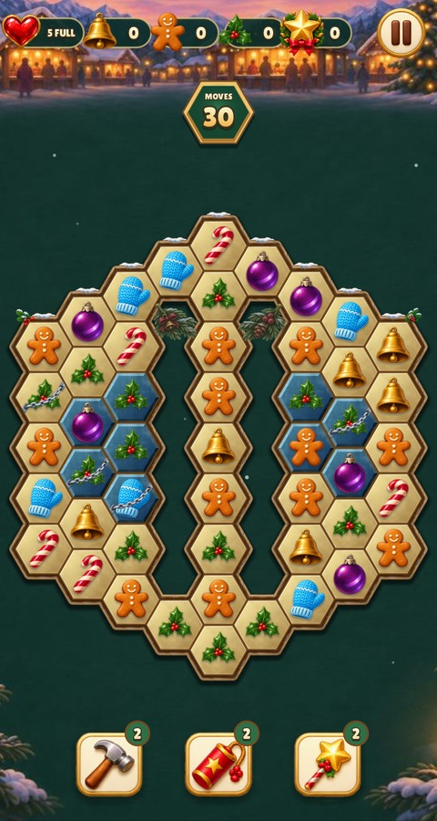
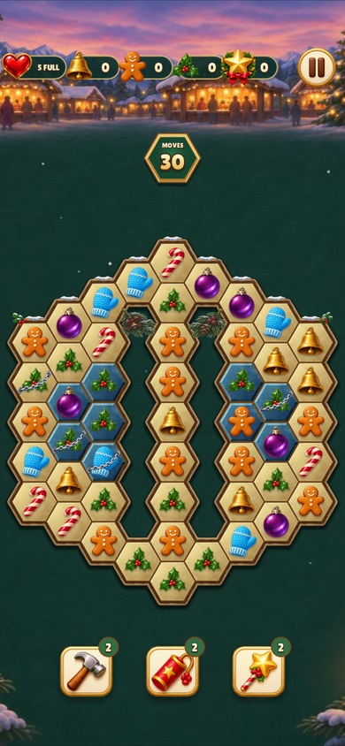
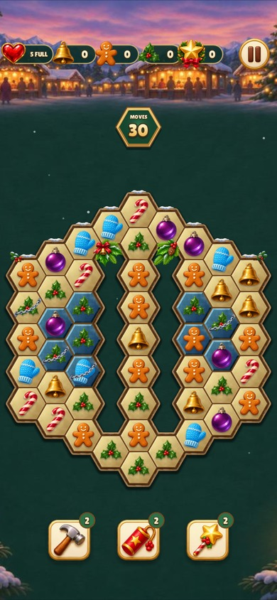

# Front-facing board ornaments

The new leaves show their broad faces, with the leaf hub, ribbon knot and
berry cluster seated over the stone corner. The foliage fans diagonally
into each opening. Its bright green and red midtones follow the Cradle of
Rome corner sheet.

Before on the left, after on the right. Relic Rush is above Christmas Market.

| Board | Before | Front-facing ornaments |
| --- | --- | --- |
| Relic Rush level 6, 480×900 |  |  |
| Relic Rush level 6, 390×844 |  |  |
| Christmas Market level 4, 480×900 |  |  |
| Christmas Market level 4, 390×844 |  |  |

The three ornaments were painted together with the built-in ImageGen tool
using the Cradle of Rome corner art and a [guide drawn from the game's hex rim](../../../engine/art/board-frame/rim-attachment-guide.png).
Registration crops and scales each painting around its hub. The frame
generator verifies that the hub covers solid stone and bakes a contact
shadow into the join. The engine draws the decorated join over the tile
faces and draws the playable pieces above it.

[ImageGen source strip](../../../engine/art/board-frame/rim-rosette-source.png) ·
[Prompts](../../../engine/art/board-frame/rim-rosette.prompt.txt) ·
[Crop and mount settings](../../../engine/art/board-frame/decorations.json) ·
[Atlas generation](baked.md)
