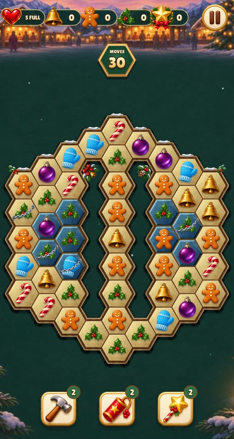
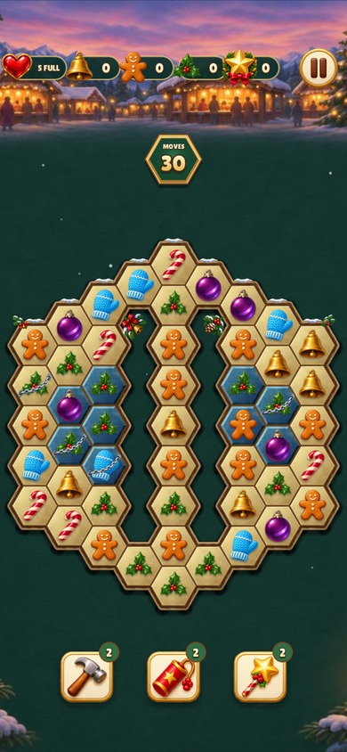
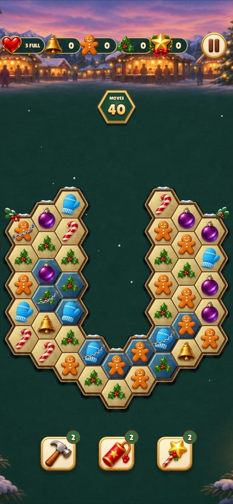

# Inner board decorations

Relic Rush's jungle vine projects down and right from the inner side of its
arch. Christmas Market's bell projects into the left opening from its left
wall, and the frosted pinecone enters the right opening from its right wall.
The open-top chamber uses larger diagonal fir sprigs on its inner walls.

| Board | Before | Diagonal side mounts |
| --- | --- | --- |
| Relic Rush level 6, 480×900 |  |  |
| Relic Rush level 6, 390×844 |  |  |
| Christmas Market level 4, 480×900 |  |  |
| Christmas Market level 4, 390×844 |  |  |
| Christmas Market level 7, 390×844 |  |  |

The three hanging variants were generated together with the built-in ImageGen
tool using the existing [outer artwork](../../../engine/art/board-frame/decorations-source.png)
and the two earlier board captures. Their stems attach at the centre of each
registered 96×96 RGBA sprite. The renderer seats the stem on the inner stone
and turns the artwork 48° into the opening. The source registration crops and
scales the paintings and trims stray matte alpha around the painted silhouette.
[Hanging source atlas](../../../engine/art/board-frame/hanging-source.png) ·
[Prompt](../../../engine/art/board-frame/hanging.prompt.txt) ·
[Crop and anchor settings](../../../engine/art/board-frame/decorations.json)

The atlas exports stay separate from the stone. Christmas Market's snow uses
the snowy stone slot on the exposed north rim, including on boards with open
channels. The inner channel floor uses the bare stone slot.

```sh
python3 tools/board_frame_decor.py
python3 tools/board_frame_decor.py --check
build/test/all --suite=relic-rush --suite=christmas-market \
  "shot dressing-shore" "shot main-character-board" "shot phone-board" "shot designed-chambers"
```
