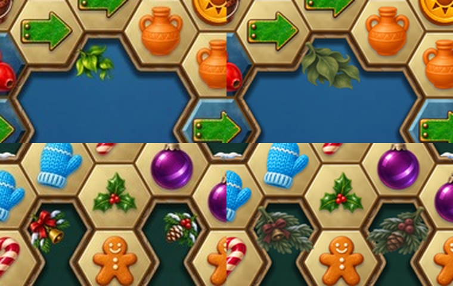
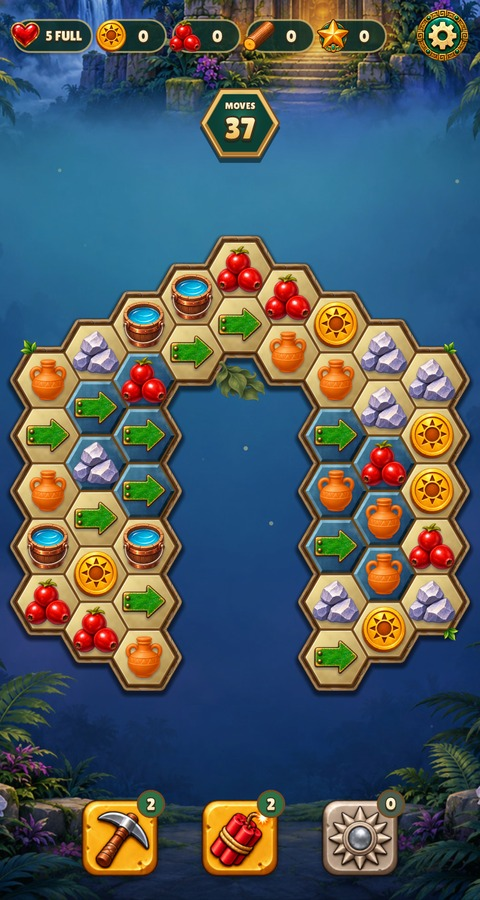
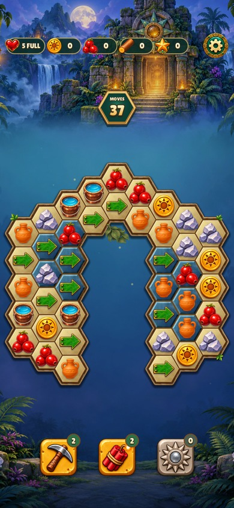

# Inner board decorations

[Current painted frame pieces and board captures](baked.md).

Relic Rush's jungle vine projects down and right from the inner side of its
arch. Christmas Market's bell projects into the left opening from its left
wall, and the frosted pinecone enters the right opening from its right wall.
The matte foliage spans most of the visible hex, with subdued greens, bronze
and red against the brighter playing pieces.
The open-top chamber uses larger diagonal fir sprigs on its inner walls.

Before on the left, after on the right. Relic Rush is above Christmas Market.



| Board | Before | Larger matte ornaments |
| --- | --- | --- |
| Relic Rush level 6, 480×900 |  |  |
| Relic Rush level 6, 390×844 |  |  |
| Christmas Market level 4, 480×900 |  |  |
| Christmas Market level 4, 390×844 |  |  |
| Christmas Market level 7, 390×844 |  |  |

The three ornaments were painted together with the built-in ImageGen tool
using the [earlier ornament artwork](../../../engine/art/board-frame/hanging-source.png),
the canonical flat-top hex and the earlier Christmas Market board capture.
Each separate 96×96 RGBA sprite is centred on an empty hex and drawn at the
hex's full coordinate width. The source art places the stem on its upper
diagonal side. Registration crops and uniformly scales the paintings and
trims stray matte alpha around the silhouette.
[Cutout source atlas](../../../engine/art/board-frame/cutout-source.png) ·
[Prompt](../../../engine/art/board-frame/cutout.prompt.txt) ·
[Crop and anchor settings](../../../engine/art/board-frame/decorations.json)

These captures show the earlier separate sprite exports. Christmas Market's snow uses
the snowy stone slot on the exposed north rim, including on boards with open
channels. The inner channel floor uses the bare stone slot.

```sh
python3 tools/board_frame_decor.py
python3 tools/board_frame_decor.py --check
python3 tools/hex_tile_art.py build/board-frame-decor/relic-rush/hanging-vine.png \
  build/board-frame-decor/christmas-market/hanging-{bell,pinecone}.png --mode object --strict
build/test/all --suite=relic-rush --suite=christmas-market \
  "shot dressing-shore" "shot main-character-board" "shot phone-board" "shot designed-chambers"
```
