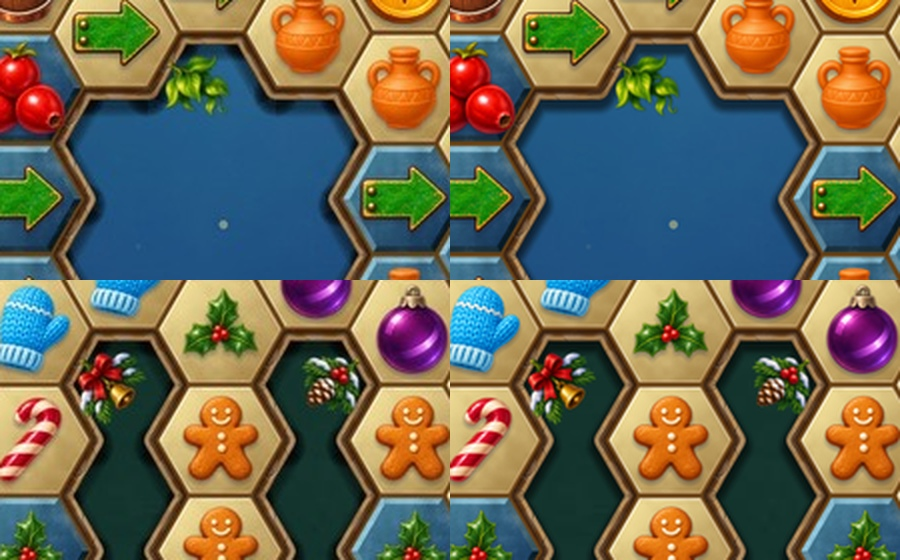
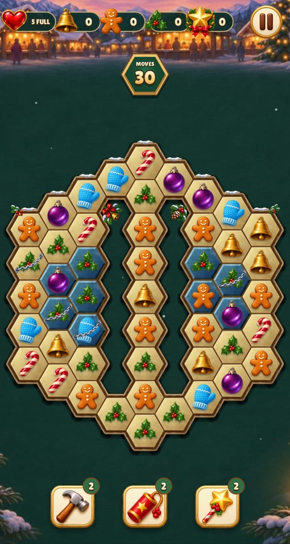
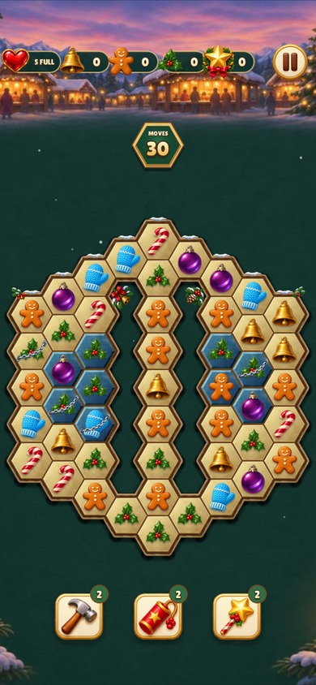

# Board shadow

The previous shadow drew translucent lines along exposed edges and circles
at both ends of each edge. The ends of adjoining edges overlapped, creating
dark knots at the corners. The renderer now draws one shadow through a soft
distance mask for the board silhouette. Its falloff depends on distance to
the silhouette, so adjacent edges share the same shadow inside openings
and around the outside.

The close-ups show before on the left and after on the right. Relic Rush is
above Christmas Market.



| Board | Before | Single shadow mask |
| --- | --- | --- |
| Relic Rush level 6, 480×900 |  |  |
| Relic Rush level 6, 390×844 |  |  |
| Christmas Market level 4, 480×900 |  |  |
| Christmas Market level 4, 390×844 |  |  |

```sh
build/test/all --suite=relic-rush --suite=christmas-market \
  "shot dressing-shore" "shot main-character-board" "shot phone-board"
```
