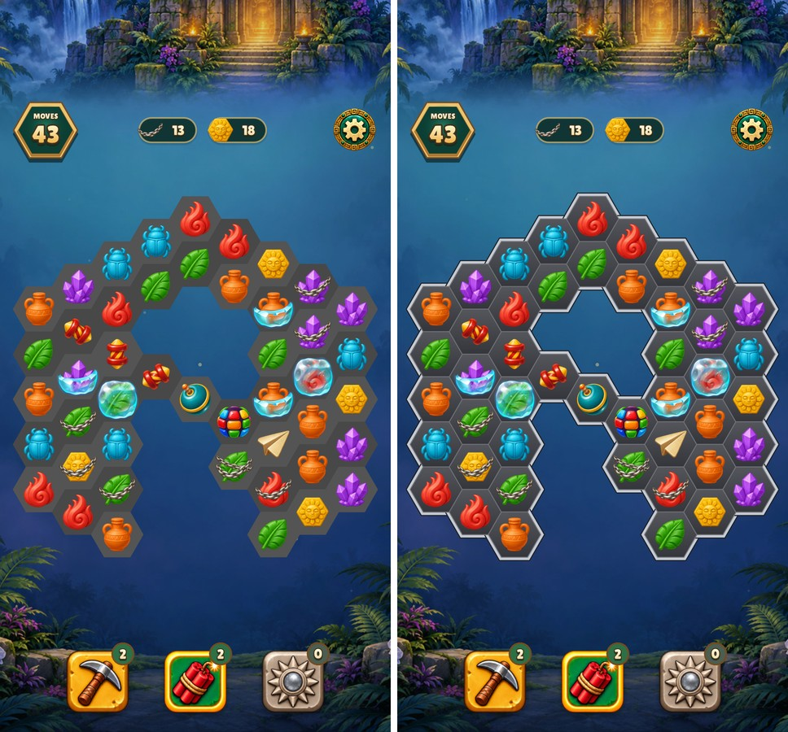
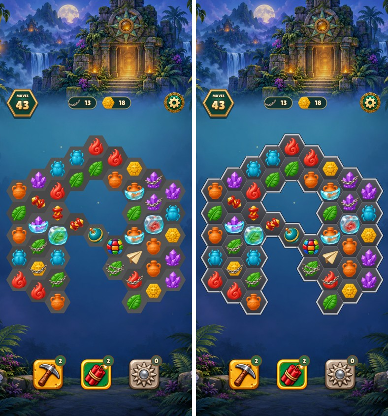
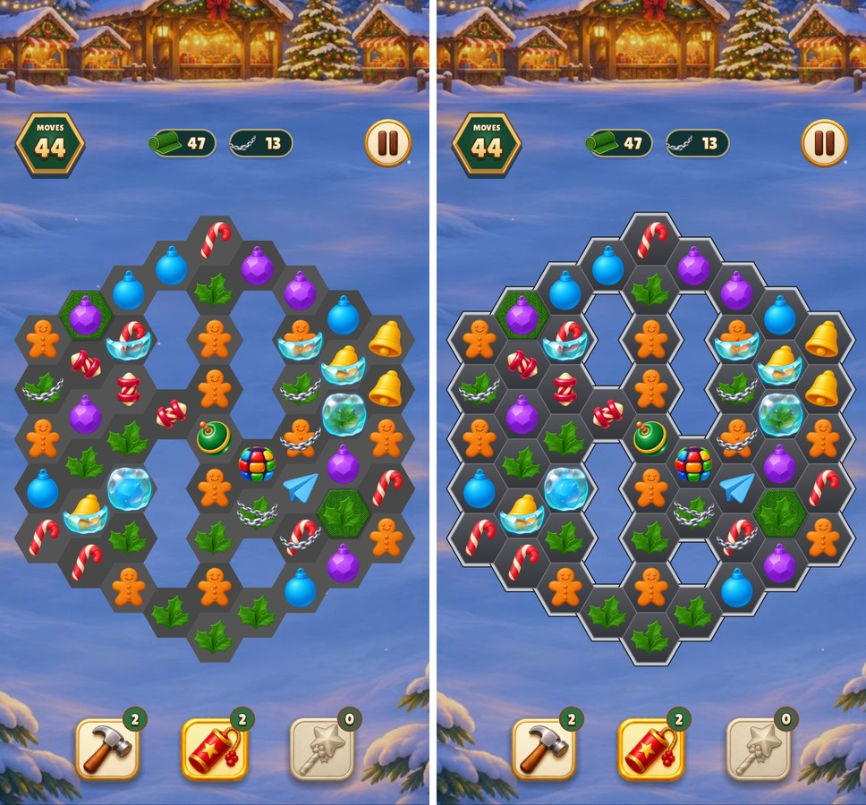
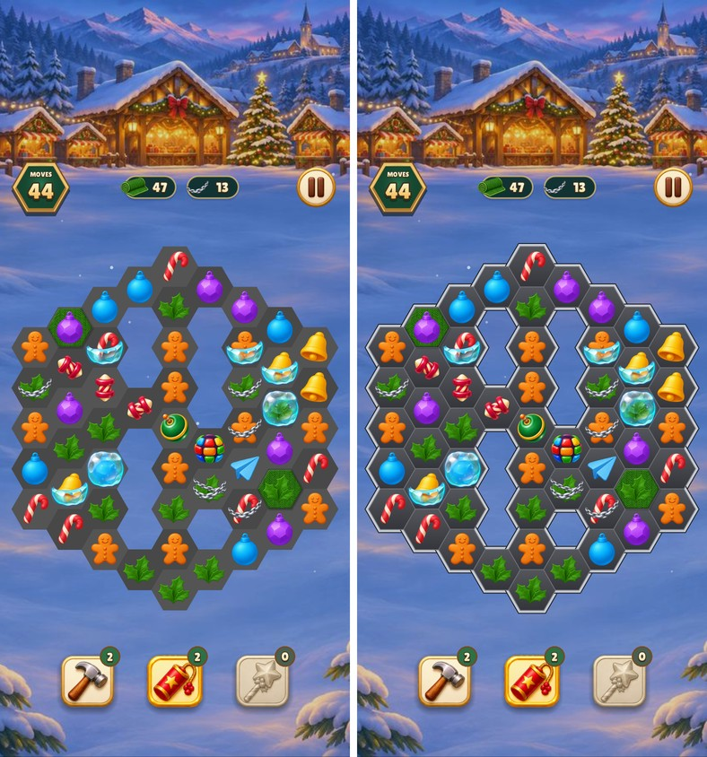

# Board outline and cell gradients

Each image shows the previous board on the left and the new one on the right.
A light rim now runs round the board's silhouette, including its holes. Every
cell carries the same top-to-bottom gradient with a thin seam, replacing the
two alternating grays. Pieces, blockers, input and layout are unchanged.

| Game | 480 × 900 | 390 × 844 |
| --- | --- | --- |
| Relic Rush |  |  |
| Christmas Market |  |  |

The colours and widths are  in , drawn by
. Capture the boards with the existing art-board shots.

```sh
./build/test/all --suite=relic-rush --suite=christmas-market 'shot art-specials' 'shot phone-art-specials' 'shot specials-board' 'shot phone-specials-board'
```
