# Independent campaign progressions

This is the first-pass checkpoint. The user's later shape references replaced
its per-level uniqueness requirement with deliberate recurring families; see
the [current shapes and element review](../match3-elements/README.md).

The first checkpoint replaces the shared campaign contours with 60 distinct
silhouettes, including under hex rotations/reflections, and individually ranked
terrain. It preserves story order and building milestones. Relic Rush emphasizes
excavation seams and interrupted approaches; Christmas Market emphasizes courts,
ribbon boundaries and patterned clearing. See each game's
[Relic progression](../../../games/relic-rush/docs/board-progression.md) and
[Christmas progression](../../../games/christmas-market/docs/board-progression.md).

The captures below are the geometry/terrain checkpoint before the subsequent
mechanics expansion. Each is an actual game render, inspected at its full size.

| Game / level | Before | After |
| --- | --- | --- |
| Relic 4, 480×900 | 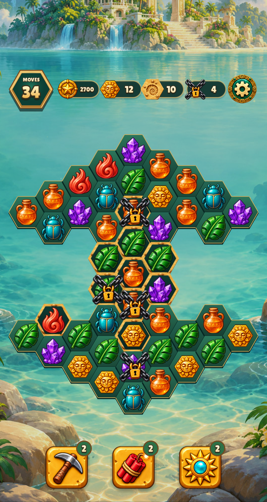 | 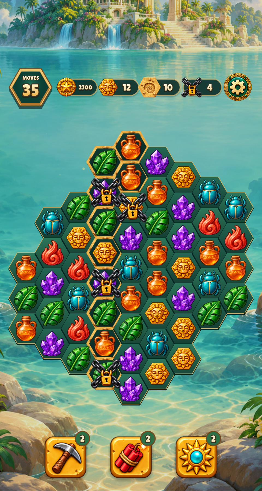 |
| Relic 13, 480×900 | 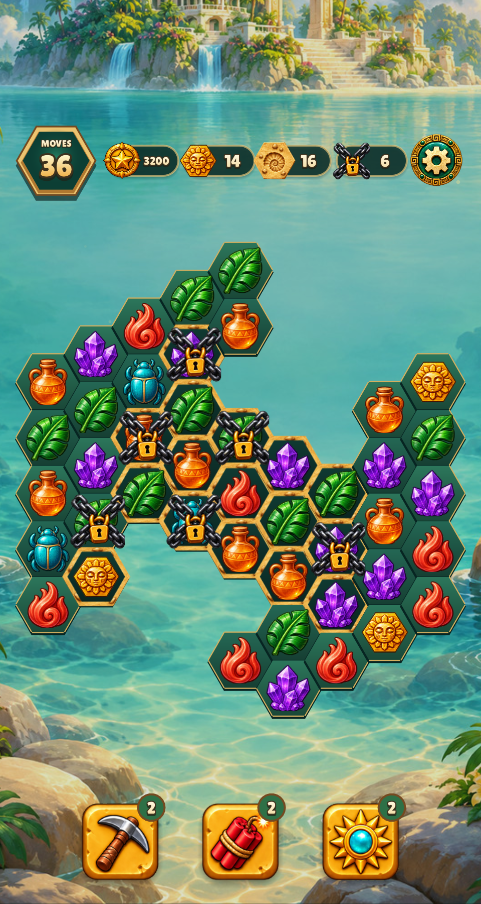 | 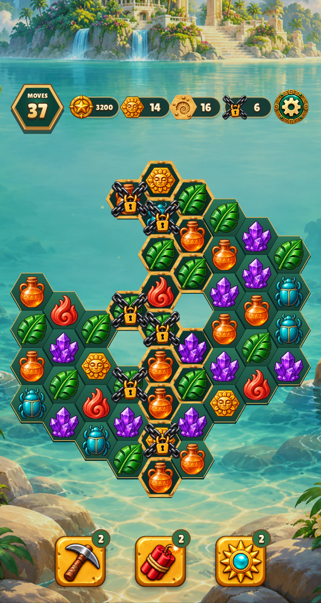 |
| Relic 22, 480×900 | 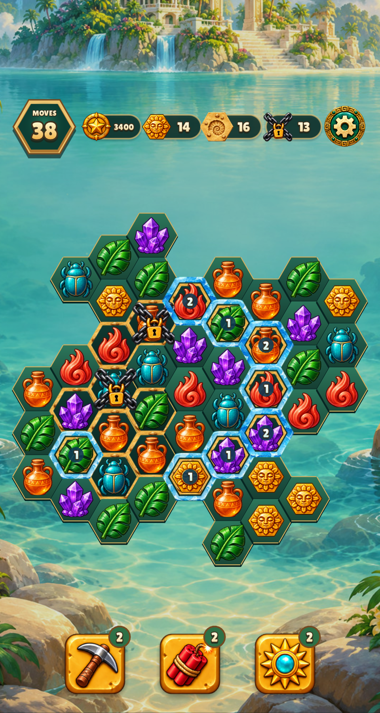 | 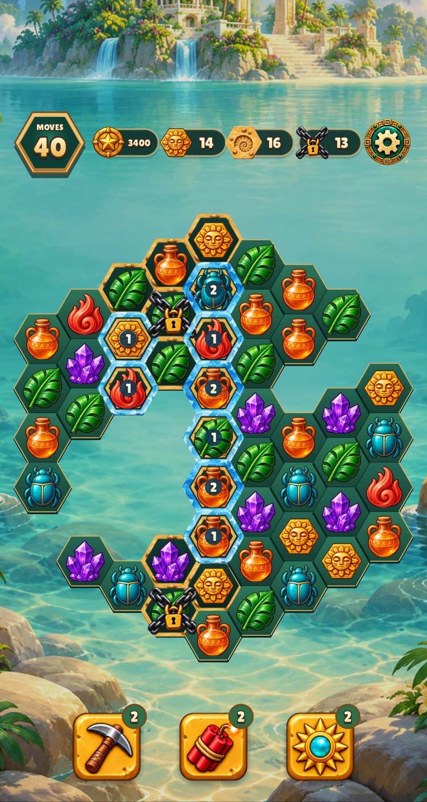 |
| Relic 30, 390×844 | 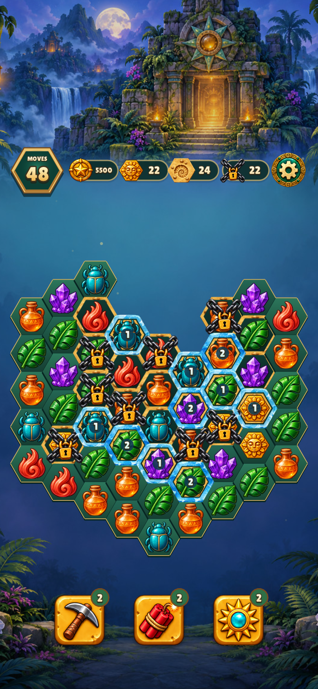 | 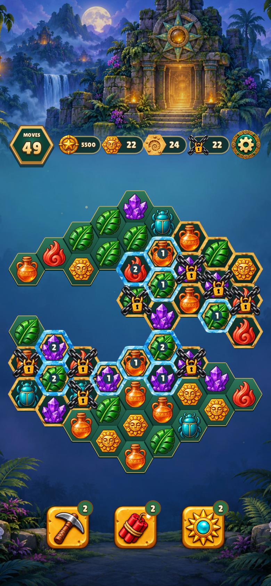 |
| Christmas 4, 480×900 | 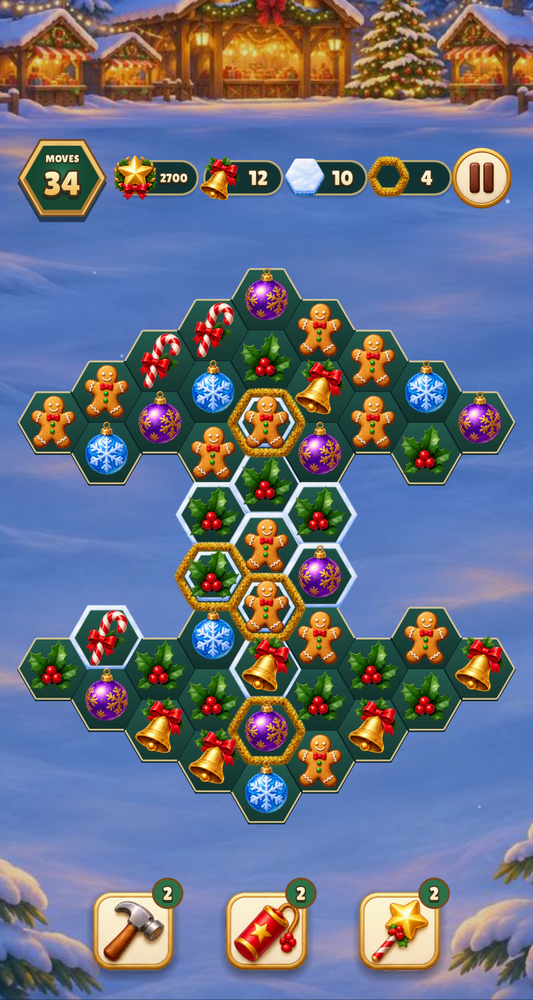 | 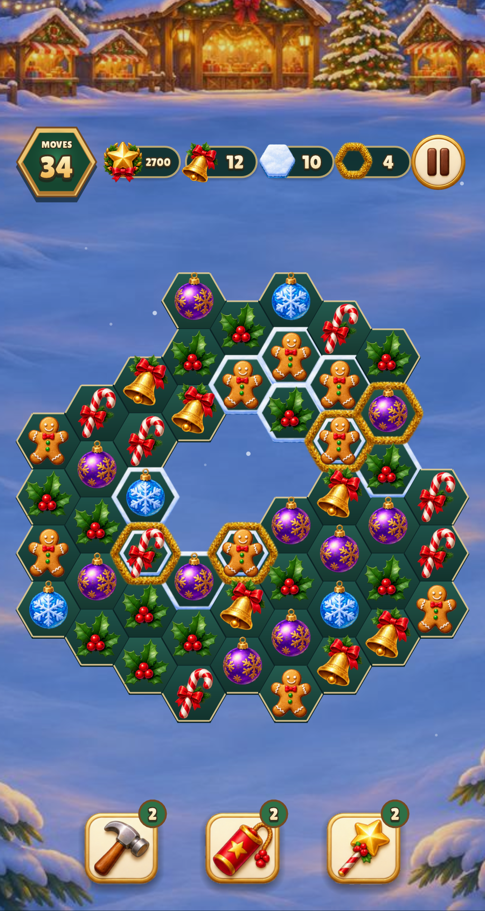 |
| Christmas 13, 480×900 | 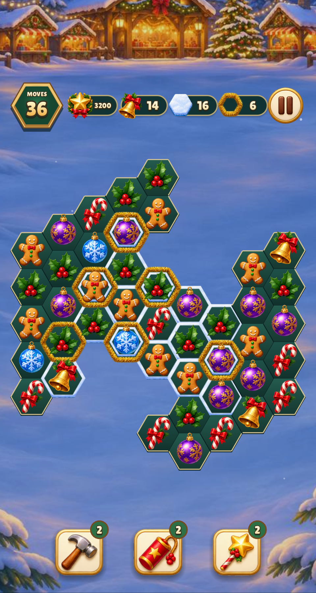 | 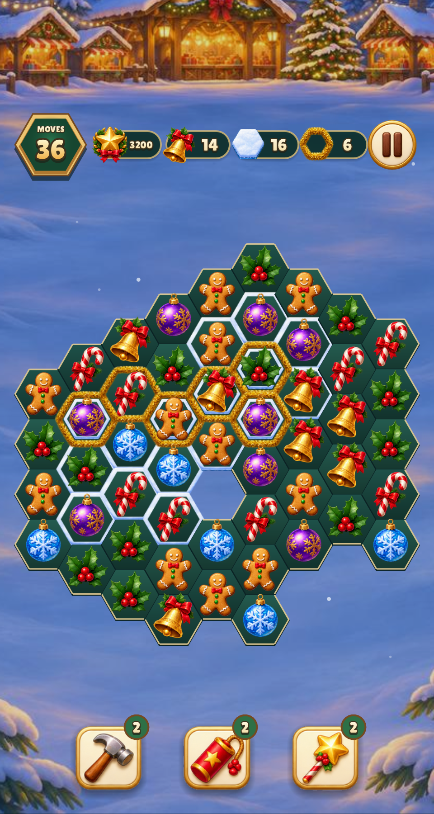 |
| Christmas 22, 480×900 | 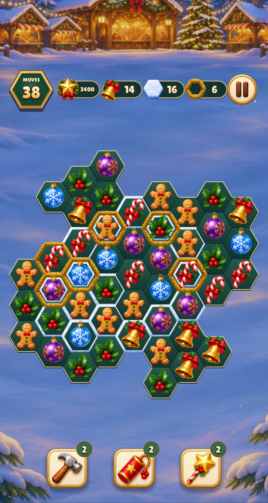 | 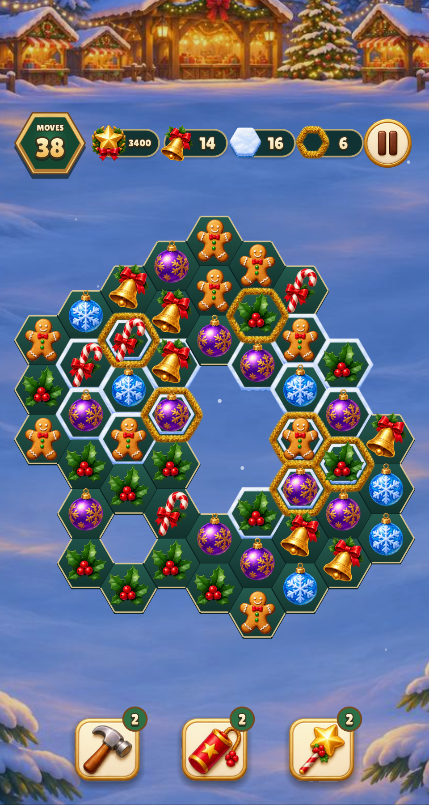 |
| Christmas 30, 390×844 | 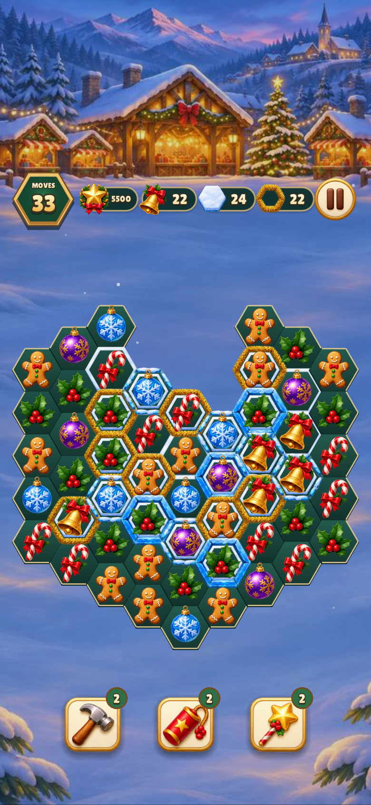 | 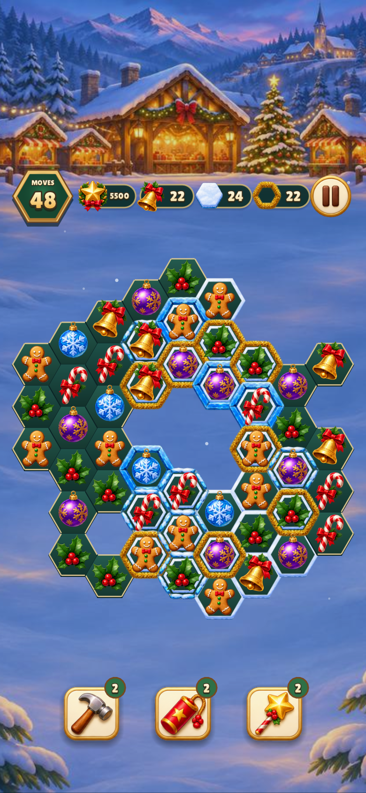 |

## Verification at this checkpoint

Affected target build check: **0.12 s** (already up to date; campaign Lua is loaded
at runtime). Each game passed `campaign_layout`, `relic_board`, `progression` and
`trickling`, plus the four captures above. Christmas's combined run took **6.52 s**.
Relic's **7.04 s** run found a fixture assuming the center was always active; after
making the synthetic fixture independent of campaign geometry, its affected
`relic_board` suite passed in **1.80 s**. The earlier photo fixture now also supplies
its own original mask rather than accidentally borrowing a redesigned level.
Repository lint passed in **1.33 s**. Times are measured wall seconds.

The extended real-rules campaign simulation passed all 30 levels per game within
four fixed seeds: Relic **11.43 s**, Christmas **11.11 s**. Failed exploratory runs
identified leftover edge targets despite completed score/collection goals. Terrain
priorities on Relic 20/26 and Christmas 8/24 were corrected; Relic 26 and Christmas
24 also had their covering workload reduced. These checks prove reproducible bot
wins, not human difficulty or retention. Human playtesting remains necessary for
balancing the intended choices.

No new artwork or shared runtime behavior changes in this checkpoint. Subsequent
mechanic assets and their review are catalogued separately.
