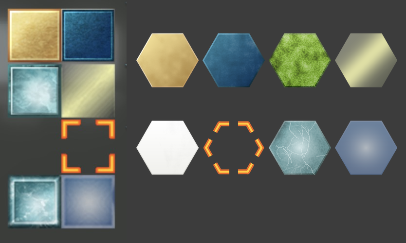
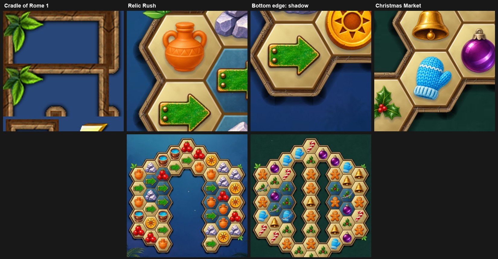
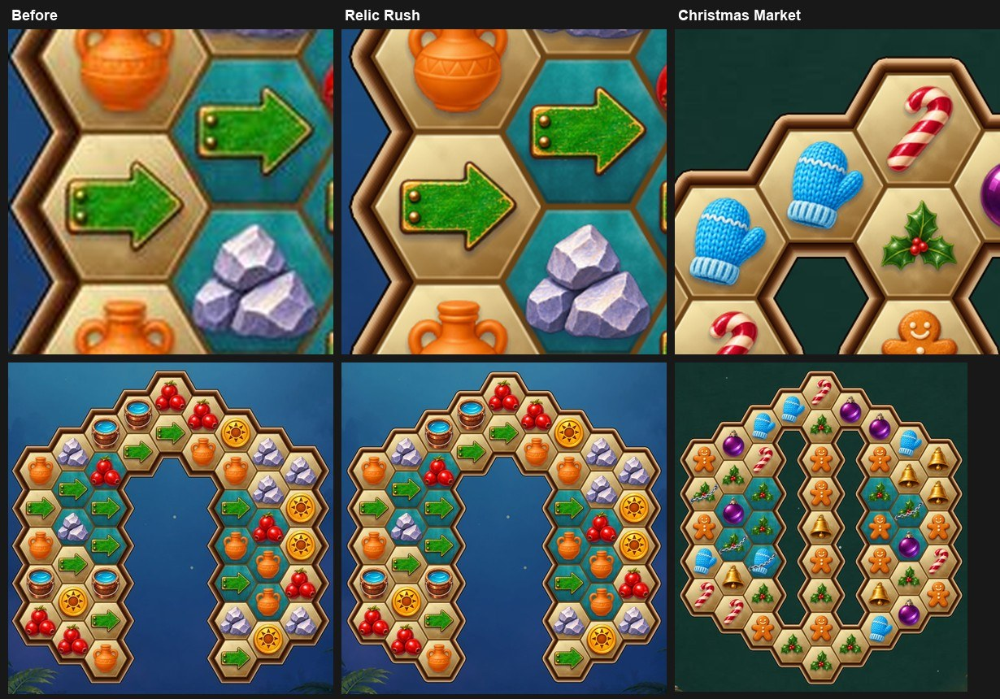
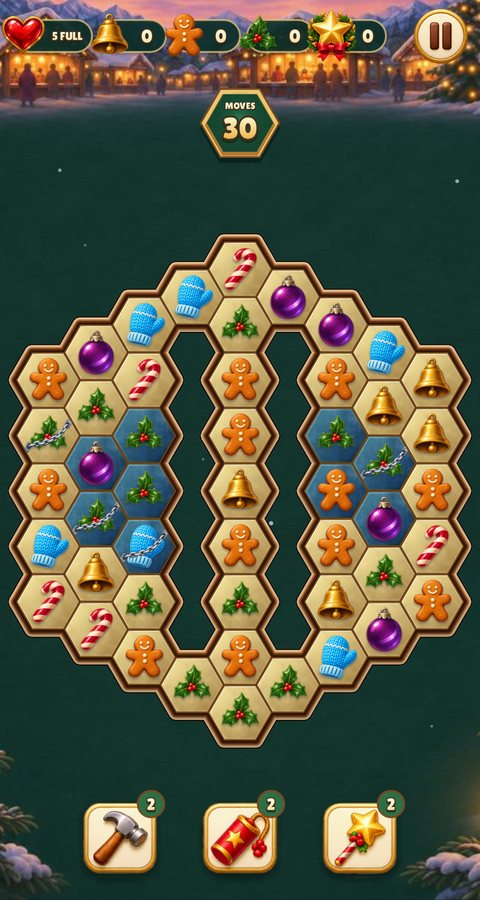
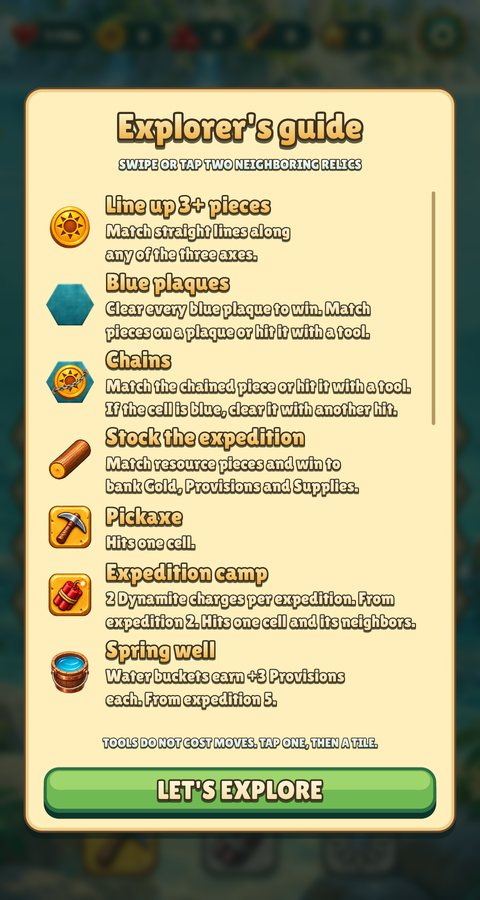
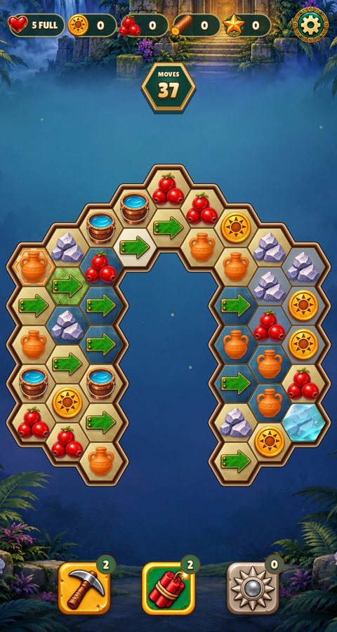
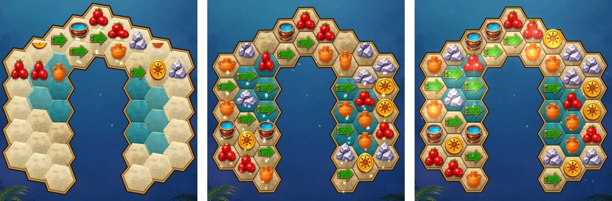

# Shared board tiles

Relic Rush and Christmas Market share eight generated hex tiles that follow the
slots of Cradle of Rome's board sheet. Parchment cells and teal-blue tablets
are the floor in both games; the other six show cell states.


The tiles follow the originals from the first Cradle of Rome: parchment lit
from the upper left, a deep blue tablet, teal ice with a white burst, a diagonal
streak for the light wave, orange corner brackets for the selected cell and a
blue-gray glow for a bonus's area. The green double tablet and white hover tile
have no original and keep their earlier look.



The board frame is one band that runs from near-black under the board's edge,
like wear and shadow, through brown to a bright peach-tan lip, as in Cradle of
Rome. The parchment follows the lighting measured on that board's empty cells:
cream at the upper left to deep gold at the lower right, with a thin edge light:



The outline's corners are rounded and the frame is 1.5 units slimmer:



| Slot | Tile | Use |
| --- | --- | --- |
| 1 | `cell-normal` | Normal and cleared cells |
| 2 | `tablet-single` | Plaques / panes required for a win |
| 3 | `tablet-double` | Two-hit tablet from a level's `oil_double` (no campaign level yet) |
| 4 | `light-wave` | Light sweeping across the board as it arrives |
| 5 | `hover` | Mouse hover |
| 6 | `selected` | Selected cell: orange corner brackets on a clear tile |
| 7 | `ice` | Floor under an iced piece |
| 8 | `bonus-area` | Cells an armed tool will hit |

| Screen | Before | After |
| --- | --- | --- |
| Relic Rush level 6, 480×900 |  |  |
| Relic Rush level 6, 390×844 |  |  |
| Christmas Market level 4, 480×900 |  |  |
| Christmas Market level 4, 390×844 |  |  |

| Explorer's Guide | Market Keeper's Guide | All tiles in game (`--art-states dressing`) |
| --- | --- | --- |
|  |  |  |

## Cell states in play

`--cell-states` pins a selected cell (top left), a hovered cell, an armed
Dynamite's area (light blue), an iced piece and a double tablet (green).

| Relic Rush level 6 | Christmas Market level 4 |
| --- | --- |
|  |  |

The light wave during the board's entrance, frames 30, 45 and 60:



Every filled tile passes `tools/hex_tile_art.py --mode fill --strict` (coverage 1.0, no spill); `selected` is an open frame.

```sh
python3 tools/board_tiles.py            # writes both games' data/board-tiles/
./build/relic-rush --headless --mute --fresh --size 480x900 --art-states dressing --shot tiles.png
./build/relic-rush --headless --mute --fresh --size 480x900 --level 6 --cell-states --shot states.png
./build/relic-rush --headless --mute --fresh --size 480x900 --level 6 --present --frames 45 --shot wave.png
```
