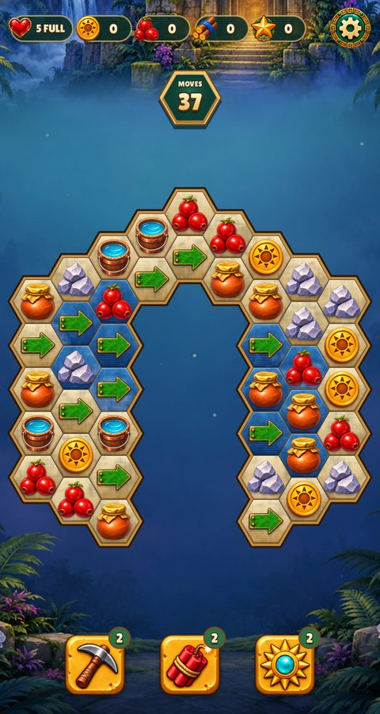
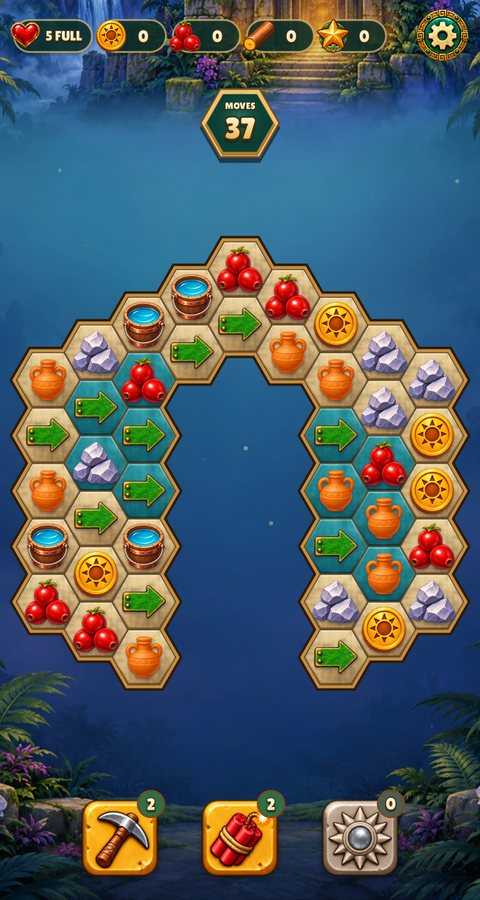
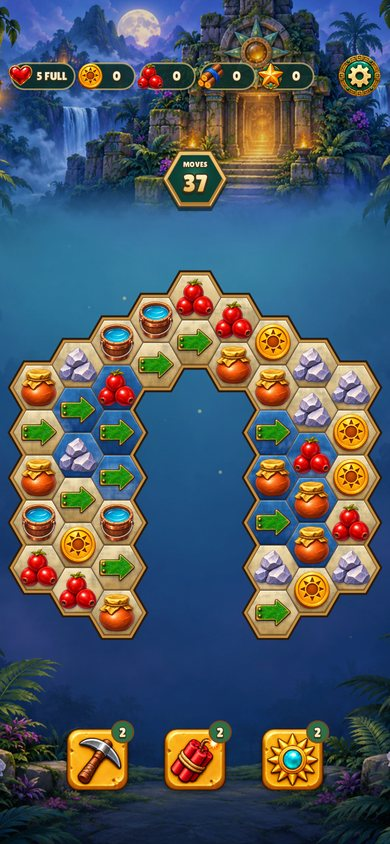
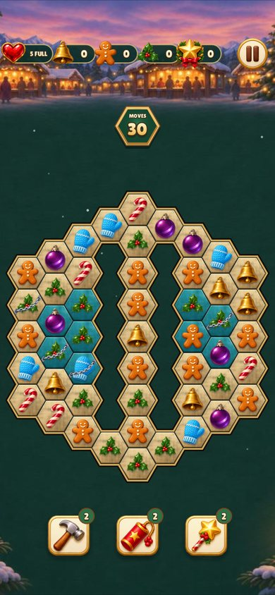
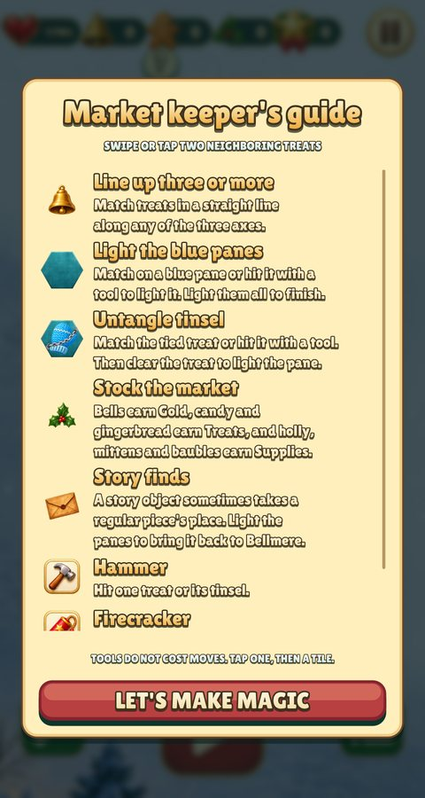

# Shared board tiles

Relic Rush and Christmas Market share eight generated hex tiles that follow the
slots of Cradle of Rome's board sheet. Parchment cells and teal-blue tablets
are in use in both games; the other six are generated and loaded for the
states still to be wired.


| Slot | Tile | Use |
| --- | --- | --- |
| 1 | `cell-normal` | Normal and cleared cells |
| 2 | `tablet-single` | Plaques / panes required for a win |
| 3 | `tablet-double` | Two-hit tablet (no rule yet) |
| 4 | `light-wave` | Light sweeping across the board (not drawn yet) |
| 5 | `hover` | Pointer hover (not drawn yet) |
| 6 | `selected` | Selected cell (not drawn yet) |
| 7 | `ice` | Ice tablet (not drawn yet) |
| 8 | `bonus-area` | Cells a tool will hit (not drawn yet) |

| Screen | Before | After |
| --- | --- | --- |
| Relic Rush level 6, 480×900 |  |  |
| Relic Rush level 6, 390×844 |  |  |
| Christmas Market level 4, 480×900 |  |  |
| Christmas Market level 4, 390×844 |  |  |

| Explorer's Guide | Market Keeper's Guide | All tiles in game (`--art-states dressing`) |
| --- | --- | --- |
|  |  |  |

Every tile passes `tools/hex_tile_art.py --mode fill --strict` (coverage 1.0, no spill).

```sh
python3 tools/board_tiles.py            # writes both games' data/board-tiles/
./build/relic-rush --headless --mute --fresh --size 480x900 --art-states dressing --shot tiles.png
```
