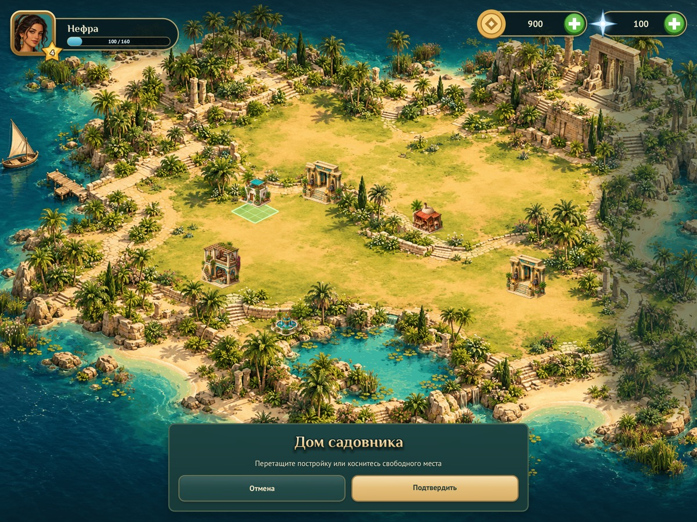
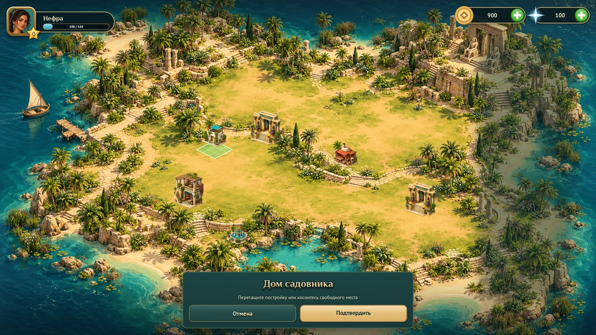
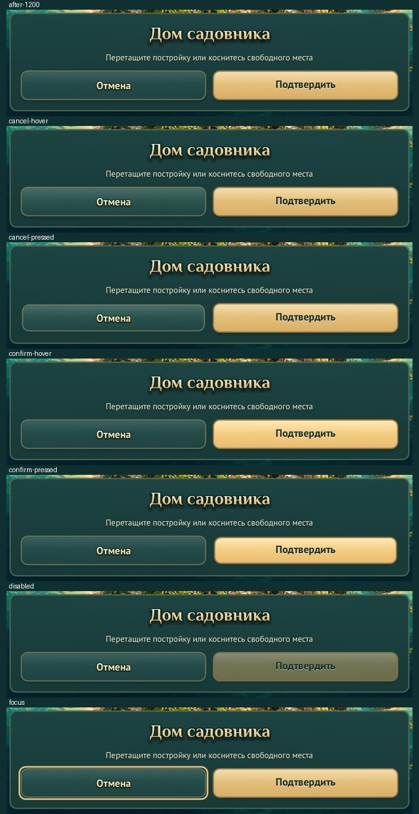

# Placement button typography

> The commands on this page used a capture tool that has since been replaced. A press and hold is now `hold()` in `tests/games/<game>.lua`; see [docs/TESTING.md](../../TESTING.md). The captures here are the historical record.

The form's accent-style routing fix was already present in the working tree:
Confirm selects `theme.accent_text`, rather than the cream `theme.button` style.
`before-1200.jpg` records that starting point, which already fixes the cream on
gold shown in the reported screenshot. This change adds the engine's existing
text effects and raises both labels from 17 to 21 points.

Cancel uses cream/gold text with a dark outline and shadow. Confirm uses dark
teal/ink text with a pale offset shadow, keeping its letter counters open.
The title already used the engine gradient, outline and shadow effects.
No bitmap assets, generated icons or procedural interaction artwork were added.

| Before text effects (accent routing already fixed) | After |
| --- | --- |
|  |  |




All controls were reviewed in actual game captures. The disabled capture has
the preview over blocked terrain (red footprint); Confirm remains readable but
its surface is dimmed and it cannot activate. Keyboard focus uses the engine's
existing ring. This panel has no selected toggle state.



## Reproduce

Build `make CFLAGS="-O2 -g -Werror"`.
Capture the actual game:

```sh
./build/nile-archive --headless --fresh --mute \
  --screen island --size 1200x900 --gesture hold --press 435,345 \
  --frames 100 --shot out.png
```

Use 1368x1026 with the same press, or 1600x900 with `--press 600,375`.
`make shots` updates the canonical long-press captures. On Retina macOS the
framebuffer is twice the requested size; review JPEGs are reduced to the
requested dimensions with Pillow's LANCZOS resampling.

`capture.c` extends the normal gesture helper with native events that release
the pickup, hover or press each control, drag the preview onto water, or press
Tab. It does not change game rendering or inject form state. Build on macOS:

```sh
cc -O2 -g -Werror -std=c11 -Iengine -D_DEFAULT_SOURCE \
  -o build/button-text docs/review/button-text/capture.c \
  build/engine/engine.o build/engine/script.o build/engine/lua.o build/engine/platform.o \
  -framework AppKit -framework OpenGL -framework IOSurface -framework Security \
  -framework AudioToolbox -framework GameController -lm
./build/button-text --game nile-archive --headless --fresh --mute \
  --screen island --size 1200x900 --gesture hold --press 435,345 \
  --control confirm-pressed --frames 100 --shot out.png
```

Other `--control` values: `cancel-hover`, `cancel-pressed`, `confirm-hover`,
`disabled`, `focus`. Control coordinates are for the 1200x900 layout.
On Linux, use the Makefile's X11/EGL/GL libraries and run under Xvfb.

Validation: Werror build, `make test` (including asset catalogue checks), and
Nile Archive's `--headless --fresh --mute --smoke` all passed. The smoke run
checks actual pointer input, cancellation and confirmation. Native captures use
macOS OpenGL; no dependencies or asset trees were downloaded.
