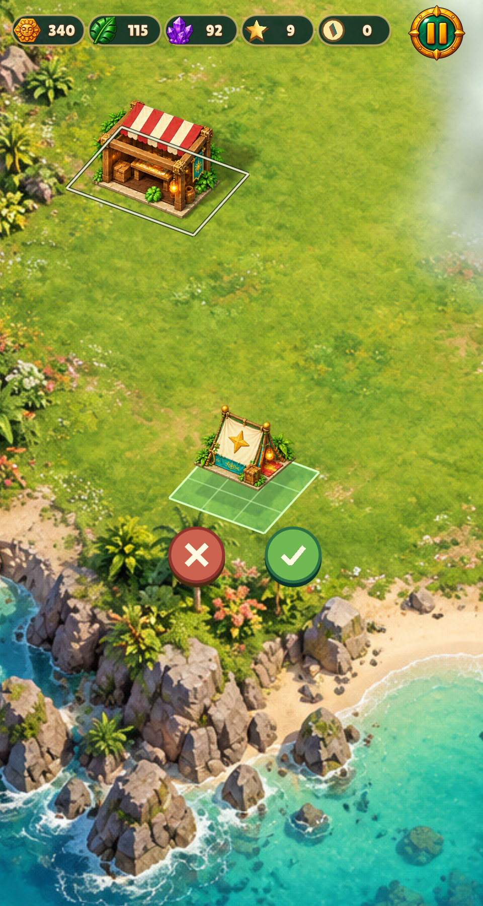
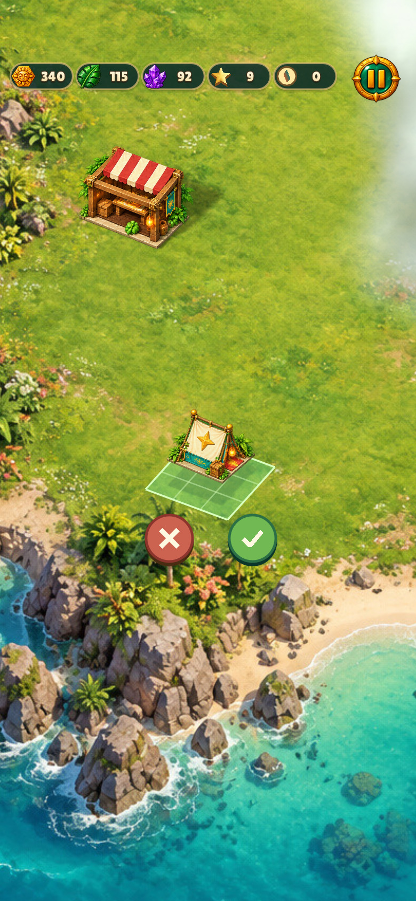
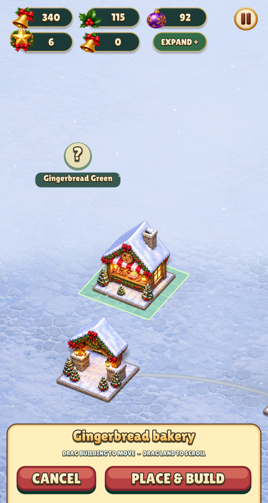
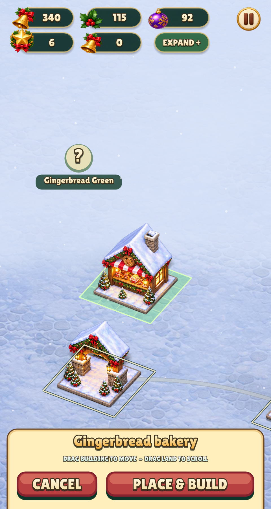
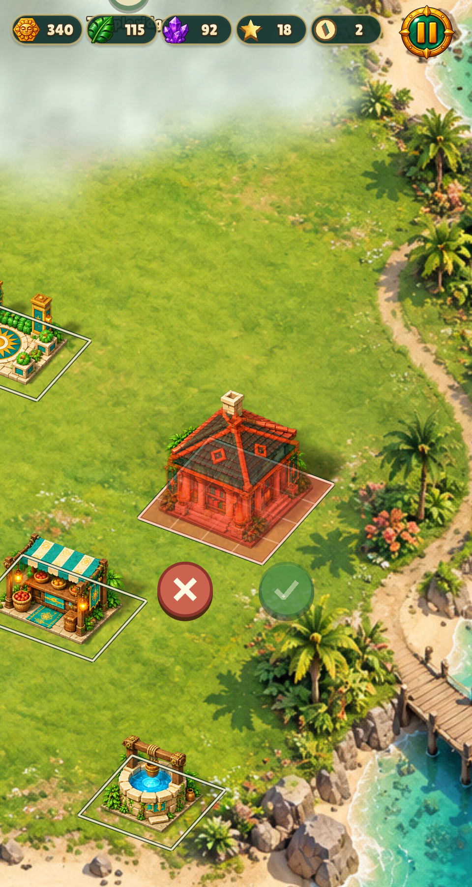

# Placement alignment guides

Other buildings now show cream outlines around their occupied ground while a
building is lifted, dragged, awaiting confirmation, or being newly placed.
The outlines include the same clearance used by collision and follow the shared
city camera. A dark contrast edge keeps them readable on grass, snow and the
building artwork; no fill obscures the scene. The mover's old location is omitted.
Confirm/Cancel hide the guides. Normal browsing has no guide overlay.

Township addresses the same visibility problem with an edit-mode option to hide
tall buildings ([official support](https://playrix.helpshift.com/hc/en/3-township/faq/6692-i-m-missing-a-building-decoration-field/)).
Here the chosen adaptation keeps buildings visible and overlays their ground
boundaries, so alignment does not require a separate toggle or mode.

| Scene | Before | After |
| --- | --- | --- |
| Relic Rush 480×900, real hold |  |  |
| Relic Rush 390×844, safe area |  |  |
| Nile Archive 1200×900, real hold |  |  |
| Christmas Market 480×900 |  |  |
| Blocked placement |  |  |

All captures were inspected. Reproduce with existing manifest entries:

```sh
build/test/relic-rush "hold relic-long-press" "hold relic-phone-long-press" "shot island-blocked"
build/test/nile-archive "hold nile-long-press"
build/test/christmas-market "shot placement"
```

The real-renderer `city_render` test checks hidden idle guides, visibility over
opaque building art, held/released previews, omission of the mover's old spot,
purchase previews and removal after cancellation. No building measurement,
sprite, collision, gesture or save behavior changed. Debug `--footprints` keeps
its existing filled tile/base/pivot view.

Measured verification: warning-as-error full native/test build 5.69 s; final
shared suite after the additional stripe renderer change 4.65 s inside the
launcher (10 s allowance, 5.68 s including Make/startup and the audio build).
Two earlier runs hit the default 5 s budget without assertion failures; the
documented 10 s allowance completed them. Relic Rush guide captures 4.26 s;
Nile Archive 3.06 s; Christmas Market 1.33 s. Lint 1.51 s, zero warnings/errors.

The work reused installed tools and added no dependencies or models. Source is
`engine/city.c`; no bitmap, icon atlas or ImageGen source was added.
