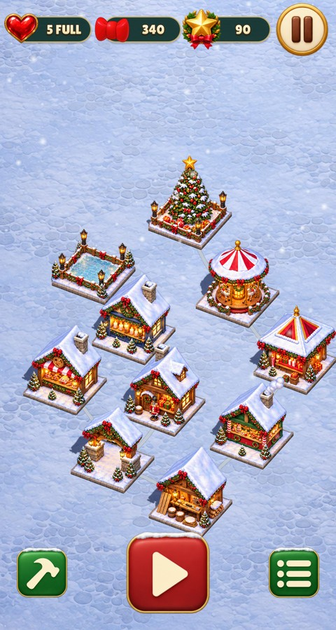
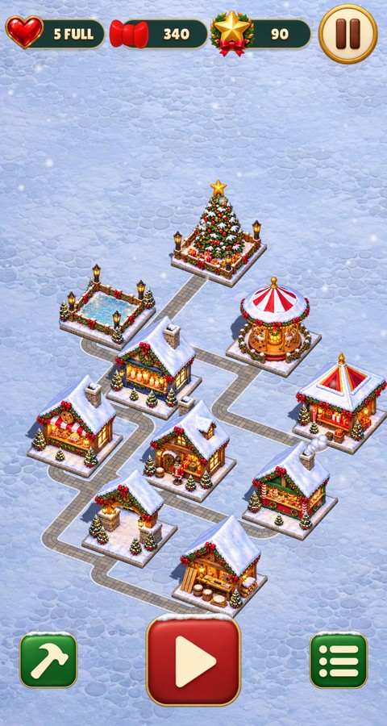
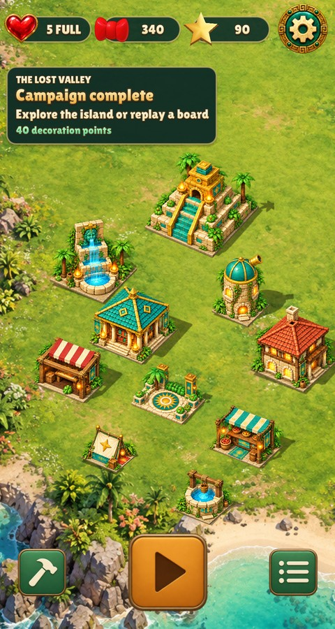
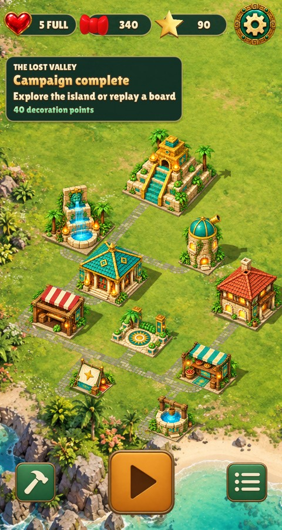
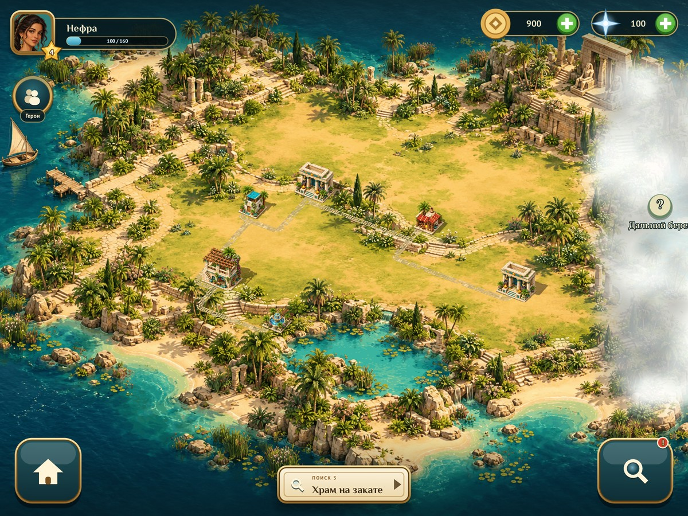
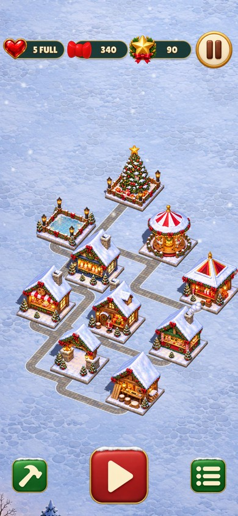
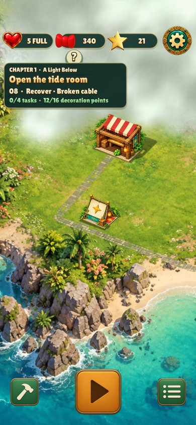
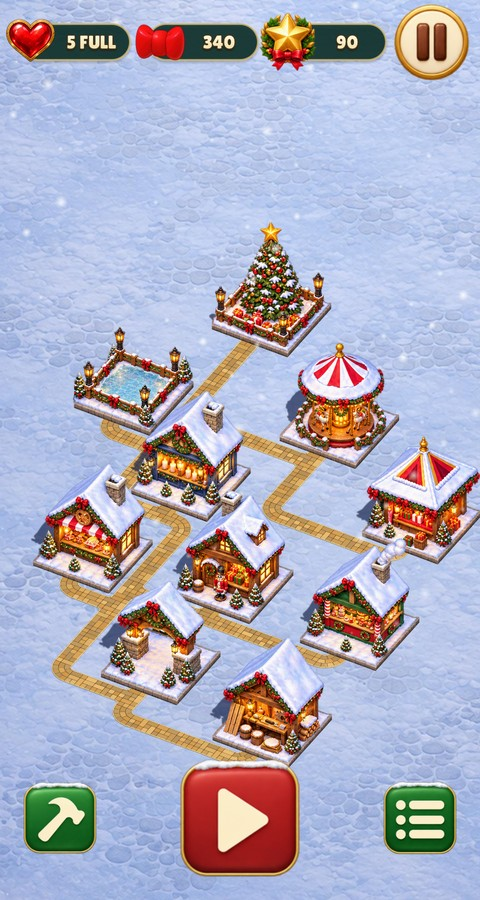
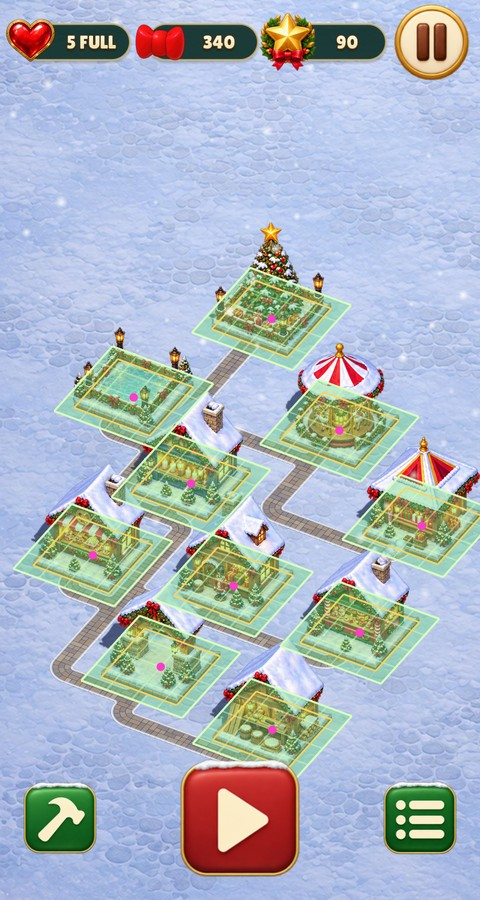

# City streets

The city's curved building connectors are replaced by paved streets on the tile
grid ([Roads](../../BUILDINGS.md#roads)). Before: main `b18bbf3a`. All captures
use the native game renderer.

| Game | Before | After |
| --- | --- | --- |
| Christmas Market, 480×900 |  |  |
| Relic Rush, 480×900 |  |  |
| Nile Archive, 1200×900 |  |  |

Alternate sizes and states, after only (no before capture was taken at 390×844):

| Christmas Market, 390×844 | Relic Rush, 390×844 (`--city 3`) | Christmas Market, `--roads sandstone` | Christmas Market, `--footprints` |
| --- | --- | --- | --- |
|  |  |  |  |

```sh
./build/christmas-market --headless --mute --fresh --size 480x900 --showcase --shot market.png
./build/relic-rush --headless --mute --fresh --size 480x900 --showcase --shot island.png
./build/nile-archive --headless --mute --fresh --size 1200x900 --screen island --shot island.png
```
