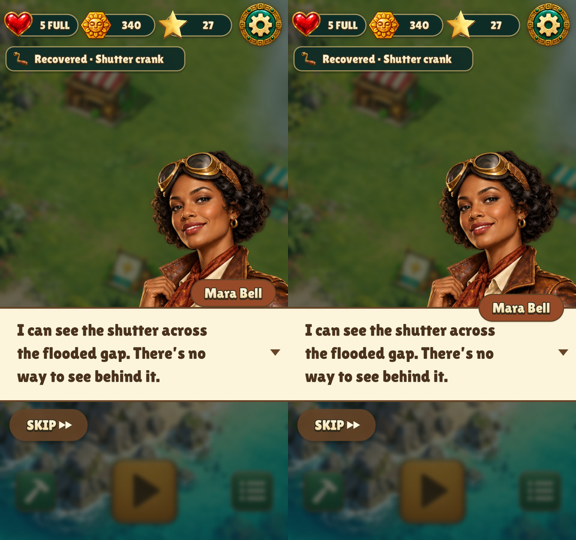
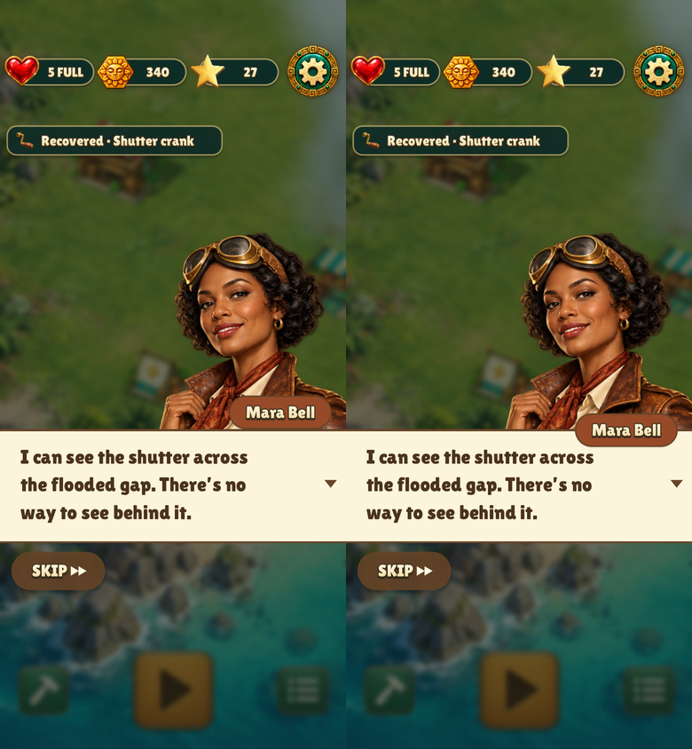
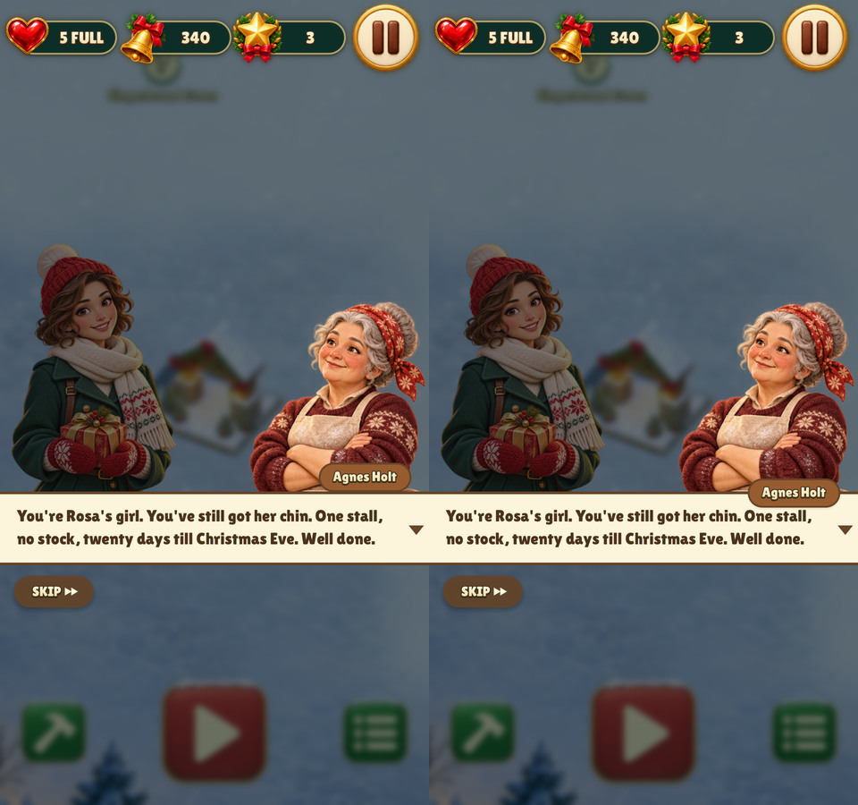
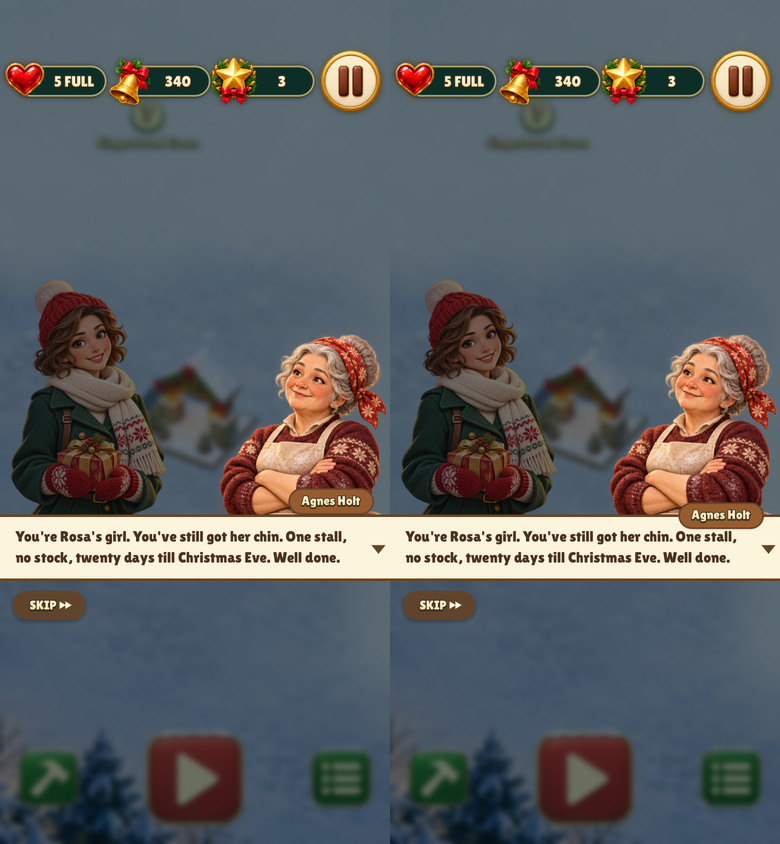

# Dialogue name tag on the top border

The shared dialogue bar centers the speaker’s name tag on its top border.
The text stays vertically centered and Skip sits below the bar. Each
comparison shows the previous placement on the left and the new one on the right.

| Game | 480×900 | 390×844 with safe areas |
| --- | --- | --- |
| Relic Rush |  |  |
| Christmas Market |  |  |

```sh
build/test/relic-rush 'shot quest-handoff'
build/test/christmas-market 'shot dialogue-bar-'
```
