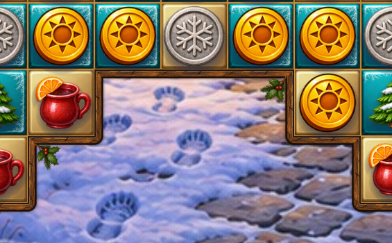
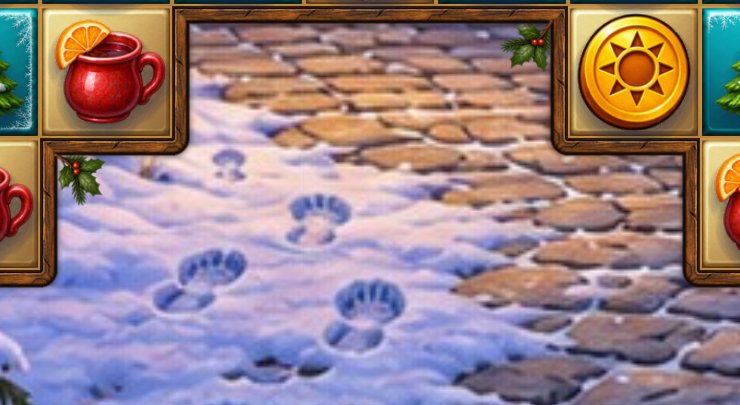

# Board frame seams

Snowflake Lane (Christmas Market level 6) has a large notch that shows the
backdrop between its rails. At some pixel scales, the edge of a transparent
frame sprite picked up its atlas neighbor through linear filtering, leaving
horizontal and vertical lines in the notch. The renderer now limits samples
to the outermost texel centers of each atlas view.

The crops below show the same area at native framebuffer resolution. The
iPhone capture uses the App Store safe-area preset.

| Capture size | Before | After |
| --- | --- | --- |
| 960 × 1800 |  |  |
| 1320 × 2868 |  |  |

```sh
make build/test/all
build/test/all --suite=engine --suite=christmas-market --suite=relic-rush \
  platform 'shot frame-seams' 'shot designed-lanes'
```

The platform test reproduces the edge leak beside a solid neighboring sprite,
including on a rotated rail. The 390 × 844 phone capture covers a scale where
the original rendering already looked clean.
