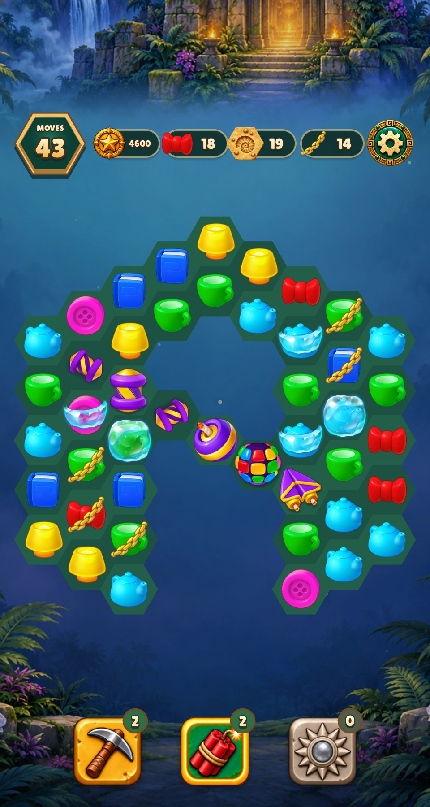
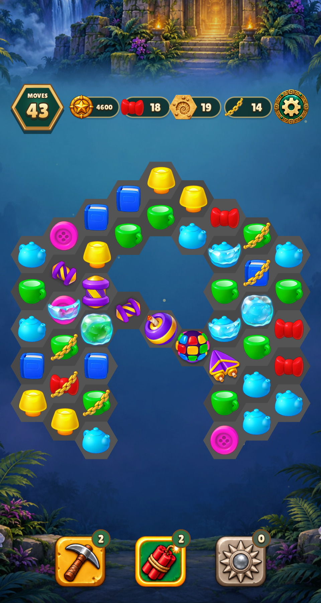
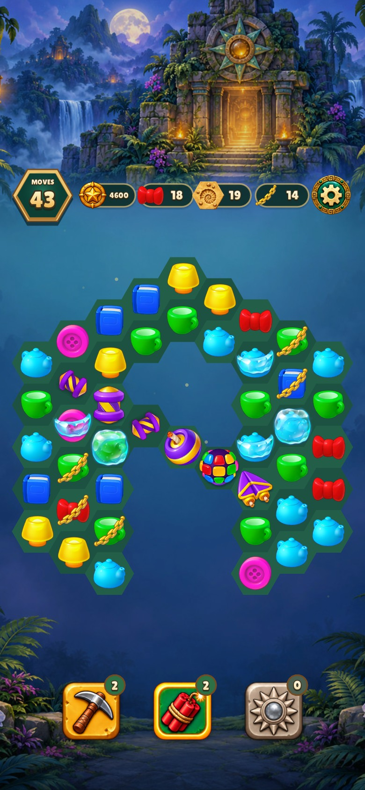
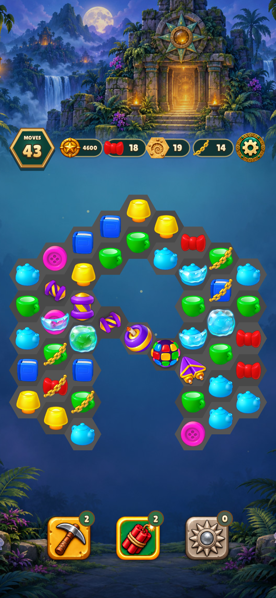
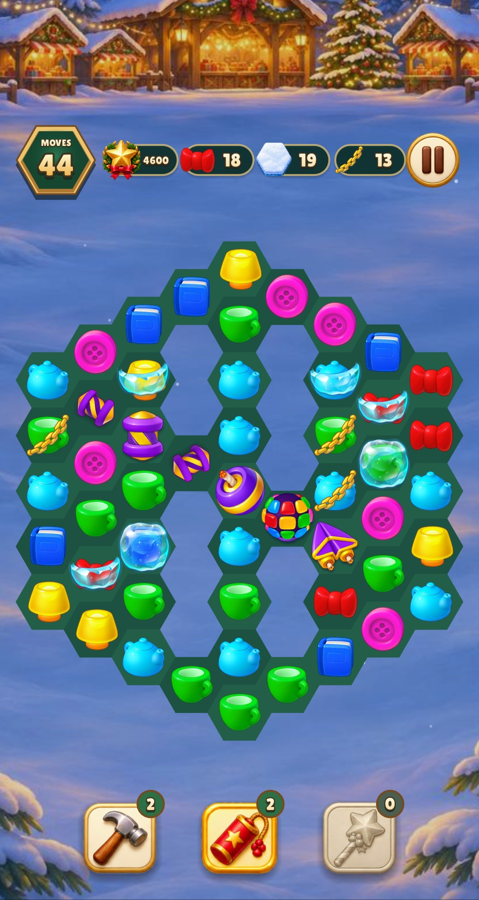
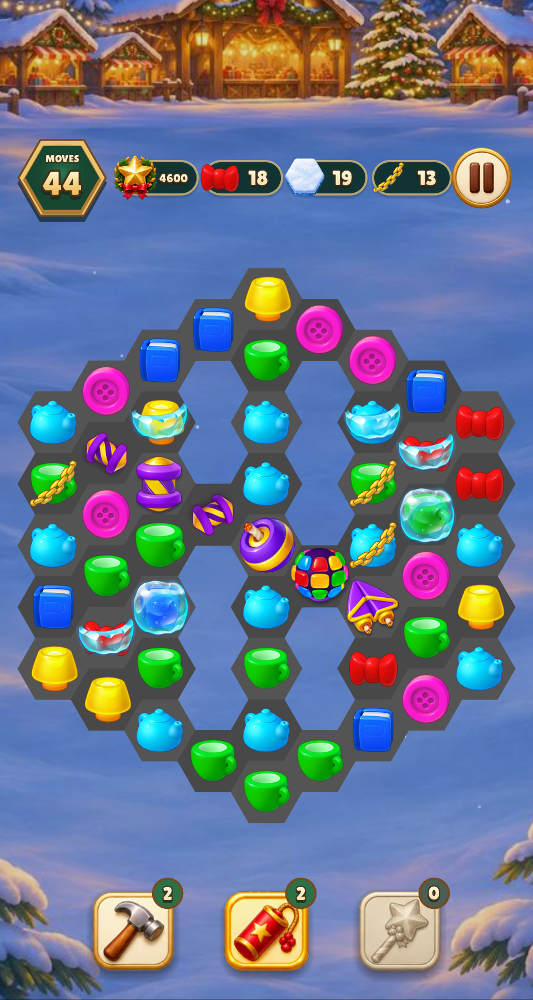
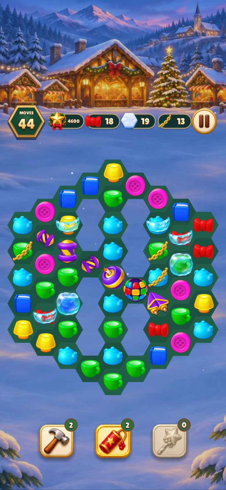
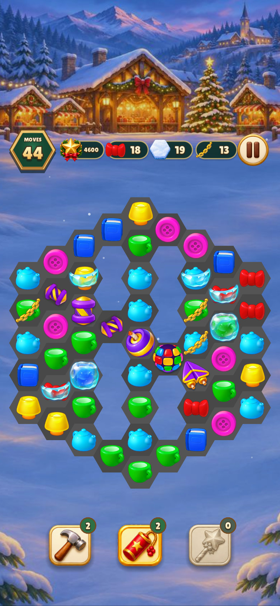

# Neutral gray hex ground

Both portrait games now draw the flat field in neutral gray: alternating
`#484848` and `#545454`, replacing the green `#1d5243` and `#235e49`.
This is a background-color change only. Source sprites, geometry, animation,
input and surrounding interface are unchanged. All four after captures were
visually inspected; before captures reuse the previous committed review.

| Screen | Before | After |
| --- | --- | --- |
| relic-rush 480×900 |  |  |
| relic-rush 390×844 |  |  |
| christmas-market 480×900 |  |  |
| christmas-market 390×844 |  |  |

Verification (measured wall time):

- `make CFLAGS="-O2 -g -Werror" relic-rush christmas-market build/test/relic-rush build/test/christmas-market`: 0.12 s; targets already current (Lua loads at runtime).
- `build/test/relic-rush 'rules relic_board' 'shot art-specials' 'shot phone-art-specials'`: 4.83 s, 3 passed, 4,067 checks.
- `build/test/christmas-market 'rules relic_board' 'shot specials-board' 'shot phone-specials-board'`: 3.78 s, 3 passed, 4,008 checks.
- `make lint`: 2.46 s, 0 warnings/errors in 146 files.

No shared rule changes or atlas regeneration were needed.
