# Homescapes donut exit and maker

The captures use the shared board renderer in Relic Rush and Christmas
Market. The 390 × 844 captures include phone safe-area insets.

## Donut exit arrow

The exit is directly below the blue portal, above the donut. The source
arrow is reproduced three times with the original stagger and fade.

| Game and logical size | Before | After |
| --- | --- | --- |
| Relic Rush 480 × 900 | 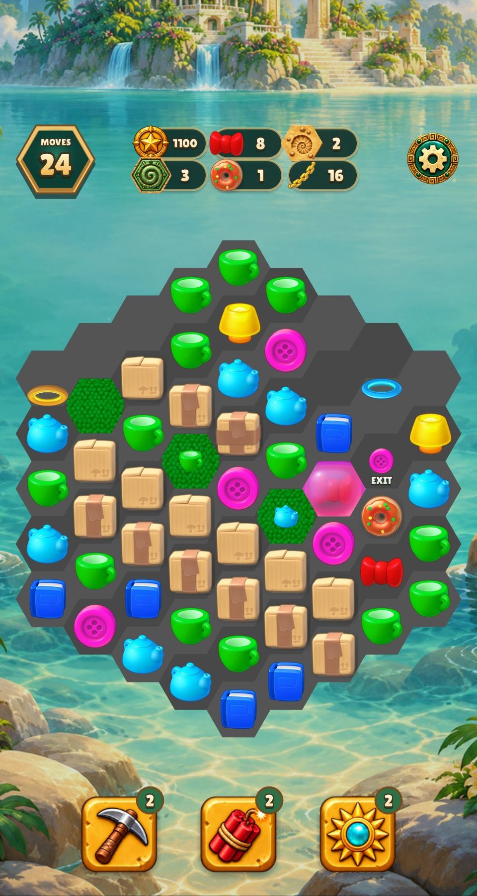 |  |
| Relic Rush 390 × 844 |  | 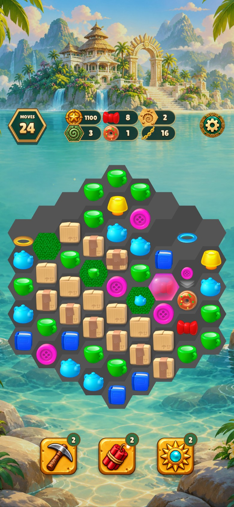 |
| Christmas Market 480 × 900 |  | 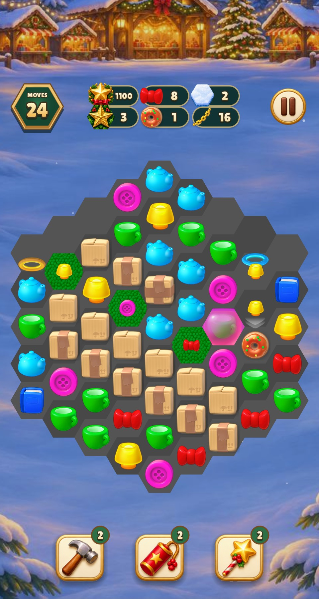 |
| Christmas Market 390 × 844 | 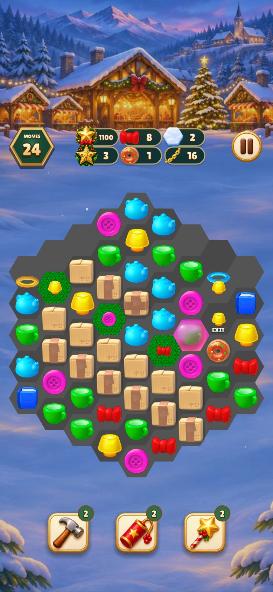 |  |

## Maker shell

The base, rear glass and front glass are registered on the same 460 × 420
source frame. The four examples show the runtime dough previews. Exact
resting poses and output indicator placement remain open.

| Game and logical size | Before | After |
| --- | --- | --- |
| Relic Rush 480 × 900 | 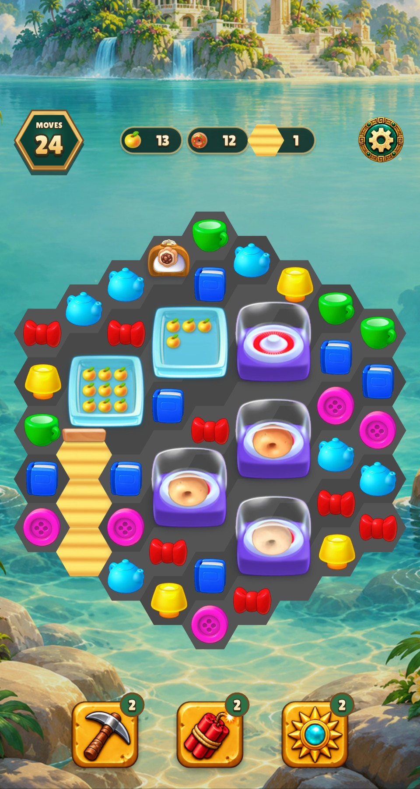 | 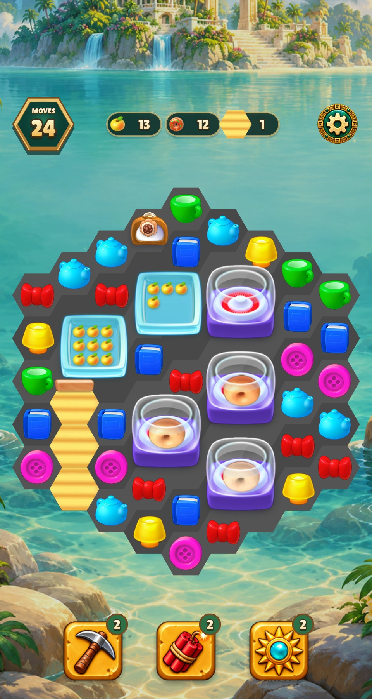 |
| Relic Rush 390 × 844 | 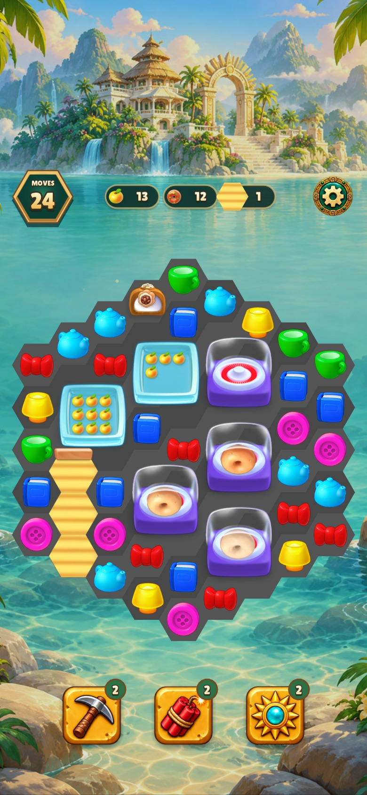 | 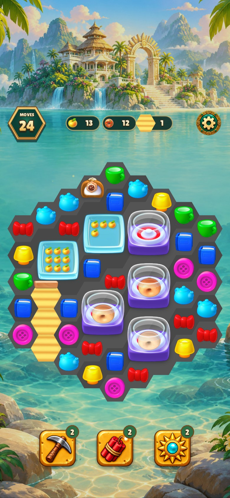 |
| Christmas Market 480 × 900 | 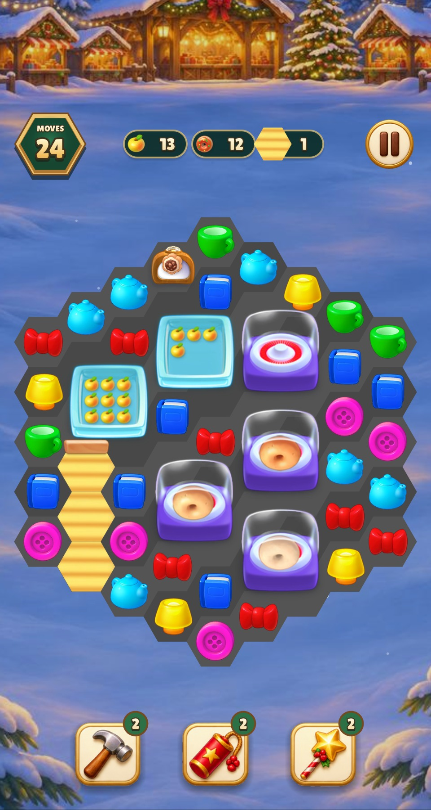 | 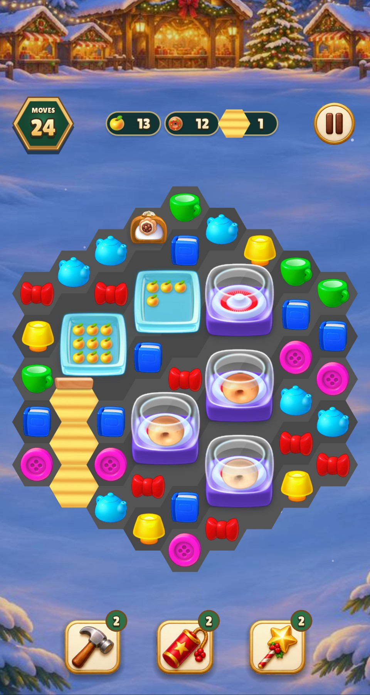 |
| Christmas Market 390 × 844 | 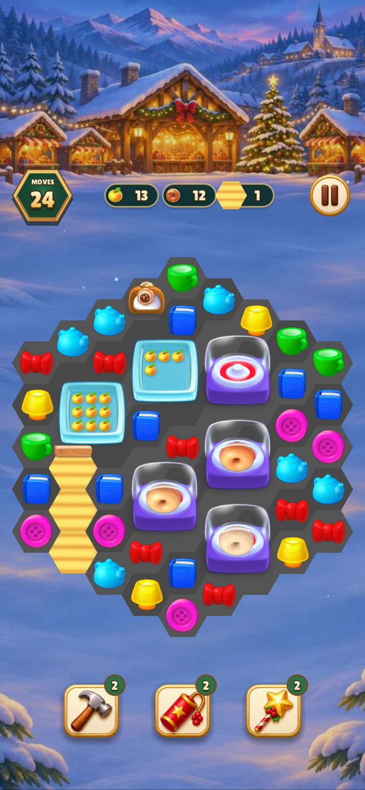 | 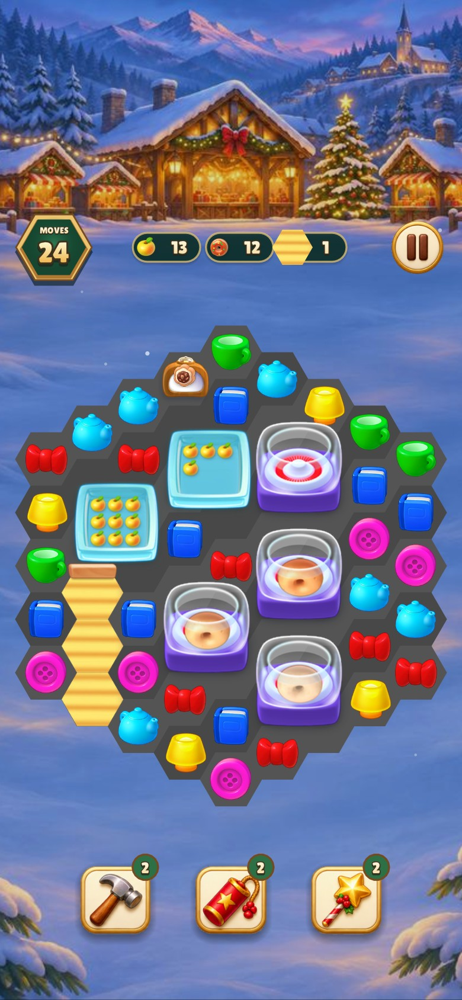 |

## Verification

- Warning-as-error build targets were current (0.07 s wall time).
- Shared checks passed 22 groups in 4.86 s within the default 5 s budget
  (5.04 s including Make). The board test checks that the exit draws three
  copies of the recovered sprite.
- Lua lint passed with 0 warnings or errors (1.41 s wall time).
- Four named captures passed in each game, with one test process per game
  (5.52 s Relic Rush, 5.14 s Christmas Market).
- The original arrow and all 13 named maker components matched the
  extraction checks. All three generated atlas manifests passed provenance
  verification. The arrow passed strict object registration in both game
  atlases, with zero pixels outside the canonical hex.

[Source rectangles, hashes and reproduction commands](../../HOMESCAPES_ART.md)
