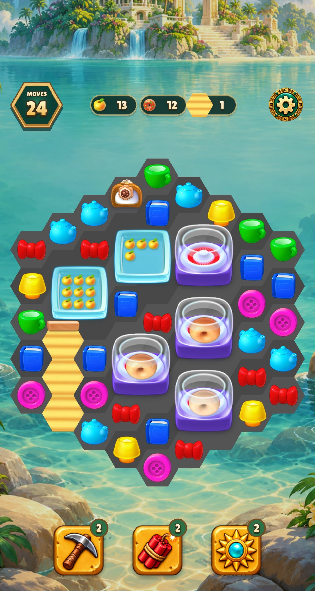
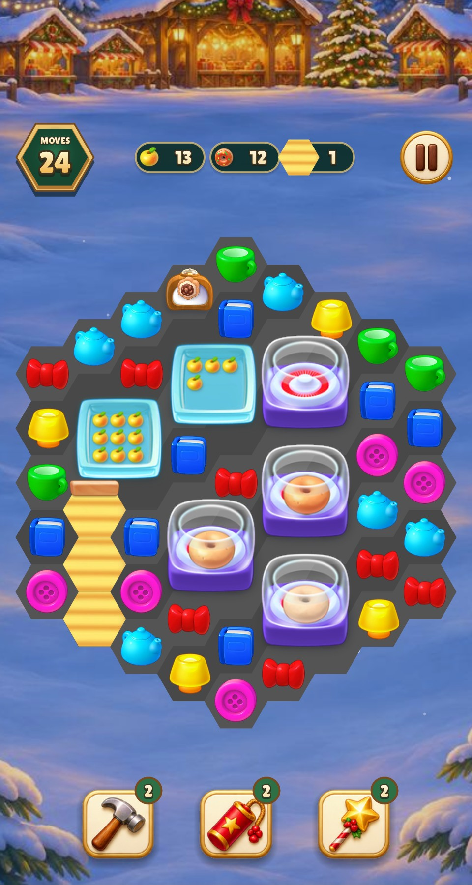
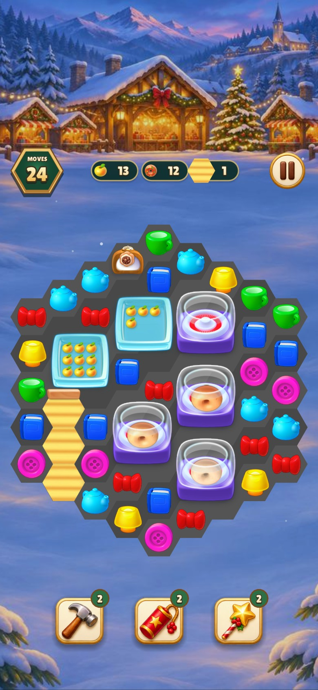

# Donut maker orientation

All three dough crops from the Homescapes 3.5.9 atlas are converted from
bottom-origin to top-origin coordinates when assembling the maker. The
original crops matched a fresh extraction from the APK pixel for pixel.
Across the two game atlases, only the three charged maker frames changed.

| Game and logical size | Before | After |
| --- | --- | --- |
| Relic Rush 480 × 900 |  |  |
| Relic Rush 390 × 844 |  |  |
| Christmas Market 480 × 900 |  |  |
| Christmas Market 390 × 844 |  |  |

Reviewed the current board pieces, power-ups, blocker layers, generators,
portal directions, donut and exit arrow in atlas contact sheets. An
independent Terra 6.1 review found no further visible inversions. All 117
Homescapes entries in the two game atlases matched pixel for pixel. Symmetric
assets have few visible orientation cues. The scope is the shipped art.

- Warning-as-error build targets were current (0.09 s wall).
- Shared tests passed all 22 groups in 6.64 s (6.91 s including Make). The
  first run reached the default 5 s limit. The repeat used a 15 s limit.
- Lua lint passed with 0 warnings or errors (2.44 s wall).
- Both named captures passed per game (4.15 s Relic Rush, 3.22 s Christmas
  Market), using one test process per game.

[Source and registration](../../HOMESCAPES_ART.md)
