# Homescapes jelly, portals and maker glass

The captures show the actual board at logical 480×900 and 390×844. The
narrow captures include phone safe-area insets.

## Portal entrance and output

The yellow portal sits at the bottom of the entrance cell. The blue portal
sits at the top of the output cell. The separate donut collection exit still
uses the `EXIT` diagnostic.

| Game and size | Before | After |
| --- | --- | --- |
| Relic Rush 480×900 | 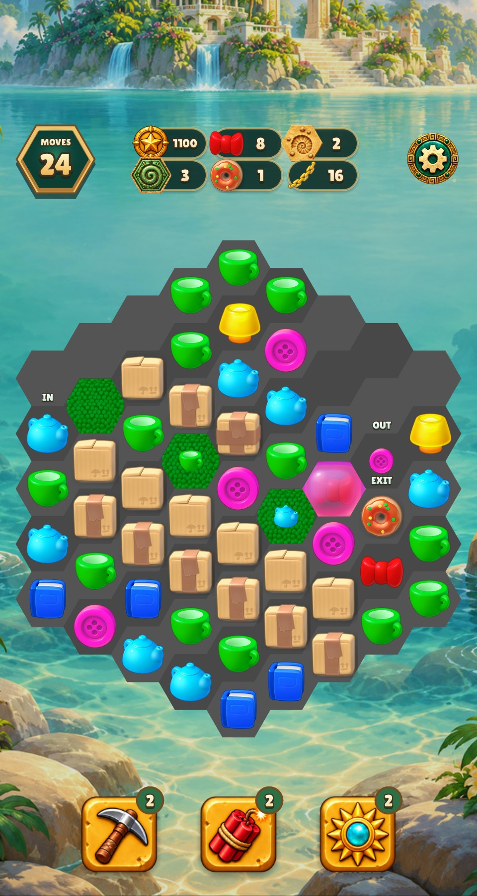 | 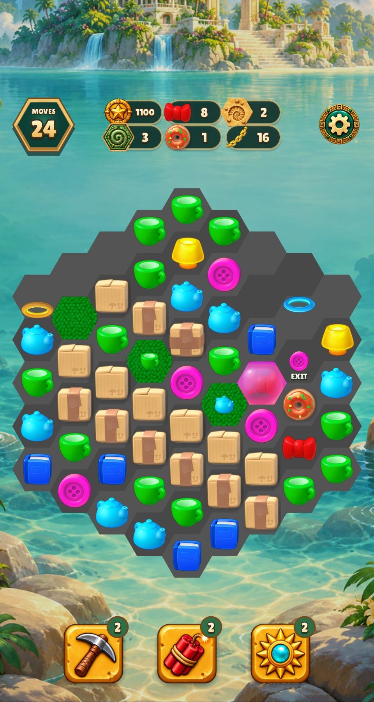 |
| Relic Rush 390×844 |  | 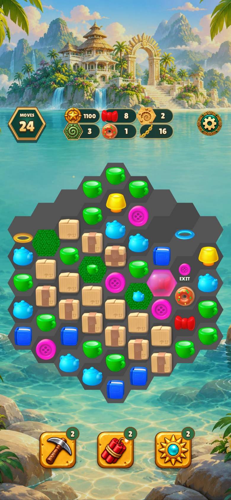 |
| Christmas Market 480×900 | 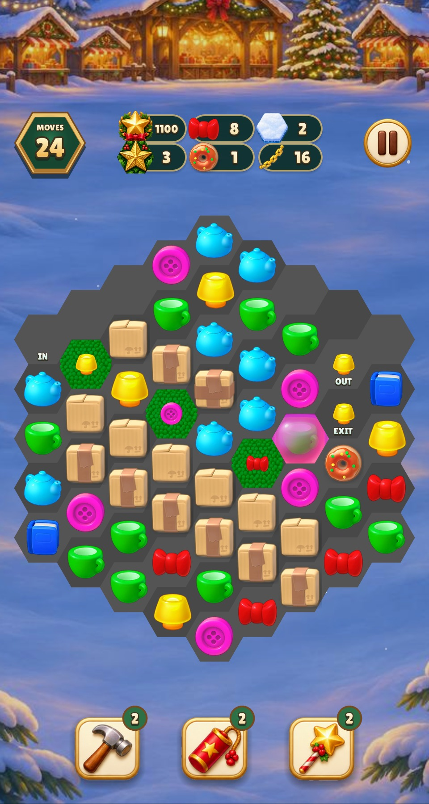 |  |
| Christmas Market 390×844 |  | 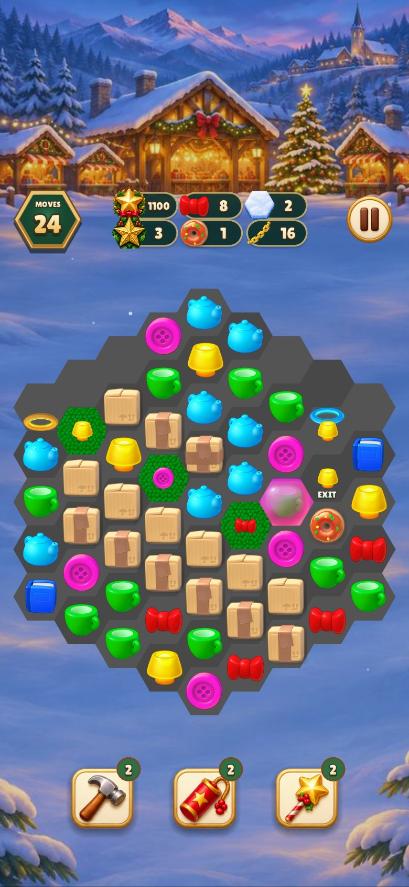 |

## Donut maker

The original glass overlay is above the heating ring and the dough. The four
previews show the existing charge mapping. The exact original progress
indicators and poses remain open.

| Game | 480×900 | 390×844 |
| --- | --- | --- |
| Relic Rush | 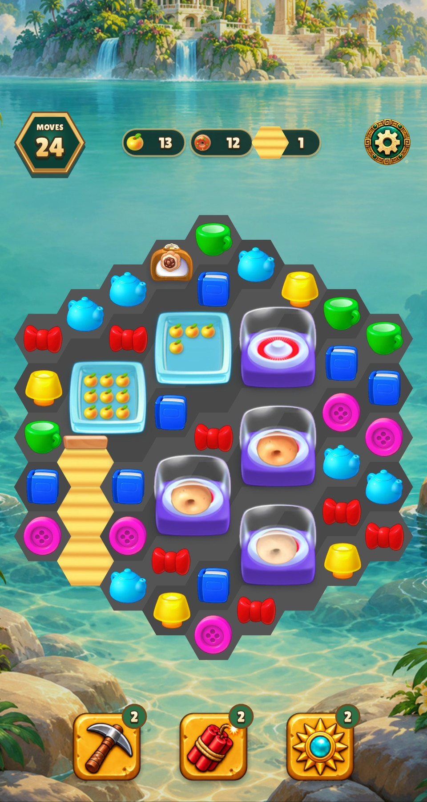 | 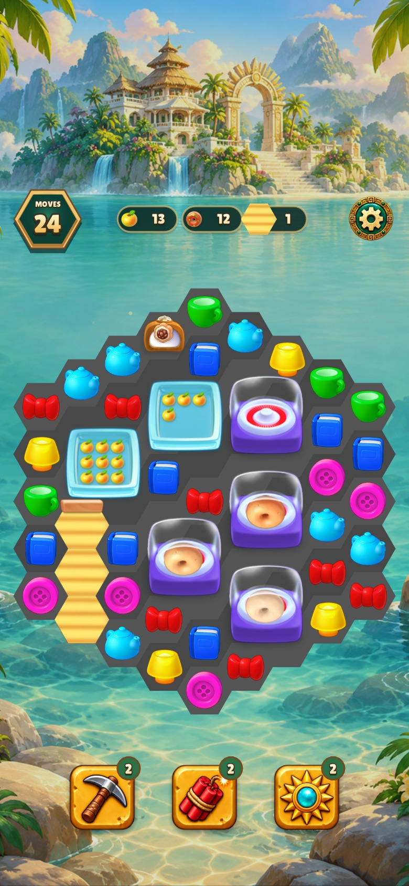 |
| Christmas Market | 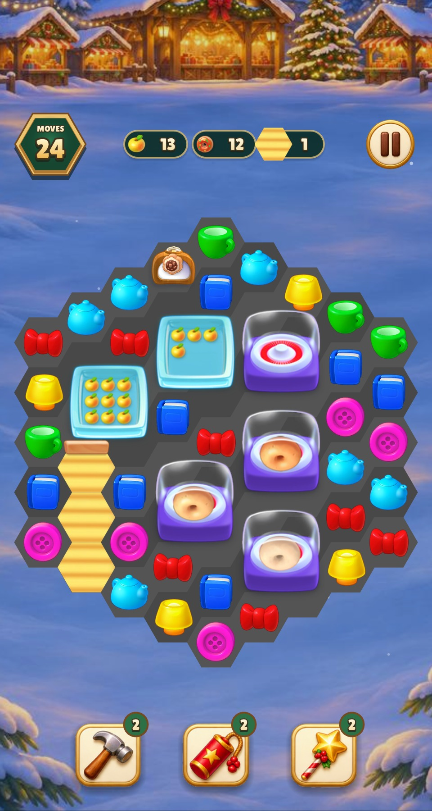 | 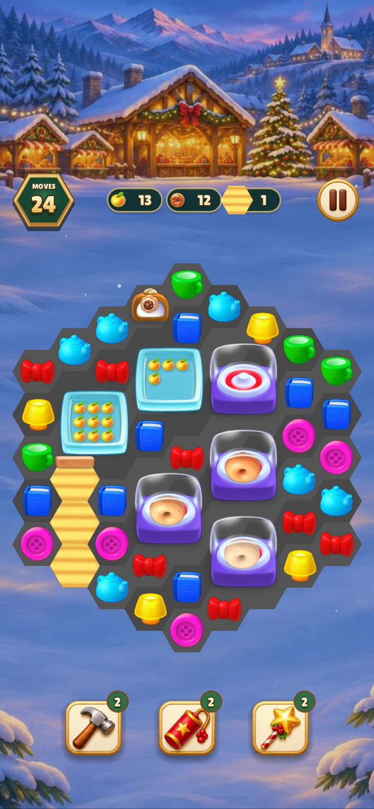 |

[Previous captures without the glass overlay](../homescapes-restored-art/README.md)

## Jelly

The six strengths run diagonally down the field, from dark red flower to clear
cherry. Below them are strengths two and one with empty cells. The soft cherry
is clipped to the authored flower opening, and the unblurred cherry is drawn
over the thin jelly at strength one.

| Game | 480×900 | 390×844 |
| --- | --- | --- |
| Relic Rush | 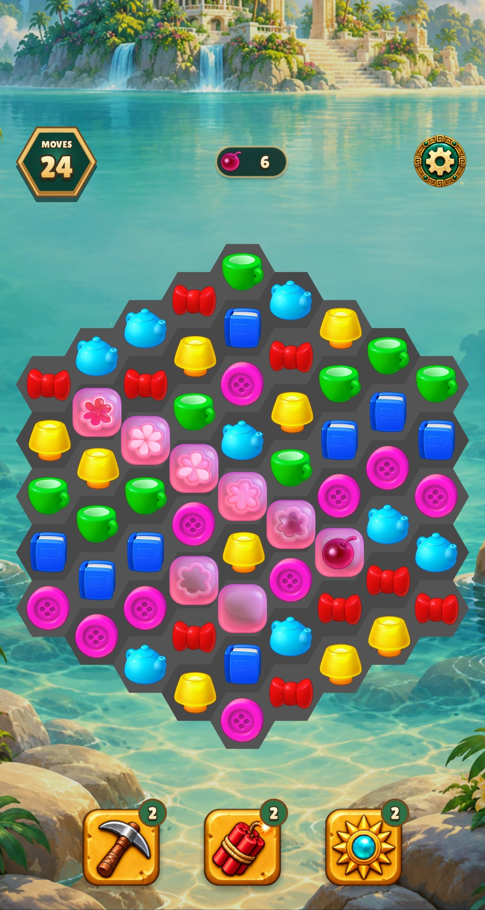 | 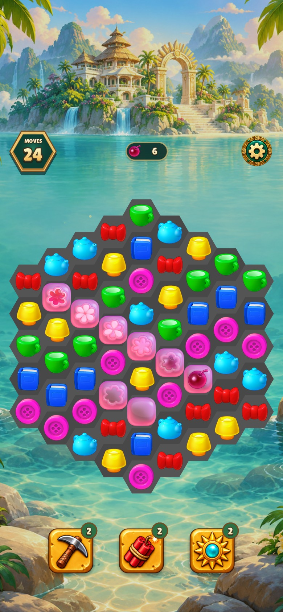 |
| Christmas Market | 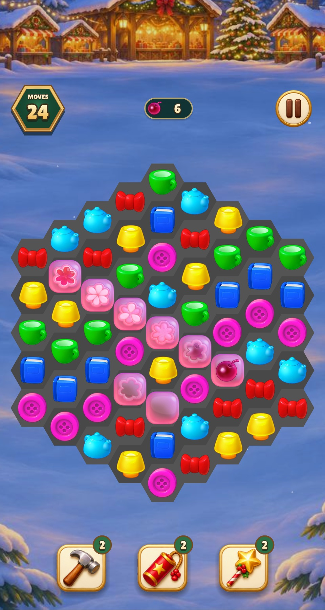 | 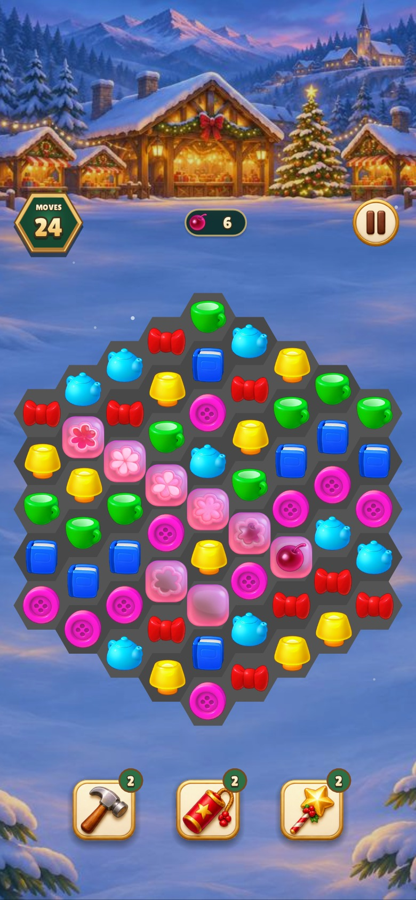 |

[Playrix's original six-state illustration](https://d2duuy9yo5pldo.cloudfront.net/playrix/e387050a-8acc-410b-a29e-52cb2c67cb14-t.png)

## Verification

- Build targets with `CFLAGS="-O2 -g -Werror"` were current (**0.17 s**).
- Shared verification passed **22 groups** in **12.12 s** with
  `make CFLAGS="-O2 -g -Werror" test TEST_BUDGET=30` (**13.12 s** wall).
- Lua lint passed with **0 warnings or errors** across 146 files (**2.91 s**).
- Six final captures per game passed in **9.46 s** for Relic Rush and
  **6.20 s** for Christmas Market. Both game runs used one process each.
- The eight jelly objects, two portal rings and original colored-box goal icon
  passed strict hex bounds. The maker is a four-cell object.
  [Registration report](registration.json)
- The shared render test checks distinct portal sprites, both variants of
  strength-two jelly and the original colored-box goal icon and counter.

Source paths, extraction steps and the outstanding colored-box field states
are listed in the [art inventory](../../HOMESCAPES_ART.md).
