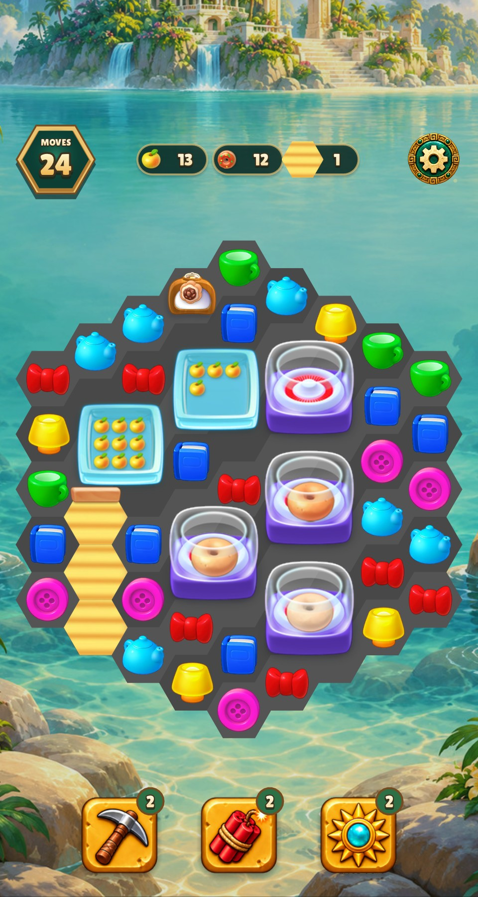
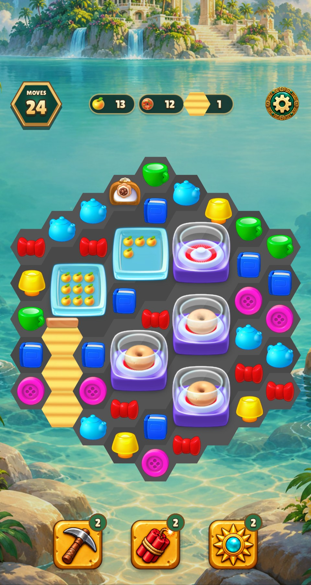
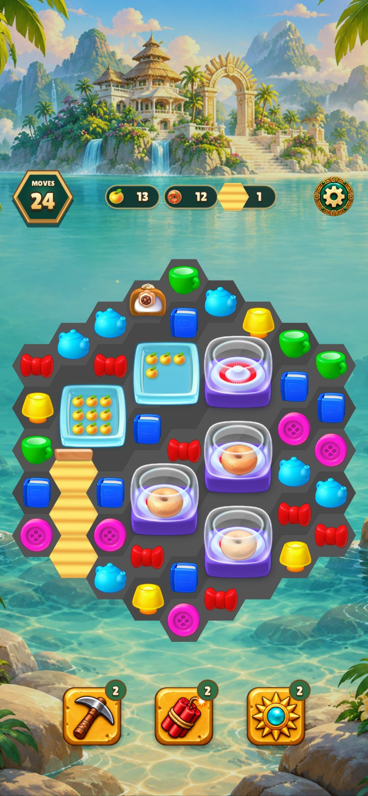
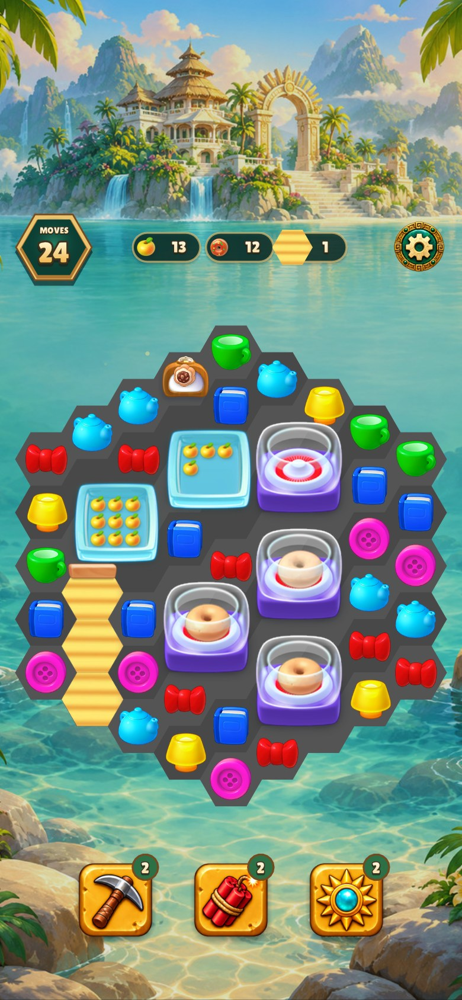
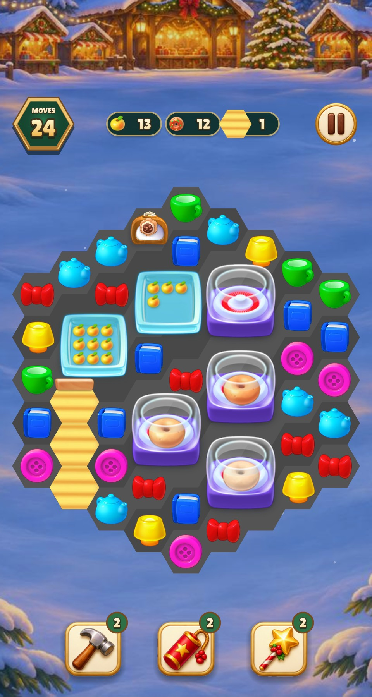
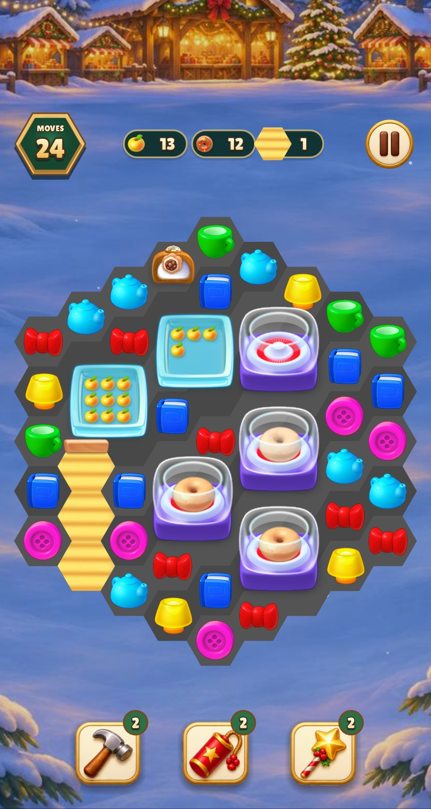
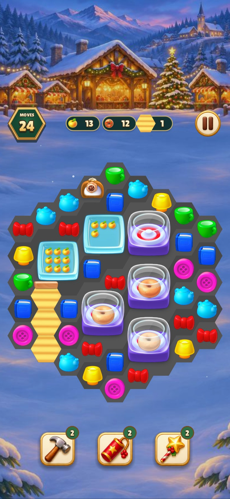
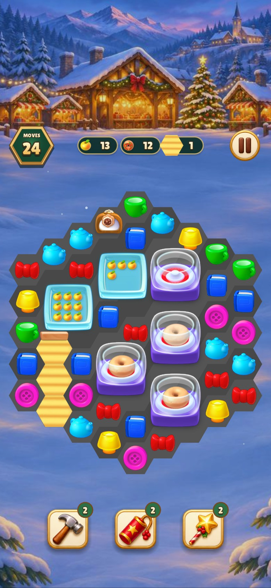

# Donut maker opening poses

On each board, the upper maker is empty. The maker immediately below it has
raw dough after one hit of a five-hit cycle. The two lower makers have heated
dough after two hits of a five-hit cycle or one hit of a three-hit cycle.
These are named source textures from the Homescapes 3.5.9 atlas, placed
inside the original base and glass layers.

| Game and logical size | Previous preview | Original opening poses |
| --- | --- | --- |
| Relic Rush 480 × 900 |  |  |
| Relic Rush 390 × 844 |  |  |
| Christmas Market 480 × 900 |  |  |
| Christmas Market 390 × 844 |  |  |

The official tutorial shows the raw pose at 2.00 s and the heated pose at
4.83 s. Later it shows glaze and two kinds of sprinkles. The runtime atlas
still needs the original source components for those later poses.
[Official tutorial](https://www.youtube.com/watch?v=6XNxRO7CMs0) · [Source mapping](../../homescapes-reference/GENERATOR_ART_SOURCES.md)

- Warning-as-error build targets were current (0.08 s wall).
- All 22 shared verification groups passed (4.26 s, 4.39 s including Make).
- Lua lint passed (1.32 s wall).
- Two named captures passed in each game (3.07 s Relic Rush and 2.13 s
  Christmas Market). Both runs used one process per game.
