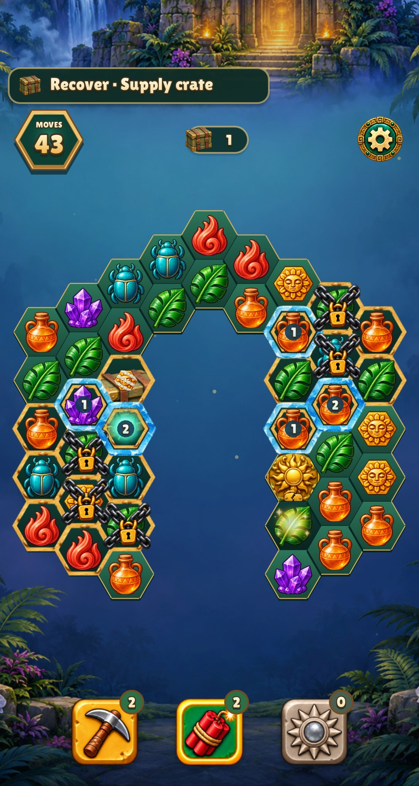
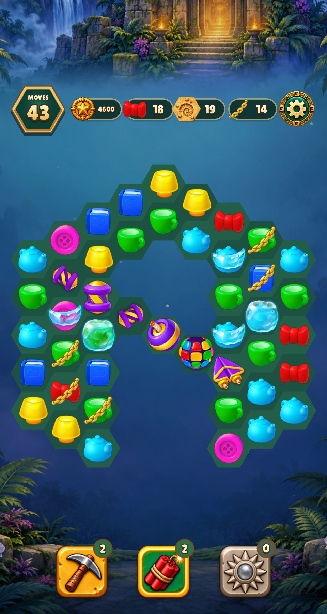
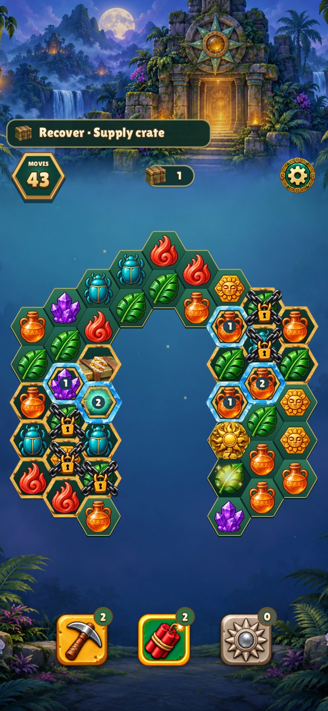
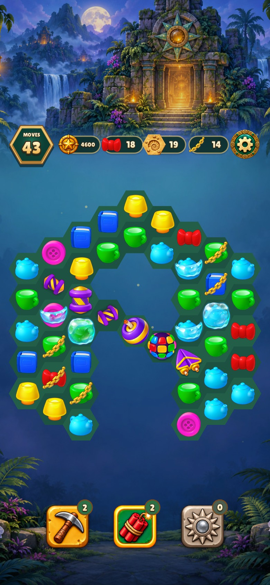

# Homescapes hex port review

[Features, source contract and remaining gaps](../../HOMESCAPES_HEX.md).

The final field uses original Homescapes sprites with no legacy gold/snow/sand
frames, selection/hint artwork, ice number badges or bevel outlines. Flat hex
geometry remains. The user explicitly retained the interface outside the field
and provisionally retained the quest-resource sprite. Missing original blocker
states are diagnostic labels, tracked in [issue #98](https://github.com/corepunch/nile-archive/issues/98).

| Before | After |
| --- | --- |
|  |  |
|  |  |

The after review fixture activates six central cells to show all six power-ups;
the older fixture hid five inside the level's hole. This fixture correction
changes the central silhouette in the comparison, not campaign geometry.

Christmas Market: [480](christmas-market/specials-board.jpg),
[390](christmas-market/phone-specials-board.jpg).
Source queue/cookie board: [Relic](relic-rush/homescapes-queue.jpg),
[Christmas](christmas-market/homescapes-queue.jpg).
Source maker/statue board: [Relic](relic-rush/homescapes-generator.jpg),
[Christmas](christmas-market/homescapes-generator.jpg).
Scrollable guide: [Relic 480](relic-rush/guide.jpg),
[Relic 390](relic-rush/phone-guide.jpg),
[Christmas 480](christmas-market/guide.jpg),
[Christmas 390](christmas-market/phone-guide.jpg).

Animation contact sheets preserve all 18 captured frames:
[ray](relic-rush/fx-ray.jpg), [plane](relic-rush/fx-plane.jpg),
[Christmas plane](christmas-market/fx-plane.jpg).
The original baseline ray fixture was also placed in an inactive cell and did
not exercise its effect. The corrected fixture enables that cell; a plane
capture asserts an emitted flight. The final sheets show the retained impact,
ray, particle and falling paths plus the original plane moving to its target.
All retained screenshots/contact sheets were visually inspected.

[Original registration sheet](original-registration.png) shows 44 atlas names
(including aliases) from 32 source PNGs. The PNGs matched the decoded source
byte-for-byte. [Geometry results](registration.json) verify strict canonical
object containment for every registered frame. Carpet/jelly material previews
remain documented diagnostics, not certified full-bleed artwork.

## Verification

- Shared production and five test binaries: `make CFLAGS="-O2 -g -Werror" all build/test/engine build/test/relic-rush build/test/christmas-market build/test/nile-archive build/test/emergency`; measured build **14.76 s**.
- Full rules, renderer/input and preflight checks: `make CFLAGS="-O2 -g -Werror" test TEST_BUDGET=30`; **22 suites/check groups passed, 0 failed**, measured execution **13.44 s** (wall command 13.62 s). The source mechanic suite reports 218 checks; both game suites cover one-tap plane activation and guide reachability. Earlier default five-second runs timed out; one earlier complete run took 4.80 s. The default budget remains five seconds and reliable compliance with it is not established on this host.
- `make lint`: **0 warnings/errors**, 146 Lua files; measured **1.36 s** on the final measured pass.
- `python3 tools/homescapes_hex.py --check`: ten generated fixture records agree exactly with the original compressed XML archive, including per-file SHA-256.
- Relic capture batch (two sizes, source boards, guide and effects): **14.4 s**; corrected guide/effect subset **12.7 s**. Final ray/plane rerun after activation-event integration: **9.7 s**.
- Christmas source/guide/plane batch: **6.7 s**; final two-size power-up/guide/plane batch: **7.6 s**.

Tests establish the documented local simulation and hex adaptation. They do not
prove original executable timing, original RNG parity, all-level solvability,
or complete original artwork coverage.
