# Original artwork restoration and phone board fit

These are actual game captures at logical 480×900 and 390×844 (the narrow size
includes safe-area insets). The source-art inventory, reproduction commands and
unresolved original states are in [HOMESCAPES_ART.md](../../HOMESCAPES_ART.md).
This review does not establish complete visual parity with Homescapes.

## Source field sizing

Before images were captured during this change, before replacing the enclosing
grid scale with active-cell bounds. Both views show source level `st0065` with
the same seed. The field now uses the maximum proportional size between the
HUD and tools; every cell remains visible and pointer coordinates follow it.

| Size | Before | After |
| --- | --- | --- |
| 480×900 | 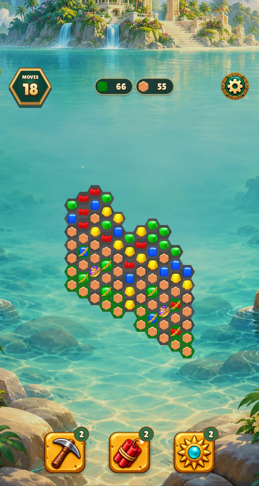 | 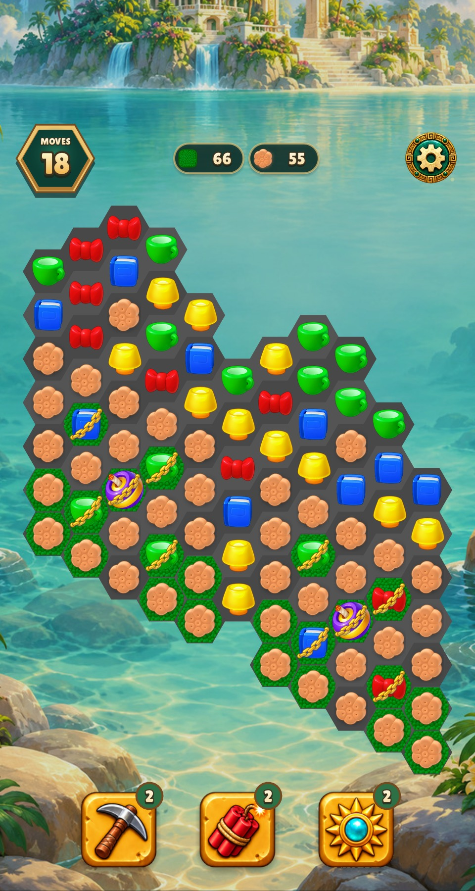 |
| 390×844 | 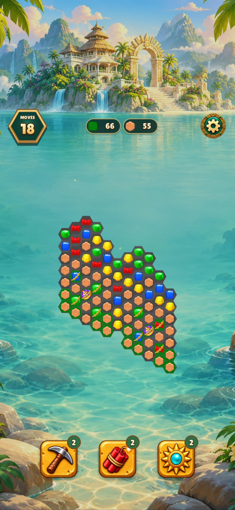 | 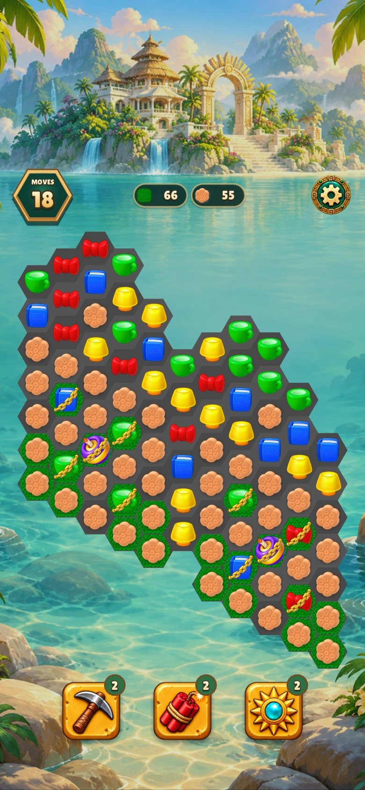 |

## Source orientation corrections

The intermediate restoration had atlas-packed objects upside down. The source
extractors now rotate statues, nuts, the platter, maker base, blind header and
queue shell by 180°. Cookie stacks already had their required rotation.
The dough placement was aligned with the corrected maker base. No recoloring
or replacement artwork was used. The maker still lacks its original dome.

| State fixture | Before correction | After correction |
| --- | --- | --- |
| Blocker strengths | 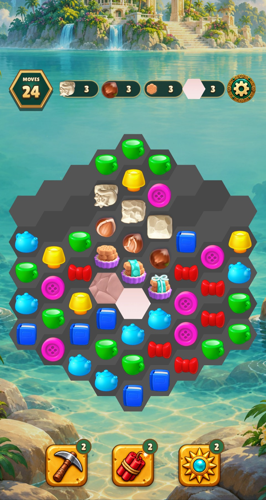 | 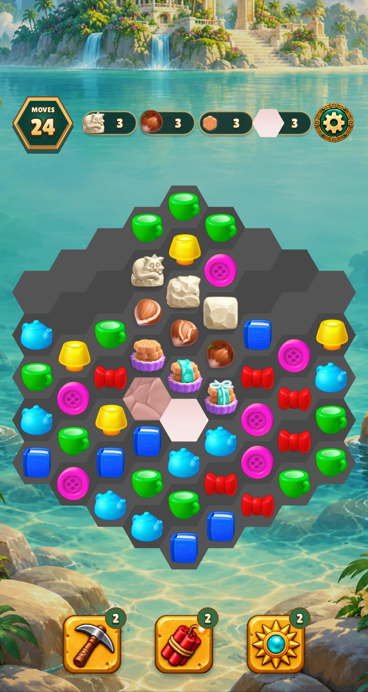 |
| Generators | 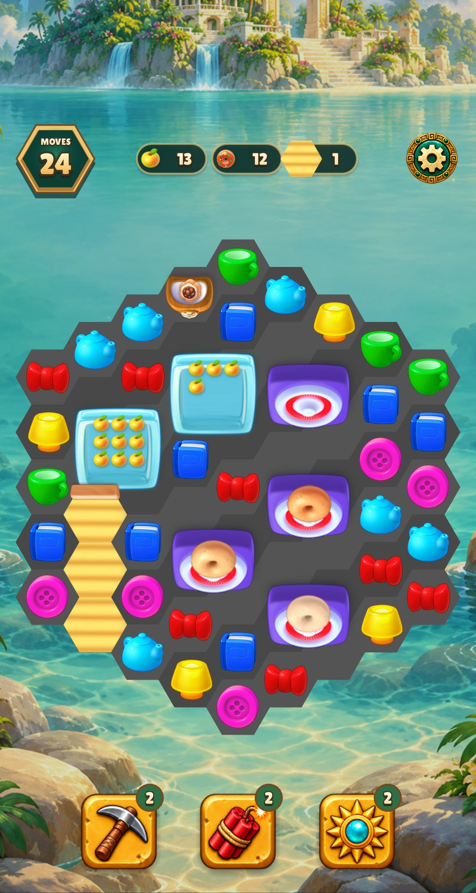 | 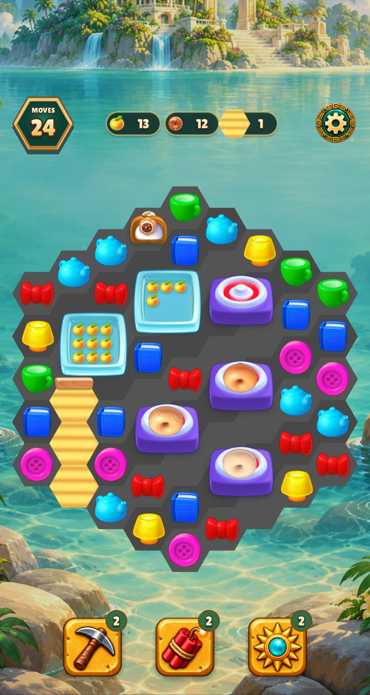 |

These fixtures enumerate states; the source-level screenshots above and below
show placement on imported fields. Earlier diagnostic-only source captures are
in [the initial port review](../homescapes-port/README.md).

## Alternate-size and second-game review

| Screen | Relic Rush | Christmas Market |
| --- | --- | --- |
| Narrow blocker strengths | 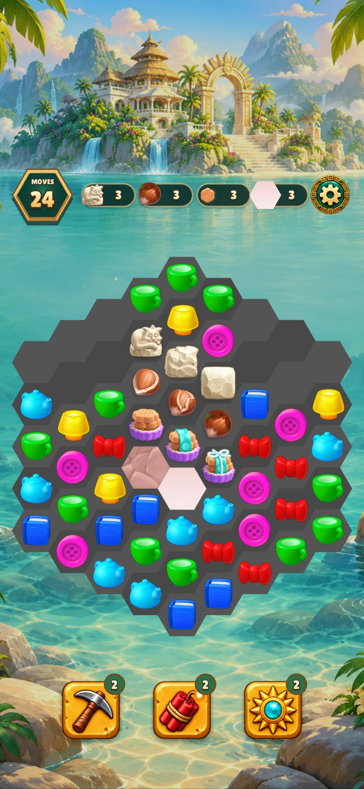 | 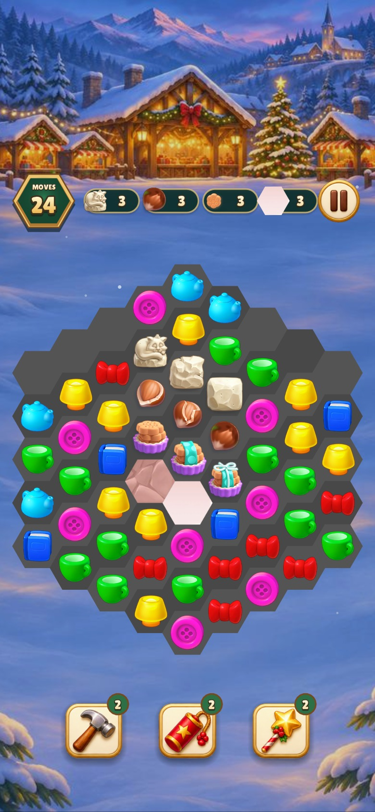 |
| Narrow generators | 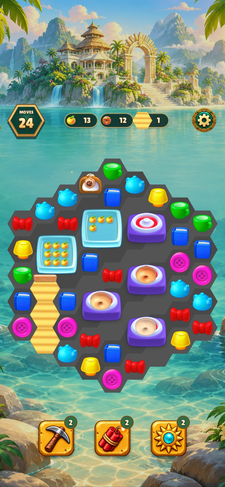 | 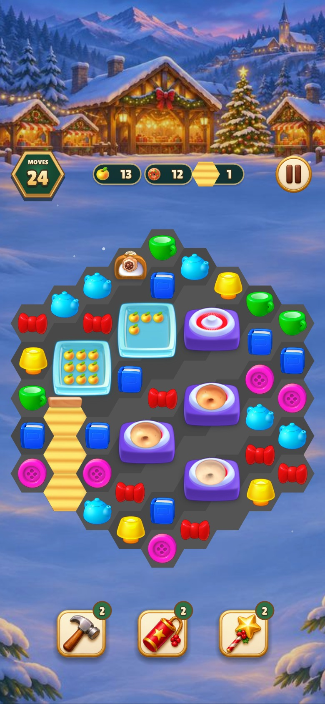 |
| Source `st0255`, narrow | 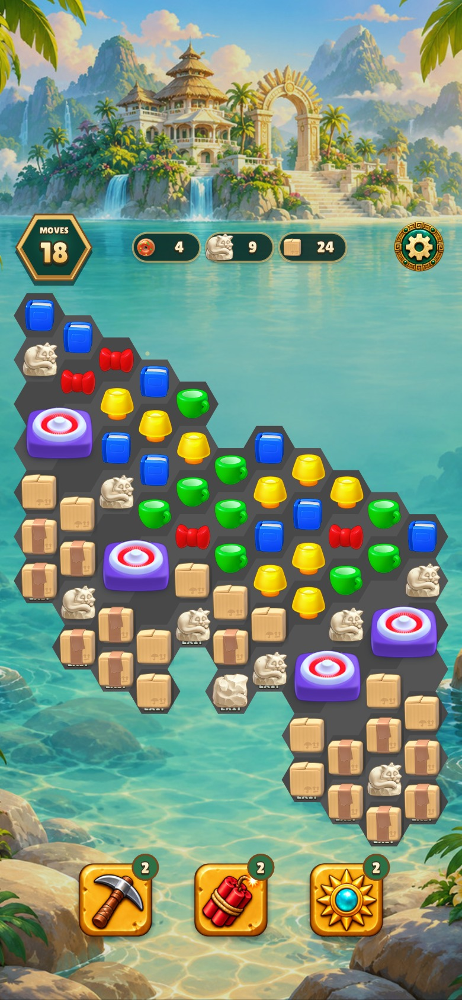 | 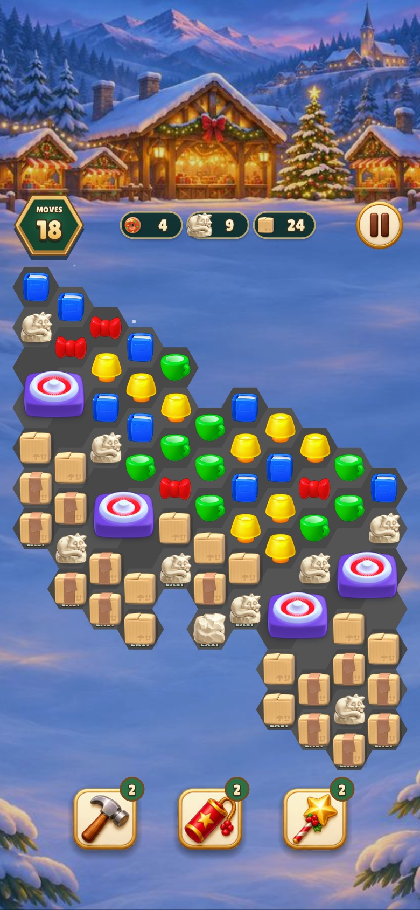 |
| Source `st0065`, 480×900 | See comparison above | 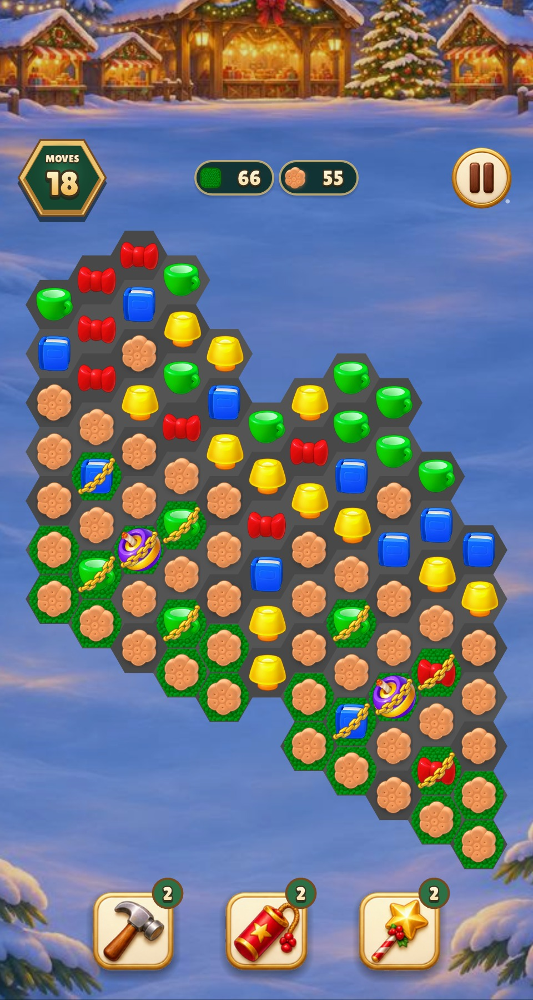 |
| Source `st0065`, 390×844 | See comparison above | 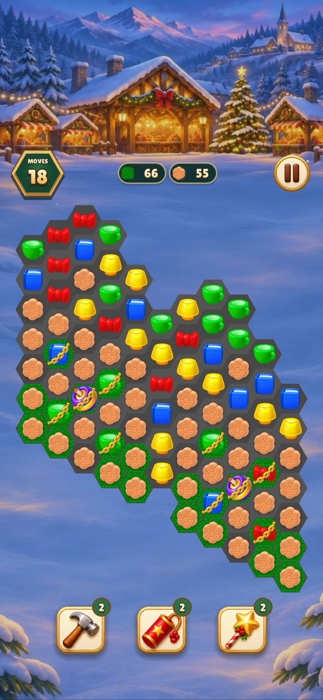 |
| Blocker strengths, 480×900 | See comparison above | 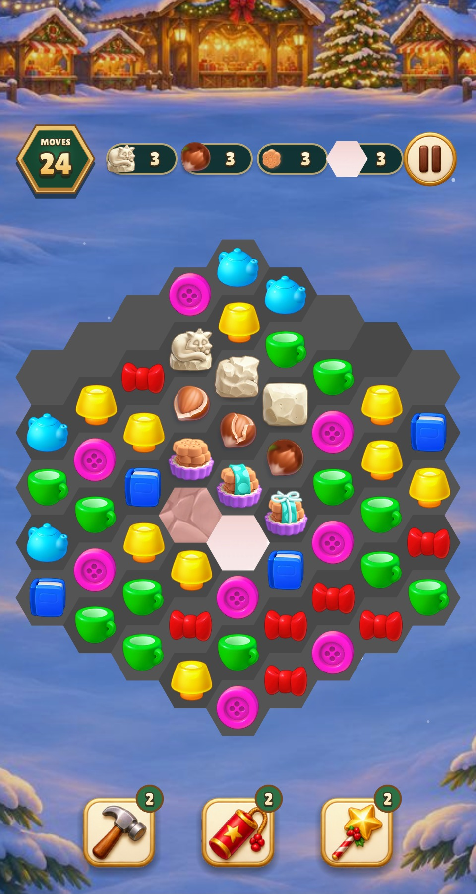 |
| Generators, 480×900 | See comparison above | 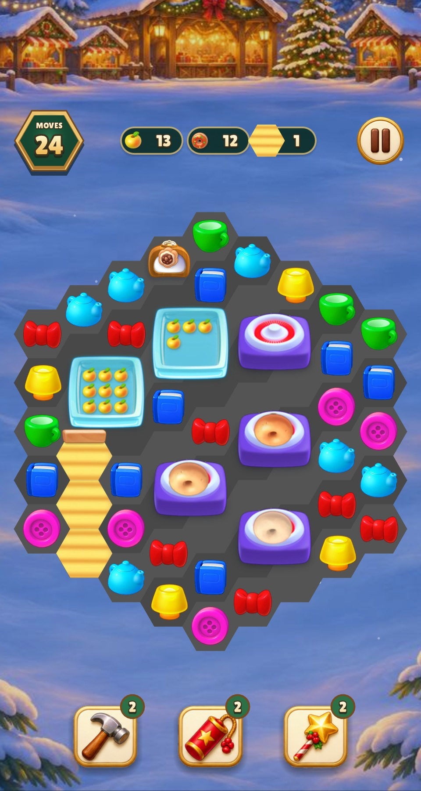 |

All 14 final captures were visually inspected. Gray field cells, original piece
alpha, three nut/statue/stack strengths, two tile materials, group footprints,
the queue preview and both phone layouts were reviewed. Existing surroundings,
controls and effects remain as requested. The source `EXIT` diagnostics visible
in `st0255` are an explicitly unresolved art state, not completed original art.

## Checks and measured times

- Full target build with `CFLAGS="-O2 -g -Werror"`: **0.24 s**; binaries were
  already current because the changes are Lua resources and image assets.
- Final `make CFLAGS="-O2 -g -Werror" test TEST_BUDGET=30`: **22 groups passed,
  0 failed, 3.93 s** execution (**4.03 s** including make). The invocation used
  an explicit 30-second ceiling; the repository default remains five seconds.
- Final `make lint`: **146 files, 0 warnings/errors, 1.56 s**.
- Seven captures per game in one invocation: Relic Rush **5.49 s** and Christmas
  Market **3.50 s** wall time. Earlier before/recovery captures are excluded
  from these final capture timings.
- [Fourteen strict registration checks](registration.json) pass for nine
  blocker objects, two tile fills, blind fill/header and queue shell. Four-cell
  composites are reviewed as objects, not certified as single-hex fills.
- Thirteen original goal images were checked against the local bundle. Sixteen
  historical crops were reproduced from the archived APK and compared by pixels;
  extractor rotations preserve source artwork and alpha.
- Regression checks cover fitting every imported fixture, full cell visibility,
  pointer lookup, centring, one draw per shared footprint, and queue previews
  that cannot advance simulation.

Reproduce each game's selected captures in one process:

```sh
build/test/relic-rush 'shot homescapes-queue' 'shot phone-homescapes-queue' 'shot homescapes-generator' 'shot homescapes-art' 'shot phone-homescapes-art'
build/test/christmas-market 'shot homescapes-queue' 'shot phone-homescapes-queue' 'shot homescapes-generator' 'shot homescapes-art' 'shot phone-homescapes-art'
```

The last two filters also select the corresponding `-generators` fixtures.
