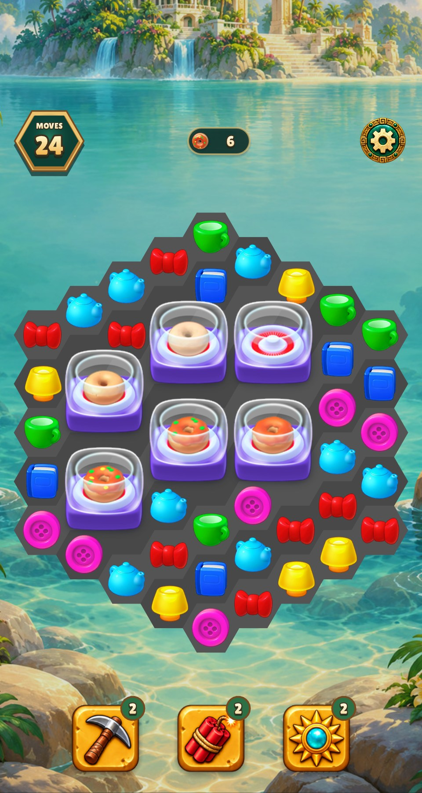
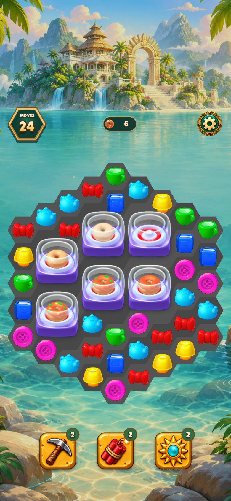
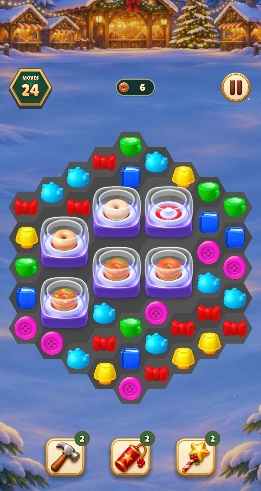
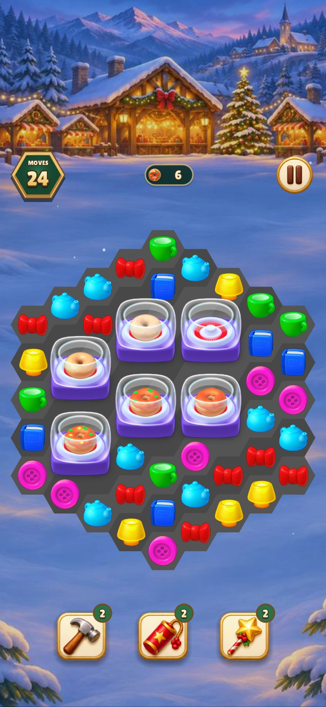

# Classic maker charge

## Classic donut maker

The empty maker is at the upper right. The rest show raw dough at upper
center, heated dough at middle left, glaze at middle right, green sprinkles
at middle center and yellow sprinkles at lower left.

| Game | 480 × 900 | 390 × 844 |
| --- | --- | --- |
| Relic Rush |  |  |
| Christmas Market |  |  |

The three late poses layer the original glaze and decoration meshes on the
shared dough frame. The hex composite's position over the heating surface
was compared visually with the Playrix recording. Each test capture uses a
five-hit cycle to expose every pose. See the earlier
[opening-pose review](../homescapes-maker-poses/README.md) for the prior
renderer.

[Official maker tutorial](https://www.youtube.com/watch?v=6XNxRO7CMs0) · [Source acquisition and mapping](../../homescapes-reference/GENERATOR_ART_SOURCES.md)

## Verification

- Warning-as-error build targets were current (0.09 s wall).
- All 22 shared verification groups passed (5.99 s, 6.13 s including Make).
- Lua lint passed (2.12 s wall). The three atlas decoder tests passed
  (1.58 s).
- 11 named maker layers matched the extracted source pixels.
- The renderer checks exercise all five charged poses.
- Four captures passed per game (4.59 s Relic Rush and 3.31 s Christmas
  Market), with one process per game.
