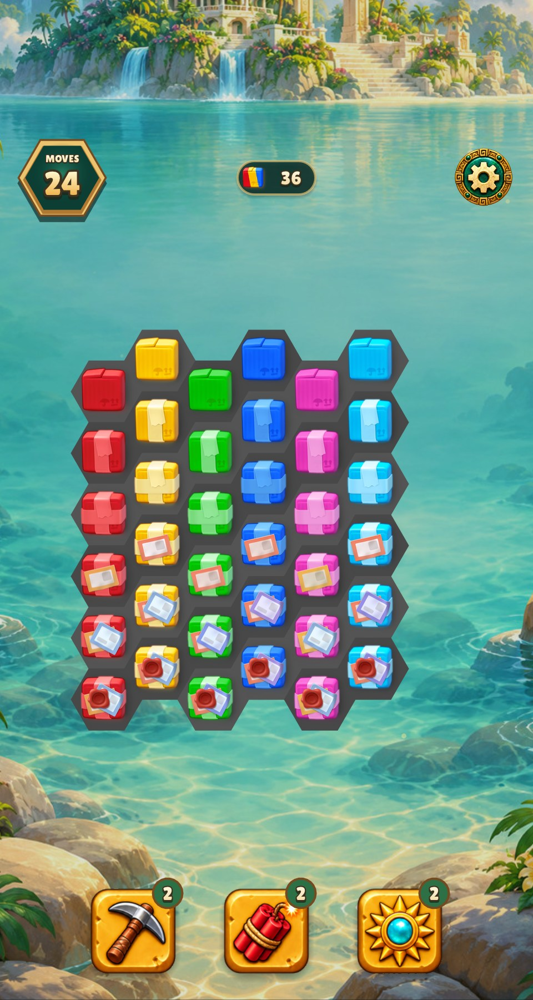
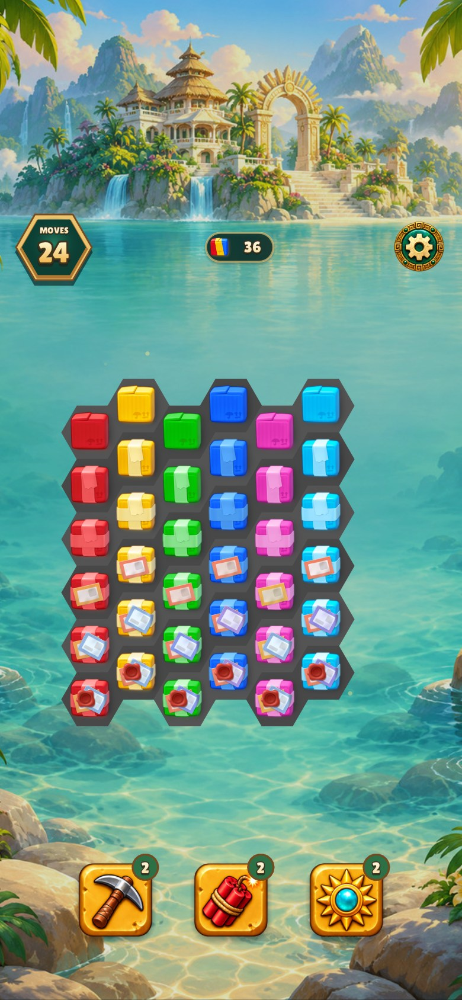
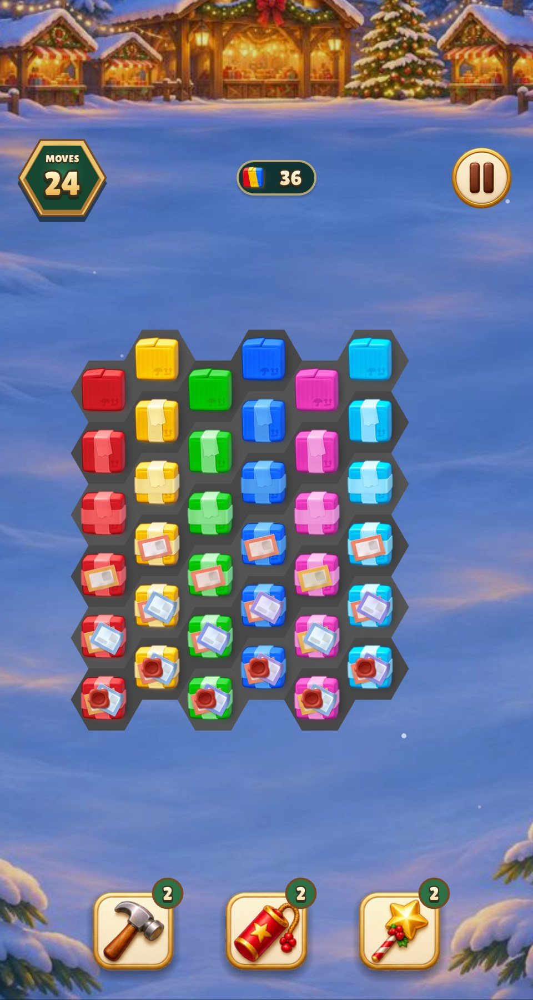
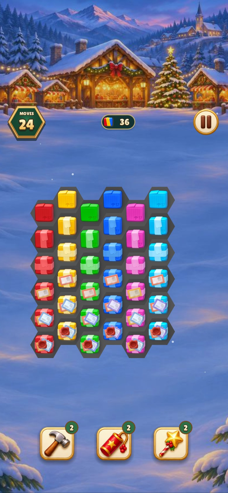

# Colored boxes and classic maker charge

## Colored boxes

Each column is one original color. Strength increases from one to six from
the top of each column. The source atlas supplies 36 distinct images with
the same health and color keys used by the original client.

| Game | 480 × 900 | 390 × 844 |
| --- | --- | --- |
| Relic Rush |  |  |
| Christmas Market |  |  |

## Classic donut maker

The empty maker is at the upper right. The rest show raw dough at upper
center, heated dough at middle left, glaze at middle right, green sprinkles
at middle center and yellow sprinkles at lower left.

| Game | 480 × 900 | 390 × 844 |
| --- | --- | --- |
| Relic Rush |  |  |
| Christmas Market |  |  |

The three late poses layer the original glaze and decoration meshes on the
shared dough frame. The hex composite's position over the heating surface
was compared visually with the Playrix recording. Each test capture uses a
five-hit cycle to expose every pose. See the earlier
[opening-pose review](../homescapes-maker-poses/README.md) for the prior
renderer.

[Official maker tutorial](https://www.youtube.com/watch?v=6XNxRO7CMs0) · [Official colored boxes tutorial](https://www.youtube.com/watch?v=FaMduRjYcsA) · [Source acquisition and mapping](../../homescapes-reference/GENERATOR_ART_SOURCES.md)

## Verification

- Warning-as-error build targets were current (0.09 s wall).
- All 22 shared verification groups passed (5.99 s, 6.13 s including Make).
- Lua lint passed (2.12 s wall). The three atlas decoder tests passed
  (1.58 s).
- All 36 original box sprites and 11 named maker layers matched the
  extracted source pixels. All 36 box states passed strict hex object
  registration in both game atlases.
- The renderer checks exercise all 36 box keys and all five charged poses.
- Four captures passed per game (4.59 s Relic Rush and 3.31 s Christmas
  Market), with one process per game.
