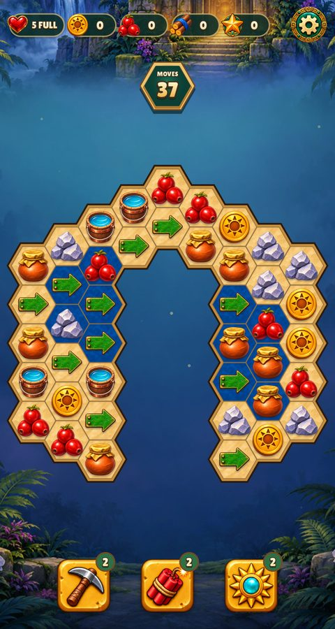
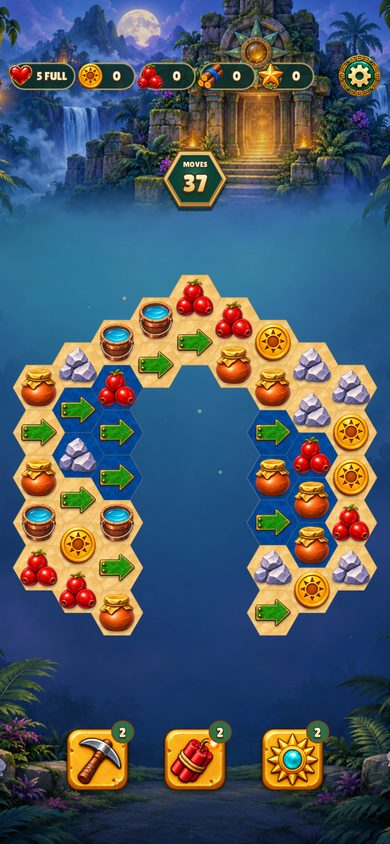
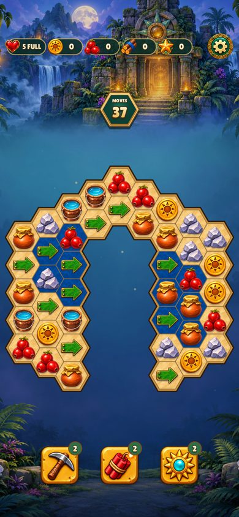
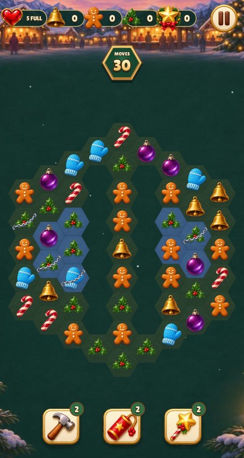
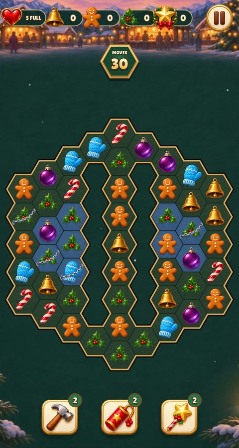
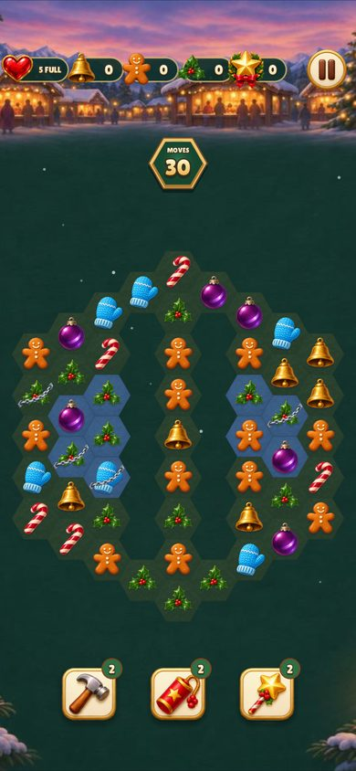
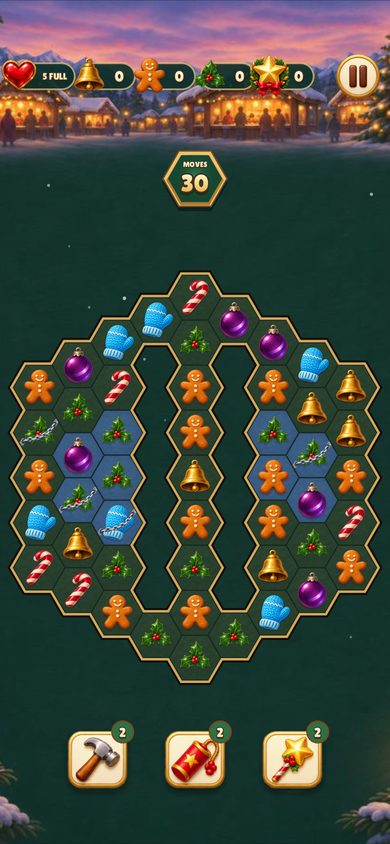

# Match-3 board frame

Both match-3 boards get back an outline around their silhouette, in the manner
of a Cradle of Rome plaque board: a dark edge outside a warm metal rim, with a
slightly wider dark seam between faces. The frame keeps Relic Rush's cobalt
target cells apart from the blue jungle mist, and lifts Christmas Market's
spruce board off its spruce backdrop. Cell art is unchanged.

| Screen | Before | After |
| --- | --- | --- |
| Relic Rush level 6, 480×900 |  |  |
| Relic Rush level 6, 390×844 |  |  |
| Christmas Market level 4, 480×900 |  |  |
| Christmas Market level 4, 390×844 |  |  |

```sh
./build/relic-rush --headless --mute --fresh --size 480x900 --level 6 --shot rr-480.png
./build/christmas-market --headless --mute --fresh --size 480x900 --level 4 --shot cm-480.png
```
