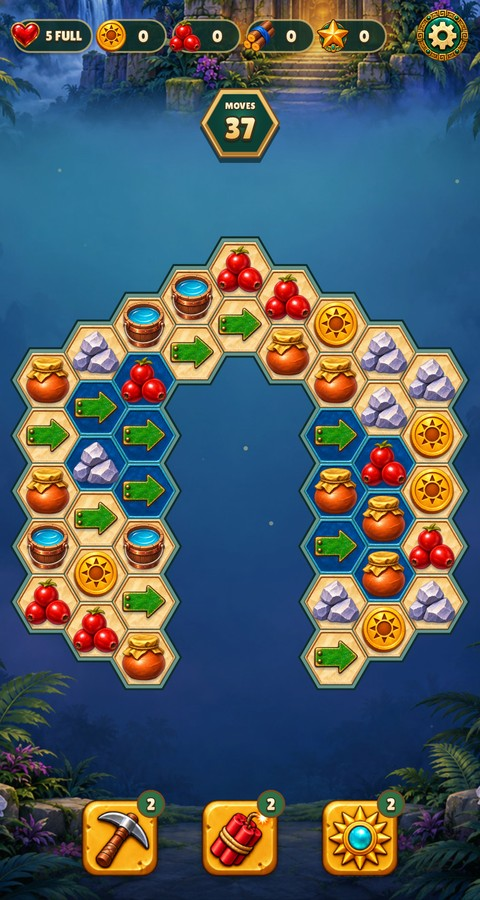
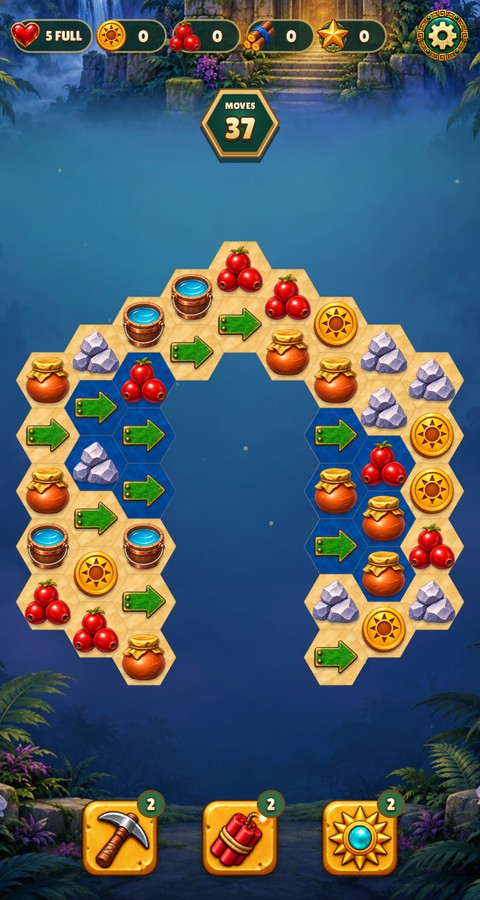
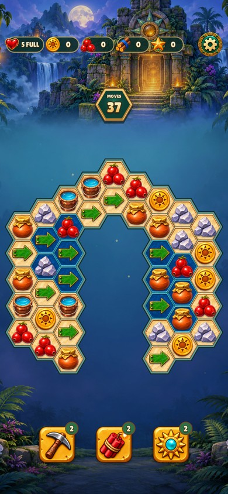
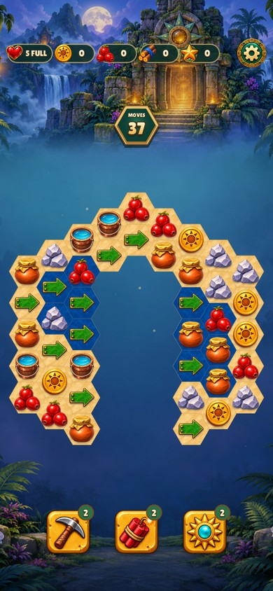
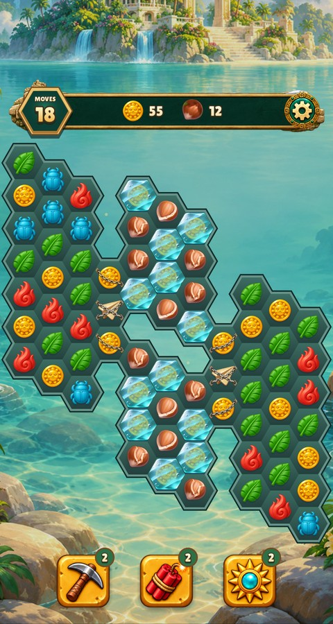
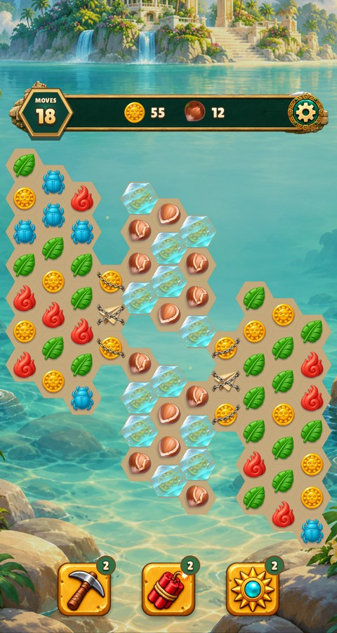
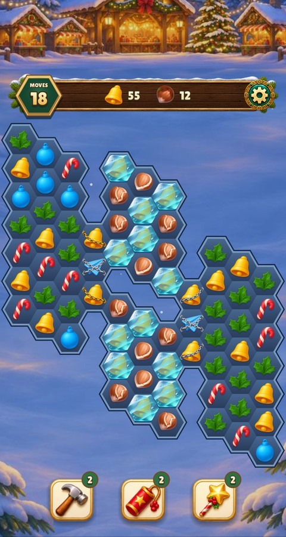
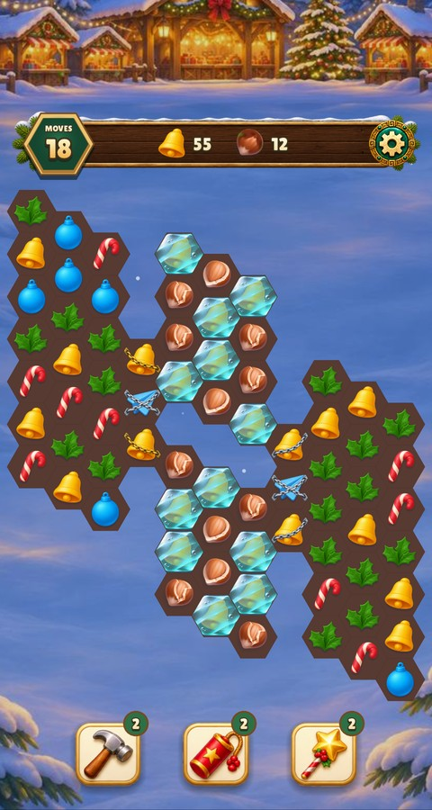

# Match-3 board surfaces

Both games use a full-radius backing and a hairline seam between faces.
Relic Rush uses flat limestone and cobalt stone from one authored sheet.
Christmas Market uses its walnut, cobalt and amber panes on the same renderer.
Reference boards pick up the flat backing and keep their authored elements.

| Screen | Before | After |
| --- | --- | --- |
| Relic Rush campaign, 480×900 |  |  |
| Relic Rush campaign, 390×844 |  |  |
| Relic Rush reference board, 480×900 |  |  |
| Christmas Market reference board, 480×900 |  |  |

[Relic Rush materials and chain overlay](relic-art.jpg).
[Christmas Market campaign at both phone sizes](../../../games/christmas-market/docs/screenshots/review/lantern-panes/README.md).

Capture in one run with the game renderer.

```sh
make all build/test/all
build/test/all --suite=relic-rush --suite=christmas-market \
  "shot dressing-shore" "shot dressing-states" "shot homescapes-chains" \
  "shot main-character-board" "shot phone-board"
```
