# Authored elements and deliberate board shapes

This review covers six new rule families, 48 original sprites, and the revised
30-level progression in each game. The [element reference](../../MATCH3_ELEMENTS.md)
describes rules, King counterparts, level schema and reproduction. Campaign
notes list every board's family, intended task and initial coverings:
[Relic Rush](../../../games/relic-rush/docs/board-progression.md),
[Christmas Market](../../../games/christmas-market/docs/board-progression.md).

## Designed spaces

The supplied hex-board references prompted a second geometry pass. Long
interior channels, chambers connected at one end, tapered bowls and compact
courts replace small arbitrary edge cuts. Families recur with changed goals
and obstructions. Relic's chambers join above; Christmas's join below. Their
lane openings and bowl widths also differ. The earlier
[board-progression checkpoint](../board-progression/README.md) preserves the
before captures; its first-pass after images are historical, not the final layouts.

| Family | Relic Rush | Christmas Market |
| --- | --- | --- |
| Twin lanes, 480×900 | 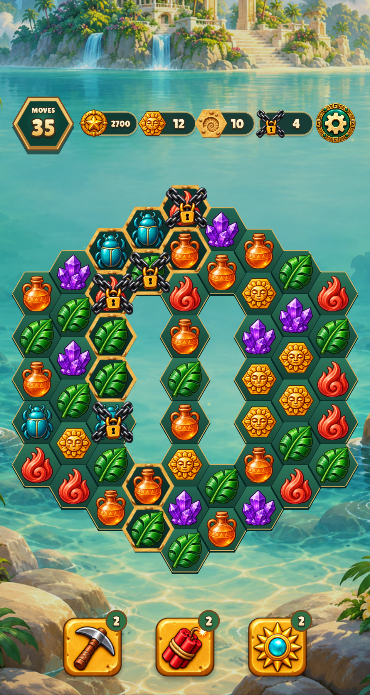 | 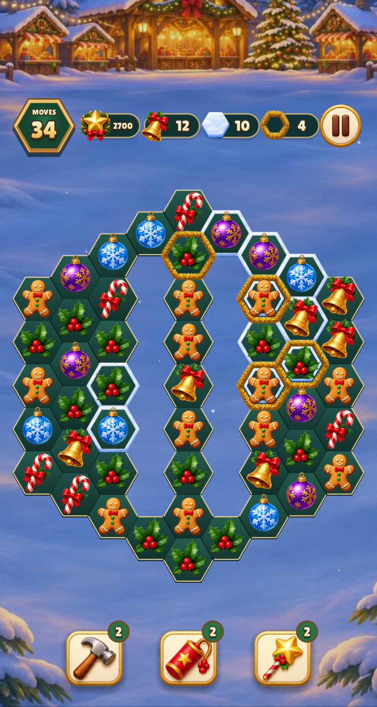 |
| Two chambers, 390×844 with safe areas | 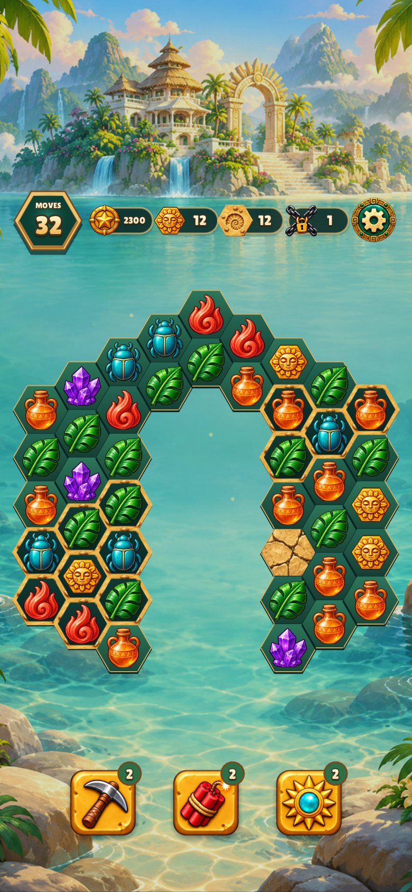 | 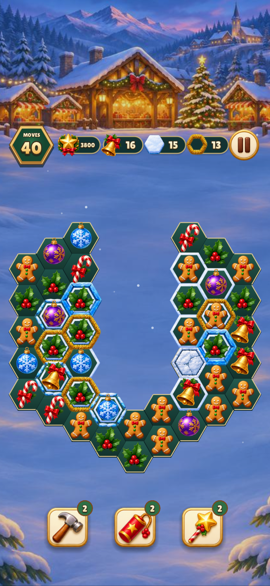 |
| Bowl with tunnel delivery, 480×900 | 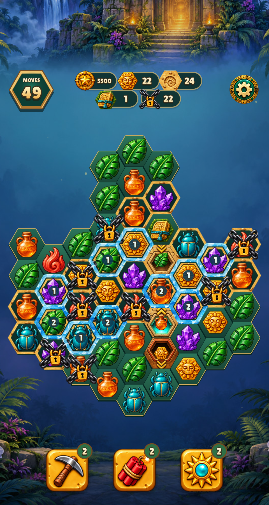 | 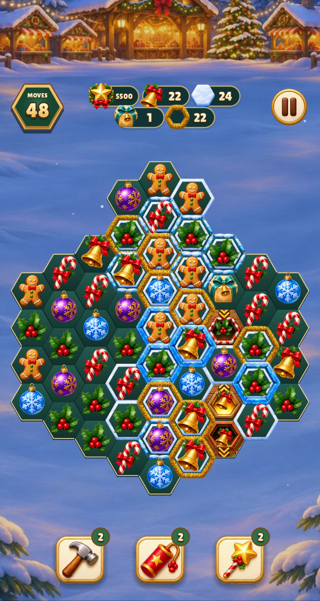 |

Mandatory ranked terrain avoids the thin isolated spine on lane boards.
Delivery routes are explicit, validated vertical/tunnel paths. Bot failures
led to localized changes in target placement and small-workspace workloads;
these checks establish feasible seeds, not human difficulty or a win-rate target.

## Actual atlas states on the board

Every stone strength, all six crate colors at both strengths, tunnel ends,
three discovery states, growth, delivery and receiving exit appear in the
debug board. This is a visual audit fixture, not a campaign level. Both skins
use authored artwork, including the six-goal HUD. Object images are clipped
to their footprints; pieces on special floor cells leave room for the floor art.

| Size | Relic Rush | Christmas Market |
| --- | --- | --- |
| 480×900 | 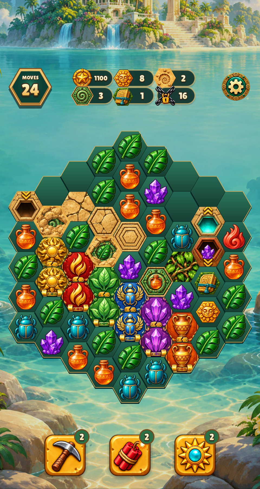 | 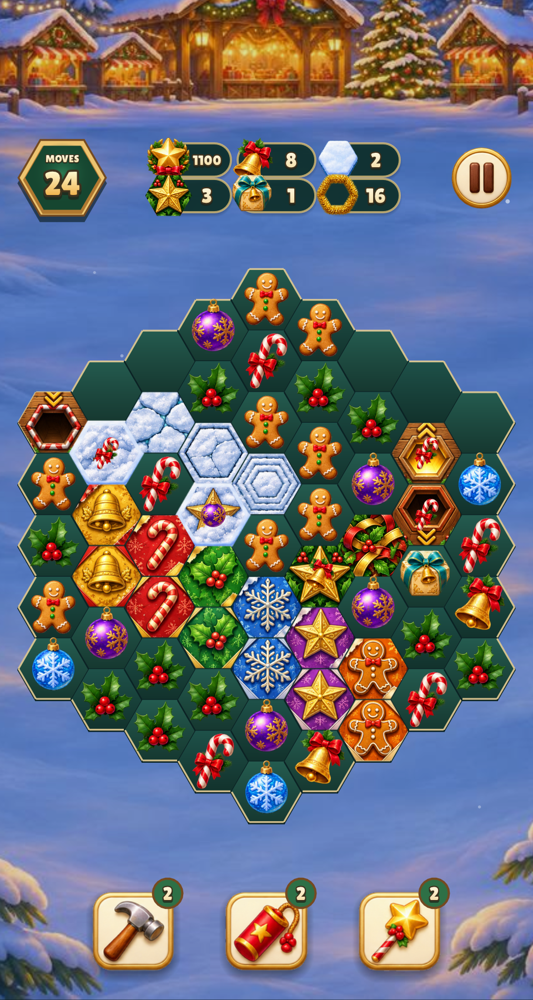 |
| 390×844, safe areas | 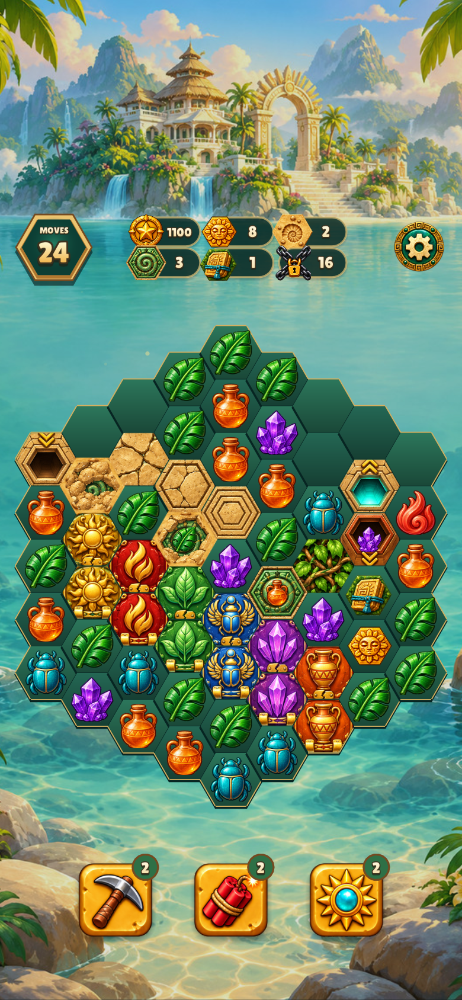 | 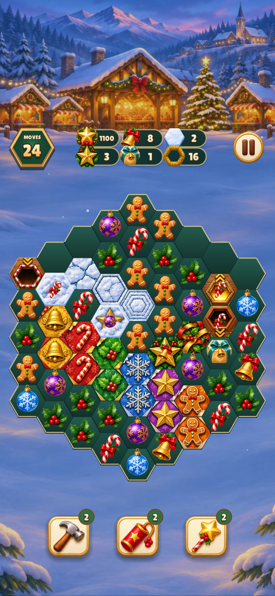 |

The user identified poor fit in the first art pass. The sampled blockers
covered only 75.7–87.0% of the canonical hex face. The replacement uses flat
paving, seal panels and gift lids, painted with full bleed and cut to the
shared mask. Their strengths vary inside the same outline. Two freestanding
delivery icons keep the first atlas's original alpha.

| Fit correction | Before | After |
| --- | --- | --- |
| Relic, 480×900 | 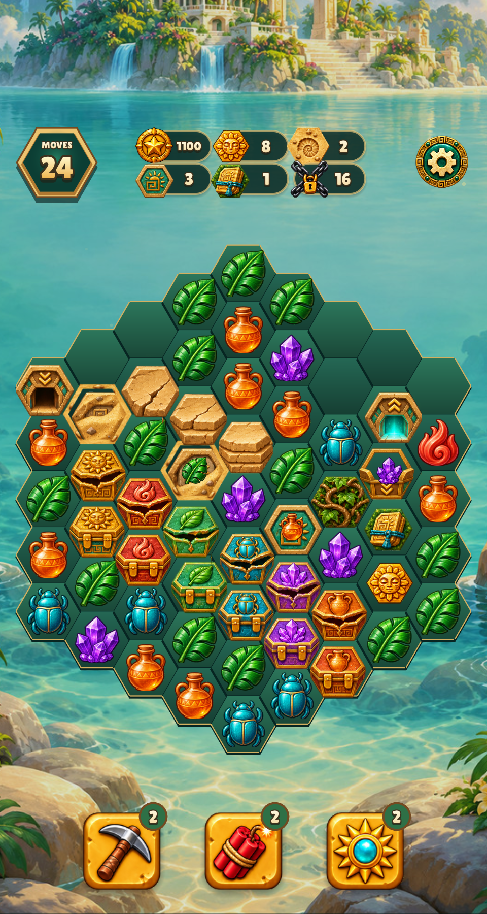 |  |
| Christmas, 390×844 | 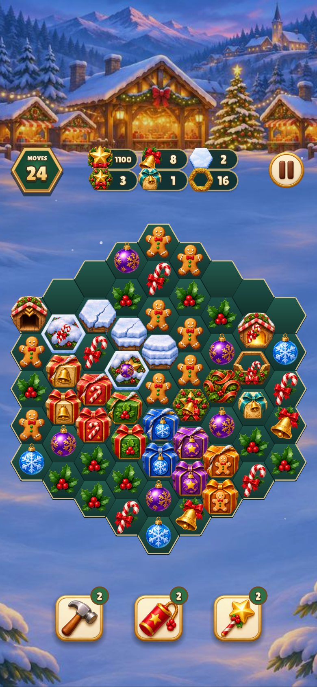 |  |

The [master](../../../engine/art/match3-elements/source.png) and
[exact prompt](../../../engine/art/match3-elements/prompt.txt) preserve the
single surface-atlas ImageGen call for both themed sets. The first atlas is
retained for the two delivery icons. The registration manifest records
all crops, fingerprints, transforms and runtime paths. The
[canonical mask, visible preview and quick checker](../../../engine/art/hex-tile/README.md)
are shared by every project. All 46 filled runtime surfaces match the mask's
alpha byte-for-byte; see the [exact fit report](fit-report.json).

## Guides and tunnel animation

The expanded guides fit inside both viewports. They cover the HUD rather than
allowing the HUD to repaint over their text. Christmas uses its themed names.

| Relic Rush, 480×900 | Christmas Market, 390×844 with safe areas |
| --- | --- |
| 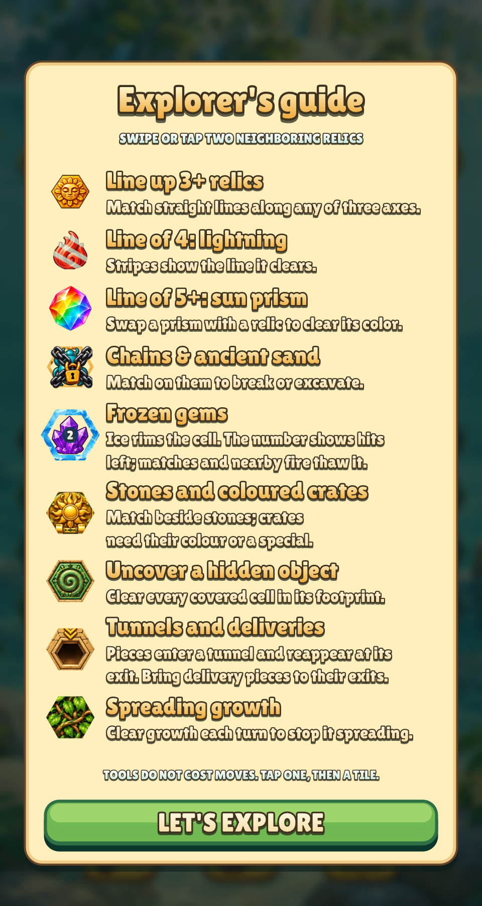 |  |

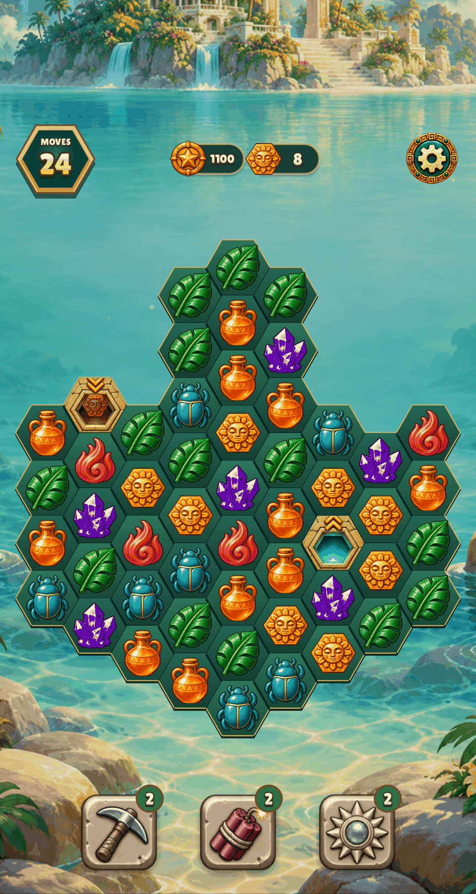

The reel drives the real fall pose. A piece disappears at the entrance and
reappears at its destination without traveling across unrelated board cells.

## Reproduction and checks

Use the existing test binaries; one invocation per game's selected batch:

```sh
make CFLAGS="-O2 -g -Werror" all build/test/relic-rush build/test/christmas-market
build/test/relic-rush "shot designed-" "shot delivery-finale" "shot element-states" "shot phone-element-states" "shot guide" "shot phone-guide" "reel tunnel-hop"
build/test/christmas-market "shot designed-" "shot delivery-finale" "shot element-states" "shot phone-element-states" "shot guide" "shot phone-guide"
build/test/relic-rush "rules campaign_play" "rules campaign_layout" --extended
build/test/christmas-market "rules campaign_play" "rules campaign_layout" --extended
make test
make lint
```

On macOS the renderer needs WindowServer access; sandbox-only launches can
abort before drawing. On Linux use Xvfb. Captures above were inspected in the
actual engine renderer, including every added strength/color and both guide sizes.

Measured validation on the development Mac:

| Check | Result | Seconds |
| --- | --- | ---: |
| Full native build and remaining shared test binaries, `-Werror` | Passed | 10.60 |
| Relic campaign play + layout, all 30 boards | 4,623 checks passed | 18.01 |
| Christmas campaign play + layout, all 30 boards | 4,659 checks passed | 14.11 |
| Relic representative shape captures | 3 passed | 6.07 |
| Christmas representative shape captures | 3 passed | 5.67 |
| Relic final fitted state captures | Passed | 2.0 |
| Relic final fitted guide, campaign captures and tunnel reel | Passed | 5.9 |
| Christmas final fitted state captures | Passed | 2.7 |
| Christmas final fitted guide capture | Passed | 1.9 |
| Christmas final fitted campaign captures | Passed | 2.2 |
| Relic campaign smoke | Passed | 36.88 |
| Christmas campaign smoke | Passed | 43.99 |
| Relic normal smoke | Passed | 11.49 |
| Christmas normal smoke | Passed | 12.31 |
| Canonical mask checker regressions | 4 passed | 0.06 |
| Full shared `make test`, including asset and renderer checks | 22 passed, within unchanged 5-second budget | 4.01 |
| Final `make lint` | 137 files, zero warnings/errors | 1.24 |

The two bot checks each permit up to four deterministic starts per board.
They do not assert that every seed is winnable or that every board has the
intended difficulty for a new player. Story and first-clear building rewards
are unchanged.
