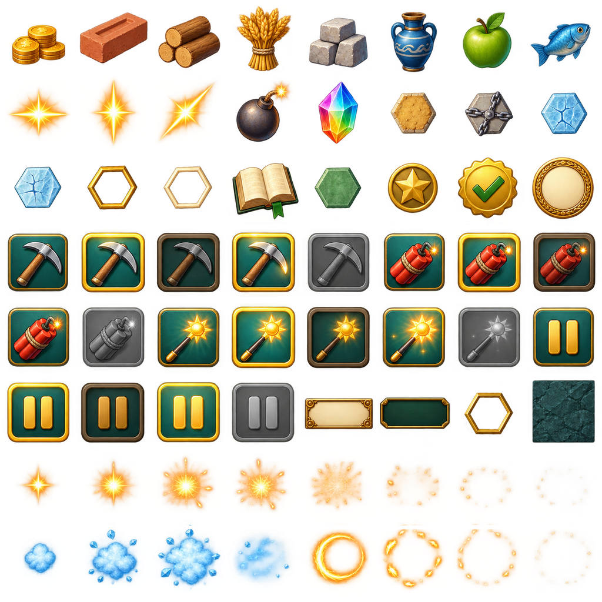
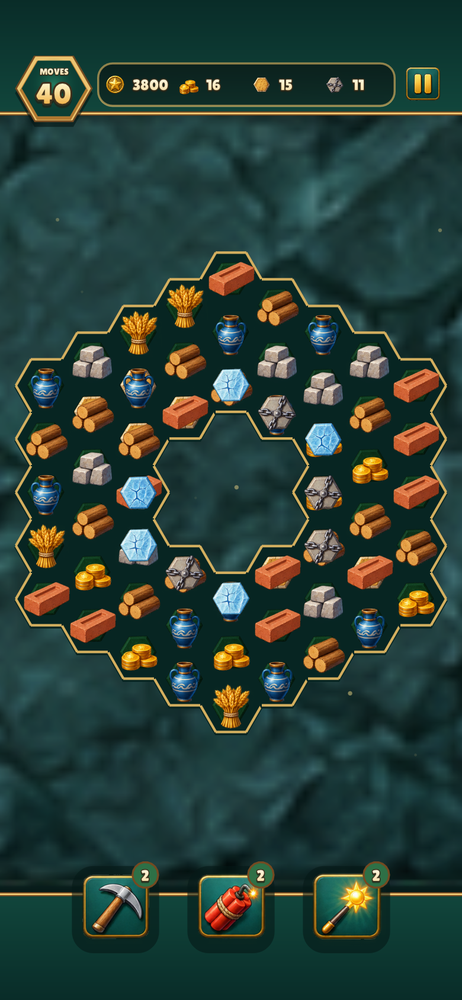
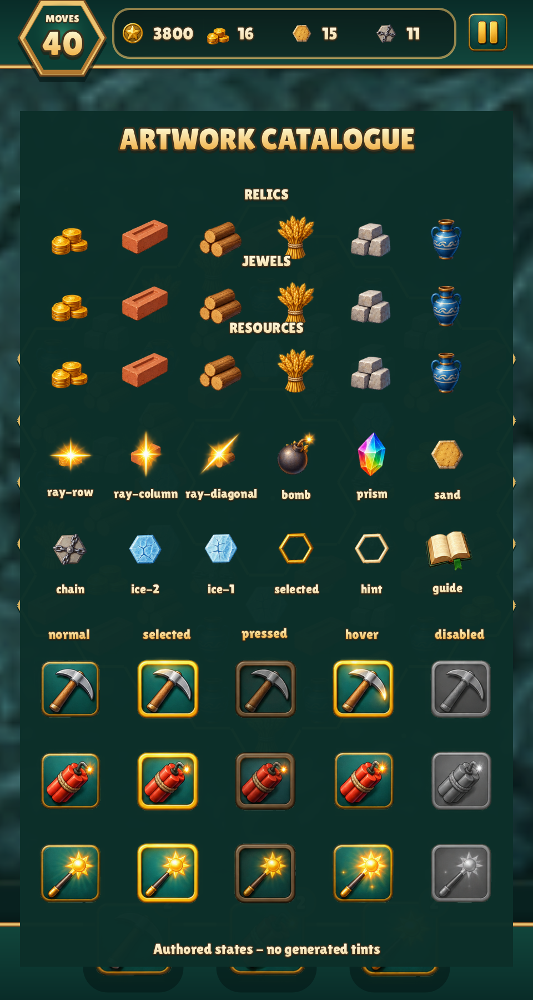
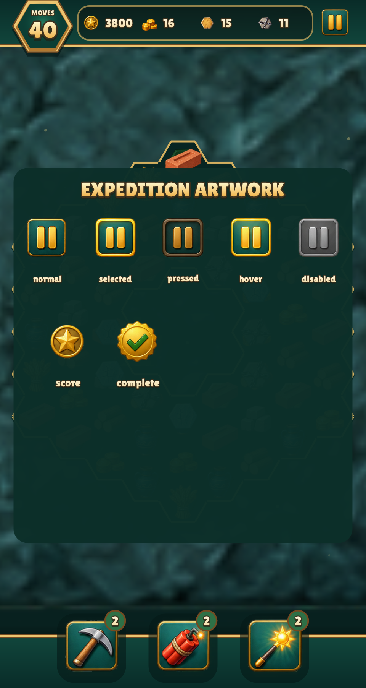

# Engine default resource skin

Original neutral resource art, authored with built-in ImageGen in one atlas:
all icons, board states, four controls in normal/selected/pressed/hover/disabled
states, HUD/panels and transient effect frames. [Source prompt](../../../engine/art/match3/prompt.txt)
and [registration](../../../engine/art/match3/manifest.json) record every crop,
resize and the 30° rotation aligning hex layers to flat-top game slots.
The default is embedded in the engine; neither game must copy it into data/.
Its resource slot 1 uses a matte clay brick from [the brick source](../../../engine/art/match3/source-brick.png) ([edit prompt](../../../engine/art/match3/brick.prompt.txt)). Relic Rush retains its original flame override; see [scope and orientation review](../resource-icons/README.md).
The shipped games normally use their own complete atlas overrides.

The resource idea follows [Cradle of Rome's resource collection](https://www.gamehouse.com/blog/2016/04/cradle-of-rome-walkthrough/).
All artwork is original. Runtime [atlas](../../../engine/data/match3.png),
frame definitions and generated embedding reproduce with
`python3 tools/match3_atlas.py` followed by `make gen`.

Actual Relic Rush captures using `--default-match3`, with the same engine logic
as either override. Phone includes safe areas; captures are at native 2×.

| 480×900 | 390×844 |
| --- | --- |
|  |  |

| Pieces, specials, blockers and all tool states | All Pause states and HUD icons |
| --- | --- |
|  |  |

`python3 tools/capture_match3_default.py` reproduces these captures plus both
overrides' full state audits and additive effects. Every source/default slot
and every listed game capture was visually inspected. The default's optional
fruit/fish/effect slots are visible in the full atlas; the existing games use
six kinds. The named pack rows repeat those six default resources when the
override is absent.

Validation includes full build/tests/lint, pixel checks for nested atlas views,
partial drawing and view-only additive blending, and both real-input game
smoke tests. UI font glyphs, ordinary shapes, and transient beams/particle
geometry are renderer primitives; every match-board raster image uses one
skin atlas. No control state is created by runtime tinting or compositing.
