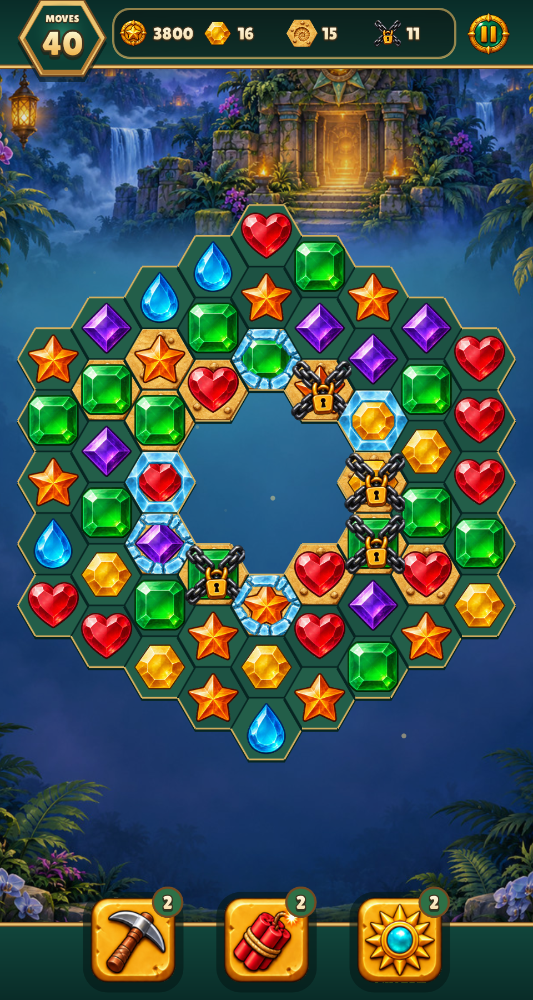
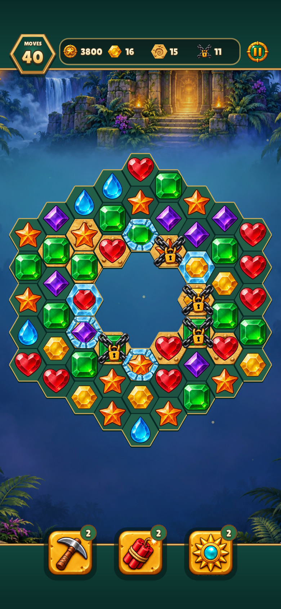
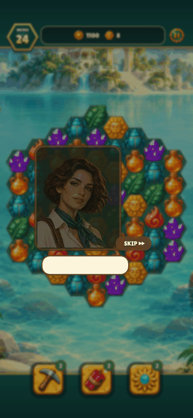
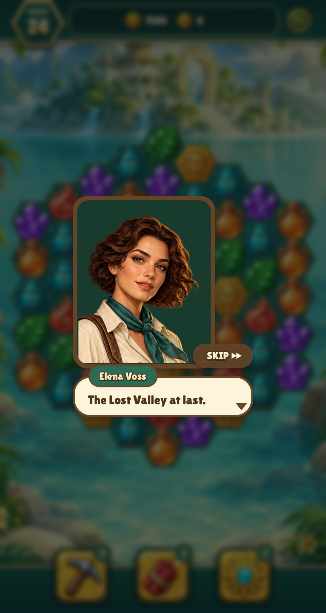
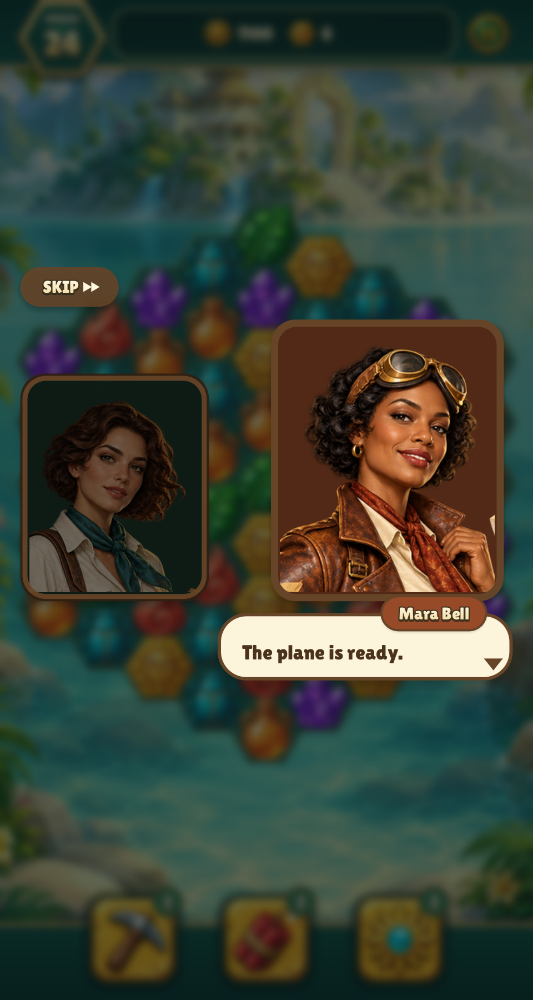

# Cell registration and portrait motion review

The 112px artwork inside a 128px canvas was being scaled as if it filled the
canvas. Board hex pieces now reach the cell diameter and other silhouettes fit
the inscribed square; state panels span the whole cell. Sprite pixels and authored
interaction states are unchanged. Relic Rush still uses its original flame.

| Size | Previous registration | Corrected registration |
| --- | --- | --- |
| 480×900 |  |  |
| 390×844, safe areas |  |  |

The engine owns finite, monotonic 0.2-second transitions. Entrance and exit
retain their slide and fade. A separate active/inactive colour tween only
brightens or dims; it cannot restart that slide. Speaker and listener use the
same size and side anchors. There is no scale/rotation animation or idle wobble.
Returning speakers already on stage do not re-enter. Layout, transition state,
and drawing are separate helpers, using the engine's value-type cubic tween.

| Size | Active speaker | Speaker and inactive listener |
| --- | --- | --- |
| 480×900 |  |  |
| 390×844, safe areas |  |  |

Captured from the real game via `tests/fixtures/dialogue/main.lua`, with a fixed
50ms presentation clock. Run `build/test/relic-rush portrait-` once for all sizes
and the reel. The GIF uses its 42 frames at half resolution and 100ms per frame.
Every frame was inspected, including entrance, both speaker changes and exit.
The still captures show completed lines. Engine tests verify unchanged settled
portrait pixels, retained entrance/exit slides, fixed speaker/listener bounds
and continuous colour retargeting. The animation previously interpolated whole
portrait rectangles and shrank listeners; it now separates slide visibility
from speaking-state colour.

See [test timing and CI changes](../../TESTING.md#fail-early-and-measure-slow-steps).

## Keep sliding, remove portrait wobble

| Previous sliding/scaling | Slide in/out, dimming without resizing |
| --- | --- |
|  |  |

| Size | Previous listener size | Same-size listener |
| --- | --- | --- |
| 480×900 |  |  |
| 390×844 |  |  |

The transition test verifies entrance/exit still slide, size remains constant,
and returning speakers retain exactly equal rectangles while their colour changes. Both phone portrait slots share visible
margins, removing a five-pixel recentering shift when speakers switch. Layout may
reflow when the dialogue composition or screen size changes; that geometry is
never tweened. Only entrance/exit visibility adds a horizontal slide; active/
inactive transitions animate colour only.
