# One portrait game, two skins: review captures

Before/after captures at 480×900 for moving the shared Relic Rush and
Christmas Market behaviour into `engine/match3_game.lua`
([PORTRAIT_GAMES.md](../../PORTRAIT_GAMES.md)). Every other capture used for
review (both boards, the town, the reward and building cards, Christmas
Market's failed dialog) is pixel-identical before and after.

| Screen | Before | After | Why it changed |
|---|---|---|---|
| Christmas Market Pause | 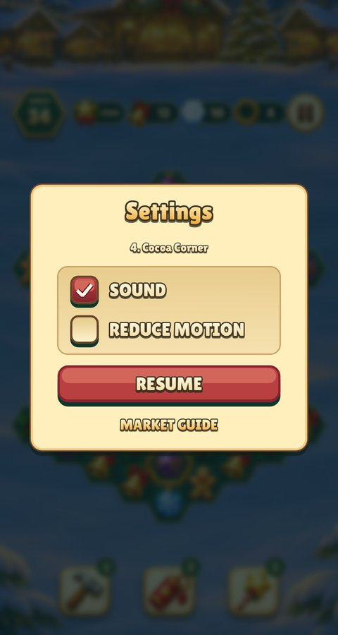 | 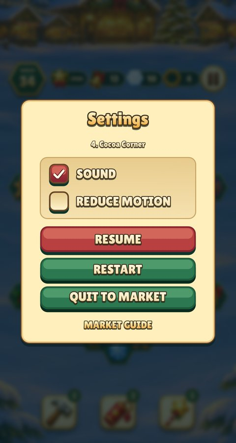 | Restart and Quit, as in Relic Rush, on an evergreen secondary button |
| Christmas Market Restart | — | 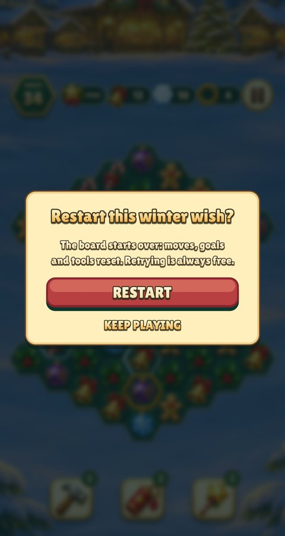 | New: Restart asks first |
| Relic Rush Restart | — | 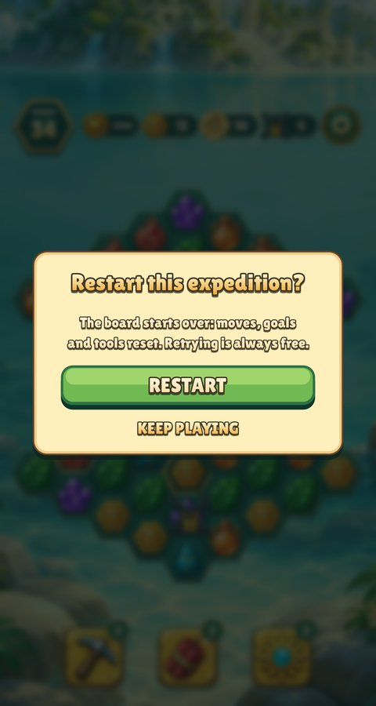 | Unchanged; shown for comparison |
| Christmas Market Winter Wishes | 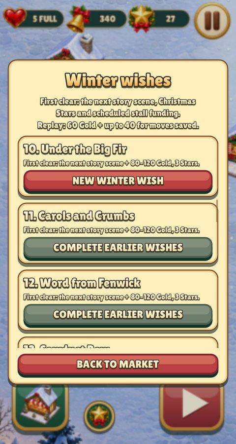 | 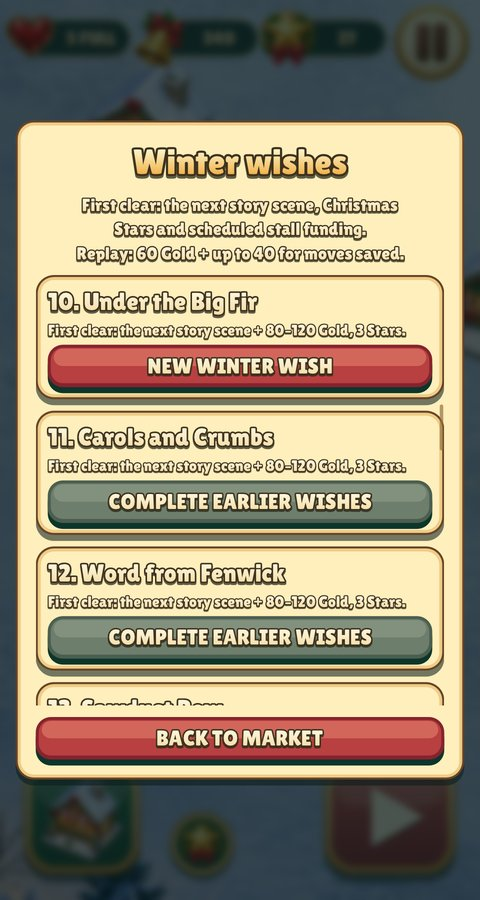 | The backdrop is dimmed on the first frame (no fade on a stalled clock) |
| Relic Rush Expeditions | 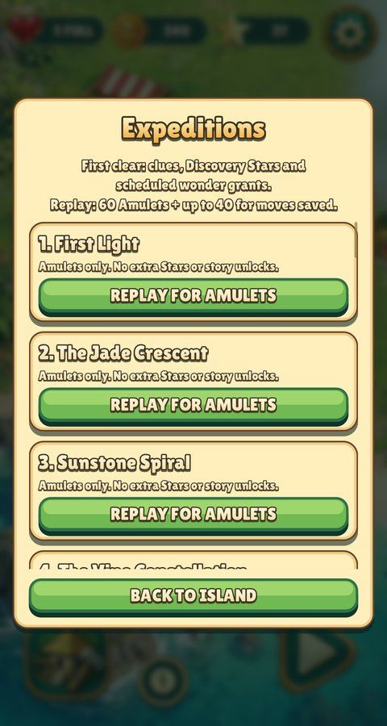 | 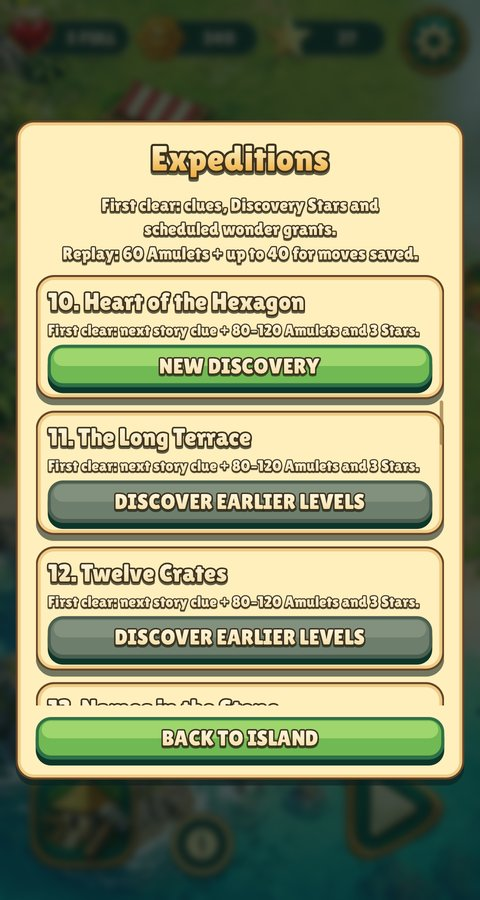 | Opens at the current level, as Christmas Market did |
| Relic Rush failed, no lives | 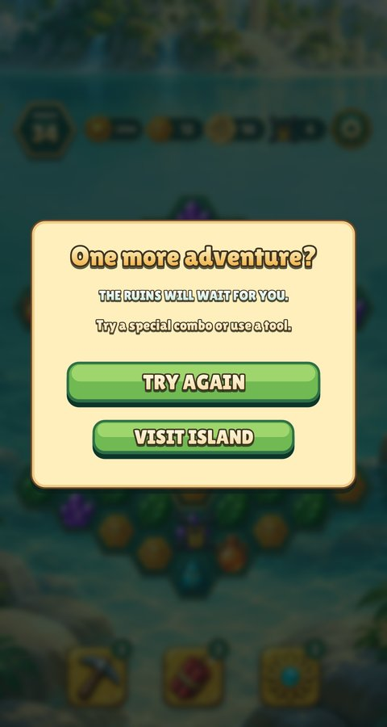 | 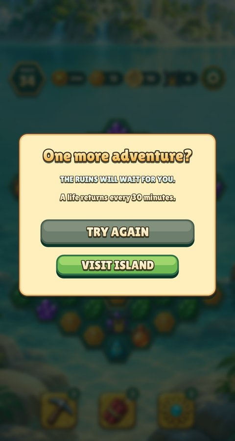 | Try Again waits and says when a life returns |
| Relic Rush town (`--showcase`) |  | 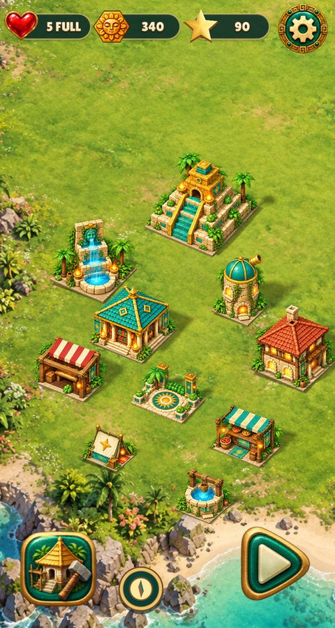 | The debug wallet shows the 90 Stars thirty clears earn |

Reproduce, from the repository root:

```sh
./build/christmas-market --headless --mute --fresh --size 480x900 --level 4 --dialog pause --shot out.png
./build/christmas-market --headless --mute --fresh --size 480x900 --level 4 --dialog confirm --shot out.png
./build/christmas-market --headless --mute --fresh --size 480x900 --expeditions --shot out.png
./build/relic-rush --headless --mute --fresh --size 480x900 --expeditions --shot out.png
./build/relic-rush --headless --mute --fresh --size 480x900 --level 4 --dialog failed --empty-lives --shot out.png
./build/relic-rush --headless --mute --fresh --size 480x900 --showcase --shot out.png
```
