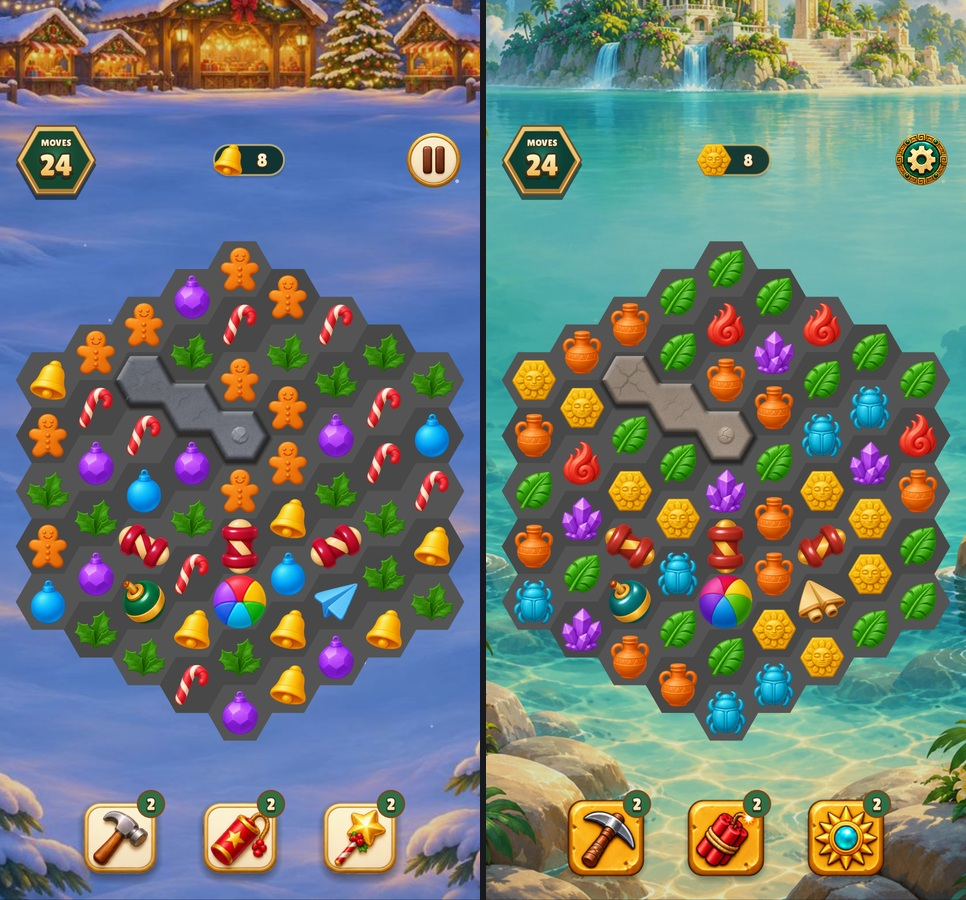
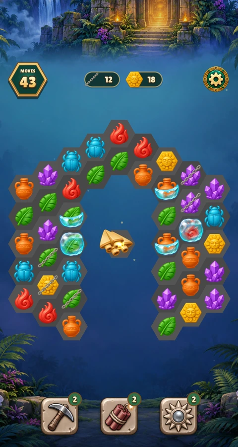

# Power-ups in both games

Christmas Market is on the left and Relic Rush is on the right. On each board,
the three rockets sit above the bomb, rainbow ball and plane.



## Relic Rush plane flight

The parchment plane flies from the middle of the board toward the left lane.
The loop plays at roughly quarter speed.



Capture the boards and flight with the existing test runner.

```sh
./build/test/all --suite=christmas-market --suite=relic-rush 'shot specials-and-stone'
./build/test/all --suite=relic-rush 'reel fx-plane'
```
