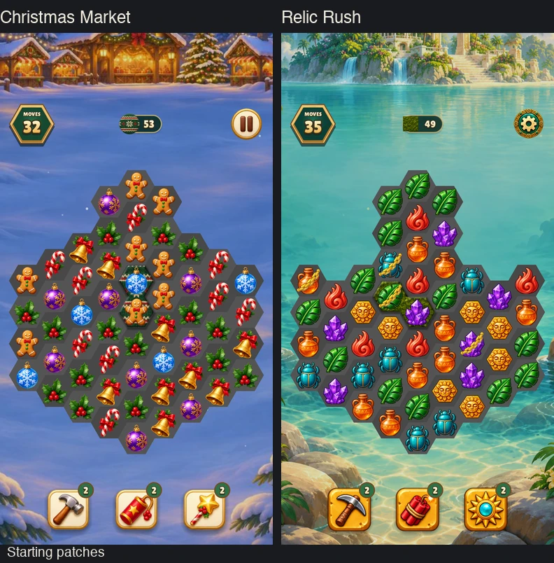
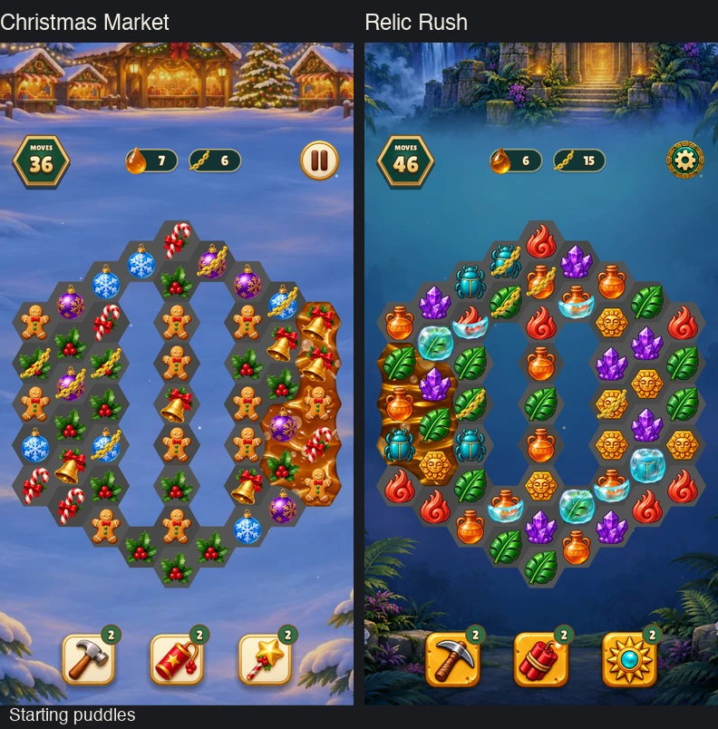
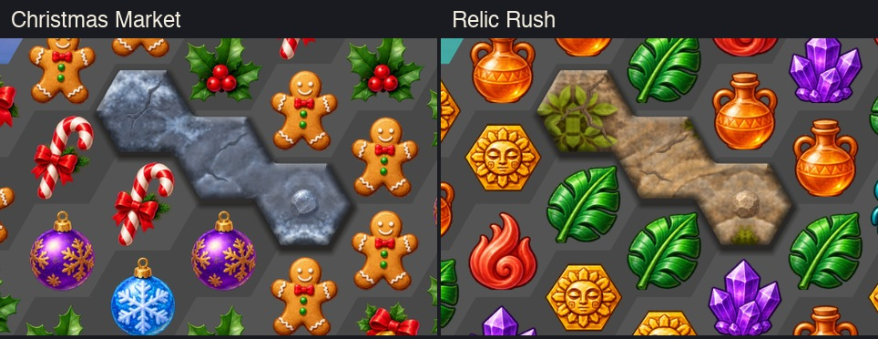

# Carpet, oil and stone in both games

Christmas Market is on the left and Relic Rush is on the right. Each loop
shows three swaps on the actual campaign board at the same speed.

## Carpet

Three consecutive matches touching the carpet expand the patch in Christmas
Market's Gingerbread Swirl (level 3) and Relic Rush's The Quay Marker (level 5).



## Oil

The first swap clears no oil, so the puddle spreads by one cell. The next two
swaps match pieces over the oil and shrink the puddle. The captures use
Christmas Market's Sawdust Row (level 13) and Relic Rush's The Archivist's Key (level 20).



## Raised surfaces

The connected stone has one, two and three hits remaining from upper left to
lower right. The top face sits inside the exposed hex edges. Carpet and stone
both catch light on the bevel and cast a soft contact shadow onto the board.



The before and after boards show Christmas Market on top and Relic Rush below.
Each row has the previous board on the left and the raised surfaces on the right.
[480 × 900](raised-surfaces-480.jpg) · [390 × 844](raised-surfaces-390.jpg)

Capture with the existing runner after building `build/test/all`.

```sh
./build/test/all --suite=christmas-market --suite=relic-rush \
  'shot element-states' 'shot phone-element-states' 'shot specials-and-stone' \
  'reel relic-rush-floor-' 'reel christmas-market-floor-'
```
