# Relic Rush input, feedback and centred indicators

Touch/mouse input no longer paints a keyboard focus outline on Confirm. Tab
navigation still displays focus. A half-second hold lifts a placed building;
dragging its preview moves it and release snaps it to the grid. Tapping land
leaves the preview where it is. Pickup requests a medium MATCH pulse and drop
requests PLACE; Confirm and Cancel add no pulse and retain their transaction
semantics. Interrupted gestures do not produce a drop pulse.

Level entrances use the same grouped TICK events as normal refill. A release
from the input that opened the screen cannot skip the entrance; skipping needs
a new press/release during it. The regression advances at 60 Hz and flushes each
frame, verifying repeated pulses through the real cooldown. Paused, skipped
and reduced-motion entrances remain covered. Physical iPhone feel was not
verified here; automated tests capture requests without driving hardware.

Special symbols follow their gem's animated centre in a separate overlay pass
above gems and blockers. Ice counters are centred and drawn last. The guide
shares these placements. Authored artwork, alpha and badge size are unchanged.

| Screen | Before | After |
| --- | --- | --- |
| Board 480×900 | 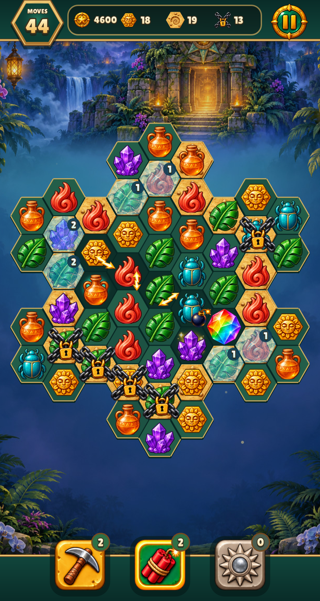 | 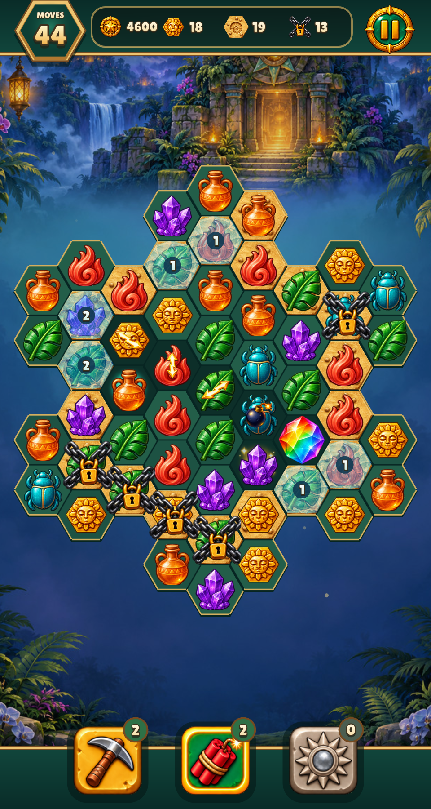 |
| Board 390×844 with safe area | 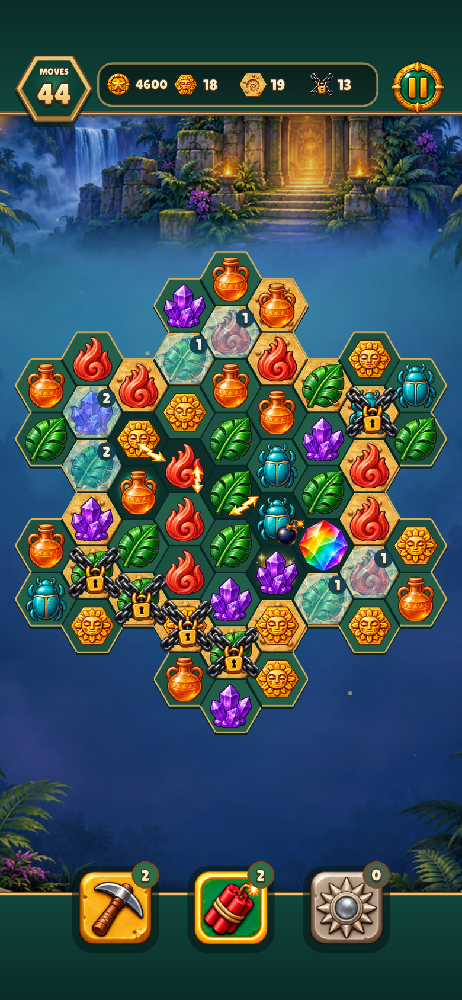 | 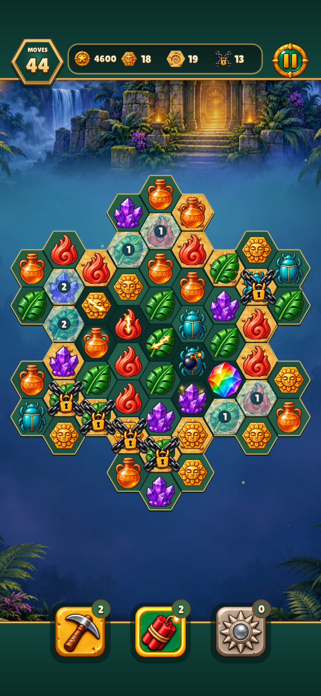 |
| Placement 480×900 |  | 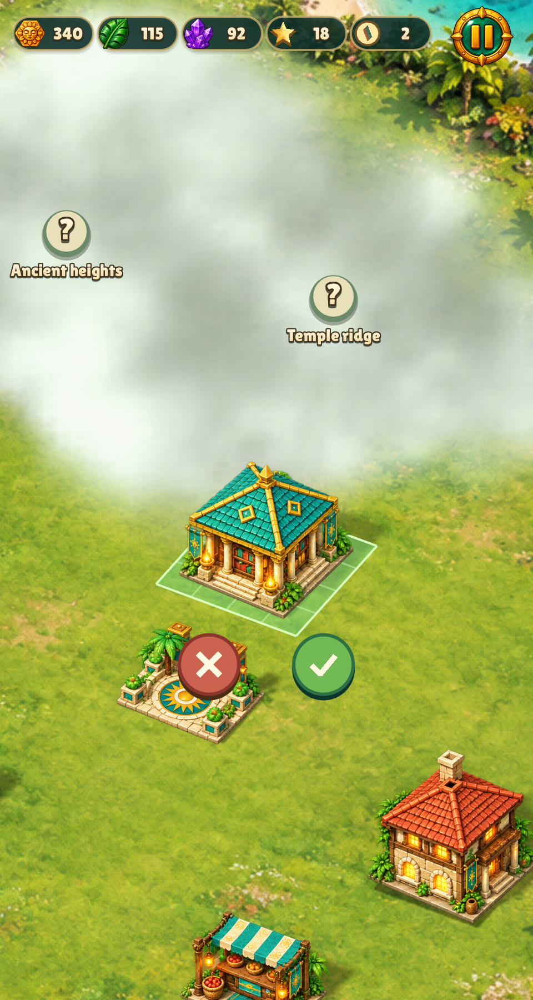 |
| Placement 390×844 with safe area | 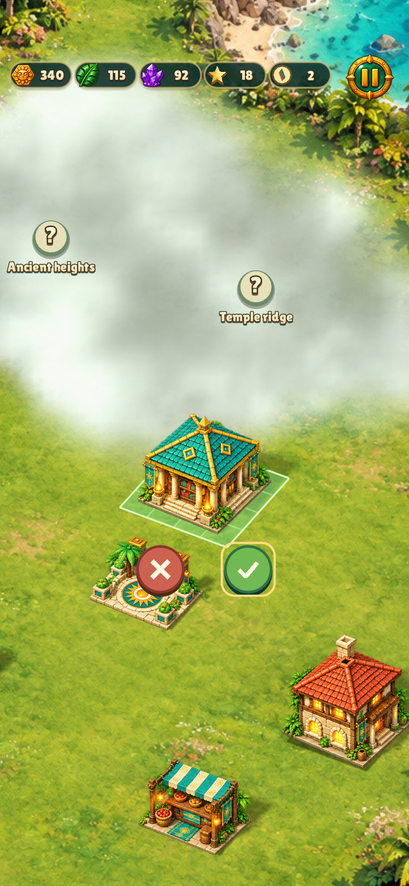 | 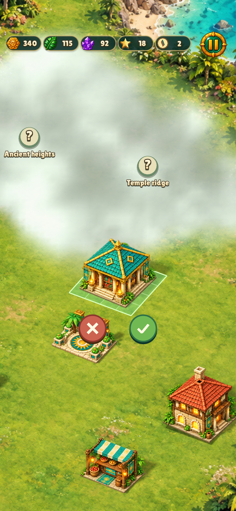 |
| Guide 480×900 |  | 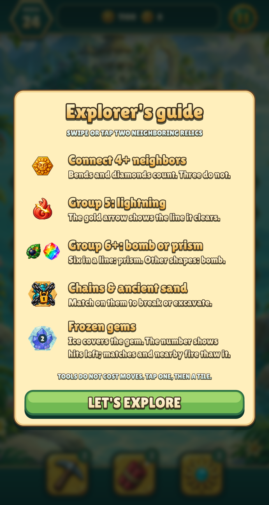 |
| Guide 390×844 with safe area | 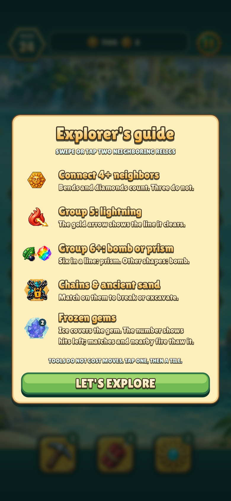 | 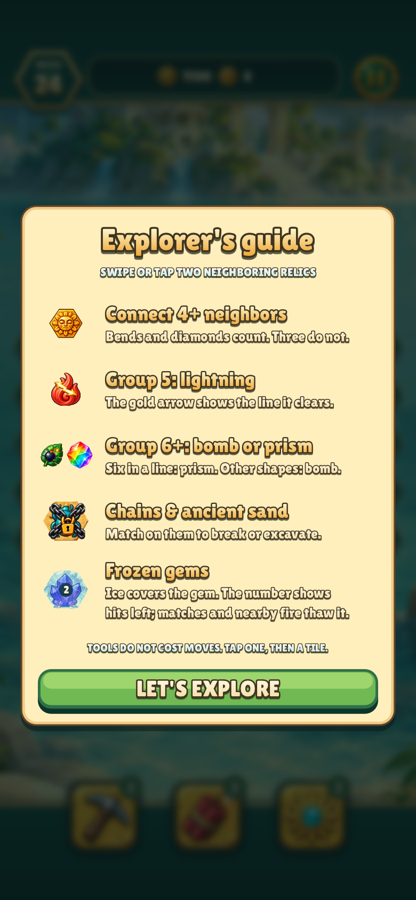 |

The placement baseline uses the previous engine focus painting and the same
`--placing focused` fixture to reproduce a retained Confirm focus. Board and
guide baselines use the previous board drawing code. All images are native
in-game software-renderer captures; they were visually inspected at both sizes.

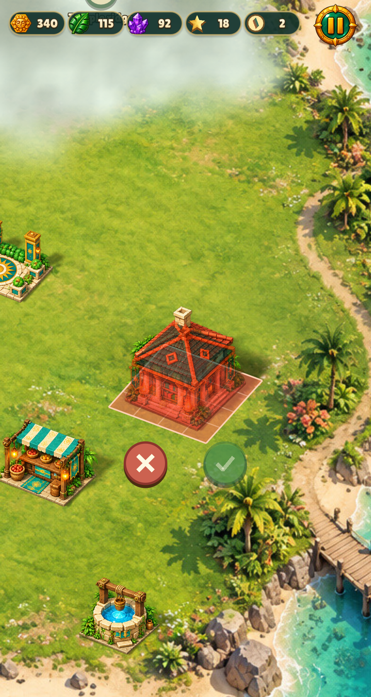


Reproduce the representative captures through the existing manifest:

```sh
build/test/relic-rush "shot art-specials" "shot phone-art-specials" \
  "shot island-placement" "shot phone-island-placement" "shot island-blocked" \
  "shot guide" "shot phone-guide" "reel relic-rush-board-intro"
```

Measured verification (elapsed seconds, compilation separate):

- Final warning-as-error full native/test build: 12.57 s.
- `make test`: 4.85 s in the budgeted launcher, 5.10 s including Make/Python startup.
- Selected Relic Rush checks, native-input smoke, six shots and entrance reel:
  22.67 s. Additional paired guide captures: 6.12 s after, 4.57 s before.
- Nile Archive / Christmas Market city smoke: 4.45 s / 8.76 s.
- `make lint`: 2.25 s; zero warnings or errors.

No dependencies or models were downloaded. The work added less than 200 MB of
local build/capture data; no large cloud job or persistent master was required.
