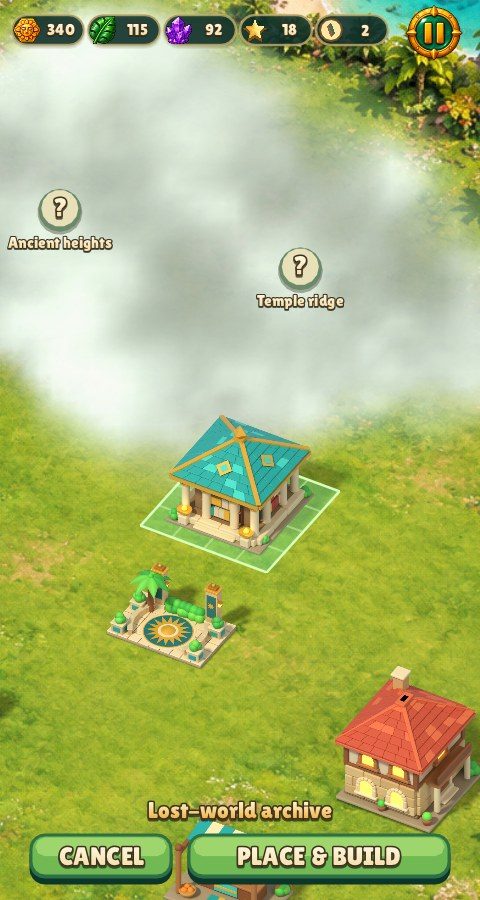
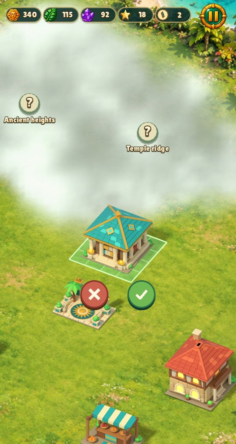
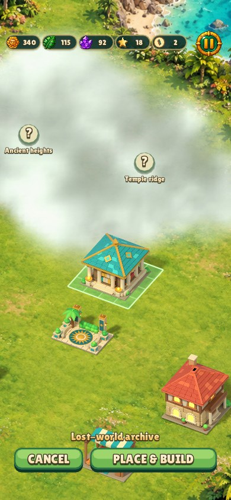
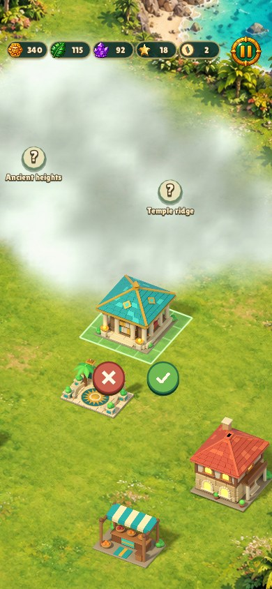
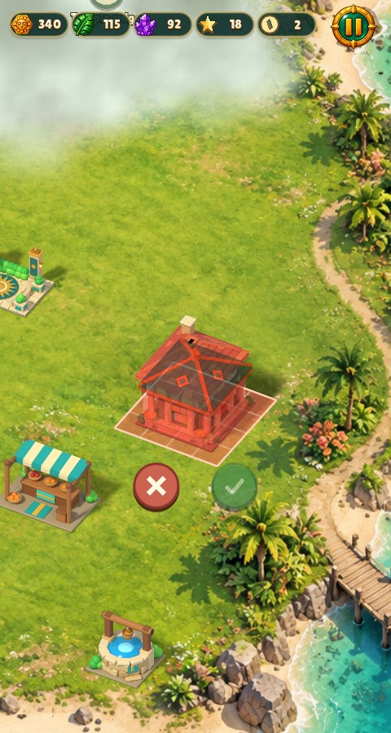
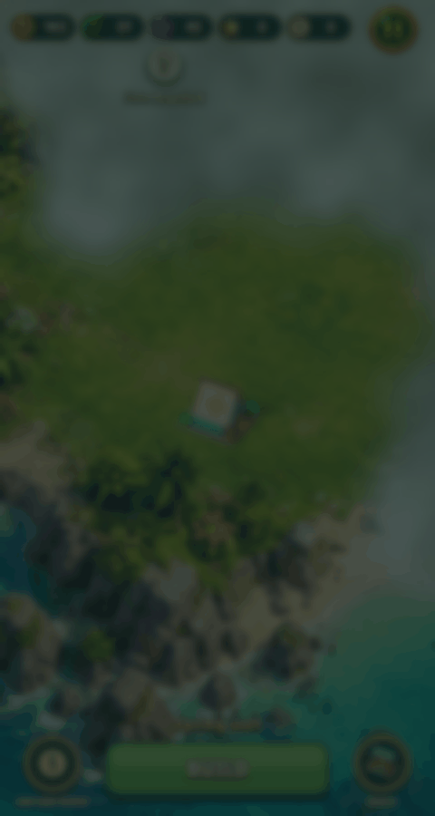

# Relic Rush gameplay and presentation fixes

Level entrances now request grouped landing ticks and stronger blocker impacts.
The normal haptic frame priority/cooldown still applies; skipped and reduced-motion
entrances produce no landing pulses. Physical vibration requires device review;
headless tests validate event count, priority, pause, reduced motion and skipping.

Dead-board recovery permutes whole movable pieces (kind and special), leaves
locked pieces and terrain fixed, and accepts only a match-free board with a legal
move. Fresh level generation remains separate. If the bounded search cannot find
a valid permutation, it restores the original pieces instead of replacing them.
Regression coverage checks all levels, every special, locked cells, and an
impossible inventory, as well as the real idle/post-cascade recovery paths.

Placement controls are an engine form anchored below the preview sprite, clamped
to the safe screen. Native-input smoke covers purchase, cancel, move, confirm and
wallet preservation. Invalid land disables ✓. The same controls follow pan/zoom.

| Size | Before | After |
| --- | --- | --- |
| 480×900 |  |  |
| 390×844, safe areas |  |  |

Blocked land: 

The backdrop snaps immediately to full blur/dim while the card continues its
entrance/exit animation. Catalogue and expedition forms opt into the shared
`snap_backdrop` option; other games retain their current backdrop policy.

The board entrance with grouped haptic events (vibration is not encoded in GIF):

Captures use the existing game test entries `shot island-placement`,
`shot phone-island-placement`, `shot island-blocked`,
`reel relic-rush-building-entrance` and `reel relic-rush-board-intro` under Xvfb
with software rendering. All displayed captures were inspected.
