# Clear Relic Rush tile indicators

The old special art surrounded a smaller gem with an ornate hexagonal frame.
The replacements use the full-size matching gem and an authored effect badge:
three two-way lightning arrows aligned with their clearing axes, or a bomb with
a lit fuse. Prism is a rainbow crystal. Selection is a soft mint glow; idle hints
are gold light with sparkles. None uses an enclosing hexagonal outline.

Frozen gems now sit beneath filled, cracked ice across the whole tile, rather
than a hollow rim. Two separately authored ice states share a translucent 0.52
material opacity so the match kind stays visible. The dark circular **1**/**2**
badge states hits remaining, and the guide uses that same rendering function.
Underlying board cells retain their hex-grid geometry.

| View | Before | After |
| --- | --- | --- |
| All powers, both ice strengths, selection and hints, 480×900 | 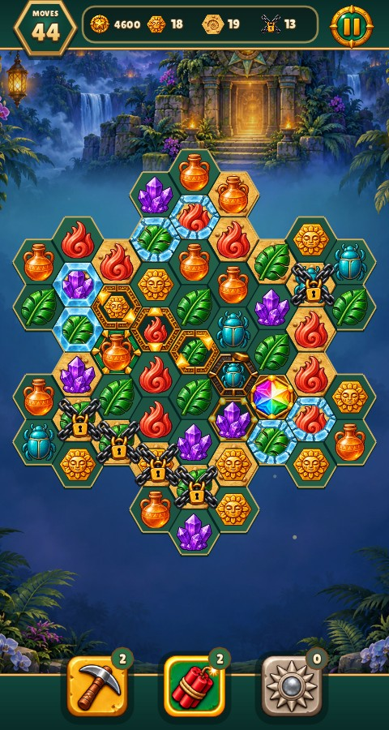 | 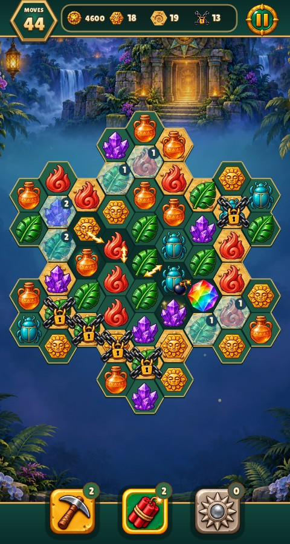 |
| Same board, 390×844 with safe areas | 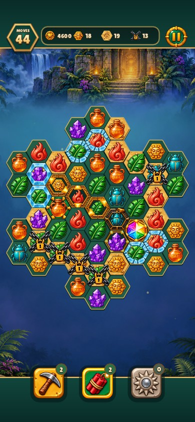 | 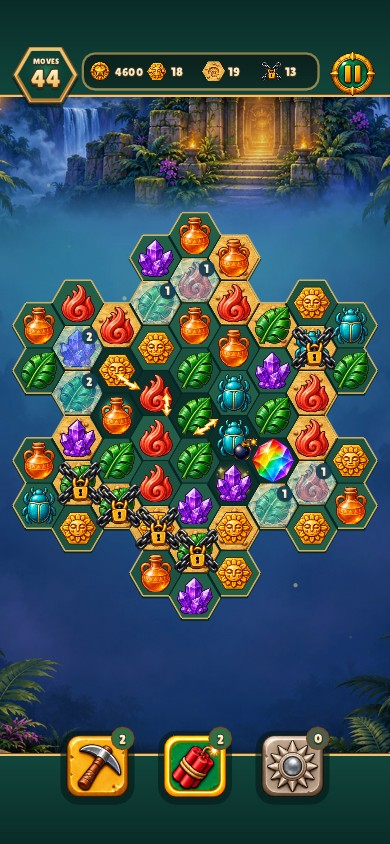 |
| Explorer's guide | 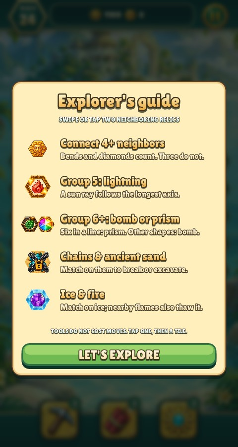 | 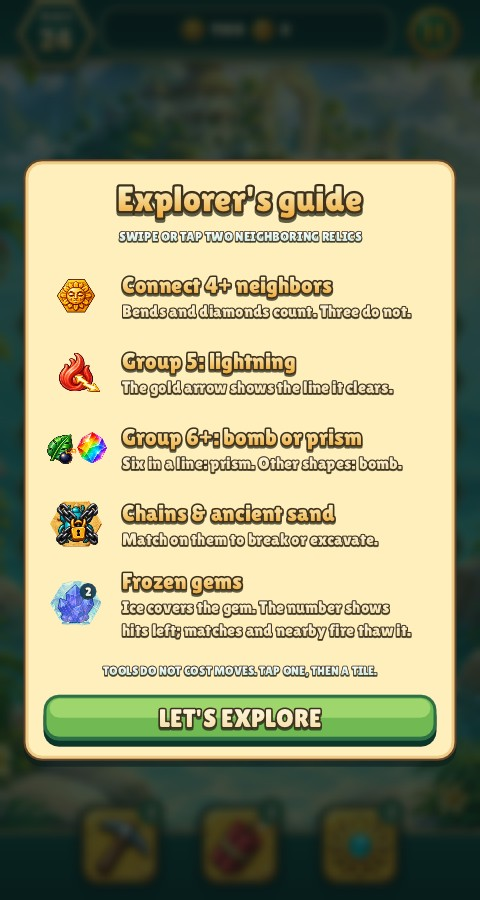 |
| Runtime art inventory | 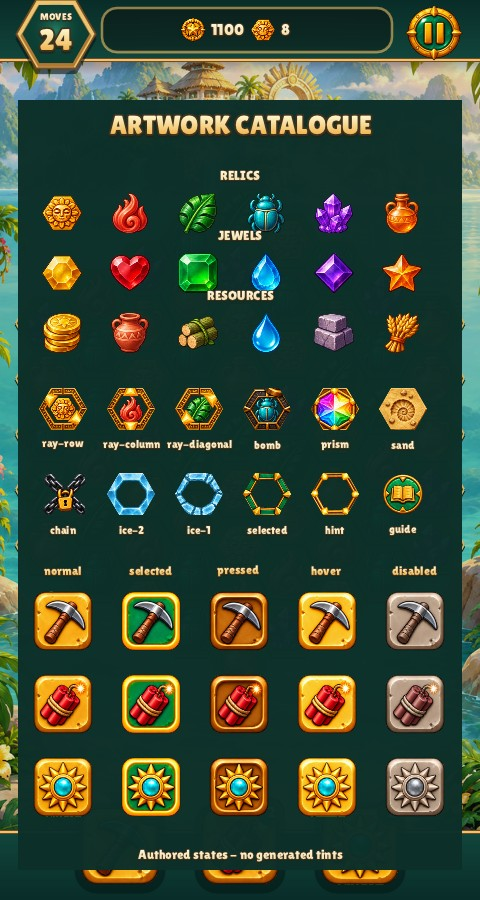 | 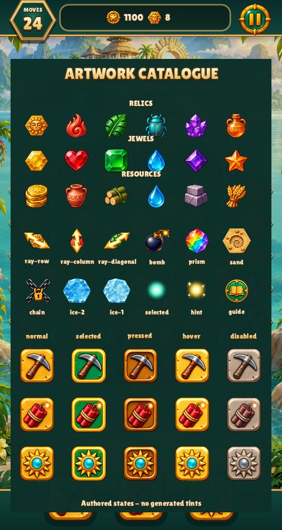 |

The optional packs retain their match kinds and use identical effect symbols:

| Jewels | Resources | Phone guide |
| --- | --- | --- |
| 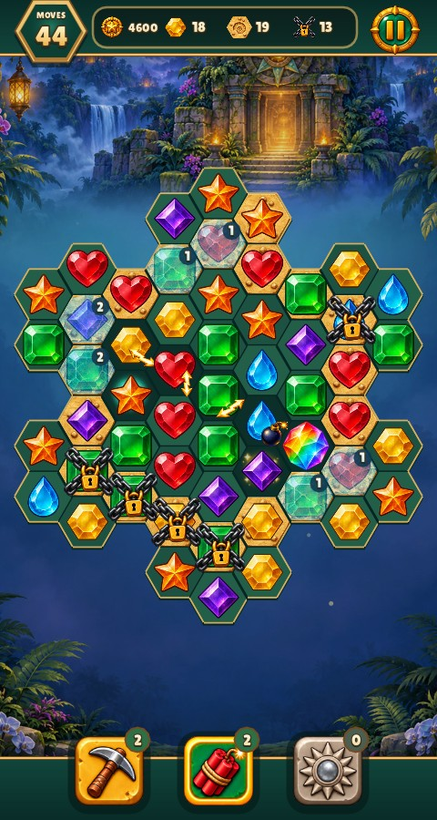 | 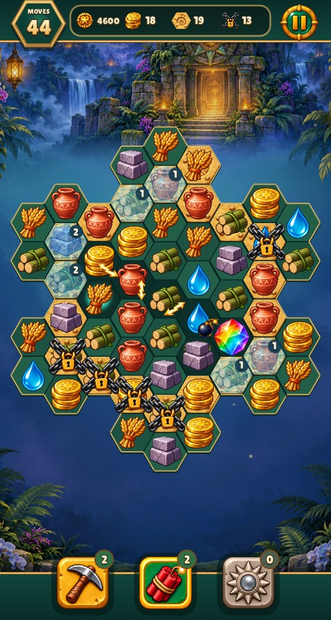 | 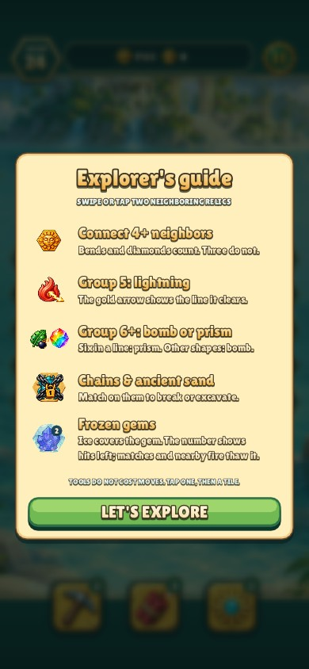 |

All images were captured from the actual game and inspected. The dense board
also includes chains, sand, normal gems and an exhausted tool, allowing these
states to be compared without a separate asset-only mockup.

Source: `games/relic-rush/art/board-states/clear-indicators.png`, a complete
transparent 3×3 ImageGen atlas; prompt and measured crop/rotation registrations
are retained alongside it. The importer preserves authored alpha, fits filled
ice to the existing cell mask, and packs the resulting sprites in the game's
single texture. Existing unrelated PNG bytes were retained after confirming
pixel equality, avoiding compression-only changes.

Reproduce: `python3 games/relic-rush/tools/board_assets.py`, then
`python3 tools/match3_atlas.py`. Verify with both tools' `--check` options and
`python3 games/relic-rush/tools/check_art_catalogue.py`. The latter now rejects
hollow ice artwork. Existing named captures cover `shot art-specials`,
`shot phone-art-specials`, `shot art-jewels`, `shot art-resources`,
`shot guide`, `shot phone-guide` and `shot art-catalogue`.

Validation: Relic Rush and its test target built (0.03 s); the board regression
and seven captures passed (8 tests, 1,635 checks, 3.6 s); lint passed across
114 files (1.44 s). Authored crops, runtime inventory and all packed-atlas
provenance checks passed. No gameplay rules changed.
