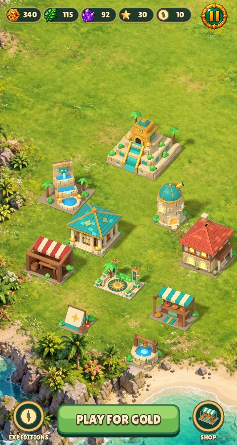
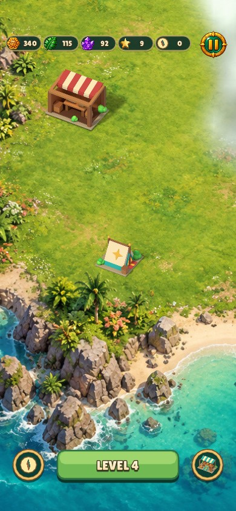

# Relic Rush town buttons

The Expeditions and Shop side buttons now show only their icons. Both centres
are derived from the central Play/Build button's bounds, moving them down six
logical units onto its centre line. The whole group still follows the existing
safe-area/tall-phone layout.

| Size | Before | After |
| --- | --- | --- |
| 480×900 |  |  |
| 390×844 with safe areas |  |  |

All four captures were inspected. Reproduce through the existing
`shot island-village` and `shot phone-island` test entries. The latter filter
also selects the existing phone placement capture.

Validation: affected game/test build passed (0.03 s); native-input smoke plus
three captures passed (4 tests, 24.5 s); lint passed across 114 files (1.91 s).
