# Engine brick and flat-top hex orientation

The engine's neutral default atlas uses a single matte red clay brick in kind
1. Relic Rush keeps its original flame, piece identities, rule name, adjacent
ice behavior and guide text. Christmas Market keeps its candy cane. Game
atlas overrides are independent of the engine default.

The sun idol and yellow hex gemstone in Relic Rush now have six-sided
flat-top outlines like the board, with horizontal top/bottom edges and pointed
left/right corners. The sun face remains upright. Existing flat-top special,
blocker and selection frames retain their artwork. The other sixteen original
pieces, including the flame, match HEAD's runtime pixels exactly.

Built-in ImageGen edited each full atlas together. The engine registers just
the brick crop from [source-brick.png](../../../engine/art/match3/source-brick.png)
([prompt](../../../engine/art/match3/brick.prompt.txt)). The Relic Rush importer
registers just the two hex crops from [source-flat-hex.png](../../../games/relic-rush/art/tile-sets/source-flat-hex.png)
([prompt](../../../games/relic-rush/art/tile-sets/flat-hex.prompt.txt)); the
unused trial brick in that generated source is never imported into the game.
The original master supplies its flame and all other pieces. The hex crops
are spatially fitted to the renderer-authored cell aspect, with no runtime
rotation of the face or generation of interaction states.

| Skin / size | Before | After |
| --- | --- | --- |
| Engine default 480×900 | 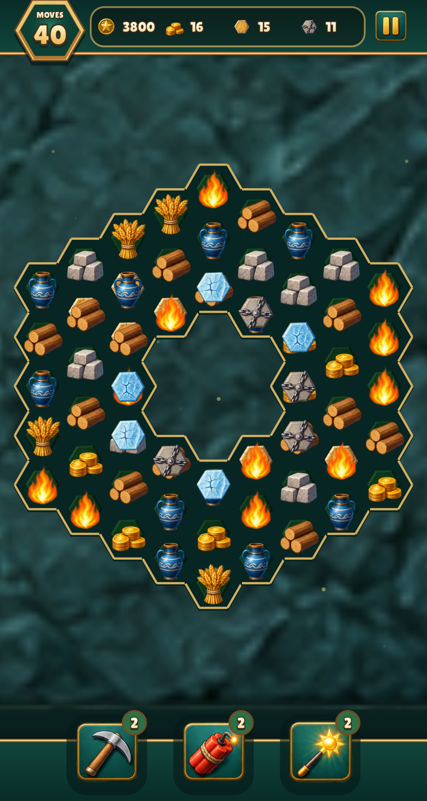 | 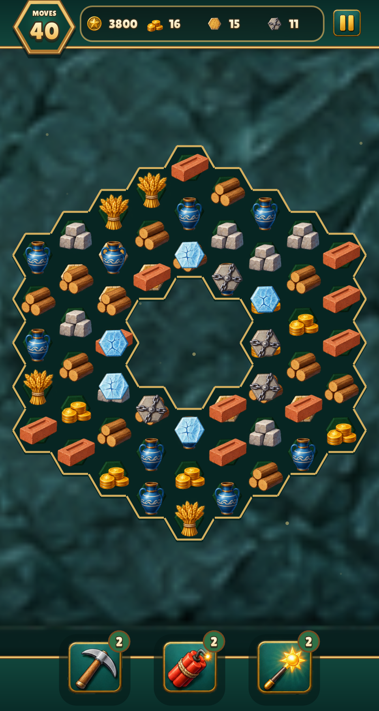 |
| Engine default 390×844 | 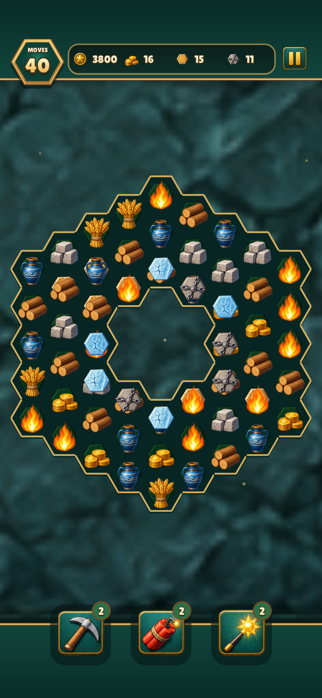 |  |
| Relics 480×900 | 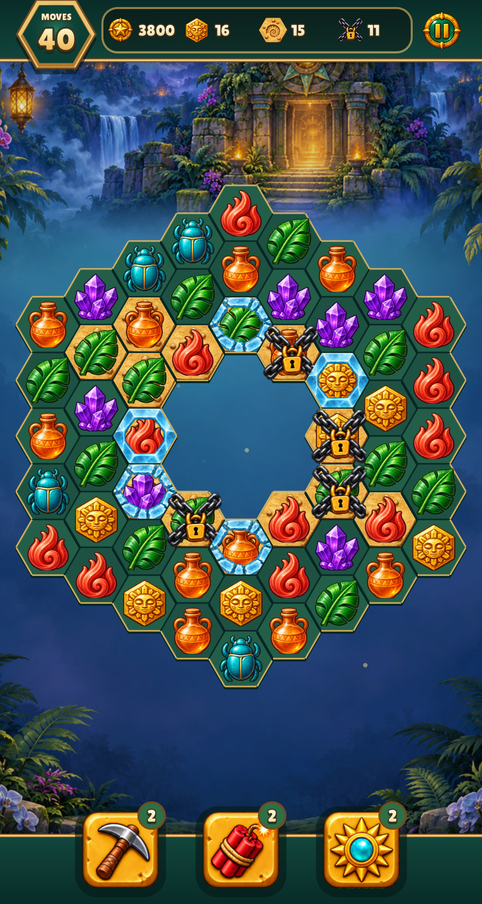 | 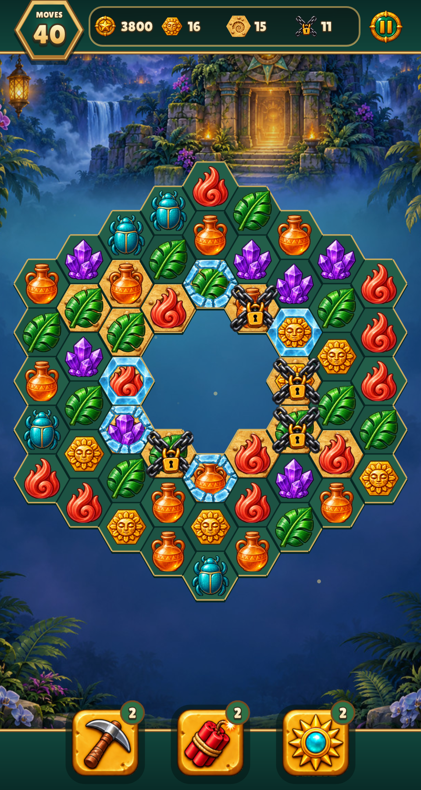 |
| Relics 390×844 | 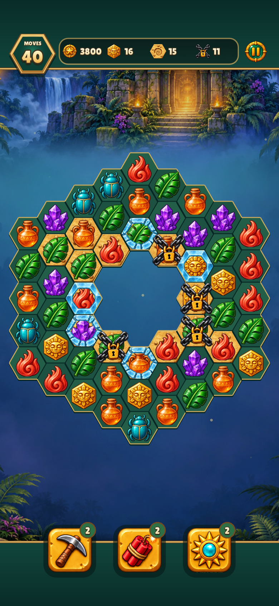 | 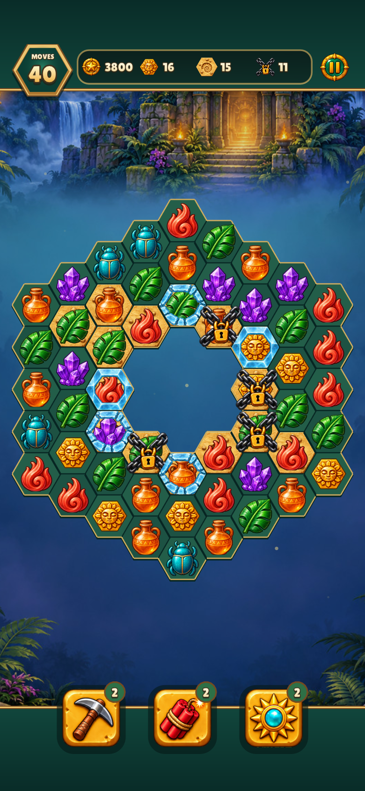 |
| Jewels 480×900 | 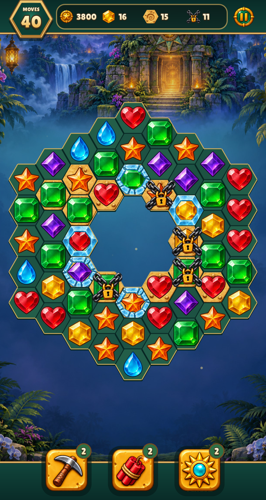 | 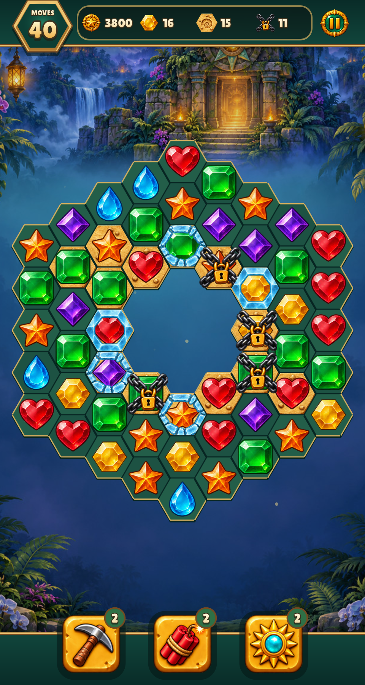 |
| Jewels 390×844 | 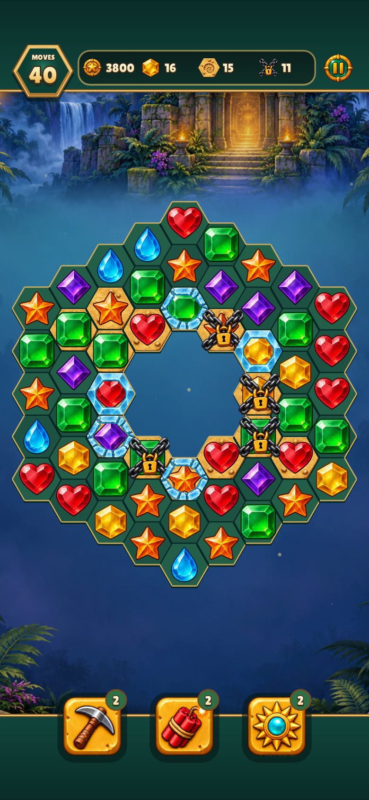 | 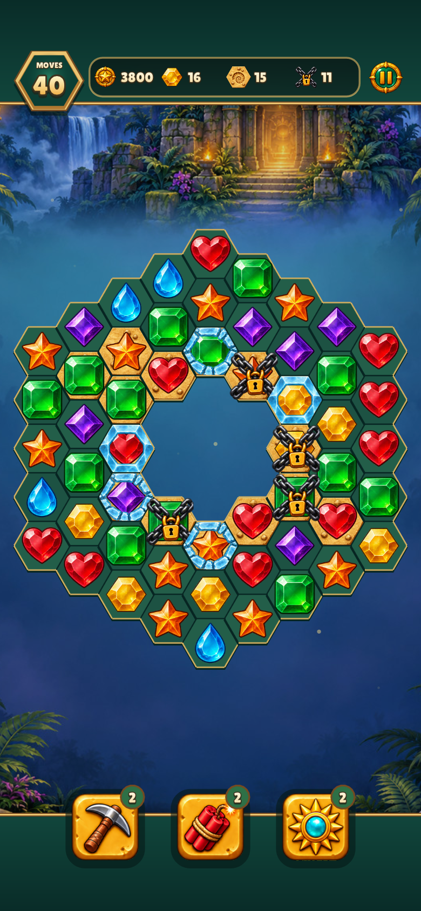 |
| Guide |  | 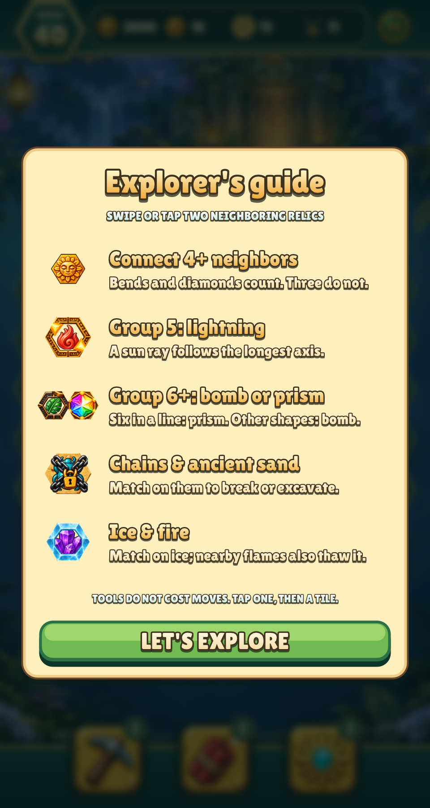 |

Captures use the actual renderer at native 2×; 390×844 shots include 47px top /
34px bottom safe areas. `python3 tools/capture_resource_icons.py` captures the
current after version; use `--before` before applying an artwork change.
Reproduce assets with `python3 tools/match3_atlas.py` and `make gen`.

Validation includes the full build, tests, lint, asset inventory, original
flame/unchanged-piece pixel comparisons and the game smoke test. A new check
compares the sun idol and yellow gemstone alpha silhouettes with the actual
board mask, rejecting point-top proportions and vertical octagon side edges.
All listed game captures and imported sprites were visually inspected.
