# Masked stripes and full-size bombs

Ray powers now draw broad cream stripes across the existing gem, masked by its
authored alpha. The bands follow the 30°, 90° and 150° clearing axes. Bombs use
the full existing bomb sprite instead of a gem with a small bomb badge. Prisms
remain whole crystals. The same drawing path is used in all three packs, during
piece movement/squash and in the Explorer's Guide.

The user explicitly requested drawing the stripes in the engine over the icon,
masked to its alpha, on 2026-11-01. This authorizes the procedural pattern rather
than new authored state artwork. No generated stripe atlas is used. Source PNGs,
their alpha, the atlas allocation and game rules are unchanged.

The shared `gfx.image_striped` API uses the existing image shader, retaining the
sampled texture alpha and shading while mixing in directional bands. Pattern
coordinates are local to the destination, independent of the atlas UV offset.
It draws in one pass and allocates no intermediate texture. Its uniforms reset
after the image so ordinary images and shapes are unaffected.

| Screen | Before | After |
| --- | --- | --- |
| Board 480×900 | 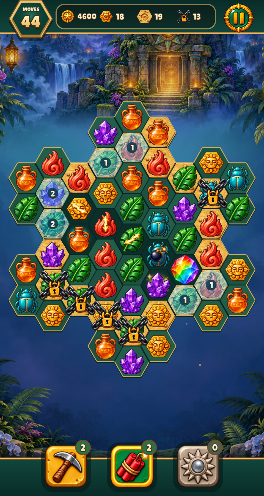 | 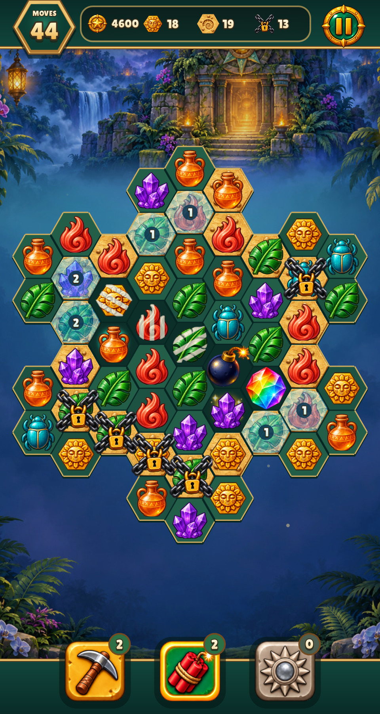 |
| Board 390×844 with safe area | 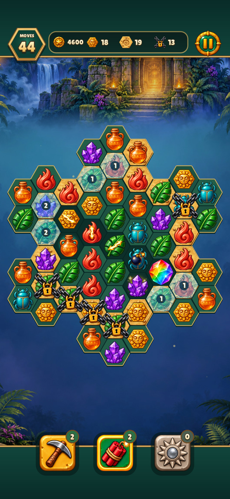 | 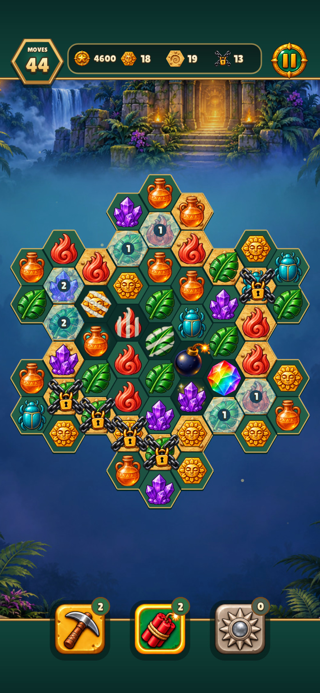 |
| Guide 480×900 | 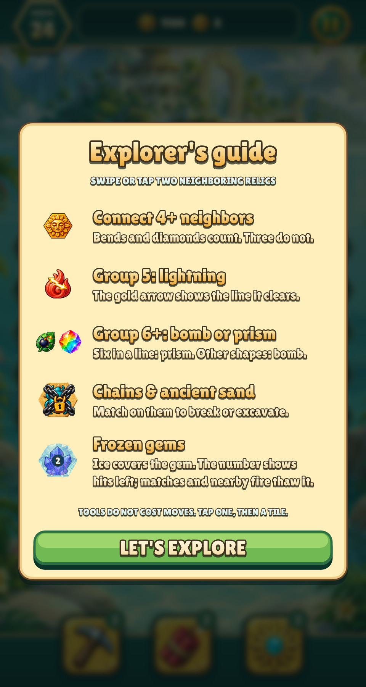 | 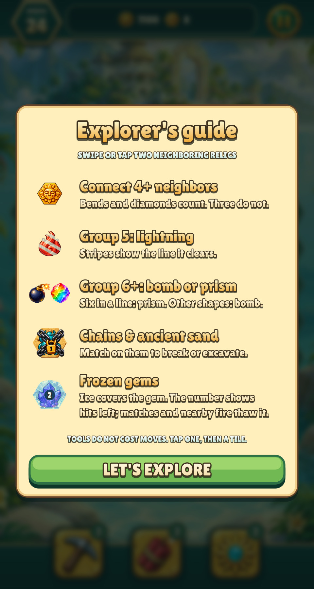 |
| Guide 390×844 with safe area | 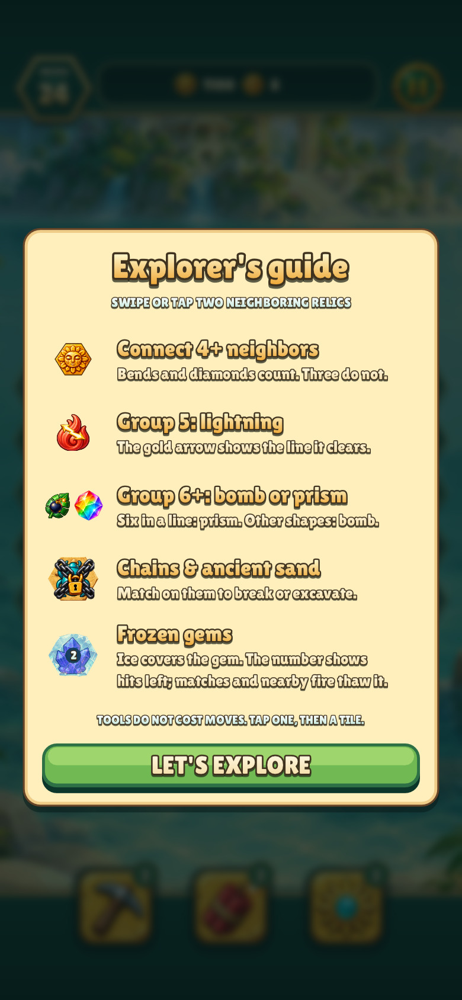 | 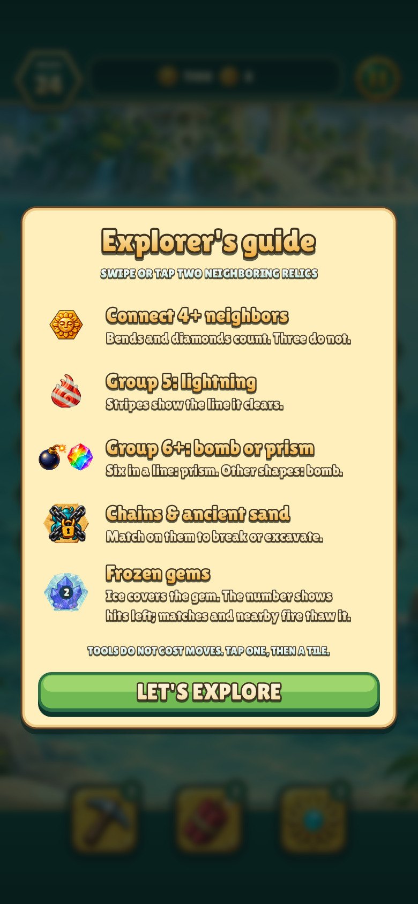 |

Baselines reuse the native captures from merged PR #67. The new dense views use
the actual live drawing path and cover every matching kind and clearing axis:

| Relics | Jewels | Resources |
| --- | --- | --- |
| 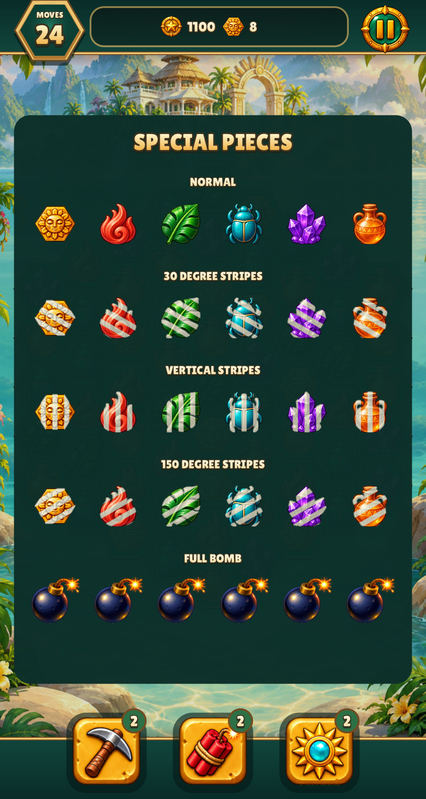 | 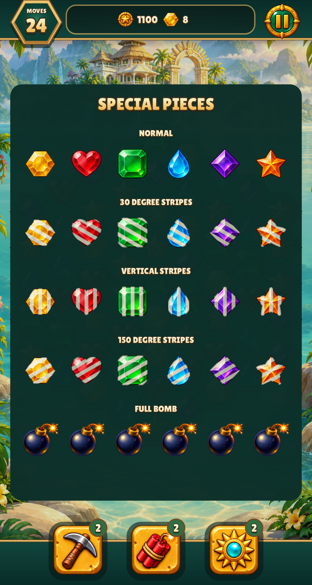 | 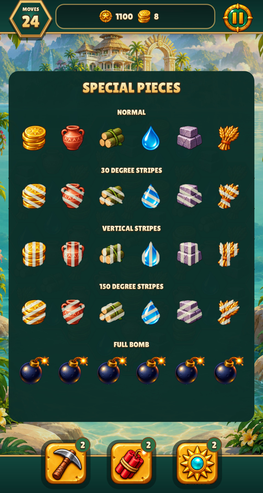 |

Optional-pack boards, the artwork catalogue, ice strengths, chains, selected and
hinted pieces, tool states and representative ray/bomb effects were also
inspected in the captures under `after/`. No missing states or placeholder art
were found. Legacy ray image regions remain for the canonical skin contract;
the board and guide no longer draw those tiny badges.

```sh
build/test/relic-rush "rules relic_board" "shot art-specials" "shot phone-art-specials" \
  "shot art-jewels" "shot art-resources" "shot stripe-states-" "shot art-catalogue" \
  "shot guide" "shot phone-guide" "shot effect-ray" "shot effect-bomb"
```

Measured verification: warning-as-error full native/test build 5.18 s; separate
updated renderer-test link 1.85 s. Focused platform/safe-area/city renderer tests
2.08 s, 127 assertions. Selected Relic Rush rules and 12 captures 8.56 s. Full
shared suite 4.65 s in the launcher (10 s allowance; 5.68 s including startup
and audio build). Lint 1.51 s, zero warnings/errors. Generated glue/API docs were
regenerated with `make gen` and checked by the full suite.

Pixel regressions check vertical, horizontal and diagonal bands, original RGB
between bands, partial and zero alpha, atlas subregions, clipping and restoration
of ordinary rendering. All new screenshots were visually inspected.
