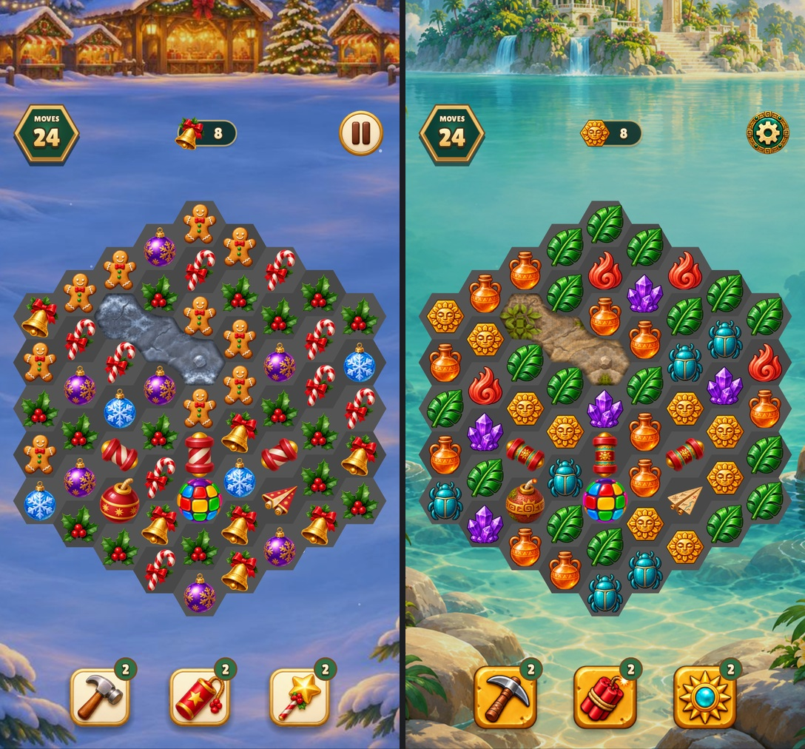

# Christmas Market and Relic Rush board comparison



In each board, the connected stone shows one, two and three hits remaining
from upper left to lower right. The lower half shows the three rocket axes
above the bomb, rainbow ball and paper plane.

```sh
make build/test/all
./build/test/all --suite=christmas-market --suite=relic-rush 'shot specials-and-stone'
```

The runner saves both 480 × 900 captures under `build/shots/<game>/`.
